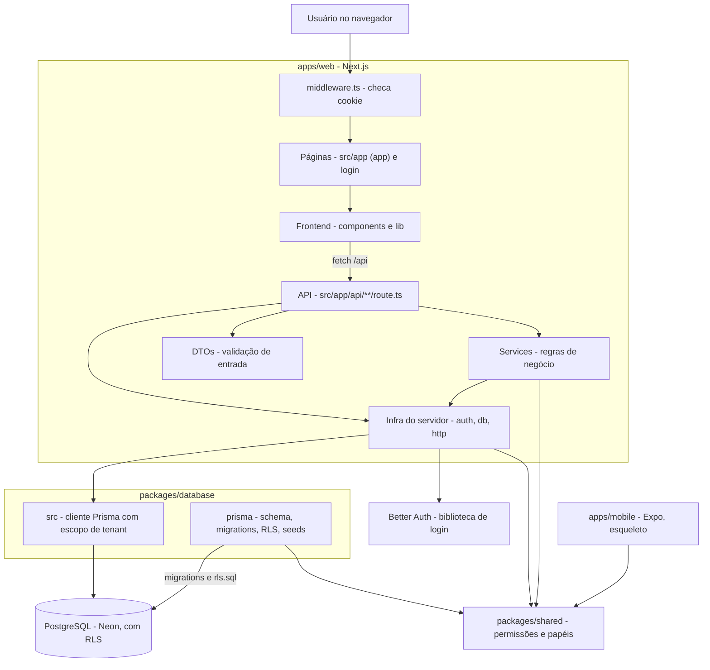
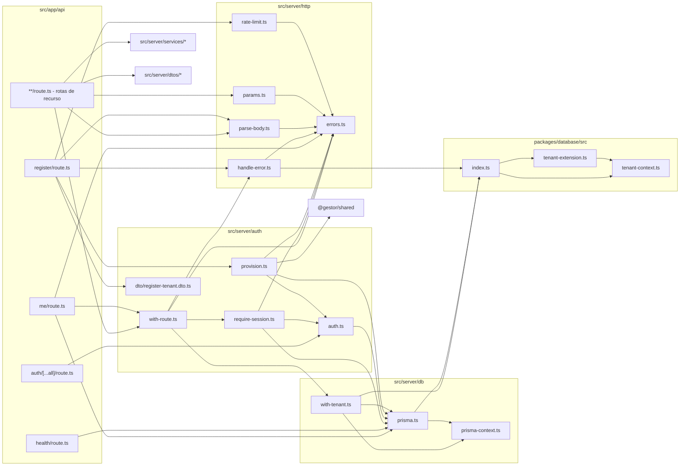
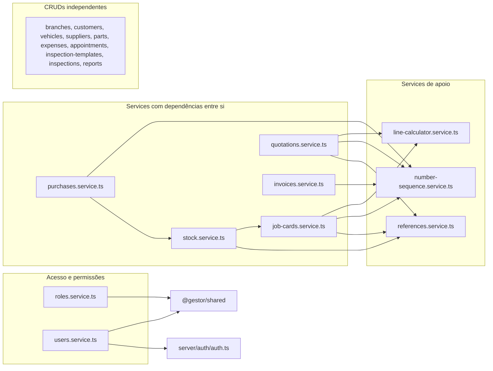
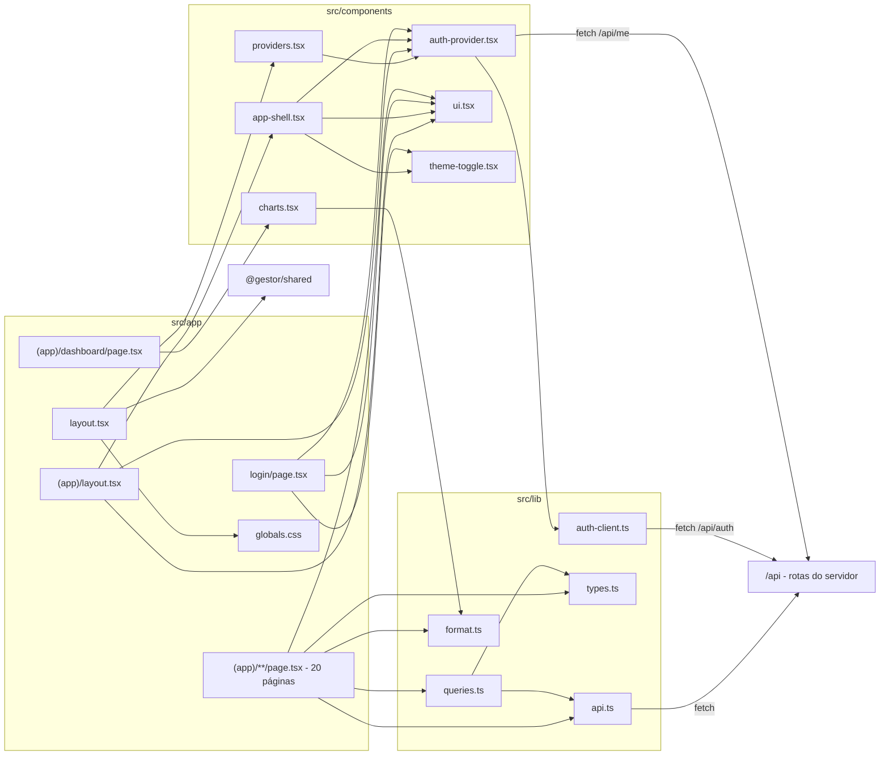
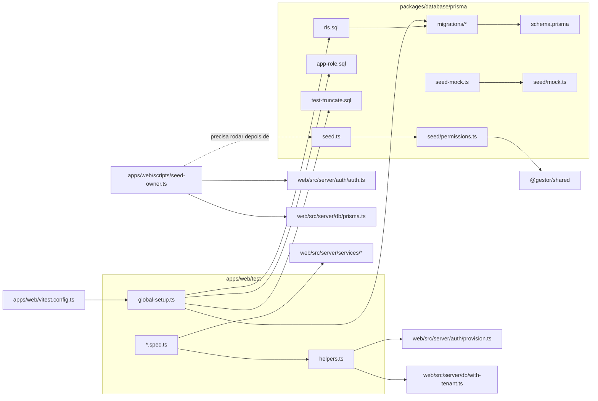
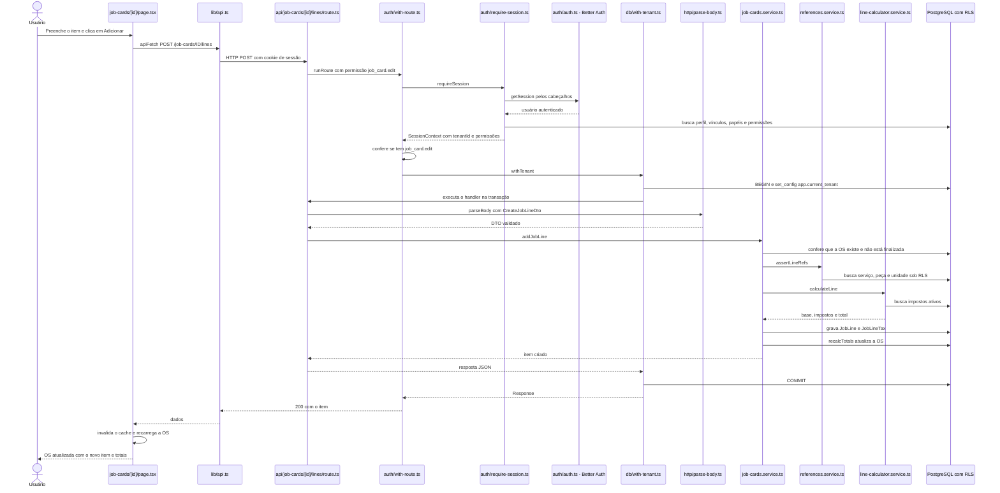

# Mapa do Projeto: Gestor de Oficinas

> Gerado em 08/10/2026. Descreve o estado do código nesta data.
> Ignorados: `node_modules/`, `.git/`, `.turbo/`, `.vercel/`, `.next/`, `pnpm-lock.yaml`, `*.tsbuildinfo` e arquivos `.env` reais (apenas `.env.example` foi lido).

---

## 1. Resumo

O **Gestor de Oficinas** é um sistema SaaS **multiempresa** para gestão de oficinas mecânicas. Cada oficina (chamada no código de *tenant*) tem seus próprios dados: clientes, veículos, agendamentos, inspeções (checklists), ordens de serviço (OS), orçamentos, faturas, pagamentos, peças, estoque, compras, despesas e relatórios.

O projeto é um **monorepo** gerenciado com **pnpm workspaces** e **Turborepo**, com quatro pacotes:

- **`apps/web`**: o produto em si. É uma aplicação **Next.js 15** que serve tanto as telas (React 19 + Tailwind + React Query) quanto a **API** (Route Handlers em `src/app/api/**`). A autenticação usa a biblioteca **Better Auth**.
- **`apps/mobile`**: app **Expo/React Native** para o mecânico. Hoje é só um esqueleto (uma tela de boas-vindas).
- **`packages/database`**: o **schema do banco (Prisma)**, as migrations, os scripts SQL de segurança (RLS), os seeds e o código que cria o cliente Prisma com "escopo de tenant".
- **`packages/shared`**: código compartilhado entre web, mobile e banco, principalmente o **catálogo de permissões** e os **papéis padrão** (Proprietário, Gerente, Atendente, Mecânico, Financeiro).

O banco é **PostgreSQL** (Neon em produção). O isolamento entre oficinas é garantido pelo próprio Postgres via **Row Level Security (RLS)**: a cada requisição, o servidor abre uma transação, informa ao banco qual é a oficina atual (`app.current_tenant`) e o banco só mostra linhas daquela oficina. O deploy é feito na **Vercel**.

---

## 2. Como o projeto roda

### Comandos principais (na raiz)

| Comando | O que faz |
|---|---|
| `pnpm install` | Instala as dependências de todos os pacotes |
| `pnpm db:generate` | Gera o Prisma Client a partir do `schema.prisma` |
| `pnpm db:deploy` | Aplica as migrations no banco |
| `pnpm db:rls` | Aplica as políticas de RLS (`rls.sql`) |
| `pnpm db:seed` | Cria permissões, a oficina demo e o usuário dono (owner) |
| `pnpm db:seed:mock` | Gera dados fictícios (clientes, OS, faturas…) para a oficina demo |
| `pnpm --filter @gestor/web dev` | Sobe o web + API em `http://localhost:3000` |
| `pnpm --filter @gestor/web test` | Roda os testes (exige um banco de teste dedicado) |

### Pontos de entrada

- **Navegador → páginas**: `apps/web/src/app/layout.tsx` (layout raiz) → `src/app/page.tsx` (redireciona para `/dashboard`) → `src/app/(app)/layout.tsx` (exige sessão) → páginas.
- **Navegador → API**: qualquer `apps/web/src/app/api/**/route.ts`. Quase todas passam por `runRoute()` em `src/server/auth/with-route.ts`.
- **Antes de tudo**: `apps/web/src/middleware.ts` intercepta as requisições de página e redireciona para `/login` quem não tem cookie de sessão.
- **Scripts de linha de comando**: `packages/database/prisma/seed.ts`, `seed-mock.ts` e `apps/web/scripts/seed-owner.ts`.
- **Mobile**: `apps/mobile/App.tsx`.

### Caminho geral de uma requisição

1. A tela (ex.: página de OS) chama `apiFetch()` (`src/lib/api.ts`), que faz um `fetch` para `/api/...` com o cookie de sessão.
2. O `route.ts` correspondente chama `runRoute()` com as permissões exigidas.
3. `runRoute()` → `requireSession()` descobre o usuário (Better Auth), a oficina ativa e as permissões → confere as permissões → `withTenant()` abre uma transação no banco e define `app.current_tenant`.
4. O route valida o corpo/query com um **DTO** (`parseBody`/`parseQuery`) e chama uma função de **service**.
5. O service usa `getDb()`, que devolve o cliente Prisma **da transação atual**, então todas as consultas já estão sob RLS.
6. Erros são convertidos em JSON com o status HTTP correto por `handleError()`.

---

## 3. Visão geral da arquitetura



### Os módulos

- **Middleware**: porteiro das páginas. Só olha se existe cookie de sessão; a validação real acontece no servidor.
- **Páginas (`src/app`)**: telas do painel administrativo. Todas são componentes de cliente que buscam dados na API via React Query.
- **Frontend compartilhado (`src/components`, `src/lib`)**: layout com menu lateral, componentes visuais (botões, tabelas, modais), contexto de autenticação, cliente HTTP, formatação e tipos.
- **API (`src/app/api`)**: 64 arquivos de rota, finos. Cada um valida a entrada e repassa para um service.
- **Infra do servidor (`src/server/auth`, `db`, `http`)**: o "coração técnico": sessão, permissões, transação por requisição com RLS, validação de DTOs, erros HTTP e rate limit.
- **Services (`src/server/services`)**: as regras de negócio (máquina de estados da OS, cálculo de itens e impostos, faturamento, estoque por ledger, compras etc.).
- **DTOs (`src/server/dtos`)**: classes com decorators do `class-validator` que descrevem e validam o formato de cada entrada.
- **`packages/database`**: define o banco e fornece o cliente Prisma que injeta `tenantId` automaticamente.
- **`packages/shared`**: fonte única das permissões e dos papéis padrão.

---

## 4. Estrutura de pastas

```text
Gestor de Oficinas/
├── .github/workflows/        # CI (testes a cada push/PR) e migração manual de produção
├── apps/
│   ├── mobile/               # App Expo do mecânico (esqueleto)
│   └── web/                  # Next.js: telas + API + auth
│       ├── scripts/          # Script para criar o usuário dono da oficina demo
│       ├── src/
│       │   ├── app/          # Rotas do Next (páginas e API)
│       │   │   ├── (app)/    # Páginas logadas (o "(app)" não aparece na URL)
│       │   │   ├── api/      # Endpoints REST
│       │   │   └── login/    # Tela de login
│       │   ├── components/   # Componentes React reutilizáveis
│       │   ├── lib/          # Cliente HTTP, hooks, formatação e tipos do frontend
│       │   ├── server/       # Código que só roda no servidor
│       │   │   ├── auth/     # Better Auth, sessão, provisionamento, wrapper de rota
│       │   │   ├── db/       # Clientes Prisma e transação por tenant
│       │   │   ├── dtos/     # Validação de entrada (class-validator)
│       │   │   ├── http/     # Erros HTTP, parse de body/query, UUID, rate limit
│       │   │   └── services/ # Regras de negócio
│       │   └── types/        # Ajuste de tipos do JSX para React 19
│       └── test/             # Testes de integração (Vitest + banco real)
├── docs/                     # Documentação de produto, domínio e deploy
└── packages/
    ├── database/             # Prisma: schema, migrations, RLS, seeds e cliente com tenant
    │   ├── prisma/
    │   │   ├── migrations/   # Histórico de alterações do banco
    │   │   └── seed/         # Funções auxiliares dos seeds
    │   └── src/              # Código exportado como @gestor/database
    └── shared/src/           # Código exportado como @gestor/shared
```

---

## 5. Arquivos, um por um

### 5.1 `packages/shared`

#### `packages/shared/src/permissions.ts`
**Propósito:** é o catálogo oficial de permissões do sistema (RBAC), a "fonte da verdade" usada pelo banco e pela API.
**Processo:** define as ações possíveis (`view`, `view_own`, `create`, `edit`, `delete`, `approve`) e, em `PERMISSION_CATALOG`, quais ações existem para cada funcionalidade (cliente, veículo, OS, fatura…). Cada permissão vira um código `funcionalidade.ação` (ex.: `invoice.approve`). Oferece funções para:
- `listPermissionDefinitions()`: expandir o catálogo em uma lista pronta para gravar no banco;
- `matchesPermissionPattern()`: verificar se um código casa com padrões como `*` ou `invoice.*`;
- `hasAllPermissions()`: verificar se quem concede tem todas as permissões que está concedendo (proteção contra escalada de privilégio).

**Depende de:** nenhum arquivo do projeto.
**Usado por:** `shared/src/roles.ts`, `shared/src/index.ts` e, via `@gestor/shared`: `database/prisma/seed/permissions.ts`, `web/src/server/auth/provision.ts`, `web/src/server/services/roles.service.ts`, `web/src/server/services/users.service.ts`.
**Bibliotecas externas:** nenhuma.

#### `packages/shared/src/roles.ts`
**Propósito:** define os papéis padrão que toda oficina nova recebe.
**Processo:** `ROLE_TEMPLATES` lista cinco papéis (Proprietário, Gerente, Atendente, Mecânico, Financeiro), cada um com padrões de permissão. O Gerente usa negação (`!setting.edit`) para tirar permissões específicas. `resolveRolePermissions()` pega todas as permissões do catálogo, aplica os padrões positivos e depois remove os negativos, devolvendo a lista final de códigos.
**Depende de:**
- `permissions.ts`: para listar o catálogo e casar padrões.

**Usado por:** `shared/src/index.ts` e, via `@gestor/shared`: `database/prisma/seed/permissions.ts`, `web/src/server/auth/provision.ts`.
**Bibliotecas externas:** nenhuma.

#### `packages/shared/src/index.ts`
**Propósito:** porta de entrada do pacote `@gestor/shared`.
**Processo:** reexporta tudo de `permissions.ts` e `roles.ts` e define a constante `APP_NAME = 'Gestor de Oficinas'`.
**Depende de:** `permissions.ts`, `roles.ts`.
**Usado por:** todo arquivo que importa `@gestor/shared`: `web/src/app/layout.tsx` (usa `APP_NAME`), `mobile/App.tsx`, os seeds e os services/auth citados acima.
**Bibliotecas externas:** nenhuma.

---

### 5.2 `packages/database` (código e scripts)

#### `packages/database/src/tenant-context.ts`
**Propósito:** guarda "qual oficina está ativa" durante a execução de uma requisição.
**Processo:** usa `AsyncLocalStorage` do Node, uma espécie de "variável global por requisição". `runWithTenant()` executa uma função com um contexto `{ tenantId, userId }`; `getTenantContext()` lê esse contexto; `requireTenantId()` lê o `tenantId` ou lança erro se não houver.
**Depende de:** nenhum arquivo do projeto.
**Usado por:** `tenant-extension.ts`, `index.ts`; via `@gestor/database`: `web/src/server/db/with-tenant.ts` e quase todos os services (para `requireTenantId()`).
**Bibliotecas externas:** `node:async_hooks`.

#### `packages/database/src/tenant-extension.ts`
**Propósito:** cria os clientes Prisma usados pela aplicação, com uma camada extra de proteção multi-tenant.
**Processo:**
1. `TENANT_MODELS` lista os modelos que têm `tenant_id`.
2. `tenantExtension` é uma extensão do Prisma que intercepta toda consulta a esses modelos. Se há um tenant no contexto, ela injeta `tenantId` nos `create`/`createMany`/`upsert` e adiciona `tenantId` no `where` das buscas e atualizações em massa.
3. `createPrismaClient()` cria o cliente com essa extensão; `createSystemPrismaClient()` cria um cliente "puro", sem extensão, para operações de plataforma (login, cadastro).
4. Ambos usam `APP_DATABASE_URL` quando definida, ou seja, conectam com o papel `app_gestor`, que é sujeito à RLS.

O próprio comentário diz que a garantia real é a RLS; a extensão é "defesa em profundidade".
**Depende de:**
- `tenant-context.ts`: para saber o tenant atual.
- Variável de ambiente `APP_DATABASE_URL`.
- Indiretamente, `prisma/schema.prisma` (o Prisma Client é gerado a partir dele).

**Usado por:** `index.ts`.
**Bibliotecas externas:** `@prisma/client`.

#### `packages/database/src/index.ts`
**Propósito:** porta de entrada do pacote `@gestor/database`.
**Processo:** reexporta `Prisma`, `PrismaClient`, as funções de criação de cliente, `TENANT_MODELS` e as funções de contexto de tenant.
**Depende de:** `tenant-extension.ts`, `tenant-context.ts`.
**Usado por:** `web/src/server/db/prisma.ts`, `web/src/server/db/with-tenant.ts`, `web/src/server/http/handle-error.ts`, os services e os testes.
**Bibliotecas externas:** `@prisma/client`.

#### `packages/database/prisma/schema.prisma`
**Propósito:** define **todo o banco de dados**: 23 enums e 65 modelos (tabelas).
**Processo:** é lido pelo Prisma para gerar o Prisma Client e as migrations. As convenções, descritas no topo do arquivo, são:
- toda tabela de negócio tem `tenant_id`;
- os IDs são UUID (pensando em sincronização offline futura);
- a exclusão é "suave" (soft delete, via `deletedAt`);
- dinheiro usa `Decimal(14,2)`;
- os nomes de tabela ficam em snake_case.

Os grupos de tabelas são:
- **Plataforma e acesso:** `Tenant`, `User`, `Session`, `Account`, `Verification` (Better Auth), `Membership` (vínculo usuário↔oficina), `Role`, `Permission`, `RolePermission`, `MembershipRole`.
- **Cadastros:** `Branch` (filial), `Customer`, `Vehicle` e os catálogos do veículo (marca, modelo, tipo, cor, combustível), `Supplier`, `ServiceCatalog`, `PartCatalog`, `Unit`, `Tax`, `ProductCategory`.
- **Operação:** `Appointment`, `BusinessHour`, `Holiday`, `JobCard` (OS) com `JobLine`, `JobLineTax`, `JobMechanic`, `JobStatusHistory`, `JobChecklistItem`.
- **Inspeção:** `InspectionTemplate`, que tem versões, seções, perguntas e opções; `Inspection` com `InspectionAnswer` e anexos.
- **Comercial e financeiro:** `Quotation` (orçamento) e linhas, `Invoice` (fatura) e linhas, `Payment`, `PaymentMethod`, `Expense`.
- **Estoque e compras:** `StockLocation`, `StockMovement` (ledger imutável), `StockBalance` (saldo projetado), `Purchase`, `PurchaseItem`.
- **Diversos:** `Attachment`, `Note`, campos customizados (`CustomFieldset`, `CustomFieldDefinition`, `CustomFieldValue`), `AuditLog`, `NumberSequence` (numeração de documentos), `RefreshToken`.

**Depende de:** variáveis de ambiente `DATABASE_URL` e `DIRECT_URL`.
**Usado por:** todas as migrations (geradas a partir dele), o Prisma Client usado por todo o servidor, `rls.sql` (que precisa conhecer os nomes das tabelas).
**Bibliotecas externas:** `prisma`.

#### `packages/database/prisma/rls.sql`
**Propósito:** liga o isolamento entre oficinas dentro do PostgreSQL.
**Processo:** cria a função `current_tenant_id()`, que lê a configuração `app.current_tenant` da sessão do banco. Depois, para 38 tabelas de negócio: ativa a RLS, força a RLS até para o dono da tabela e cria a política `tenant_isolation` (só enxerga ou grava linhas cujo `tenant_id` seja o tenant atual). Se o tenant não foi definido, nenhuma linha aparece. As tabelas de plataforma (usuários, tenants, papéis, sessões) ficam de fora porque são consultadas antes de se saber a oficina.
**Depende de:**
- `schema.prisma` / migrations: as tabelas precisam existir.
- Configuração `app.current_tenant`, definida por `web/src/server/db/with-tenant.ts`, `web/src/server/auth/provision.ts` e `web/scripts/seed-owner.ts`.

**Usado por:** os scripts `db:rls` / `db:rls:direct` de `packages/database/package.json`; `web/test/global-setup.ts`.
**Bibliotecas externas:** nenhuma (SQL puro).

#### `packages/database/prisma/app-role.sql`
**Propósito:** cria o papel de banco `app_gestor` (sem permissão de ignorar RLS) em bancos de dev e teste.
**Processo:** se o papel não existe, cria-o com senha padrão `app_gestor`. Depois concede `select/insert/update/delete` em todas as tabelas e sequências, inclusive as futuras.
**Depende de:** nenhum arquivo.
**Usado por:** o script `db:app-role:direct`, chamado por `web/test/global-setup.ts`.
**Bibliotecas externas:** nenhuma.

#### `packages/database/prisma/test-truncate.sql`
**Propósito:** limpar o banco de teste.
**Processo:** percorre todas as tabelas do schema `public` (exceto o histórico de migrations) e executa `TRUNCATE ... CASCADE`.
**Depende de:** nenhum arquivo.
**Usado por:** o script `db:truncate:direct`, chamado por `web/test/global-setup.ts` antes e depois da suíte.
**Bibliotecas externas:** nenhuma.

#### `packages/database/prisma/seed.ts`
**Propósito:** popular o banco com o mínimo para o sistema funcionar e uma oficina de demonstração.
**Processo:**
1. Sincroniza o catálogo de permissões.
2. Se `SEED_DEMO_TENANT` não for `false`, cria (ou reaproveita) a oficina `oficina-demo` e a filial `MATRIZ`.
3. Cria os papéis padrão, os meios de pagamento (Dinheiro, Cartão, Pix, Transferência), as unidades (un, h, L), um imposto "Sem imposto" e um checklist "Inspeção Básica" com perguntas de freios, pneus e observações.

Ao final, avisa que o usuário dono deve ser criado com `pnpm db:seed:owner`.
**Depende de:**
- `seed/permissions.ts`: para sincronizar permissões e criar os papéis.
- Variável `SEED_DEMO_TENANT`.

**Usado por:** o script `db:seed` (raiz e `packages/database`).
**Bibliotecas externas:** `@prisma/client`.

#### `packages/database/prisma/seed/permissions.ts`
**Propósito:** funções de seed reaproveitáveis para permissões e papéis.
**Processo:** `seedPermissions()` faz upsert de cada permissão do catálogo. `seedTenantRoles()` cria ou atualiza os cinco papéis de sistema de uma oficina e regrava as permissões de cada papel (apaga as antigas e insere as calculadas por `resolveRolePermissions`).
**Depende de:**
- `@gestor/shared` (`shared/src/permissions.ts` e `roles.ts`): o catálogo e os papéis.

**Usado por:** `prisma/seed.ts`.
**Bibliotecas externas:** `@prisma/client`.

#### `packages/database/prisma/seed-mock.ts`
**Propósito:** gerar dados fictícios para a oficina demo.
**Processo:** procura a oficina `oficina-demo` (exige que o seed base já tenha rodado), chama `seedMockData()` e imprime uma tabela com quantos registros de cada tipo foram criados.
**Depende de:**
- `seed/mock.ts`: a geração em si.

**Usado por:** o script `db:seed:mock`.
**Bibliotecas externas:** `@prisma/client`.

#### `packages/database/prisma/seed/mock.ts`
**Propósito:** gerador de dados de demonstração realistas e reproduzíveis (~700 linhas).
**Processo:**
1. Usa um gerador pseudoaleatório com semente fixa (`mulberry32`), então os dados saem sempre iguais.
2. Apaga os dados de negócio da oficina, preservando o dono.
3. Cria duas filiais, catálogos de veículos (marcas e modelos brasileiros), membros da equipe (mecânicos, atendente, gerente, financeiro), clientes, veículos, peças, serviços, fornecedores, locais e saldos de estoque, compras, OS com itens e mecânicos, inspeções, orçamentos, faturas, pagamentos, despesas e agendamentos.
4. A função `line()` calcula os valores de cada item (desconto, base, imposto, total).

**Depende de:** nenhum arquivo do projeto (recebe o `PrismaClient` por parâmetro).
**Usado por:** `prisma/seed-mock.ts`.
**Bibliotecas externas:** `@prisma/client`, `node:crypto`.

#### Migrations (`packages/database/prisma/migrations/`)

| Arquivo | O que muda no banco |
|---|---|
| `migration_lock.toml` | Trava o provedor como `postgresql` (gerado pelo Prisma, não editar). |
| `20260925191542_init/migration.sql` | Criação inicial: todos os enums e tabelas do domínio (~1.600 linhas). |
| `20260925195318_add_purchases/migration.sql` | Cria o enum `PurchaseStatus` e as tabelas `purchases` e `purchase_items`. |
| `20261003120000_add_user_default_tenant/migration.sql` | Adiciona `users.default_tenant_id` (a oficina padrão do usuário). |
| `20261003130000_better_auth/migration.sql` | Adiciona `users.emailVerified` e as tabelas `sessions`, `accounts` e `verifications`, exigidas pelo Better Auth. |
| `20261007120000_add_purchase_expense_and_cost/migration.sql` | Liga despesa à compra (`expenses.purchase_id`) e guarda o custo anterior da peça (`purchase_items.previous_cost`), usado para reverter o custo ao cancelar a compra. |

**Depende de:** `schema.prisma` (são geradas a partir dele).
**Usado por:** os scripts `db:migrate`, `db:deploy` e `db:deploy:direct`, o workflow `migrate.yml` e `web/test/global-setup.ts`.

---

### 5.3 `apps/web`: infraestrutura do servidor

#### `apps/web/src/server/db/prisma-context.ts`
**Propósito:** guarda a transação do Prisma ativa na requisição.
**Processo:** exporta um `AsyncLocalStorage` (`prismaContext`) onde `with-tenant.ts` coloca o cliente da transação, para que `getDb()` o encontre.
**Depende de:** nenhum arquivo.
**Usado por:** `db/prisma.ts`, `db/with-tenant.ts`.
**Bibliotecas externas:** `node:async_hooks`.

#### `apps/web/src/server/db/prisma.ts`
**Propósito:** fornece os clientes de banco usados no servidor.
**Processo:** cria uma única vez (reaproveitando entre recarregamentos em dev) dois clientes:
- `base`: com a extensão de tenant;
- `system`: sem a extensão, para auth e plataforma.

`getDb()` devolve a transação da requisição atual, se existir, ou o `base`. É a função que **todos os services** usam para falar com o banco.
**Depende de:**
- `@gestor/database` (`database/src/index.ts`): para criar os clientes.
- `prisma-context.ts`: para achar a transação ativa.

**Usado por:** `db/with-tenant.ts`, `auth/auth.ts`, `auth/provision.ts`, `auth/require-session.ts`, todos os services, `api/me/route.ts`, `api/health/route.ts`, `scripts/seed-owner.ts` e os testes.
**Bibliotecas externas:** nenhuma direta.

#### `apps/web/src/server/db/with-tenant.ts`
**Propósito:** executa um trecho de código "dentro da oficina": numa transação com a RLS ativada.
**Processo:**
1. Abre uma transação (`base.$transaction`, timeout de 10 s para caber no limite serverless).
2. Executa `set_config('app.current_tenant', tenantId, true)`, valendo só para essa transação.
3. Registra o tenant no `AsyncLocalStorage` do pacote de banco e a transação no `prismaContext`.
4. Roda a função.

Tudo que a função fizer via `getDb()` fica na mesma transação e sob RLS.
**Depende de:**
- `@gestor/database` (`runWithTenant`): para o contexto de tenant.
- `prisma.ts` (`base`): para abrir a transação.
- `prisma-context.ts`: para guardar a transação.
- `packages/database/prisma/rls.sql` (indireto): é o que dá efeito ao `app.current_tenant`.

**Usado por:** `auth/with-route.ts`, `test/helpers.ts`.
**Bibliotecas externas:** nenhuma direta.

#### `apps/web/src/server/auth/auth.ts`
**Propósito:** configura o **Better Auth** (login por e-mail e senha).
**Processo:** cria a instância `auth` usando o adaptador Prisma sobre o cliente `system` (as tabelas de usuários e sessões não têm RLS). Mapeia o campo `image` para a coluna existente `avatarUrl`, declara campos extras do usuário (`isActive`, `isPlatformAdmin`, `defaultTenantId`), deixa o Prisma gerar os IDs e liga rate limit (100 req/min no geral; 10/min em login e cadastro; 5/min em "esqueci a senha").
**Depende de:**
- `db/prisma.ts` (`system`).
- Variáveis `BETTER_AUTH_SECRET` e `BETTER_AUTH_URL`.
- Tabelas `users`, `sessions`, `accounts` e `verifications` (migration `better_auth`).

**Usado por:** `api/auth/[...all]/route.ts`, `auth/require-session.ts`, `auth/provision.ts`, `services/users.service.ts`, `scripts/seed-owner.ts`, `test/auth.spec.ts`.
**Bibliotecas externas:** `better-auth`.

#### `apps/web/src/server/auth/require-session.ts`
**Propósito:** descobrir **quem** está chamando a API, **em qual oficina** e **com quais permissões**.
**Processo:**
1. Pede ao Better Auth a sessão a partir dos cabeçalhos (cookie). Sem sessão, erro 401.
2. Carrega o perfil do usuário; se estiver inativo, erro 401.
3. Busca os vínculos (`memberships`) ativos do usuário com papéis e permissões. A oficina ativa é a `defaultTenantId`; se não houver, é a mais antiga. Sem vínculo, erro 403.
4. Junta os códigos de permissão de todos os papéis. Administrador da plataforma recebe `*`.
5. Devolve um `SessionContext`.

As permissões são lidas do banco **a cada requisição** (sempre atualizadas).
**Depende de:**
- `auth.ts`: para ler a sessão.
- `db/prisma.ts` (`system`): para ler usuário e vínculos.
- `http/errors.ts`: para os erros 401/403.

**Usado por:** `auth/with-route.ts`.
**Bibliotecas externas:** `next/headers`.

#### `apps/web/src/server/auth/with-route.ts`
**Propósito:** é o "envelope" padrão de toda rota autenticada da API.
**Processo:** `runRoute(opções, req, handler)`:
1. chama `requireSession()`;
2. confere se o usuário tem **todas** as permissões exigidas (`*` libera tudo); se faltar alguma, erro 403 dizendo qual;
3. executa o handler dentro de `withTenant()` (transação + RLS);
4. qualquer erro vira resposta JSON via `handleError()`.

**Depende de:**
- `require-session.ts`: para identificar o usuário.
- `db/with-tenant.ts`: para a transação com RLS.
- `http/errors.ts` (`ForbiddenError`) e `http/handle-error.ts`.

**Usado por:** praticamente todos os `src/app/api/**/route.ts` (exceto `auth`, `health` e `register`).
**Bibliotecas externas:** `next/server` (tipos).

#### `apps/web/src/server/auth/provision.ts`
**Propósito:** cadastrar uma **nova oficina** junto com seu dono.
**Processo:**
1. Gera o slug a partir do nome (sem acentos, minúsculo).
2. Verifica se o slug ou o e-mail já existem (erro 409).
3. Cria o usuário pelo Better Auth.
4. Numa transação: garante o catálogo de permissões, cria o tenant, define `app.current_tenant` (para a RLS permitir), cria a filial "Matriz", os cinco papéis com suas permissões, o vínculo do dono e a associação ao papel Proprietário.
5. Grava a oficina como padrão do usuário.

Se algo falhar, apaga o usuário criado para não deixar "órfãos".
**Depende de:**
- `@gestor/shared`: `ROLE_TEMPLATES`, `listPermissionDefinitions`, `resolveRolePermissions`.
- `db/prisma.ts` (`system`).
- `http/errors.ts` (`ConflictError`).
- `auth.ts`: para criar o usuário.
- `dto/register-tenant.dto.ts` (tipo da entrada).

**Usado por:** `api/register/route.ts`, `test/helpers.ts`, `test/auth.spec.ts`.
**Bibliotecas externas:** nenhuma direta.

#### `apps/web/src/server/auth/dto/register-tenant.dto.ts`
**Propósito:** valida os dados de cadastro de oficina.
**Processo:** exige nome da oficina, nome e e-mail do dono e senha com no mínimo 8 caracteres. Aceita um slug opcional (só letras minúsculas, números e hífen).
**Depende de:** nenhum arquivo.
**Usado por:** `auth/provision.ts`, `api/register/route.ts`.
**Bibliotecas externas:** `class-validator`.

#### `apps/web/src/server/env.ts`
**Propósito:** ler variáveis de ambiente do servidor com validação.
**Processo:** `serverEnv()` exige `BETTER_AUTH_SECRET` (lança erro se faltar) e usa `BETTER_AUTH_URL` com padrão `http://localhost:3000`.
**Depende de:** variáveis `BETTER_AUTH_SECRET` e `BETTER_AUTH_URL`.
**Usado por:** nenhum arquivo (ver Observações).
**Bibliotecas externas:** `server-only`.

#### `apps/web/src/server/http/errors.ts`
**Propósito:** classes de erro HTTP.
**Processo:** `HttpError` guarda um status. As subclasses `BadRequestError` (400), `UnauthorizedError` (401), `ForbiddenError` (403), `NotFoundError` (404), `ConflictError` (409) e `TooManyRequestsError` (429) têm mensagens padrão em português.
**Depende de:** nenhum arquivo.
**Usado por:** `handle-error.ts`, `params.ts`, `parse-body.ts`, `rate-limit.ts`, `auth/require-session.ts`, `auth/with-route.ts`, `auth/provision.ts`, quase todos os services e `api/me/route.ts`.
**Bibliotecas externas:** nenhuma.

#### `apps/web/src/server/http/handle-error.ts`
**Propósito:** transformar qualquer erro em resposta JSON padronizada.
**Processo:**
- `HttpError` vira o status e a mensagem do próprio erro.
- Erro Prisma `P2002` (registro duplicado) vira 409; `P2025` (registro não encontrado) vira 404.
- Qualquer outro erro é registrado no console e vira 500 "Erro interno do servidor".

**Depende de:**
- `errors.ts`.
- `@gestor/database` (`Prisma`): para reconhecer os erros do Prisma.

**Usado por:** `auth/with-route.ts`, `api/register/route.ts`.
**Bibliotecas externas:** `next/server`.

#### `apps/web/src/server/http/parse-body.ts`
**Propósito:** validar o corpo JSON e a query string contra um DTO.
**Processo:** converte o objeto bruto numa instância da classe DTO (com conversão implícita de tipos) e roda o `class-validator` com `whitelist` e `forbidNonWhitelisted`, então campos não declarados geram erro. As mensagens de erro (inclusive as de objetos aninhados) são juntadas num único `BadRequestError`. Exporta `parseBody()` (corpo) e `parseQuery()` (query string).
**Depende de:** `errors.ts`.
**Usado por:** quase todas as rotas com `POST`, `PATCH` ou `PUT`, e as listagens com filtros.
**Bibliotecas externas:** `class-transformer`, `class-validator`, `reflect-metadata`, `server-only`.

#### `apps/web/src/server/http/params.ts`
**Propósito:** validar parâmetros de URL no formato UUID.
**Processo:** `assertUuid(valor)` testa com uma expressão regular e lança `BadRequestError("id inválido")` se não bater.
**Depende de:** `errors.ts`.
**Usado por:** todas as rotas com `[id]`, `[lineId]`, `[userId]`, `[paymentId]`, `[questionId]` ou `[jobCardId]`.
**Bibliotecas externas:** nenhuma.

#### `apps/web/src/server/http/rate-limit.ts`
**Propósito:** limitar abuso em rotas públicas.
**Processo:** guarda um contador por chave num `Map` em memória. `rateLimit(chave, limite, janela)` lança 429 se o limite for excedido na janela. `sweepRateLimitBuckets()` remove contadores vencidos. `clientIp()` extrai o IP de `x-forwarded-for` / `x-real-ip`. Funciona por instância da função serverless, não é distribuído.
**Depende de:** `errors.ts`.
**Usado por:** `api/register/route.ts`, `test/regressions.spec.ts`.
**Bibliotecas externas:** nenhuma.

#### `apps/web/src/middleware.ts`
**Propósito:** proteger as páginas privadas antes de elas carregarem.
**Processo:** se `BETTER_AUTH_SECRET` não estiver definida, deixa tudo passar. Para rotas que **não** são `/api`:
- sem cookie de sessão e fora de `/login`: redireciona para `/login`;
- com cookie e em `/login`: redireciona para `/dashboard`.

Ignora arquivos estáticos e imagens. Só lê o cookie; quem valida a sessão de verdade é o servidor.
**Depende de:** variável `BETTER_AUTH_SECRET`.
**Usado por:** o Next.js (executado automaticamente).
**Bibliotecas externas:** `next/server`, `better-auth/cookies`.

#### `apps/web/src/types/jsx.d.ts`
**Propósito:** compatibilidade de tipos com o React 19.
**Processo:** o React 19 removeu o namespace global `JSX`. Este arquivo o recria apontando para `React.JSX`, permitindo escrever `JSX.Element` no código.
**Depende de:** nenhum arquivo.
**Usado por:** o TypeScript, em todos os componentes que declaram retorno `JSX.Element`.
**Bibliotecas externas:** `react` (tipos).

---

### 5.4 `apps/web`: services (regras de negócio)

Todos os services usam `getDb()` (`db/prisma.ts`), que já roda dentro da transação com RLS, e lançam os erros de `http/errors.ts`. As listagens seguem o mesmo padrão: paginação (`page` e `pageSize`, padrão 20), filtros opcionais e retorno `{ items, total, page, pageSize, totalPages }`. Muitos usam **soft delete** (preenchem `deletedAt` ou `isActive = false` em vez de apagar).

#### `services/number-sequence.service.ts`
**Propósito:** gerar números sequenciais de documentos por oficina (ex.: `JC-000001`).
**Processo:** `nextNumber(entidade, { prefix, padding })` faz um upsert em `NumberSequence`: se não existe, cria com `nextValue = 2`; se existe, incrementa. Devolve o valor anterior formatado com prefixo e zeros à esquerda. Por rodar na transação da requisição, a numeração é consistente.
**Depende de:** `@gestor/database` (`requireTenantId`), `db/prisma.ts`. Tabela `number_sequences`.
**Usado por:** `job-cards.service.ts` (`JC-`), `quotations.service.ts` (`OR-` e `FT-`), `invoices.service.ts` (`FT-`), `purchases.service.ts` (`CP-`).

#### `services/line-calculator.service.ts`
**Propósito:** cálculo central do valor de um item (linha) de OS ou orçamento.
**Processo:** `calculateLine()`:
1. bruto = quantidade × preço;
2. aplica o desconto (percentual, com no máximo 100%, ou valor fixo), sem deixar a base negativa;
3. busca os impostos ativos informados e calcula cada um (percentual sobre a base, ou valor fixo);
4. devolve base, impostos, total e as linhas de imposto para gravar.

Usa `Prisma.Decimal` para não perder precisão.
**Depende de:** `db/prisma.ts` (tabela `taxes`), `http/errors.ts`.
**Usado por:** `job-cards.service.ts`, `quotations.service.ts`.
**Bibliotecas externas:** `@prisma/client`.

#### `services/references.service.ts`
**Propósito:** garantir que IDs enviados pelo usuário (cliente, veículo, peça, serviço, unidade) existem **na oficina atual**.
**Processo:** cada função `assert...Ref()` busca o registro; como a busca roda sob RLS, um ID de outra oficina "não existe" e gera `BadRequestError("X inválido")`. `assertLineRefs()` valida serviço, peça e unidade em paralelo.
**Depende de:** `db/prisma.ts`, `http/errors.ts`.
**Usado por:** `job-cards.service.ts`, `quotations.service.ts`, `stock.service.ts`.

#### `services/branches.service.ts`
**Propósito:** CRUD de filiais.
**Processo:** listar (não excluídas, por nome), criar, atualizar e remover (soft delete). Antes de alterar, confirma que a filial existe.
**Depende de:** `db/prisma.ts`, `http/errors.ts`, `dtos/create-branch.dto.ts`, `dtos/update-branch.dto.ts`.
**Usado por:** `api/branches/route.ts`, `api/branches/[id]/route.ts`, `test/flows.spec.ts`, `test/regressions.spec.ts`.

#### `services/customers.service.ts`
**Propósito:** CRUD de clientes.
**Processo:** cria; lista com busca por nome, documento, e-mail ou telefone (sem diferenciar maiúsculas), do mais novo para o mais antigo; busca por ID; atualiza; remove (soft delete).
**Depende de:** `db/prisma.ts`, `http/errors.ts`, `dtos/create-customer.dto.ts`, `query-customer.dto.ts`, `update-customer.dto.ts`.
**Usado por:** `api/customers/route.ts`, `api/customers/[id]/route.ts`, testes.

#### `services/vehicles.service.ts`
**Propósito:** CRUD de veículos.
**Processo:** ao criar ou trocar o dono, confere se o cliente existe. Lista com filtro por cliente e busca por placa, VIN, chassi ou nome do cliente, trazendo cliente, marca e modelo. O detalhe inclui também combustível e cor. Remove com soft delete.
**Depende de:** `db/prisma.ts`, `http/errors.ts`, DTOs `create-vehicle`, `query-vehicle`, `update-vehicle`.
**Usado por:** `api/vehicles/route.ts`, `api/vehicles/[id]/route.ts`, testes.

#### `services/suppliers.service.ts`
**Propósito:** CRUD de fornecedores.
**Processo:** igual aos cadastros acima. A busca é por nome ou documento; a remoção marca `isActive = false`.
**Depende de:** `db/prisma.ts`, `http/errors.ts`, DTOs `create-supplier`, `query-supplier`, `update-supplier`.
**Usado por:** `api/suppliers/route.ts`, `api/suppliers/[id]/route.ts`.

#### `services/parts.service.ts`
**Propósito:** CRUD do catálogo de peças.
**Processo:** busca por nome ou SKU; listagem e detalhe trazem categoria e unidade; remoção com soft delete.
**Depende de:** `db/prisma.ts`, `http/errors.ts`, DTOs `create-part`, `query-part`, `update-part`.
**Usado por:** `api/parts/route.ts`, `api/parts/[id]/route.ts`, testes.

#### `services/expenses.service.ts`
**Propósito:** CRUD de despesas.
**Processo:** cria convertendo a data; lista com filtros por filial, categoria e período, devolvendo também a **soma** dos valores filtrados; atualiza; remove (exclusão real, não soft delete).
**Depende de:** `db/prisma.ts`, `http/errors.ts`, DTOs `create-expense`, `query-expense`, `update-expense`.
**Usado por:** `api/expenses/route.ts`, `api/expenses/[id]/route.ts`.

#### `services/appointments.service.ts`
**Propósito:** agenda da oficina.
**Processo:** cria agendamentos (filial, cliente, veículo, tipo, início e fim, responsável); lista com filtros por filial, cliente, veículo, status e período, ordenando pelo horário; detalha; atualiza; muda só o status (`updateAppointmentStatus`); remove (exclusão real).
**Depende de:** `db/prisma.ts`, `http/errors.ts`, DTOs `create-appointment`, `query-appointment`, `update-appointment`, `update-appointment-status`.
**Usado por:** `api/appointments/route.ts`, `api/appointments/[id]/route.ts`, `api/appointments/[id]/status/route.ts`.

#### `services/job-cards.service.ts`
**Propósito:** **Ordens de Serviço (OS)**, o processo central da oficina.
**Processo:**
- **Criar:** valida cliente e veículo, gera o número `JC-xxxxxx` e cria a OS (o atendente padrão é o usuário logado).
- **Listar:** filtros por filial, cliente, veículo, responsável, tipo e status, mais busca por número, placa ou nome do cliente.
- **Detalhar:** traz cliente, veículo, responsáveis, itens com impostos, mecânicos, histórico de status, inspeção e contagem de orçamentos e faturas.
- **Máquina de estados:** `ALLOWED_TRANSITIONS` define as mudanças permitidas (ex.: `DRAFT → SCHEDULED/CHECKED_IN/CANCELLED`; `IN_PROGRESS → WAITING_PARTS/COMPLETED/CANCELLED`; `LOCKED` e `CANCELLED` são finais). `transitionJobCard()` recusa transições inválidas, carimba as datas (início, conclusão, entrega, bloqueio) e grava o histórico com o motivo.
- **Itens:** `addJobLine`, `updateJobLine` e `removeJobLine` validam as referências, calculam os valores com `calculateLine()` e recalculam os totais da OS. Bloqueiam alterações em OS `CANCELLED`, `DELIVERED` ou `LOCKED`.
- **Mecânicos:** `assignMechanic` (upsert com função e horas) e `removeMechanic`.
- **`recalcTotals()`:** subtotal = soma das bases; impostos = soma dos impostos; total = subtotal + impostos − desconto da OS.

**Depende de:**
- `line-calculator.service.ts`: valores dos itens.
- `number-sequence.service.ts`: número da OS.
- `references.service.ts`: validação de cliente, veículo, peça, serviço e unidade.
- `db/prisma.ts`, `http/errors.ts`.
- DTOs `assign-mechanic`, `create-job-card`, `create-job-line`, `query-job-card`, `transition-job-card`, `update-job-card`, `update-job-line`.

**Usado por:** as rotas `api/job-cards/**`, `stock.service.ts` (usa `addJobLine`) e os testes `flows.spec.ts` e `regressions.spec.ts`.
**Bibliotecas externas:** `@prisma/client` (enum `JobStatus`, `Decimal`).

#### `services/quotations.service.ts`
**Propósito:** **orçamentos** e sua conversão em fatura.
**Processo:**
- **Criar:** gera o número `OR-xxxxxx`. Se `copyFromJobCard` for verdadeiro, copia todos os itens da OS vinculada.
- **Itens:** adicionar, atualizar e remover, com o mesmo cálculo da OS, e recálculo dos totais (subtotal, impostos, total de descontos, total).
- **Ciclo de status:**
  - `sendQuotation`: `DRAFT → SENT`;
  - `approveQuotation`: `DRAFT/SENT → APPROVED`, registrando quem aprovou e quando;
  - `rejectQuotation`: `DRAFT/SENT → REJECTED`.
- **Excluir:** só orçamentos em rascunho.
- **`convertQuotationToInvoice`:** só para orçamento aprovado e ainda não convertido. Gera o número `FT-xxxxxx`, cria a fatura já **emitida** (`ISSUED`), copia cada item com seus impostos e marca o orçamento como `CONVERTED`.

**Depende de:** `line-calculator.service.ts`, `number-sequence.service.ts`, `references.service.ts`, `db/prisma.ts`, `http/errors.ts`, DTOs `line-item`, `create-quotation`, `query-quotation`, `update-quotation`.
**Usado por:** as rotas `api/quotations/**` e `test/flows.spec.ts`.

#### `services/invoices.service.ts`
**Propósito:** **faturas** e **pagamentos**.
**Processo:**
- **Listar e detalhar:** com cliente, OS, orçamento, itens e pagamentos.
- **Atualizar:** só vencimento e observações.
- **`issueInvoice`:** `DRAFT → ISSUED`.
- **`cancelInvoice`:** cancela, exceto se já estiver paga.
- **`createInvoiceFromJobCard`:** fatura uma OS (não pode estar cancelada nem já faturada). Copia itens e impostos, calcula o desconto global e cria a fatura como `ISSUED`.
- **`addInvoicePayment`:** recusa pagamento em fatura cancelada e valor acima do saldo em aberto. Depois recalcula o status (`PARTIALLY_PAID` ou `PAID`) via `syncInvoicePaymentStatus`.
- **`removeInvoicePayment`:** apaga o pagamento e recalcula o status.
- **`renderInvoiceDocument`:** monta um **HTML** da fatura (itens, totais, pagamentos), escapando caracteres especiais, para impressão ou geração futura de PDF.

**Depende de:** `number-sequence.service.ts`, `db/prisma.ts`, `http/errors.ts`, DTOs `create-payment`, `query-invoice`, `update-invoice`.
**Usado por:** as rotas `api/invoices/**` e os testes `flows.spec.ts` e `regressions.spec.ts`.

#### `services/stock.service.ts`
**Propósito:** **estoque** por *ledger* (livro-razão): todo movimento é registrado e o saldo é uma projeção.
**Processo:**
- **Locais:** listar (opcionalmente por filial) e criar.
- **`recordMovement()`**, o coração do estoque:
  1. valida o local e a peça;
  2. calcula o saldo resultante e **impede saldo negativo**;
  3. grava o `StockMovement`;
  4. atualiza (upsert) o `StockBalance`.
- **`createMovement()`:** movimento manual. O sinal da quantidade é definido pelo tipo: entradas (`INITIAL`, `PURCHASE`, `RETURN_IN`) são positivas, saídas são negativas e `ADJUSTMENT` respeita o sinal informado.
- **`issueToJob()`:** dá baixa de uma peça para uma OS e, por padrão, **adiciona a peça como item da OS** com o preço de venda.
- **Listar saldos:** com filtro opcional de "estoque baixo" (saldo ≤ mínimo).
- **Listar movimentos:** paginado, com filtros.

**Depende de:**
- `job-cards.service.ts` (`addJobLine`): para lançar a peça na OS.
- `references.service.ts` (`assertPartRef`).
- `db/prisma.ts`, `http/errors.ts`.
- DTOs `create-location`, `create-movement`, `issue-to-job`, `query-balance`, `query-movement`.

**Usado por:** as rotas `api/stock/**`, `purchases.service.ts` (usa `recordMovement`) e os testes.

#### `services/purchases.service.ts`
**Propósito:** **compras** de peças (entrada de estoque).
**Processo:**
- **`createPurchase()`:**
  1. gera o número `CP-xxxxxx` e soma o subtotal;
  2. para cada item: grava o `PurchaseItem` guardando o **custo anterior** da peça, lança um movimento `PURCHASE` no estoque e atualiza o custo da peça com o novo custo;
  3. se `createExpense` não for `false`, cria uma despesa "Compras" ligada à compra.
- **`cancelPurchase()`:**
  1. lança um `ADJUSTMENT` negativo para cada item, o que falha se o estoque já foi consumido;
  2. **restaura o custo anterior** de cada peça;
  3. apaga a despesa ligada e marca a compra como `CANCELLED`.
- **Listar e detalhar:** com filtros por fornecedor, status e período.

**Depende de:** `number-sequence.service.ts`, `stock.service.ts` (`recordMovement`), `db/prisma.ts`, `http/errors.ts`, DTOs `create-purchase`, `query-purchase`.
**Usado por:** `api/purchases/route.ts`, `api/purchases/[id]/route.ts`, `api/purchases/[id]/cancel/route.ts`, `test/regressions.spec.ts`.

#### `services/inspection-templates.service.ts`
**Propósito:** modelos de checklist de inspeção, **versionados**.
**Processo:** `createInspectionTemplate()` cria o modelo com a versão 1 já publicada, com seções, perguntas e opções aninhadas (a ordem vem do índice se não for informada). Também há listagem com busca por nome e detalhe com todas as versões ordenadas. `publishInspectionTemplate()` cria uma **nova versão** clonando a última por inteiro; assim, inspeções antigas continuam apontando para a versão que usaram.
**Depende de:** `db/prisma.ts`, `http/errors.ts`, DTOs `create-inspection-template`, `query-inspection-template`.
**Usado por:** `api/inspection-templates/route.ts`, `api/inspection-templates/[id]/route.ts`, `api/inspection-templates/[id]/publish/route.ts`.

#### `services/inspections.service.ts`
**Propósito:** execução de inspeções (checklists preenchidos).
**Processo:**
- **`startInspection()`:** pega a **última versão** do modelo e cria a inspeção `IN_PROGRESS` com uma resposta vazia para cada pergunta.
- **Listar e detalhar:** com veículo, OS e respostas (inclusive pergunta, opções, seção e anexos).
- **`updateInspection()`:** muda status e notas; ao concluir, carimba `completedAt`. `completeInspection()` é um atalho para concluir.
- **`upsertInspectionAnswer()`:** confere que a pergunta pertence à versão usada pela inspeção e grava valor, resultado (OK, Atenção, Reparar…), comentário e, opcionalmente, o status de aprovação (com quem aprovou e quando).

**Depende de:** `db/prisma.ts`, `http/errors.ts`, DTOs `query-inspection`, `start-inspection`, `update-inspection`, `upsert-answer`.
**Usado por:** as rotas `api/inspections/**`.

#### `services/roles.service.ts`
**Propósito:** gestão de **papéis** e suas permissões.
**Processo:**
- **Listar:** com contagem de permissões e membros.
- **Detalhar:** com as permissões.
- **Listar o catálogo de permissões:** usa o cliente `system`.
- **Criar:** gera um slug único e só concede permissões que **o próprio usuário possui** (`hasAllPermissions`); caso contrário, erro 403.
- **Atualizar:** proíbe mudar as permissões do papel Proprietário e regrava as permissões.
- **Remover:** proíbe remover papel de sistema ou papel em uso.

**Depende de:** `@gestor/shared` (`hasAllPermissions`), `@gestor/database` (`requireTenantId`), `db/prisma.ts` (`getDb` e `system`), `http/errors.ts`, DTOs `create-role`, `update-role`.
**Usado por:** `api/roles/route.ts`, `api/roles/[id]/route.ts`, `api/roles/permissions/route.ts`, `test/regressions.spec.ts`.

#### `services/users.service.ts`
**Propósito:** gestão da **equipe** (membros da oficina).
**Processo:** trabalha sobre `Membership` (o vínculo usuário↔oficina).
- **Listar:** com busca por nome ou e-mail e filtro de filial.
- **Criar:** recusa e-mail repetido; valida que os papéis pertencem à oficina e que o usuário logado possui todas as permissões desses papéis; cria o usuário no Better Auth e depois o vínculo e os papéis. Se falhar, apaga o usuário.
- **Atualizar:** nome, filial, status e papéis; o proprietário não pode ser desativado.
- **Remover:** marca o vínculo como `DISABLED`; o proprietário não pode ser removido.

**Depende de:** `@gestor/shared` (`hasAllPermissions`), `auth/auth.ts`, `db/prisma.ts`, `http/errors.ts`, DTOs `create-user`, `query-user`, `update-user`.
**Usado por:** `api/users/route.ts`, `api/users/[id]/route.ts`, `test/regressions.spec.ts`.

#### `services/reports.service.ts`
**Propósito:** números para o dashboard.
**Processo:**
- **`financialReport()`:** no período e filial informados, soma o total faturado (faturas emitidas, parciais ou pagas), o total recebido (pagamentos), as despesas e o líquido (recebido − despesas).
- **`stockReport()`:** valor do estoque a custo e a preço de venda, e lista de itens com estoque baixo.
- **`jobCardsReport()`:** contagem de OS por status, por tipo e total.

**Depende de:** `db/prisma.ts`, DTO `query-report`.
**Usado por:** `api/reports/financial/route.ts`, `api/reports/stock/route.ts`, `api/reports/job-cards/route.ts`.

---

### 5.5 `apps/web`: DTOs (`src/server/dtos/`)

Os DTOs são classes que descrevem o formato de cada entrada da API. Os decorators do `class-validator` (`@IsString`, `@IsUUID`, `@IsEnum`, `@Min`…) fazem a validação, executada por `http/parse-body.ts`. Os enums vêm de `@prisma/client`, portanto do `schema.prisma`. Cada DTO é usado pelo service do seu domínio e pela rota correspondente.

**Padrões gerais:**
- `pagination.dto.ts` define `page` (≥ 1) e `pageSize` (1 a 100). Vários `query-*.dto.ts` herdam dele.
- A maioria dos `update-*.dto.ts` é só `class UpdateX extends CreateX {}`, ou seja, reaproveita as mesmas regras do cadastro (ver Observações).

| Domínio | Arquivo | Campos principais | Usado por (service / rota) |
|---|---|---|---|
| Base | `pagination.dto.ts` | page, pageSize | herdado pelos `query-*` |
| Agenda | `create-appointment.dto.ts` | branchId, customerId, vehicleId, type, scheduledStart/End, assignedToId, notes | appointments / `api/appointments` |
| Agenda | `update-appointment.dto.ts` | herda de `create-appointment` | appointments / `api/appointments/[id]` |
| Agenda | `update-appointment-status.dto.ts` | status | appointments / `api/appointments/[id]/status` |
| Agenda | `query-appointment.dto.ts` | branchId, customerId, vehicleId, status, from, to | appointments / `api/appointments` |
| Filiais | `create-branch.dto.ts` / `update-branch.dto.ts` | name, code | branches / `api/branches`, `api/branches/[id]` |
| Clientes | `create-customer.dto.ts` / `update-customer.dto.ts` | type, name, document, email, phone, endereço, notes | customers / `api/customers`… |
| Clientes | `query-customer.dto.ts` | page, pageSize, search | customers / `api/customers` |
| Veículos | `create-vehicle.dto.ts` / `update-vehicle.dto.ts` | customerId, marca, modelo, combustível, cor, tipo, plate, vin, chassis, year, transmission, odometer | vehicles / `api/vehicles`… |
| Veículos | `query-vehicle.dto.ts` | customerId, search, page, pageSize | vehicles / `api/vehicles` |
| Fornecedores | `create-supplier.dto.ts` / `update-supplier.dto.ts` / `query-supplier.dto.ts` | name, document, email, phone / search | suppliers / `api/suppliers`… |
| Peças | `create-part.dto.ts` / `update-part.dto.ts` / `query-part.dto.ts` | name, sku, categoryId, unitId, costPrice, salePrice, minStock / search | parts / `api/parts`… |
| Despesas | `create-expense.dto.ts` / `update-expense.dto.ts` | branchId, jobCardId, category, description, amount, expenseDate | expenses / `api/expenses`… |
| Despesas | `query-expense.dto.ts` | branchId, category, from, to | expenses / `api/expenses` |
| OS | `create-job-card.dto.ts` / `update-job-card.dto.ts` | branchId, type, customerId, vehicleId, appointmentId, responsáveis, odômetro, combustível, reclamação, notas, desconto | job-cards / `api/job-cards`… |
| OS | `query-job-card.dto.ts` | branchId, customerId, vehicleId, assignedToId, type, status, search | job-cards / `api/job-cards` |
| OS | `create-job-line.dto.ts` / `update-job-line.dto.ts` | type, serviceId, partId, description, quantity, unitId, unitPrice, desconto, taxIds, sequence | job-cards / `api/job-cards/[id]/lines`… |
| OS | `transition-job-card.dto.ts` | status, reason | job-cards / `api/job-cards/[id]/transition` |
| OS | `assign-mechanic.dto.ts` | userId, role, hours | job-cards / `api/job-cards/[id]/mechanics` |
| Orçamentos | `create-quotation.dto.ts` / `update-quotation.dto.ts` | branchId, customerId, jobCardId, validUntil, notes, copyFromJobCard | quotations / `api/quotations`… |
| Orçamentos | `query-quotation.dto.ts` | customerId, jobCardId, status | quotations / `api/quotations` |
| Orçamentos | `line-item.dto.ts` | `CreateLineItemDto` e `UpdateLineItemDto`: mesmos campos do item de OS | quotations / `api/quotations/[id]/lines`… |
| Faturas | `update-invoice.dto.ts` | dueDate, notes | invoices / `api/invoices/[id]` |
| Faturas | `query-invoice.dto.ts` | customerId, jobCardId, status | invoices / `api/invoices` |
| Faturas | `create-payment.dto.ts` | amount, methodId, paidAt, reference, notes | invoices / `api/invoices/[id]/payments` |
| Estoque | `create-location.dto.ts` | branchId, name | stock / `api/stock/locations` |
| Estoque | `create-movement.dto.ts` | locationId, partId, type, quantity, unitCost, refType, refId, notes | stock / `api/stock/movements` |
| Estoque | `query-movement.dto.ts` | locationId, partId, refId, type | stock / `api/stock/movements` |
| Estoque | `query-balance.dto.ts` | locationId, partId, lowStock | stock / `api/stock/balances` |
| Estoque | `issue-to-job.dto.ts` | jobCardId, locationId, partId, quantity, addToJob | stock / `api/stock/issues` |
| Compras | `create-purchase.dto.ts` | `CreatePurchaseItemDto` (partId, quantity, unitCost) + branchId, locationId, supplierId, purchaseDate, createExpense, items | purchases / `api/purchases` |
| Compras | `query-purchase.dto.ts` | supplierId, status, from, to | purchases / `api/purchases` |
| Inspeção | `create-inspection-template.dto.ts` | estrutura aninhada: template → seções → perguntas → opções | inspection-templates / `api/inspection-templates` |
| Inspeção | `query-inspection-template.dto.ts` | search | inspection-templates / `api/inspection-templates` |
| Inspeção | `start-inspection.dto.ts` | branchId, vehicleId, jobCardId, templateId, notes | inspections / `api/inspections` |
| Inspeção | `query-inspection.dto.ts` | vehicleId, jobCardId, status | inspections / `api/inspections` |
| Inspeção | `update-inspection.dto.ts` | status, notes | inspections / `api/inspections/[id]` |
| Inspeção | `upsert-answer.dto.ts` | value, result, comment, approvalStatus | inspections / `api/inspections/[id]/answers/[questionId]` |
| Papéis | `create-role.dto.ts` / `update-role.dto.ts` | name, description, permissionCodes | roles / `api/roles`… |
| Equipe | `create-user.dto.ts` | name, email, password, branchId, roleIds | users / `api/users` |
| Equipe | `update-user.dto.ts` | name, branchId, status, roleIds | users / `api/users/[id]` |
| Equipe | `query-user.dto.ts` | search, branchId | users / `api/users` |
| Relatórios | `query-report.dto.ts` | from, to, branchId | reports / `api/reports/financial` |

---

### 5.6 `apps/web`: rotas da API (`src/app/api/`)

**Padrão de todas as rotas autenticadas** (ex.: `api/customers/[id]/route.ts`):

```ts
export function PATCH(req, ctx) {
  return runRoute({ permissions: ['customer.edit'] }, req, async (request) => {
    const { id } = await ctx.params;                      // parâmetro da URL
    const dto = await parseBody(request, UpdateCustomerDto); // valida o corpo
    return NextResponse.json(await updateCustomer(assertUuid(id), dto)); // chama o service
  });
}
```

Todas declaram `runtime = 'nodejs'` e `dynamic = 'force-dynamic'`. Cada rota depende de: `server/auth/with-route.ts`, `server/http/parse-body.ts` (quando recebe corpo ou query), `server/http/params.ts` (quando tem `[id]`), o **DTO** e o **service** do seu domínio.

#### Rotas especiais (sem `runRoute`)

| Arquivo | Métodos | O que faz | Depende de |
|---|---|---|---|
| `auth/[...all]/route.ts` | GET, POST | Entrega todas as rotas do Better Auth (`/api/auth/sign-in/email`, `/sign-out`, `/get-session`…) via `toNextJsHandler`. | `server/auth/auth.ts` |
| `register/route.ts` | POST | **Público.** Cadastro de nova oficina: limita 5 tentativas por minuto por IP, valida o DTO e chama `provisionTenant`; responde 201. | `auth/provision.ts`, `auth/dto/register-tenant.dto.ts`, `http/handle-error.ts`, `http/parse-body.ts`, `http/rate-limit.ts` |
| `health/route.ts` | GET | **Público.** Faz `SELECT 1` no banco e responde `ok/up` ou 503 `db: down`. | `server/db/prisma.ts` (`system`) |
| `me/route.ts` | GET | Usa `runRoute` sem permissão específica. Devolve usuário, oficina ativa, `membershipId` e permissões para o frontend. | `with-route.ts`, `db/prisma.ts`, `http/errors.ts` |

#### Rotas de recurso

| Recurso | Rota (`/api/...`) | Métodos → função do service | Permissão |
|---|---|---|---|
| Agenda | `appointments` | GET → `listAppointments`; POST → `createAppointment` | `appointment.view` / `.create` |
| | `appointments/[id]` | GET → `findAppointment`; PATCH → `updateAppointment`; DELETE → `removeAppointment` | `.view` / `.edit` / `.delete` |
| | `appointments/[id]/status` | PATCH → `updateAppointmentStatus` | `appointment.edit` |
| Filiais | `branches` | GET → `listBranches`; POST → `createBranch` | `branch.view` / `.create` |
| | `branches/[id]` | PATCH → `updateBranch`; DELETE → `removeBranch` | `.edit` / `.delete` |
| Clientes | `customers` | GET → `listCustomers`; POST → `createCustomer` | `customer.view` / `.create` |
| | `customers/[id]` | GET / PATCH / DELETE | `.view` / `.edit` / `.delete` |
| Despesas | `expenses` | GET → `listExpenses`; POST → `createExpense` | `expense.view` / `.create` |
| | `expenses/[id]` | GET / PATCH / DELETE | `.view` / `.edit` / `.delete` |
| Checklists | `inspection-templates` | GET → `listInspectionTemplates`; POST → `createInspectionTemplate` | `inspection.view` / `.create` |
| | `inspection-templates/[id]` | GET → `findInspectionTemplate` | `inspection.view` |
| | `inspection-templates/[id]/publish` | POST → `publishInspectionTemplate` | `inspection.edit` |
| Inspeções | `inspections` | GET → `listInspections`; POST → `startInspection` | `inspection.view` / `.create` |
| | `inspections/[id]` | GET → `findInspection`; PATCH → `updateInspection` | `.view` / `.edit` |
| | `inspections/[id]/complete` | POST → `completeInspection` | `inspection.edit` |
| | `inspections/[id]/answers/[questionId]` | PUT → `upsertInspectionAnswer` | `inspection.edit` |
| Faturas | `invoices` | GET → `listInvoices` | `invoice.view` |
| | `invoices/[id]` | GET → `findInvoice`; PATCH → `updateInvoice` | `.view` / `.edit` |
| | `invoices/[id]/issue` | POST → `issueInvoice` | `invoice.edit` |
| | `invoices/[id]/cancel` | POST → `cancelInvoice` | `invoice.edit` |
| | `invoices/[id]/document` | GET → `renderInvoiceDocument` (responde HTML) | `invoice.view` |
| | `invoices/[id]/payments` | POST → `addInvoicePayment` | `payment.create` |
| | `invoices/[id]/payments/[paymentId]` | DELETE → `removeInvoicePayment` | `payment.delete` |
| | `invoices/from-job/[jobCardId]` | POST → `createInvoiceFromJobCard` | `invoice.create` |
| OS | `job-cards` | GET → `listJobCards`; POST → `createJobCard` | `job_card.view` / `.create` |
| | `job-cards/[id]` | GET → `findJobCard`; PATCH → `updateJobCard` | `.view` / `.edit` |
| | `job-cards/[id]/transition` | POST → `transitionJobCard` | `job_card.edit` |
| | `job-cards/[id]/lines` | POST → `addJobLine` | `job_card.edit` |
| | `job-cards/[id]/lines/[lineId]` | PATCH → `updateJobLine`; DELETE → `removeJobLine` | `job_card.edit` |
| | `job-cards/[id]/mechanics` | POST → `assignMechanic` | `job_card.edit` |
| | `job-cards/[id]/mechanics/[userId]` | DELETE → `removeMechanic` | `job_card.edit` |
| Peças | `parts` | GET → `listParts`; POST → `createPart` | `part.view` / `.create` |
| | `parts/[id]` | GET / PATCH / DELETE | `.view` / `.edit` / `.delete` |
| Compras | `purchases` | GET → `listPurchases`; POST → `createPurchase` | `purchase.view` / `.create` |
| | `purchases/[id]` | GET → `findPurchase` | `purchase.view` |
| | `purchases/[id]/cancel` | POST → `cancelPurchase` | `purchase.edit` |
| Orçamentos | `quotations` | GET → `listQuotations`; POST → `createQuotation` | `quotation.view` / `.create` |
| | `quotations/[id]` | GET / PATCH / DELETE (`removeQuotation`) | `.view` / `.edit` / `.delete` |
| | `quotations/[id]/lines` | POST → `addQuotationLine` | `quotation.edit` |
| | `quotations/[id]/lines/[lineId]` | PATCH / DELETE | `quotation.edit` |
| | `quotations/[id]/send` | POST → `sendQuotation` | `quotation.edit` |
| | `quotations/[id]/approve` | POST → `approveQuotation` | `quotation.approve` |
| | `quotations/[id]/reject` | POST → `rejectQuotation` | `quotation.approve` |
| | `quotations/[id]/convert-to-invoice` | POST → `convertQuotationToInvoice` | `invoice.create` |
| Relatórios | `reports/financial` | GET → `financialReport` | `report.view` |
| | `reports/job-cards` | GET → `jobCardsReport` | `report.view` |
| | `reports/stock` | GET → `stockReport` | `report.view` |
| Papéis | `roles` | GET → `listRoles`; POST → `createRole` | `role.view` / `.create` |
| | `roles/[id]` | GET → `findRole`; PATCH → `updateRole`; DELETE → `removeRole` | `.view` / `.edit` / `.delete` |
| | `roles/permissions` | GET → `listPermissions` | `role.view` |
| Estoque | `stock/balances` | GET → `listBalances` | `stock.view` |
| | `stock/locations` | GET → `listLocations`; POST → `createLocation` | `stock.view` / `.create` |
| | `stock/movements` | GET → `listMovements`; POST → `createMovement` | `stock.view` / `.create` |
| | `stock/issues` | POST → `issueToJob` | `stock.create` |
| Fornecedores | `suppliers` | GET / POST | `supplier.view` / `.create` |
| | `suppliers/[id]` | GET / PATCH / DELETE | `.view` / `.edit` / `.delete` |
| Equipe | `users` | GET → `listUsers`; POST → `createUser` | `user.view` / `.create` |
| | `users/[id]` | GET → `findUser`; PATCH → `updateUser`; DELETE → `removeUser` | `.view` / `.edit` / `.delete` |
| Veículos | `vehicles` | GET → `listVehicles`; POST → `createVehicle` | `vehicle.view` / `.create` |
| | `vehicles/[id]` | GET / PATCH / DELETE | `.view` / `.edit` / `.delete` |

As rotas que criam ou alteram registros sensíveis (OS, orçamentos, faturas, pagamentos, compras, movimentos de estoque, papéis, usuários, inspeções) repassam ao service o `session.authUserId` (quem fez) ou `session.permissions` (para impedir escalada de privilégio).

---

### 5.7 `apps/web`: frontend compartilhado

#### `apps/web/src/lib/api.ts`
**Propósito:** cliente HTTP do frontend para a API.
**Processo:**
- `apiFetch<T>(caminho, opções)` chama `${NEXT_PUBLIC_API_URL}${caminho}` (padrão `/api`) com `Content-Type: application/json` e envio de cookies.
- Se a resposta for 401, redireciona para `/login`. Se for outro erro, lança `ApiError` com a mensagem vinda do servidor.
- `apiFetchText()` faz o mesmo, mas devolve texto (usado para o HTML da fatura).
- `buildQuery()` monta a query string ignorando valores vazios.

**Depende de:** variável `NEXT_PUBLIC_API_URL`; as rotas de `src/app/api/**` (em tempo de execução).
**Usado por:** `lib/queries.ts` e todas as páginas de `src/app/(app)/**`.
**Bibliotecas externas:** nenhuma (usa `fetch`).

#### `apps/web/src/lib/queries.ts`
**Propósito:** hooks reutilizáveis do React Query para listas usadas em formulários (selects).
**Processo:**
- `useBranches()` busca `/branches`;
- `useCustomers(search)` busca `/customers` (até 100);
- `useVehicles(customerId)` busca `/vehicles` (até 100, filtrando pelo cliente).

Também declara o tipo `Branch`.
**Depende de:** `lib/api.ts`, `lib/types.ts`.
**Usado por:** as páginas `appointments`, `inspections`, `job-cards`, `purchases`, `stock`, `team` e `vehicles`.
**Bibliotecas externas:** `@tanstack/react-query`.

#### `apps/web/src/lib/types.ts`
**Propósito:** tipos TypeScript das respostas da API, do ponto de vista do frontend.
**Processo:** declara `Paginated<T>`, `Customer`, `Vehicle`, `JobStatus`, `JobCard`, `JobLine`, `Appointment`, `Quotation`, `Invoice`, `Part`, `StockBalance`, `StockLocation`, `Purchase`, `Supplier`, os tipos de inspeção e checklist, `BranchFull`, `TeamMember`, `Role` e `Permission`. Os valores monetários chegam como `string | number` porque o Prisma serializa `Decimal` como texto.
**Depende de:** nenhum arquivo (espelha manualmente o `schema.prisma`).
**Usado por:** `lib/queries.ts` e quase todas as páginas.
**Bibliotecas externas:** nenhuma.

#### `apps/web/src/lib/format.ts`
**Propósito:** formatação em português do Brasil.
**Processo:** `formatMoney` (R$), `formatNumber`, `formatDate`, `formatDateTime` e `toInputDate` (para campos `<input type="date">`). Tratam valores vazios ou inválidos devolvendo `-` ou `''`.
**Depende de:** nenhum arquivo.
**Usado por:** `components/charts.tsx` e as páginas de dashboard, agenda, checklists, inspeções, faturas, OS, peças, compras, orçamentos e estoque.
**Bibliotecas externas:** nenhuma (`Intl`).

#### `apps/web/src/lib/auth-client.ts`
**Propósito:** cliente do Better Auth no navegador.
**Processo:** `createAuthClient()` sem URL, ou seja, usa a mesma origem (`/api/auth`).
**Depende de:** a rota `api/auth/[...all]/route.ts` (em tempo de execução).
**Usado por:** `components/auth-provider.tsx`.
**Bibliotecas externas:** `better-auth/react`.

#### `apps/web/src/components/providers.tsx`
**Propósito:** envolve a aplicação com os "provedores" globais.
**Processo:** cria um `QueryClient` do React Query (sem novas tentativas automáticas e sem recarregar ao focar a janela) e coloca o `AuthProvider` dentro dele.
**Depende de:** `auth-provider.tsx`.
**Usado por:** `app/layout.tsx`.
**Bibliotecas externas:** `@tanstack/react-query`.

#### `apps/web/src/components/auth-provider.tsx`
**Propósito:** contexto de autenticação no frontend.
**Processo:**
1. Observa a sessão do Better Auth (`authClient.useSession()`).
2. Quando há sessão, chama `/api/me` para obter usuário, oficina e permissões, e guarda isso em `session`.
3. Expõe `login(email, senha)` (via `authClient.signIn.email`) e `logout()` (sai e redireciona para `/login`).
4. O hook `useAuth()` dá acesso a esse contexto.

**Depende de:** `lib/auth-client.ts`; as rotas `api/me` e `api/auth/*` (em tempo de execução).
**Usado por:** `providers.tsx`, `app-shell.tsx`, `app/(app)/layout.tsx`, `app/login/page.tsx`.
**Bibliotecas externas:** `react`.

#### `apps/web/src/components/app-shell.tsx`
**Propósito:** "moldura" das páginas logadas.
**Processo:** desenha o menu lateral com 15 itens (Dashboard, Clientes, Veículos, Filiais, Equipe, Papéis, Agendamentos, Inspeções, Checklists, Orçamentos, OS, Faturas, Peças, Estoque, Compras), destacando o item da página atual. O cabeçalho tem campo de busca, alternância de tema, sino de notificações e as iniciais, o nome e o e-mail do usuário; o botão "Sair" chama `logout()`.
**Depende de:** `auth-provider.tsx` (`useAuth`), `theme-toggle.tsx`, `ui.tsx` (`cn`).
**Usado por:** `app/(app)/layout.tsx`.
**Bibliotecas externas:** `lucide-react` (ícones), `next/link`, `next/navigation`.

#### `apps/web/src/components/ui.tsx`
**Propósito:** biblioteca de componentes visuais do projeto.
**Processo:** `cn()` junta classes CSS. Os componentes são estilizados com os tokens de tema do Tailwind:
- `Button` (variantes primary, secondary, danger, ghost);
- `Input`, `Select`, `Textarea`, `Field` (rótulo + dica);
- `Card`, `Badge` (cores), `PageHeader`, `Modal`;
- `ErrorText`, `EmptyState`, `Spinner`;
- `Th` e `Td` (células de tabela).

**Depende de:** nenhum arquivo.
**Usado por:** `app-shell.tsx`, `app/(app)/layout.tsx`, `app/login/page.tsx` e todas as páginas.
**Bibliotecas externas:** `react`.

#### `apps/web/src/components/charts.tsx`
**Propósito:** gráficos simples, sem biblioteca externa.
**Processo:** `BarList` desenha barras horizontais proporcionais ao maior valor. `DonutChart` desenha uma rosca em SVG com o total no centro e uma legenda com percentuais. `CHART_COLORS` define a paleta.
**Depende de:** `lib/format.ts`.
**Usado por:** `app/(app)/dashboard/page.tsx`.
**Bibliotecas externas:** nenhuma.

#### `apps/web/src/components/theme-toggle.tsx`
**Propósito:** botão de tema claro/escuro.
**Processo:** liga ou desliga a classe `dark` no `<html>` e salva a preferência em `localStorage`.
**Depende de:** nenhum arquivo. Trabalha junto com o script de tema de `app/layout.tsx` e as variáveis CSS de `globals.css`.
**Usado por:** `app-shell.tsx`, `app/login/page.tsx`.
**Bibliotecas externas:** `lucide-react`.

#### `apps/web/src/app/globals.css`
**Propósito:** estilos globais e **tokens de tema**.
**Processo:** importa a fonte Inter (Google Fonts), ativa o Tailwind e define variáveis CSS de cor (marca, texto, superfícies, estados e a escala `slate`) para o tema claro (`:root`) e o escuro (`.dark`).
**Depende de:** `tailwind.config.ts` (que consome essas variáveis).
**Usado por:** `app/layout.tsx`.

---

### 5.8 `apps/web`: páginas e layouts

#### `apps/web/src/app/layout.tsx`
**Propósito:** layout raiz de todas as páginas.
**Processo:** define o título (`Gestor de Oficinas · Administração`), injeta um pequeno script que aplica o tema salvo **antes** da renderização (evita "piscar"), carrega `globals.css` e envolve tudo em `Providers`.
**Depende de:** `@gestor/shared` (`APP_NAME`), `components/providers.tsx`, `globals.css`.
**Usado por:** o Next.js (raiz da árvore de páginas).

#### `apps/web/src/app/page.tsx`
**Propósito:** página `/`.
**Processo:** apenas redireciona para `/dashboard`.
**Depende de:** nenhum arquivo.
**Usado por:** o Next.js.

#### `apps/web/src/app/(app)/layout.tsx`
**Propósito:** layout de todas as páginas logadas.
**Processo:** lê `session` e `loading` de `useAuth()`. Enquanto carrega, mostra um `Spinner`; sem sessão, manda para `/login`; com sessão, desenha `AppShell` com a página dentro.
**Depende de:** `components/app-shell.tsx`, `components/auth-provider.tsx`, `components/ui.tsx`.
**Usado por:** o Next.js, para todas as páginas em `(app)/`.

#### `apps/web/src/app/login/page.tsx`
**Propósito:** tela de login.
**Processo:** formulário de e-mail e senha (pré-preenchido com as credenciais demo). Ao enviar, chama `login()` e redireciona para `/dashboard`; em caso de erro, mostra a mensagem.
**Depende de:** `components/auth-provider.tsx`, `components/theme-toggle.tsx`, `components/ui.tsx`.
**Usado por:** o Next.js; o `middleware.ts` e o `lib/api.ts` redirecionam para cá.

#### Páginas detalhadas

##### `apps/web/src/app/(app)/dashboard/page.tsx`
**Propósito:** painel inicial com indicadores.
**Processo:** busca em paralelo `/reports/financial`, `/reports/job-cards` e `/reports/stock`. Mostra KPIs (faturado, recebido, despesas, líquido, valor do estoque, OS), uma `BarList` e um `DonutChart` das OS por status e tipo, e a lista de itens com estoque baixo.
**Depende de:** `lib/api.ts`, `lib/format.ts`, `components/charts.tsx`, `components/ui.tsx`; rotas `api/reports/*`.

##### `apps/web/src/app/(app)/job-cards/[id]/page.tsx`
**Propósito:** detalhe de uma Ordem de Serviço.
**Processo:** carrega `/job-cards/{id}` e mostra cliente, veículo, itens, totais e histórico de status. Permite:
- **mudar o status** (`POST /job-cards/{id}/transition`), oferecendo só as transições válidas;
- **adicionar item** (`POST /job-cards/{id}/lines`);
- **remover item** (`DELETE /job-cards/{id}/lines/{lineId}`).

Após cada ação, invalida o cache do React Query para recarregar.
**Depende de:** `lib/api.ts`, `lib/types.ts`, `lib/format.ts`, `components/ui.tsx`; rotas `api/job-cards/[id]/**`.

##### `apps/web/src/app/(app)/quotations/[id]/page.tsx`
**Propósito:** detalhe de um orçamento.
**Processo:** carrega `/quotations/{id}` e mostra itens e totais. Botões de **Enviar**, **Aprovar** e **Rejeitar** (`POST .../send|approve|reject`) e **Converter em fatura** (`POST .../convert-to-invoice`), que leva à fatura criada.
**Depende de:** `lib/api.ts`, `lib/types.ts`, `lib/format.ts`, `components/ui.tsx`; rotas `api/quotations/[id]/**`.

##### `apps/web/src/app/(app)/invoices/[id]/page.tsx`
**Propósito:** detalhe de uma fatura.
**Processo:** carrega `/invoices/{id}` e mostra itens, totais e pagamentos. Permite **emitir** (`POST .../issue`), **registrar pagamento** (`POST .../payments`) e **imprimir**, buscando o HTML de `/invoices/{id}/document` com `apiFetchText`.
**Depende de:** `lib/api.ts` (`apiFetch`, `apiFetchText`), `lib/types.ts`, `lib/format.ts`, `components/ui.tsx`; rotas `api/invoices/[id]/**`.

##### `apps/web/src/app/(app)/inspections/[id]/page.tsx`
**Propósito:** preencher uma inspeção.
**Processo:** carrega `/inspections/{id}`, agrupa as respostas por seção e mostra um campo adequado para cada tipo de pergunta. Cada resposta é salva com `PUT /inspections/{id}/answers/{questionId}` e a inspeção é concluída com `POST /inspections/{id}/complete`.
**Depende de:** `lib/api.ts`, `lib/types.ts`, `lib/format.ts`, `components/ui.tsx`; rotas `api/inspections/[id]/**`.

##### `apps/web/src/app/(app)/inspection-templates/page.tsx`
**Propósito:** lista e criação de checklists.
**Processo:** lista `/inspection-templates` e abre um modal para montar um checklist novo com seções, perguntas (tipos) e opções, enviando um `POST` com a estrutura aninhada.
**Depende de:** `lib/api.ts`, `lib/types.ts`, `components/ui.tsx`.

##### `apps/web/src/app/(app)/team/page.tsx`
**Propósito:** gestão da equipe.
**Processo:** lista `/users` com busca, carrega os papéis (`/roles`) e as filiais (`useBranches`). Permite criar membro (nome, e-mail, senha, filial, papéis), editar e desativar.
**Depende de:** `lib/api.ts`, `lib/types.ts`, `lib/queries.ts`, `components/ui.tsx`; rotas `api/users/**`, `api/roles`.

#### Demais páginas (resumo)

| Página | O que mostra / faz | Rotas da API chamadas | Depende de |
|---|---|---|---|
| `(app)/customers/page.tsx` | Lista com busca, criação, edição e exclusão de clientes em modal | `GET/POST /customers`, `PATCH/DELETE /customers/{id}` | `lib/api`, `lib/types`, `components/ui` |
| `(app)/vehicles/page.tsx` | Lista com busca e CRUD de veículos; select de cliente | `/vehicles`, `/vehicles/{id}` + `useCustomers` | `lib/api`, `lib/types`, `lib/queries`, `components/ui` |
| `(app)/branches/page.tsx` | CRUD de filiais | `/branches`, `/branches/{id}` | `lib/api`, `lib/types`, `components/ui` |
| `(app)/roles/page.tsx` | CRUD de papéis com seleção de permissões agrupadas por funcionalidade | `/roles`, `/roles/{id}`, `/roles/permissions` | `lib/api`, `lib/types`, `components/ui` |
| `(app)/appointments/page.tsx` | Lista de agendamentos; criação; mudança de status | `GET/POST /appointments`, `PATCH /appointments/{id}/status` + `useBranches`, `useCustomers`, `useVehicles` | `lib/api`, `lib/types`, `lib/queries`, `lib/format`, `components/ui` |
| `(app)/inspections/page.tsx` | Lista de inspeções por status; iniciar inspeção a partir de um checklist | `GET/POST /inspections`, `GET /inspection-templates` + `useBranches`, `useVehicles` | `lib/api`, `lib/types`, `lib/queries`, `lib/format`, `components/ui` |
| `(app)/inspection-templates/[id]/page.tsx` | Visualiza as versões de um checklist e publica uma nova | `GET /inspection-templates/{id}`, `POST .../publish` | `lib/api`, `lib/types`, `lib/format`, `components/ui` |
| `(app)/job-cards/page.tsx` | Lista de OS por status; abertura de nova OS | `GET/POST /job-cards` + `useBranches`, `useCustomers`, `useVehicles` | `lib/api`, `lib/types`, `lib/queries`, `lib/format`, `components/ui` |
| `(app)/quotations/page.tsx` | Lista de orçamentos por status (sem criação) | `GET /quotations` | `lib/api`, `lib/types`, `lib/format`, `components/ui` |
| `(app)/invoices/page.tsx` | Lista de faturas por status | `GET /invoices` | `lib/api`, `lib/types`, `lib/format`, `components/ui` |
| `(app)/parts/page.tsx` | CRUD do catálogo de peças com busca | `/parts`, `/parts/{id}` | `lib/api`, `lib/types`, `lib/format`, `components/ui` |
| `(app)/stock/page.tsx` | Saldos (com filtro de estoque baixo), locais e movimentos; cria local e lança movimento | `/stock/balances`, `/stock/locations`, `/stock/movements`, `/parts` + `useBranches` | `lib/api`, `lib/types`, `lib/queries`, `lib/format`, `components/ui` |
| `(app)/purchases/page.tsx` | Lista de compras; nova compra com vários itens (peça, quantidade, custo) | `GET/POST /purchases`, `/stock/locations`, `/parts`, `/suppliers` + `useBranches` | `lib/api`, `lib/types`, `lib/queries`, `lib/format`, `components/ui` |

---

### 5.9 Testes (`apps/web/test/`)

Os testes são de **integração**: chamam os services diretamente contra um **PostgreSQL real** dedicado, com RLS ativa.

#### `test/global-setup.ts`
**Propósito:** preparar o banco de teste antes da suíte.
**Processo:** exige `TEST_DIRECT_URL`, `TEST_DATABASE_URL` e `TEST_APP_DATABASE_URL`. Executa, via `pnpm --filter @gestor/database`: as migrations, a criação do papel `app_gestor`, a RLS e a limpeza das tabelas. Ao final da suíte, limpa de novo.
**Depende de:** `packages/database/package.json` (scripts `db:deploy:direct`, `db:app-role:direct`, `db:rls:direct`, `db:truncate:direct`) e, portanto, de `app-role.sql`, `rls.sql`, `test-truncate.sql` e das migrations.
**Usado por:** `vitest.config.ts`.

#### `test/helpers.ts`
**Propósito:** criar uma oficina isolada para cada teste.
**Processo:** `createTestTenant()` gera dados únicos, chama `provisionTenant()` e devolve uma função `run(fn)` que executa código dentro de `withTenant()` daquela oficina.
**Depende de:** `server/auth/provision.ts`, `server/db/with-tenant.ts`.
**Usado por:** `auth.spec.ts`, `flows.spec.ts`, `regressions.spec.ts`, `rls.spec.ts`.

#### `test/empty.ts`
**Propósito:** módulo vazio.
**Processo:** substitui o pacote `server-only` durante os testes (configurado em `vitest.config.ts`), já que esse pacote só funciona dentro do Next.
**Usado por:** `vitest.config.ts`.

#### Suítes

| Arquivo | O que verifica | Depende de |
|---|---|---|
| `auth.spec.ts` | Provisiona o dono e faz login; rejeita senha errada; resolve vínculo e permissões do dono; recusa slug duplicado | `auth/auth.ts`, `auth/provision.ts`, `db/prisma.ts`, `helpers.ts` |
| `rls.spec.ts` | A conexão usa o papel `app_gestor`; sem tenant, nenhuma linha aparece; uma oficina não vê os dados da outra | `db/prisma.ts`, `services/customers.service.ts`, `helpers.ts` |
| `flows.spec.ts` | Ciclo completo: cliente → veículo → OS → itens → orçamento → aprovação → fatura → pagamento → estoque | services de branches, customers, vehicles, parts, job-cards, quotations, invoices e stock; `helpers.ts` |
| `regressions.spec.ts` | Imposto não duplicado no total da OS; OS não faturada duas vezes; desconto > 100% recusado; pagamento acima do saldo recusado; estoque não fica negativo; ninguém concede permissões que não tem; cancelar compra reverte a despesa e o custo; referência a cliente de outra oficina recusada; rate limit bloqueia | services de branches, customers, vehicles, parts, job-cards, invoices, stock, purchases, roles e users; `http/rate-limit.ts`; `@gestor/database`; `helpers.ts` |

---

### 5.10 Scripts e app mobile

#### `apps/web/scripts/seed-owner.ts`
**Propósito:** criar o usuário **dono** da oficina demo (precisa do Better Auth, por isso fica no app web e não no pacote de banco).
**Processo:**
1. Cria o usuário com `auth.api.signUpEmail` (ou reaproveita, se já existir).
2. Encontra a oficina `oficina-demo` e a filial `MATRIZ`, definindo `app.current_tenant` para a RLS permitir a leitura.
3. Cria ou atualiza o vínculo como dono, associa o papel `owner` e define a oficina padrão do usuário.

**Depende de:** `src/server/auth/auth.ts`, `src/server/db/prisma.ts`; variáveis `SEED_OWNER_EMAIL` e `SEED_OWNER_PASSWORD`; dados criados por `packages/database/prisma/seed.ts`.
**Usado por:** o script `seed:owner` (`apps/web/package.json`), chamado por `pnpm db:seed` e `pnpm db:seed:owner` na raiz.

#### `apps/mobile/App.tsx`
**Propósito:** tela única do app mobile (esqueleto).
**Processo:** mostra o nome do app e um texto explicando que ali entrará a inspeção em campo e o consumo de peças com sincronização offline.
**Depende de:** `@gestor/shared` (`APP_NAME`).
**Usado por:** o Expo (`main: node_modules/expo/AppEntry.js` carrega `App.tsx`).
**Bibliotecas externas:** `react-native`, `expo-status-bar`.

---

## 6. Diagramas de dependências

### 6.1 Backend: da rota ao banco



### 6.2 Services entre si

Todos os services também dependem de `db/prisma.ts` e `http/errors.ts`; essas setas foram omitidas para o diagrama ficar legível.



### 6.3 Frontend



### 6.4 Banco, seeds e testes



---

## 7. Fluxo principal

O fluxo mais representativo do sistema é **"adicionar um item a uma Ordem de Serviço"**, porque passa por todas as camadas: tela, cliente HTTP, rota, autenticação, permissões, transação com RLS, validação, regras de negócio, cálculo e banco.



### Narração passo a passo

1. **Tela:** na página da OS, o usuário preenche tipo, descrição, quantidade e preço e clica em adicionar. A página usa um `useMutation` do React Query.
2. **Cliente HTTP:** `apiFetch` envia `POST /api/job-cards/{id}/lines` com o cookie de sessão. Se a resposta for 401, mandaria o usuário para o login.
3. **Rota:** `lines/route.ts` chama `runRoute({ permissions: ['job_card.edit'] }, ...)`.
4. **Sessão:** `requireSession` pergunta ao Better Auth quem é o usuário e, no banco (cliente `system`, sem RLS), descobre a oficina ativa e junta as permissões dos papéis.
5. **Permissão:** se faltar `job_card.edit`, a resposta é 403 com a permissão que faltou.
6. **Transação e RLS:** `withTenant` abre uma transação e executa `set_config('app.current_tenant', ...)`. A partir daqui, o Postgres só mostra e aceita linhas dessa oficina.
7. **Validação:** `parseBody` transforma o JSON em `CreateJobLineDto` e valida. Campos desconhecidos ou inválidos geram 400.
8. **Regras de negócio:** `addJobLine`:
   - confere que a OS existe e não está `CANCELLED`, `DELIVERED` ou `LOCKED`;
   - valida as referências (`references.service`), recusando um ID de outra oficina;
   - calcula os valores (`line-calculator.service`): bruto, desconto, base, impostos e total;
   - grava o item com seus impostos e recalcula subtotal, impostos e total da OS.
9. **Fim:** a transação é confirmada (`COMMIT`), a resposta volta em JSON e a página invalida o cache para mostrar a OS atualizada.

Se qualquer etapa lançar erro, `handleError` converte em JSON com o status adequado e a transação é desfeita (rollback).

---

## 8. Arquivos de configuração

| Arquivo | Para que serve |
|---|---|
| `package.json` (raiz) | Define o monorepo, o pnpm 9 como gerenciador e Node ≥ 20. Scripts globais (`build`, `dev`, `test`, `typecheck` via Turborepo e atalhos `db:*`). Fixa as versões dos tipos do React 19. |
| `pnpm-workspace.yaml` | Declara os pacotes do workspace: `apps/*` e `packages/*`. |
| `turbo.json` | Tarefas do Turborepo (build, dev, lint, typecheck, test, db:*), dependências entre elas (ex.: typecheck depende do build dos pacotes) e variáveis de ambiente globais que afetam o cache. |
| `tsconfig.base.json` | Configuração TypeScript comum (ES2022, `strict`, `noUncheckedIndexedAccess`), herdada pelos pacotes. |
| `.npmrc` | Instala as peer dependencies automaticamente e não as torna obrigatórias. |
| `.gitignore` | Ignora dependências, builds, `.env*` (exceto `.env.example`), logs, chaves do Expo, configurações de editor e `.vercel`. |
| `.gitattributes` | Normaliza as quebras de linha para LF e marca imagens e PDFs como binários. |
| `.env.example` | Modelo das variáveis: banco (`DATABASE_URL`, `APP_DATABASE_URL`, `DIRECT_URL`), auth (`BETTER_AUTH_SECRET`, `BETTER_AUTH_URL`), `NEXT_PUBLIC_API_URL`, S3 (futuro), seed (`SEED_*`) e testes (`TEST_*`). |
| `.env`, `.env.local` | Valores reais das variáveis acima. **Não documentados por conterem segredos.** |
| `AGENTS.md` | Guia de retomada para agentes de IA: visão do produto, stack, como rodar, convenções de arquitetura. |
| `.github/workflows/ci.yml` | CI em push para `main` e em PRs: sobe um Postgres 16, instala, gera o Prisma Client, roda typecheck, build do web e testes. |
| `.github/workflows/migrate.yml` | Execução **manual** das migrations em produção, usando o secret `PROD_DIRECT_URL`. |
| `packages/shared/package.json` / `tsconfig.json` | Pacote `@gestor/shared`; compila `src` para `dist` com `tsc`. |
| `packages/database/package.json` | Pacote `@gestor/database`. Scripts do Prisma: generate, migrate, deploy, rls, app-role, truncate, seed, seed:mock, studio. As versões `:direct` não leem o `.env`, usam as variáveis já presentes no ambiente. |
| `packages/database/tsconfig.json` | Compila `src` para `dist` em CommonJS. |
| `apps/web/package.json` | Pacote `@gestor/web`. Scripts `dev`/`start` na porta 3000 lendo o `.env` da raiz, `test` (Vitest) e `seed:owner`. |
| `apps/web/tsconfig.json` | TypeScript do Next: decorators habilitados (necessários para os DTOs), alias `@/*` → `src/*`. |
| `apps/web/next.config.mjs` | Cabeçalhos de segurança (X-Frame-Options, HSTS, Referrer-Policy etc.) e CSP só em produção. Transpila os pacotes `@gestor/shared` e `@gestor/database`. |
| `apps/web/next-env.d.ts` | Tipos do Next.js (gerado automaticamente, não editar). |
| `apps/web/tailwind.config.ts` | Tema inspirado no FinTrust UI Kit: cores ligadas às variáveis CSS de `globals.css` (claro e escuro), fonte Inter, bordas e sombras. |
| `apps/web/postcss.config.mjs` | Ativa Tailwind e Autoprefixer. |
| `apps/web/vercel.json` | Deploy na Vercel: região `gru1` (São Paulo) e build via Turborepo filtrando o web. |
| `apps/web/vitest.config.ts` | Vitest: ambiente Node, só `test/**/*.spec.ts`, `global-setup.ts`, execução sequencial (sem paralelismo entre arquivos), timeouts maiores e troca das URLs de banco pelas `TEST_*`. Substitui `server-only` por `test/empty.ts`. |
| `apps/mobile/package.json` | Pacote `@gestor/mobile` (Expo 52, React Native 0.76). |
| `apps/mobile/app.json` | Configuração do app Expo (nome, slug, orientação, ícone Android). |
| `apps/mobile/babel.config.js` | Preset Babel do Expo. |
| `apps/mobile/metro.config.js` | Ajusta o bundler Metro para monorepo (observa a raiz e resolve `node_modules` do app e da raiz). |
| `apps/mobile/tsconfig.json` | Herda a configuração do Expo, `strict`, alias `@/*`. |

### Documentos existentes em `docs/`

| Arquivo | Conteúdo |
|---|---|
| `analise-projetos-referencia.md` | Análise comparativa de três sistemas de oficina usados como referência e recomendações para este produto. |
| `dicionario-dados-referencias.md` | Dicionário de dados extraído das referências e mapeado para o modelo-alvo. |
| `especificacao-dominio.md` | Especificação dos subsistemas que mais impactam o schema: inspeção, máquinas de estado, preços/impostos, estoque, campos customizados e RBAC. |
| `escopo-projeto-e-roadmap.md` | Escopo funcional, arquitetura e roadmap (documento de handoff). |
| `plano-migracao-neon-vercel.md` | Plano da migração de NestJS + Docker para Next.js full stack + Neon + Better Auth. |
| `deploy-vercel.md` | Passo a passo de deploy na Vercel com Neon. |
| `referencia-layout-fintrust.md` | Análise do UI Kit FinTrust que inspirou o visual. |

---

## 9. Observações

Pontos que chamaram atenção durante a leitura. Eles são **apenas apontados aqui; nada foi corrigido**.

### Possíveis problemas

1. **Os DTOs de atualização (PATCH) exigem os mesmos campos obrigatórios do cadastro.** `UpdateCustomerDto`, `UpdateVehicleDto`, `UpdateJobCardDto` e outros são apenas `extends CreateXDto`, sem tornar os campos opcionais. Exemplo: um `PATCH /customers/{id}` sem `name` deve ser recusado com 400 (provável). As telas atuais parecem enviar o objeto completo, então talvez não apareça na prática.
2. **Itens de orçamento podem ser alterados depois de aprovado ou convertido.** `addQuotationLine`, `updateQuotationLine` e `removeQuotationLine` não verificam o status do orçamento, ao contrário dos itens da OS, que bloqueiam OS finalizada.
3. **`removeMechanic` não verifica se a OS está finalizada**, ao contrário de `assignMechanic`.
4. **Fonte do Google bloqueada em produção (provável).** `globals.css` importa a fonte Inter de `fonts.googleapis.com`, mas a CSP de produção em `next.config.mjs` só permite estilos e fontes de `'self'`. Em produção, a fonte provavelmente não carrega e o navegador usa a fonte reserva.
5. **O middleware fica desligado sem `BETTER_AUTH_SECRET`.** É intencional (comentário "Fase 4"), mas se a variável faltar em algum ambiente, as páginas ficam acessíveis sem login. A API continua protegida por `requireSession`.

### Código aparentemente não usado ou legado

- `apps/web/src/server/env.ts`: a função `serverEnv()` não é importada por nenhum arquivo.
- `packages/database/prisma/schema.prisma`: o modelo `RefreshToken` provavelmente é sobra da antiga API NestJS, já que o Better Auth usa `sessions`.
- `apps/web/src/server/dtos/line-item.dto.ts` e `create-job-line.dto.ts` têm os mesmos campos; poderiam ser um só.
- `lib/queries.ts` declara um tipo `Branch` além do `BranchFull` de `lib/types.ts`.
- Comentários e nomes ainda citam o NestJS (`AllExceptionsFilter`, `ParseUUIDPipe`, `TenantContextInterceptor`), resquício da migração.

### Inconsistências menores

- `TENANT_MODELS`, em `tenant-extension.ts`, **não inclui `Purchase`**, embora `purchases` tenha RLS em `rls.sql`. O isolamento continua garantido pela RLS, e o service passa `tenantId` explicitamente.
- Exclusões têm comportamentos diferentes: clientes, veículos, peças, filiais e OS usam soft delete; agendamentos e despesas são apagados de verdade; fornecedores usam `isActive = false`.

### Funcionalidades com API mas sem tela

Existem rotas e services prontos que nenhuma página chama:
- **Despesas:** `/expenses` (CRUD completo);
- **Fornecedores:** CRUD (a tela de compras só lista);
- **Estoque:** baixa de peça para OS (`/stock/issues`);
- **OS:** atribuição de mecânicos (`/job-cards/{id}/mechanics`) e faturamento direto (`/invoices/from-job/{jobCardId}`);
- **Cancelamentos:** de fatura (`/invoices/{id}/cancel`) e de compra (`/purchases/{id}/cancel`);
- **Orçamentos:** criação (a tela só lista e detalha) e edição de itens.

Fora isso, o campo de busca e o sino de notificações do `app-shell.tsx` são apenas visuais, sem funcionalidade.

### Segurança e higiene

- A tela de login vem **pré-preenchida** com as credenciais demo, e `seed-owner.ts` imprime a senha no console. Isso é aceitável em dev, mas vale remover antes de uso real.
- O `rate-limit.ts` é em memória, por instância serverless (o próprio comentário admite). Em produção, o limite efetivo é maior que 5/min.

### Pontos que não ficaram 100% claros

- O conteúdo exato das páginas de lista mais simples foi descrito a partir das rotas que elas chamam e dos imports, sem leitura linha a linha de todo o JSX.
- `seed/mock.ts` (~700 linhas) foi lido em parte (estrutura, limpeza e entidades criadas), não linha a linha.
