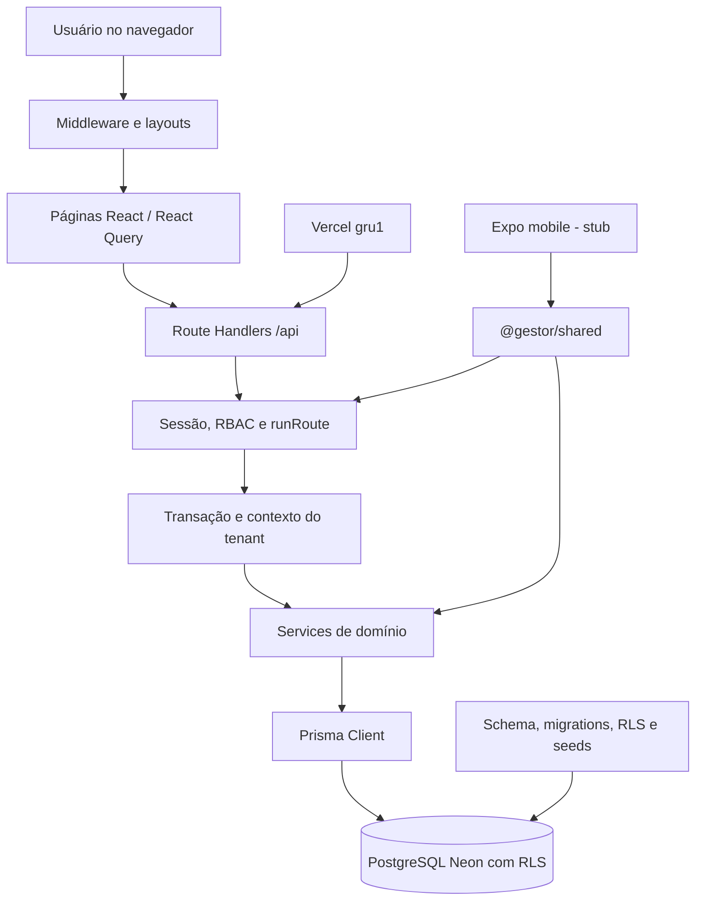

# 1. Arquitetura

## 1.1 Visão geral



O navegador e a API são entregues pelo mesmo aplicativo Next.js. A autenticação identifica o usuário; o RBAC decide a operação; a transação define o tenant; e o PostgreSQL aplica RLS. Essa sequência é detalhada em [processos](02-processos.md) §2.1.

## 1.2 Módulos

| Módulo | Arquivos | Responsabilidade |
|---|---:|---|
| [01 — Banco: modelo, runtime e segurança](arquivos/01-banco-modelo-e-seguranca.md) §1 | 6 | Define o schema canônico, o cliente Prisma contextual e as barreiras de isolamento por tenant. |
| [02 — Banco: seeds, limpeza e migrations](arquivos/02-banco-seeds-e-migrations.md) §2 | 10 | Inicializa dados, produz massa de demonstração, limpa o banco de teste e registra a evolução física do schema. |
| [03 — Código compartilhado, mobile e ferramentas](arquivos/03-compartilhado-mobile-e-ferramentas.md) §3 | 5 | Centraliza permissões/papéis, contém o esqueleto mobile e automatiza o PostgreSQL portátil de testes. |
| [04 — Frontend compartilhado](arquivos/04-frontend-base.md) §4 | 17 | Fornece shell, autenticação no navegador, cliente HTTP, tipos, formatação, componentes visuais e estilos. |
| [05 — Páginas e layouts web](arquivos/05-paginas-web.md) §5 | 24 | Implementa a navegação e as telas do painel administrativo. |
| [06 — Infraestrutura do servidor](arquivos/06-infraestrutura-do-servidor.md) §6 | 14 | Resolve autenticação, autorização, transação por tenant, erros HTTP e provisionamento. |
| [07 — DTOs comuns e de cadastros](arquivos/07-dtos-comuns-e-cadastros.md) §7 | 25 | Valida paginação e entradas de filiais, clientes, veículos, peças, serviços, fornecedores, usuários e papéis. |
| [08 — DTOs de operação](arquivos/08-dtos-operacao.md) §8 | 21 | Valida agenda, inspeções, ordens de serviço, mecânicos e estoque. |
| [09 — DTOs financeiros](arquivos/09-dtos-financeiro.md) §9 | 13 | Valida despesas, compras, orçamentos, faturas, pagamentos e filtros de relatórios. |
| [10 — Serviços de cadastros e acesso](arquivos/10-servicos-cadastros.md) §10 | 12 | Executa regras de cadastro, referências, inspeções e administração de acesso. |
| [11 — Serviços transacionais](arquivos/11-servicos-transacionais.md) §11 | 9 | Executa os fluxos de OS, cálculo, numeração, orçamento, faturamento, compras, estoque e relatórios. |
| [12 — API de acesso e cadastros](arquivos/12-api-acesso-e-cadastros.md) §12 | 15 | Expõe autenticação, contexto do usuário, filiais, clientes, veículos, equipe e papéis. |
| [13 — API de agenda e inspeções](arquivos/13-api-agenda-e-inspecoes.md) §13 | 10 | Expõe agendamentos, templates versionados e execução de inspeções. |
| [14 — API de ordens de serviço](arquivos/14-api-ordens-de-servico.md) §14 | 7 | Expõe OS, itens, mecânicos e transições de estado. |
| [15 — API de catálogos e estoque](arquivos/15-api-catalogos-e-estoque.md) §15 | 8 | Expõe peças, catálogo de serviços, locais, movimentos, saldos e baixas. |
| [16 — API de fornecedores, compras e despesas](arquivos/16-api-compras-e-despesas.md) §16 | 7 | Expõe fornecedores, despesas e o recebimento/cancelamento de compras. |
| [17 — API de orçamentos](arquivos/17-api-orcamentos.md) §17 | 8 | Expõe orçamento, itens, decisão e conversão para fatura. |
| [18 — API de faturas e relatórios](arquivos/18-api-faturas-e-relatorios.md) §18 | 11 | Expõe emissão, pagamentos, cancelamento, documento e agregações gerenciais. |
| [19 — Testes](arquivos/19-testes.md) §19 | 7 | Prepara o banco isolado e verifica autenticação, RLS, regressões e fluxos integrados. |

## 1.3 Árvore comentada

```text
Gestor de Oficinas/
├── .github/workflows/       # CI e migration manual de produção
├── apps/
│   ├── web/                 # Next.js: páginas, API, auth e regras de domínio
│   └── mobile/              # Expo; esqueleto da fase offline
├── packages/
│   ├── database/            # Prisma, migrations, RLS, seeds e contexto de tenant
│   └── shared/              # permissões e papéis padrão
├── scripts/                 # PostgreSQL portátil de testes
├── docs/                    # especificações, runbooks, mapa e caderno
├── package.json             # comandos do monorepo
└── turbo.json               # pipeline e variáveis que participam do build/cache
```

## 1.4 Configuração e execução

| Área | Arquivos | Observação |
|---|---|---|
| Workspace | `package.json`, `pnpm-workspace.yaml`, `turbo.json` | pnpm 9, Node ≥20, tarefas Turbo |
| Web | `apps/web/package.json`, configs Next/Tailwind/Vitest/Vercel | porta 3000, runtime Node para Prisma |
| Mobile | `apps/mobile/package.json`, Expo/Metro/Babel | ainda sem fluxo de produto |
| Banco | `packages/database/package.json`, `.env.example` | pooled/runtime, direct/migrations e URLs dedicadas de teste |
| CI/CD | `.github/workflows/ci.yml`, `migrate.yml` | qualidade automática; migration de produção manual |

Variáveis documentadas sem valores: `DATABASE_URL`, `APP_DATABASE_URL`, `DIRECT_URL`, `BETTER_AUTH_SECRET`, `BETTER_AUTH_URL`, `NEXT_PUBLIC_API_URL`, `TEST_DATABASE_URL`, `TEST_DIRECT_URL`, `TEST_APP_DATABASE_URL` e parâmetros `SEED_*`/storage previstos no exemplo.

## 1.5 Pontos de entrada

- Navegação: `apps/web/src/app/layout.tsx`, `apps/web/src/app/page.tsx` e `apps/web/src/app/(app)/layout.tsx`.
- HTTP: 66 arquivos `apps/web/src/app/api/**/route.ts`.
- Servidor: `runRoute`, `requireSession`, `withTenant` e services.
- Banco: schema Prisma, migrations, `app-role.sql`, `rls.sql` e seeds.
- Testes: Vitest com `global-setup.ts` e PostgreSQL real.
- Mobile: `apps/mobile/App.tsx`.
