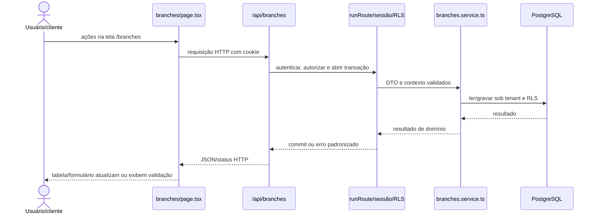
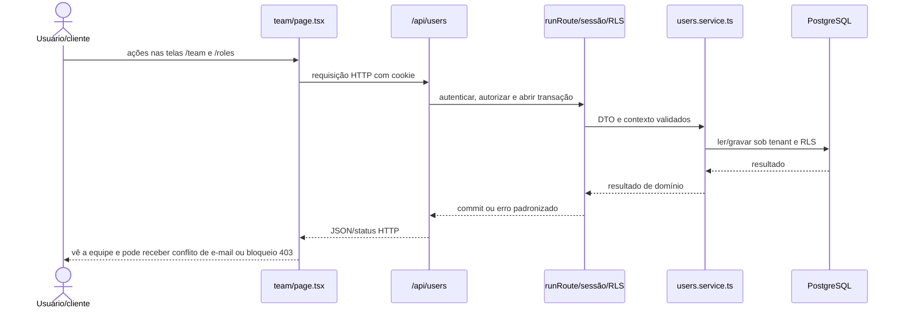
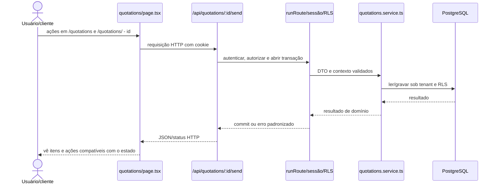
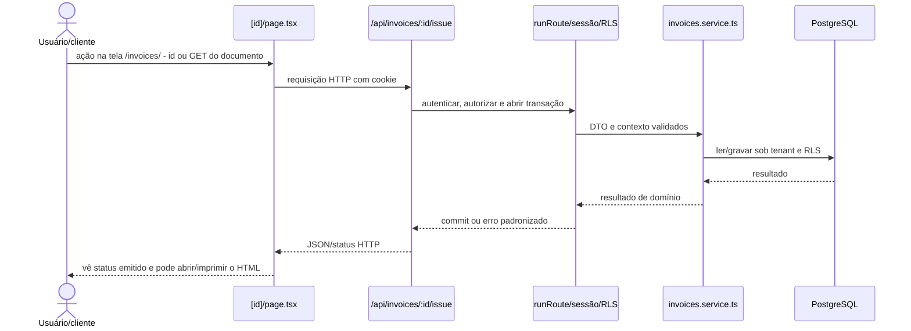
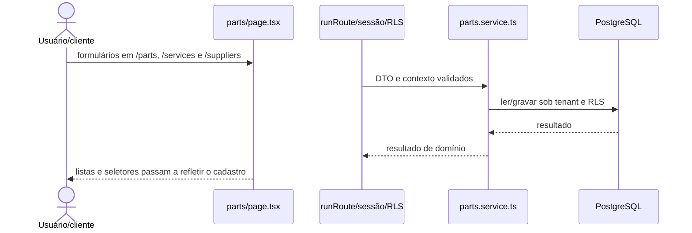
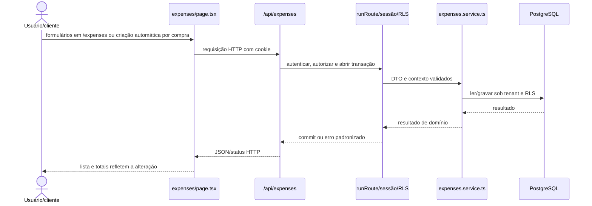
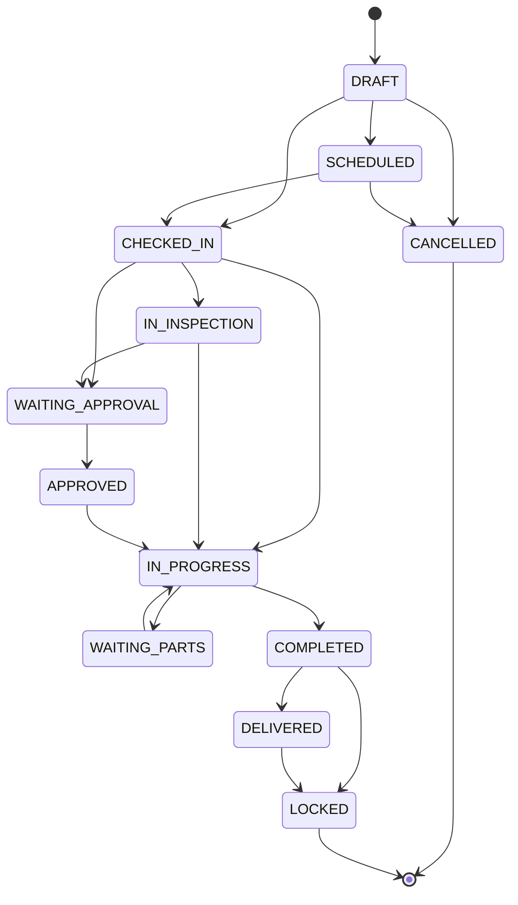

# 2. Processos ponta a ponta

> 18 processos confirmados no código em `83ac90f`. Não foram encontrados workers, filas, cron jobs ou outros processos assíncronos/agendados; notificações permanecem planejadas.

## 2.1 Entrar e autorizar uma requisição

**Gatilho:** usuário envia e-mail/senha na tela de login ou uma tela chama a API com o cookie de sessão.

**Passos:**

1. A tela chama o cliente Better Auth e recebe o cookie de sessão. ([`apps/web/src/app/login/page.tsx`](arquivos/04-frontend-base.md) §4.3).
2. O handler Better Auth valida a credencial e persiste/renova a sessão. ([`apps/web/src/lib/auth-client.ts`](arquivos/04-frontend-base.md) §4.12).
3. Nas APIs de negócio, runRoute chama requireSession. ([`apps/web/src/app/api/auth/[...all]/route.ts`](arquivos/12-api-acesso-e-cadastros.md) §12.1).
4. requireSession resolve vínculo, tenant ativo, papéis e permissões. ([`apps/web/src/server/auth/auth.ts`](arquivos/06-infraestrutura-do-servidor.md) §6.2).
5. withTenant abre transação e define app.current_tenant antes do handler. ([`apps/web/src/server/auth/require-session.ts`](arquivos/06-infraestrutura-do-servidor.md) §6.5).

**O que o banco vê:** `User`, `Account`, `Session`, `Membership`, `MembershipRole`, `Role`, `RolePermission`, `Permission`. Antes: sem sessão válida ou sem contexto de tenant. Depois: sessão por cookie e requisição limitada ao tenant/permissões.

**O que o usuário vê:** entra no dashboard; em falha vê erro de credencial, 401 ou 403.

```mermaid
sequenceDiagram
  actor U as Usuário/cliente
  participant P as login/page.tsx
  participant R as /api/auth/:all*
  participant W as runRoute/sessão/RLS
  participant DB as PostgreSQL
  U->>P: usuário envia e-mail/senha na tela de login ou uma tela chama a API com o cookie de sessão
  P->>R: requisição HTTP com cookie
  R->>W: autenticar, autorizar e abrir transação
  W->>DB: ler/gravar sessão e contexto
  DB-->>W: resultado
  W-->>R: commit ou erro padronizado
  R-->>P: JSON/status HTTP
  P-->>U: entra no dashboard; em falha vê erro de credencial, 401 ou 403
```

**Onde mexer se isso mudar:**

- [`apps/web/src/app/login/page.tsx`](arquivos/04-frontend-base.md) §4.3
- [`apps/web/src/lib/auth-client.ts`](arquivos/04-frontend-base.md) §4.12
- [`apps/web/src/app/api/auth/[...all]/route.ts`](arquivos/12-api-acesso-e-cadastros.md) §12.1
- [`apps/web/src/server/auth/auth.ts`](arquivos/06-infraestrutura-do-servidor.md) §6.2
- [`apps/web/src/server/auth/require-session.ts`](arquivos/06-infraestrutura-do-servidor.md) §6.5
- [`apps/web/src/server/auth/with-route.ts`](arquivos/06-infraestrutura-do-servidor.md) §6.6
- [`apps/web/src/server/db/with-tenant.ts`](arquivos/06-infraestrutura-do-servidor.md) §6.9

## 2.2 Registrar uma nova oficina

**Gatilho:** requisição pública POST /api/register.

**Passos:**

1. A rota aplica rate limit e valida os dados. ([`apps/web/src/app/api/register/route.ts`](arquivos/12-api-acesso-e-cadastros.md) §12.8).
2. O provisionamento cria o usuário credencial no Better Auth. ([`apps/web/src/server/auth/dto/register-tenant.dto.ts`](arquivos/06-infraestrutura-do-servidor.md) §6.3).
3. Uma transação cria tenant, filial, vínculo e papel de proprietário. ([`apps/web/src/server/auth/provision.ts`](arquivos/06-infraestrutura-do-servidor.md) §6.4).
4. A resposta devolve a identidade do ambiente criado, sem expor segredo. ([`apps/web/src/server/auth/auth.ts`](arquivos/06-infraestrutura-do-servidor.md) §6.2).

**O que o banco vê:** `User`, `Account`, `Tenant`, `Branch`, `Membership`, `MembershipRole`, `Role`, `RolePermission`. Antes: não há conta nem tenant para o e-mail. Depois: owner vinculado ao novo tenant e à filial inicial.

**O que o usuário vê:** recebe confirmação; conflitos e entrada inválida retornam erro.

```mermaid
sequenceDiagram
  actor U as Usuário/cliente
  participant R as /api/register
  participant W as runRoute/sessão/RLS
  participant DB as PostgreSQL
  U->>R: requisição pública POST /api/register
  R->>W: autenticar, autorizar e abrir transação
  W->>DB: ler/gravar sessão e contexto
  DB-->>W: resultado
  W-->>R: commit ou erro padronizado
  R-->>U: recebe confirmação; conflitos e entrada inválida retornam erro
```

**Onde mexer se isso mudar:**

- [`apps/web/src/app/api/register/route.ts`](arquivos/12-api-acesso-e-cadastros.md) §12.8
- [`apps/web/src/server/auth/dto/register-tenant.dto.ts`](arquivos/06-infraestrutura-do-servidor.md) §6.3
- [`apps/web/src/server/auth/provision.ts`](arquivos/06-infraestrutura-do-servidor.md) §6.4
- [`apps/web/src/server/auth/auth.ts`](arquivos/06-infraestrutura-do-servidor.md) §6.2

## 2.3 Administrar filiais

**Gatilho:** ações na tela /branches.

**Passos:**

1. A página lista filiais. ([`apps/web/src/app/(app)/branches/page.tsx`](arquivos/05-paginas-web.md) §5.2).
2. Criação/edição envia DTO para a rota. ([`apps/web/src/app/api/branches/route.ts`](arquivos/12-api-acesso-e-cadastros.md) §12.3).
3. A rota exige permissão e executa o service no tenant. ([`apps/web/src/app/api/branches/[id]/route.ts`](arquivos/12-api-acesso-e-cadastros.md) §12.2).
4. O service grava ou desativa a filial e devolve a visão atualizada. ([`apps/web/src/server/services/branches.service.ts`](arquivos/10-servicos-cadastros.md) §10.2).

**O que o banco vê:** `Branch`. Antes: lista existente. Depois: filial criada, atualizada ou marcada como excluída.

**O que o usuário vê:** tabela/formulário atualizam ou exibem validação.



**Onde mexer se isso mudar:**

- [`apps/web/src/app/(app)/branches/page.tsx`](arquivos/05-paginas-web.md) §5.2
- [`apps/web/src/app/api/branches/route.ts`](arquivos/12-api-acesso-e-cadastros.md) §12.3
- [`apps/web/src/app/api/branches/[id]/route.ts`](arquivos/12-api-acesso-e-cadastros.md) §12.2
- [`apps/web/src/server/services/branches.service.ts`](arquivos/10-servicos-cadastros.md) §10.2

## 2.4 Administrar equipe, papéis e permissões

**Gatilho:** ações nas telas /team e /roles.

**Passos:**

1. A tela consulta usuários/papéis/permissões. ([`apps/web/src/app/(app)/team/page.tsx`](arquivos/05-paginas-web.md) §5.23).
2. A API valida permissão administrativa. ([`apps/web/src/app/(app)/roles/page.tsx`](arquivos/05-paginas-web.md) §5.19).
3. Criação de usuário passa pelo Better Auth e cria vínculo. ([`apps/web/src/app/api/users/route.ts`](arquivos/12-api-acesso-e-cadastros.md) §12.13).
4. Alterações de papel reescrevem associações e permissões no tenant. ([`apps/web/src/app/api/roles/route.ts`](arquivos/12-api-acesso-e-cadastros.md) §12.11).

**O que o banco vê:** `User`, `Account`, `Membership`, `MembershipRole`, `Role`, `RolePermission`, `Permission`. Antes: equipe e matriz de acesso existentes. Depois: usuário/vínculo/papel atualizado.

**O que o usuário vê:** vê a equipe e pode receber conflito de e-mail ou bloqueio 403.



**Onde mexer se isso mudar:**

- [`apps/web/src/app/(app)/team/page.tsx`](arquivos/05-paginas-web.md) §5.23
- [`apps/web/src/app/(app)/roles/page.tsx`](arquivos/05-paginas-web.md) §5.19
- [`apps/web/src/app/api/users/route.ts`](arquivos/12-api-acesso-e-cadastros.md) §12.13
- [`apps/web/src/app/api/roles/route.ts`](arquivos/12-api-acesso-e-cadastros.md) §12.11
- [`apps/web/src/server/services/users.service.ts`](arquivos/10-servicos-cadastros.md) §10.11
- [`apps/web/src/server/services/roles.service.ts`](arquivos/10-servicos-cadastros.md) §10.8

## 2.5 Cadastrar clientes e veículos

**Gatilho:** formulários em /customers e /vehicles.

**Passos:**

1. A página consulta a lista paginada. ([`apps/web/src/app/(app)/customers/page.tsx`](arquivos/05-paginas-web.md) §5.3).
2. O formulário envia cadastro ou alteração. ([`apps/web/src/app/(app)/vehicles/page.tsx`](arquivos/05-paginas-web.md) §5.24).
3. DTO e referências são validados. ([`apps/web/src/app/api/customers/route.ts`](arquivos/12-api-acesso-e-cadastros.md) §12.5).
4. O service grava no tenant; exclusão aplicável é lógica. ([`apps/web/src/app/api/vehicles/route.ts`](arquivos/12-api-acesso-e-cadastros.md) §12.15).

**O que o banco vê:** `Customer`, `Vehicle`. Antes: cadastro ausente ou versão anterior. Depois: cliente/veículo disponível para agenda e OS.

**O que o usuário vê:** lista recarrega; duplicidade/UUID inválido aparece como erro.

```mermaid
sequenceDiagram
  actor U as Usuário/cliente
  participant P as customers/page.tsx
  participant R as /api/customers
  participant W as runRoute/sessão/RLS
  participant S as customers.service.ts
  participant DB as PostgreSQL
  U->>P: formulários em /customers e /vehicles
  P->>R: requisição HTTP com cookie
  R->>W: autenticar, autorizar e abrir transação
  W->>S: DTO e contexto validados
  S->>DB: ler/gravar sob tenant e RLS
  DB-->>S: resultado
  S-->>W: resultado de domínio
  W-->>R: commit ou erro padronizado
  R-->>P: JSON/status HTTP
  P-->>U: lista recarrega; duplicidade/UUID inválido aparece como erro
```

**Onde mexer se isso mudar:**

- [`apps/web/src/app/(app)/customers/page.tsx`](arquivos/05-paginas-web.md) §5.3
- [`apps/web/src/app/(app)/vehicles/page.tsx`](arquivos/05-paginas-web.md) §5.24
- [`apps/web/src/app/api/customers/route.ts`](arquivos/12-api-acesso-e-cadastros.md) §12.5
- [`apps/web/src/app/api/vehicles/route.ts`](arquivos/12-api-acesso-e-cadastros.md) §12.15
- [`apps/web/src/server/services/customers.service.ts`](arquivos/10-servicos-cadastros.md) §10.3
- [`apps/web/src/server/services/vehicles.service.ts`](arquivos/10-servicos-cadastros.md) §10.12

## 2.6 Agendar e mudar o estado de um atendimento

**Gatilho:** ações na tela /appointments.

**Passos:**

1. A tela envia cliente, veículo, filial, horário e observações. ([`apps/web/src/app/(app)/appointments/page.tsx`](arquivos/05-paginas-web.md) §5.1).
2. O service valida referências do mesmo tenant e cria o agendamento. ([`apps/web/src/app/api/appointments/route.ts`](arquivos/13-api-agenda-e-inspecoes.md) §13.3).
3. A mudança de estado passa por endpoint específico. ([`apps/web/src/app/api/appointments/[id]/status/route.ts`](arquivos/13-api-agenda-e-inspecoes.md) §13.2).
4. Cancelamento/exclusão segue a regra implementada no service. ([`apps/web/src/server/services/appointments.service.ts`](arquivos/10-servicos-cadastros.md) §10.1).

**O que o banco vê:** `Appointment`, `Customer`, `Vehicle`, `Branch`. Antes: horário livre ou agendamento em estado anterior. Depois: agendamento criado/alterado com novo estado.

**O que o usuário vê:** agenda é recarregada; referência inválida ou regra de estado retorna erro.

```mermaid
sequenceDiagram
  actor U as Usuário/cliente
  participant P as appointments/page.tsx
  participant R as /api/appointments
  participant W as runRoute/sessão/RLS
  participant S as appointments.service.ts
  participant DB as PostgreSQL
  U->>P: ações na tela /appointments
  P->>R: requisição HTTP com cookie
  R->>W: autenticar, autorizar e abrir transação
  W->>S: DTO e contexto validados
  S->>DB: ler/gravar sob tenant e RLS
  DB-->>S: resultado
  S-->>W: resultado de domínio
  W-->>R: commit ou erro padronizado
  R-->>P: JSON/status HTTP
  P-->>U: agenda é recarregada; referência inválida ou regra de estado retorna erro
```

**Onde mexer se isso mudar:**

- [`apps/web/src/app/(app)/appointments/page.tsx`](arquivos/05-paginas-web.md) §5.1
- [`apps/web/src/app/api/appointments/route.ts`](arquivos/13-api-agenda-e-inspecoes.md) §13.3
- [`apps/web/src/app/api/appointments/[id]/status/route.ts`](arquivos/13-api-agenda-e-inspecoes.md) §13.2
- [`apps/web/src/server/services/appointments.service.ts`](arquivos/10-servicos-cadastros.md) §10.1

## 2.7 Criar e publicar um template de inspeção

**Gatilho:** ações em /inspection-templates.

**Passos:**

1. Usuário cria a definição e suas seções/perguntas. ([`apps/web/src/app/(app)/inspection-templates/page.tsx`](arquivos/05-paginas-web.md) §5.7).
2. Enquanto rascunho, a versão pode ser editada. ([`apps/web/src/app/(app)/inspection-templates/[id]/page.tsx`](arquivos/05-paginas-web.md) §5.6).
3. Publicar congela a versão ativa. ([`apps/web/src/app/api/inspection-templates/[id]/publish/route.ts`](arquivos/13-api-agenda-e-inspecoes.md) §13.4).
4. Nova mudança relevante deve originar outra versão. ([`apps/web/src/server/services/inspection-templates.service.ts`](arquivos/10-servicos-cadastros.md) §10.4).

**O que o banco vê:** `InspectionTemplate`, `InspectionTemplateVersion`, `InspectionSection`, `InspectionQuestion`. Antes: rascunho editável. Depois: versão publicada disponível para execução.

**O que o usuário vê:** vê status/versão; template inválido ou já publicado é recusado.

```mermaid
sequenceDiagram
  actor U as Usuário/cliente
  participant P as inspection-templates/page.tsx
  participant R as /api/inspection-templates/:id/publish
  participant W as runRoute/sessão/RLS
  participant S as inspection-templates.service.ts
  participant DB as PostgreSQL
  U->>P: ações em /inspection-templates
  P->>R: requisição HTTP com cookie
  R->>W: autenticar, autorizar e abrir transação
  W->>S: DTO e contexto validados
  S->>DB: ler/gravar sob tenant e RLS
  DB-->>S: resultado
  S-->>W: resultado de domínio
  W-->>R: commit ou erro padronizado
  R-->>P: JSON/status HTTP
  P-->>U: vê status/versão; template inválido ou já publicado é recusado
```

**Onde mexer se isso mudar:**

- [`apps/web/src/app/(app)/inspection-templates/page.tsx`](arquivos/05-paginas-web.md) §5.7
- [`apps/web/src/app/(app)/inspection-templates/[id]/page.tsx`](arquivos/05-paginas-web.md) §5.6
- [`apps/web/src/app/api/inspection-templates/[id]/publish/route.ts`](arquivos/13-api-agenda-e-inspecoes.md) §13.4
- [`apps/web/src/server/services/inspection-templates.service.ts`](arquivos/10-servicos-cadastros.md) §10.4

## 2.8 Executar e concluir uma inspeção

**Gatilho:** início e preenchimento em /inspections/:id.

**Passos:**

1. A inspeção referencia uma versão publicada. ([`apps/web/src/app/(app)/inspections/[id]/page.tsx`](arquivos/05-paginas-web.md) §5.8).
2. A tela envia respostas por pergunta. ([`apps/web/src/app/api/inspections/route.ts`](arquivos/13-api-agenda-e-inspecoes.md) §13.10).
3. O service faz upsert das respostas no tenant. ([`apps/web/src/app/api/inspections/[id]/answers/[questionId]/route.ts`](arquivos/13-api-agenda-e-inspecoes.md) §13.7).
4. Concluir valida obrigatórias e muda status; aprovação alimenta o gate de faturamento. ([`apps/web/src/app/api/inspections/[id]/complete/route.ts`](arquivos/13-api-agenda-e-inspecoes.md) §13.8).

**O que o banco vê:** `Inspection`, `InspectionAnswer`, `InspectionTemplateVersion`, `InspectionQuestion`, `JobCard`. Antes: inspeção aberta/incompleta. Depois: respostas persistidas e inspeção concluída/aprovada conforme regras.

**O que o usuário vê:** checklist e progresso atualizam; faltas obrigatórias impedem conclusão.

```mermaid
sequenceDiagram
  actor U as Usuário/cliente
  participant P as [id]/page.tsx
  participant R as /api/inspections
  participant W as runRoute/sessão/RLS
  participant S as inspections.service.ts
  participant DB as PostgreSQL
  U->>P: início e preenchimento em /inspections/ - id
  P->>R: requisição HTTP com cookie
  R->>W: autenticar, autorizar e abrir transação
  W->>S: DTO e contexto validados
  S->>DB: ler/gravar sob tenant e RLS
  DB-->>S: resultado
  S-->>W: resultado de domínio
  W-->>R: commit ou erro padronizado
  R-->>P: JSON/status HTTP
  P-->>U: checklist e progresso atualizam; faltas obrigatórias impedem conclusão
```

**Onde mexer se isso mudar:**

- [`apps/web/src/app/(app)/inspections/[id]/page.tsx`](arquivos/05-paginas-web.md) §5.8
- [`apps/web/src/app/api/inspections/route.ts`](arquivos/13-api-agenda-e-inspecoes.md) §13.10
- [`apps/web/src/app/api/inspections/[id]/answers/[questionId]/route.ts`](arquivos/13-api-agenda-e-inspecoes.md) §13.7
- [`apps/web/src/app/api/inspections/[id]/complete/route.ts`](arquivos/13-api-agenda-e-inspecoes.md) §13.8
- [`apps/web/src/server/services/inspections.service.ts`](arquivos/10-servicos-cadastros.md) §10.5

## 2.9 Criar e conduzir uma ordem de serviço

**Gatilho:** ações em /job-cards e /job-cards/:id.

**Passos:**

1. A criação valida cliente/veículo e gera número transacional. ([`apps/web/src/app/(app)/job-cards/page.tsx`](arquivos/05-paginas-web.md) §5.13).
2. Itens são validados, calculados e persistidos com impostos. ([`apps/web/src/app/(app)/job-cards/[id]/page.tsx`](arquivos/05-paginas-web.md) §5.12).
3. Mecânicos podem ser atribuídos enquanto a OS é editável. ([`apps/web/src/app/api/job-cards/route.ts`](arquivos/14-api-ordens-de-servico.md) §14.7).
4. Transições são conferidas contra a máquina de estados e registradas no histórico. ([`apps/web/src/app/api/job-cards/[id]/transition/route.ts`](arquivos/14-api-ordens-de-servico.md) §14.6).
5. Totais são recalculados após mudança de itens. ([`apps/web/src/server/services/job-cards.service.ts`](arquivos/11-servicos-transacionais.md) §11.3).

**O que o banco vê:** `JobCard`, `JobLine`, `JobLineTax`, `JobMechanic`, `JobStatusHistory`, `NumberSequence`. Antes: sem OS ou OS em estado anterior. Depois: OS numerada, totalizada e em estado permitido.

**O que o usuário vê:** detalhe mostra itens, mecânicos, total e transições; estado final bloqueia edição.

```mermaid
sequenceDiagram
  actor U as Usuário/cliente
  participant P as job-cards/page.tsx
  participant R as /api/job-cards
  participant W as runRoute/sessão/RLS
  participant S as job-cards.service.ts
  participant DB as PostgreSQL
  U->>P: ações em /job-cards e /job-cards/ - id
  P->>R: requisição HTTP com cookie
  R->>W: autenticar, autorizar e abrir transação
  W->>S: DTO e contexto validados
  S->>DB: ler/gravar sob tenant e RLS
  DB-->>S: resultado
  S-->>W: resultado de domínio
  W-->>R: commit ou erro padronizado
  R-->>P: JSON/status HTTP
  P-->>U: detalhe mostra itens, mecânicos, total e transições; estado final bloqueia edição
```

**Onde mexer se isso mudar:**

- [`apps/web/src/app/(app)/job-cards/page.tsx`](arquivos/05-paginas-web.md) §5.13
- [`apps/web/src/app/(app)/job-cards/[id]/page.tsx`](arquivos/05-paginas-web.md) §5.12
- [`apps/web/src/app/api/job-cards/route.ts`](arquivos/14-api-ordens-de-servico.md) §14.7
- [`apps/web/src/app/api/job-cards/[id]/transition/route.ts`](arquivos/14-api-ordens-de-servico.md) §14.6
- [`apps/web/src/server/services/job-cards.service.ts`](arquivos/11-servicos-transacionais.md) §11.3
- [`apps/web/src/server/services/line-calculator.service.ts`](arquivos/11-servicos-transacionais.md) §11.4

## 2.10 Criar, enviar e decidir um orçamento

**Gatilho:** ações em /quotations e /quotations/:id.

**Passos:**

1. O orçamento nasce manualmente ou copiando os itens de uma OS. ([`apps/web/src/app/(app)/quotations/page.tsx`](arquivos/05-paginas-web.md) §5.18).
2. Itens e impostos são calculados e os totais recalculados. ([`apps/web/src/app/(app)/quotations/[id]/page.tsx`](arquivos/05-paginas-web.md) §5.17).
3. Enviar muda o estado para aguardando decisão. ([`apps/web/src/app/api/quotations/[id]/send/route.ts`](arquivos/17-api-orcamentos.md) §17.7).
4. Aprovar ou rejeitar grava estado/data; estados finais impedem alteração de itens. ([`apps/web/src/app/api/quotations/[id]/approve/route.ts`](arquivos/17-api-orcamentos.md) §17.1).

**O que o banco vê:** `Quotation`, `QuotationLine`, `QuotationLineTax`, `JobCard`, `NumberSequence`. Antes: rascunho ou orçamento enviado. Depois: orçamento totalizado e enviado/aprovado/rejeitado.

**O que o usuário vê:** vê itens e ações compatíveis com o estado.



**Onde mexer se isso mudar:**

- [`apps/web/src/app/(app)/quotations/page.tsx`](arquivos/05-paginas-web.md) §5.18
- [`apps/web/src/app/(app)/quotations/[id]/page.tsx`](arquivos/05-paginas-web.md) §5.17
- [`apps/web/src/app/api/quotations/[id]/send/route.ts`](arquivos/17-api-orcamentos.md) §17.7
- [`apps/web/src/app/api/quotations/[id]/approve/route.ts`](arquivos/17-api-orcamentos.md) §17.1
- [`apps/web/src/app/api/quotations/[id]/reject/route.ts`](arquivos/17-api-orcamentos.md) §17.5
- [`apps/web/src/server/services/quotations.service.ts`](arquivos/11-servicos-transacionais.md) §11.7

## 2.11 Converter orçamento ou OS em fatura

**Gatilho:** botão de conversão no orçamento ou ação de faturamento da OS.

**Passos:**

1. A rota carrega a origem sob RLS. ([`apps/web/src/app/(app)/quotations/[id]/page.tsx`](arquivos/05-paginas-web.md) §5.17).
2. O service verifica estado/aprovação e evita duplicidade indevida. ([`apps/web/src/app/api/quotations/[id]/convert-to-invoice/route.ts`](arquivos/17-api-orcamentos.md) §17.2).
3. Número da fatura é reservado transacionalmente. ([`apps/web/src/app/api/invoices/from-job/[jobCardId]/route.ts`](arquivos/18-api-faturas-e-relatorios.md) §18.7).
4. Linhas, impostos e vínculos são copiados; a origem recebe a referência/estado correspondente. ([`apps/web/src/server/services/invoices.service.ts`](arquivos/11-servicos-transacionais.md) §11.2).

**O que o banco vê:** `Quotation`, `JobCard`, `Invoice`, `InvoiceLine`, `InvoiceLineTax`, `NumberSequence`. Antes: origem faturável sem fatura correspondente. Depois: fatura rascunho vinculada e totalizada.

**O que o usuário vê:** é levado ou passa a enxergar a fatura; regra inválida retorna 400/409.

```mermaid
sequenceDiagram
  actor U as Usuário/cliente
  participant P as [id]/page.tsx
  participant R as /api/quotations/:id/convert-to-invoice
  participant W as runRoute/sessão/RLS
  participant S as invoices.service.ts
  participant DB as PostgreSQL
  U->>P: botão de conversão no orçamento ou ação de faturamento da OS
  P->>R: requisição HTTP com cookie
  R->>W: autenticar, autorizar e abrir transação
  W->>S: DTO e contexto validados
  S->>DB: ler/gravar sob tenant e RLS
  DB-->>S: resultado
  S-->>W: resultado de domínio
  W-->>R: commit ou erro padronizado
  R-->>P: JSON/status HTTP
  P-->>U: é levado ou passa a enxergar a fatura; regra inválida retorna 400/409
```

**Onde mexer se isso mudar:**

- [`apps/web/src/app/(app)/quotations/[id]/page.tsx`](arquivos/05-paginas-web.md) §5.17
- [`apps/web/src/app/api/quotations/[id]/convert-to-invoice/route.ts`](arquivos/17-api-orcamentos.md) §17.2
- [`apps/web/src/app/api/invoices/from-job/[jobCardId]/route.ts`](arquivos/18-api-faturas-e-relatorios.md) §18.7
- [`apps/web/src/server/services/invoices.service.ts`](arquivos/11-servicos-transacionais.md) §11.2

## 2.12 Emitir e gerar o documento de uma fatura

**Gatilho:** ação na tela /invoices/:id ou GET do documento.

**Passos:**

1. A emissão verifica estado e pré-condições. ([`apps/web/src/app/(app)/invoices/[id]/page.tsx`](arquivos/05-paginas-web.md) §5.10).
2. O service grava datas/status e calcula vencimento/saldos. ([`apps/web/src/app/api/invoices/[id]/issue/route.ts`](arquivos/18-api-faturas-e-relatorios.md) §18.3).
3. O endpoint document monta HTML com os dados da fatura. ([`apps/web/src/app/api/invoices/[id]/document/route.ts`](arquivos/18-api-faturas-e-relatorios.md) §18.2).
4. PDF ainda depende de um serviço headless futuro que consuma esse HTML. ([`apps/web/src/server/services/invoices.service.ts`](arquivos/11-servicos-transacionais.md) §11.2).

**O que o banco vê:** `Invoice`, `InvoiceLine`, `InvoiceLineTax`, `Customer`, `Vehicle`, `Tenant`. Antes: fatura em rascunho. Depois: fatura emitida e documento HTML disponível.

**O que o usuário vê:** vê status emitido e pode abrir/imprimir o HTML.



**Onde mexer se isso mudar:**

- [`apps/web/src/app/(app)/invoices/[id]/page.tsx`](arquivos/05-paginas-web.md) §5.10
- [`apps/web/src/app/api/invoices/[id]/issue/route.ts`](arquivos/18-api-faturas-e-relatorios.md) §18.3
- [`apps/web/src/app/api/invoices/[id]/document/route.ts`](arquivos/18-api-faturas-e-relatorios.md) §18.2
- [`apps/web/src/server/services/invoices.service.ts`](arquivos/11-servicos-transacionais.md) §11.2

## 2.13 Registrar pagamento ou cancelar uma fatura

**Gatilho:** ações financeiras em /invoices/:id.

**Passos:**

1. O pagamento é validado contra a fatura. ([`apps/web/src/app/(app)/invoices/[id]/page.tsx`](arquivos/05-paginas-web.md) §5.10).
2. O service grava Payment e recalcula valor pago/saldo/status. ([`apps/web/src/app/api/invoices/[id]/payments/route.ts`](arquivos/18-api-faturas-e-relatorios.md) §18.5).
3. Remover pagamento recalcula novamente. ([`apps/web/src/app/api/invoices/[id]/payments/[paymentId]/route.ts`](arquivos/18-api-faturas-e-relatorios.md) §18.4).
4. Cancelar verifica as regras e marca a fatura sem apagar o histórico. ([`apps/web/src/app/api/invoices/[id]/cancel/route.ts`](arquivos/18-api-faturas-e-relatorios.md) §18.1).

**O que o banco vê:** `Invoice`, `Payment`. Antes: fatura aberta/parcial ou emitida. Depois: saldo/status atualizado ou fatura cancelada.

**O que o usuário vê:** resumo financeiro muda imediatamente; excesso, estado inválido ou recurso ausente geram erro.

```mermaid
sequenceDiagram
  actor U as Usuário/cliente
  participant P as [id]/page.tsx
  participant R as /api/invoices/:id/payments
  participant W as runRoute/sessão/RLS
  participant S as invoices.service.ts
  participant DB as PostgreSQL
  U->>P: ações financeiras em /invoices/ - id
  P->>R: requisição HTTP com cookie
  R->>W: autenticar, autorizar e abrir transação
  W->>S: DTO e contexto validados
  S->>DB: ler/gravar sob tenant e RLS
  DB-->>S: resultado
  S-->>W: resultado de domínio
  W-->>R: commit ou erro padronizado
  R-->>P: JSON/status HTTP
  P-->>U: resumo financeiro muda imediatamente; excesso, estado inválido ou recurso ausente geram erro
```

**Onde mexer se isso mudar:**

- [`apps/web/src/app/(app)/invoices/[id]/page.tsx`](arquivos/05-paginas-web.md) §5.10
- [`apps/web/src/app/api/invoices/[id]/payments/route.ts`](arquivos/18-api-faturas-e-relatorios.md) §18.5
- [`apps/web/src/app/api/invoices/[id]/payments/[paymentId]/route.ts`](arquivos/18-api-faturas-e-relatorios.md) §18.4
- [`apps/web/src/app/api/invoices/[id]/cancel/route.ts`](arquivos/18-api-faturas-e-relatorios.md) §18.1
- [`apps/web/src/server/services/invoices.service.ts`](arquivos/11-servicos-transacionais.md) §11.2

## 2.14 Manter peças, serviços e fornecedores

**Gatilho:** formulários em /parts, /services e /suppliers.

**Passos:**

1. As telas listam e filtram os catálogos. ([`apps/web/src/app/(app)/parts/page.tsx`](arquivos/05-paginas-web.md) §5.15).
2. DTOs validam identificação, preço/custo e estado ativo. ([`apps/web/src/app/(app)/services/page.tsx`](arquivos/05-paginas-web.md) §5.20).
3. Services aplicam unicidade e tenant. ([`apps/web/src/app/(app)/suppliers/page.tsx`](arquivos/05-paginas-web.md) §5.22).
4. Exclusões desativam ou fazem soft delete conforme o recurso. ([`apps/web/src/server/services/parts.service.ts`](arquivos/10-servicos-cadastros.md) §10.6).

**O que o banco vê:** `Part`, `ServiceCatalog`, `Supplier`. Antes: cadastro ausente ou desatualizado. Depois: item disponível para OS, orçamento, compra ou estoque.

**O que o usuário vê:** listas e seletores passam a refletir o cadastro.



**Onde mexer se isso mudar:**

- [`apps/web/src/app/(app)/parts/page.tsx`](arquivos/05-paginas-web.md) §5.15
- [`apps/web/src/app/(app)/services/page.tsx`](arquivos/05-paginas-web.md) §5.20
- [`apps/web/src/app/(app)/suppliers/page.tsx`](arquivos/05-paginas-web.md) §5.22
- [`apps/web/src/server/services/parts.service.ts`](arquivos/10-servicos-cadastros.md) §10.6
- [`apps/web/src/server/services/services.service.ts`](arquivos/10-servicos-cadastros.md) §10.9
- [`apps/web/src/server/services/suppliers.service.ts`](arquivos/10-servicos-cadastros.md) §10.10

## 2.15 Movimentar estoque e baixar peça para uma OS

**Gatilho:** ações na tela /stock e baixa vinculada a uma OS.

**Passos:**

1. A entrada/saída informa peça, local, quantidade e motivo. ([`apps/web/src/app/(app)/stock/page.tsx`](arquivos/05-paginas-web.md) §5.21).
2. O service valida referências e disponibilidade quando necessário. ([`apps/web/src/app/api/stock/movements/route.ts`](arquivos/15-api-catalogos-e-estoque.md) §15.8).
3. Um StockMovement imutável é gravado. ([`apps/web/src/app/api/stock/issues/route.ts`](arquivos/15-api-catalogos-e-estoque.md) §15.6).
4. A baixa para OS também cria/relaciona o item e recalcula a operação; o saldo é projetado pelo ledger. ([`apps/web/src/server/services/stock.service.ts`](arquivos/11-servicos-transacionais.md) §11.9).

**O que o banco vê:** `StockLocation`, `StockMovement`, `Part`, `JobCard`, `JobLine`. Antes: saldo derivado dos movimentos anteriores. Depois: novo movimento altera a projeção e, na baixa, o custo/itens da OS.

**O que o usuário vê:** saldo e histórico recarregam; estoque insuficiente é recusado.

```mermaid
sequenceDiagram
  actor U as Usuário/cliente
  participant P as stock/page.tsx
  participant R as /api/stock/movements
  participant W as runRoute/sessão/RLS
  participant S as stock.service.ts
  participant DB as PostgreSQL
  U->>P: ações na tela /stock e baixa vinculada a uma OS
  P->>R: requisição HTTP com cookie
  R->>W: autenticar, autorizar e abrir transação
  W->>S: DTO e contexto validados
  S->>DB: ler/gravar sob tenant e RLS
  DB-->>S: resultado
  S-->>W: resultado de domínio
  W-->>R: commit ou erro padronizado
  R-->>P: JSON/status HTTP
  P-->>U: saldo e histórico recarregam; estoque insuficiente é recusado
```

**Onde mexer se isso mudar:**

- [`apps/web/src/app/(app)/stock/page.tsx`](arquivos/05-paginas-web.md) §5.21
- [`apps/web/src/app/api/stock/movements/route.ts`](arquivos/15-api-catalogos-e-estoque.md) §15.8
- [`apps/web/src/app/api/stock/issues/route.ts`](arquivos/15-api-catalogos-e-estoque.md) §15.6
- [`apps/web/src/server/services/stock.service.ts`](arquivos/11-servicos-transacionais.md) §11.9

## 2.16 Receber ou cancelar uma compra

**Gatilho:** ações em /purchases.

**Passos:**

1. A compra valida fornecedor, filial, itens e custos. ([`apps/web/src/app/(app)/purchases/page.tsx`](arquivos/05-paginas-web.md) §5.16).
2. O service cria cabeçalho/itens e recebe a compra na mesma transação. ([`apps/web/src/app/api/purchases/route.ts`](arquivos/16-api-compras-e-despesas.md) §16.5).
3. Cada item gera movimento de entrada e atualiza custo da peça. ([`apps/web/src/app/api/purchases/[id]/cancel/route.ts`](arquivos/16-api-compras-e-despesas.md) §16.3).
4. Uma despesa vinculada é criada; cancelamento reverte com movimentos compensatórios e cancela a despesa. ([`apps/web/src/server/services/purchases.service.ts`](arquivos/11-servicos-transacionais.md) §11.6).

**O que o banco vê:** `Purchase`, `PurchaseItem`, `StockMovement`, `Part`, `Expense`, `Supplier`. Antes: sem compra e sem entrada correspondente. Depois: compra recebida com estoque/despesa, ou cancelada com reversões.

**O que o usuário vê:** vê status e totais; referências e estados inválidos são recusados.

```mermaid
sequenceDiagram
  actor U as Usuário/cliente
  participant P as purchases/page.tsx
  participant R as /api/purchases
  participant W as runRoute/sessão/RLS
  participant S as purchases.service.ts
  participant DB as PostgreSQL
  U->>P: ações em /purchases
  P->>R: requisição HTTP com cookie
  R->>W: autenticar, autorizar e abrir transação
  W->>S: DTO e contexto validados
  S->>DB: ler/gravar sob tenant e RLS
  DB-->>S: resultado
  S-->>W: resultado de domínio
  W-->>R: commit ou erro padronizado
  R-->>P: JSON/status HTTP
  P-->>U: vê status e totais; referências e estados inválidos são recusados
```

**Onde mexer se isso mudar:**

- [`apps/web/src/app/(app)/purchases/page.tsx`](arquivos/05-paginas-web.md) §5.16
- [`apps/web/src/app/api/purchases/route.ts`](arquivos/16-api-compras-e-despesas.md) §16.5
- [`apps/web/src/app/api/purchases/[id]/cancel/route.ts`](arquivos/16-api-compras-e-despesas.md) §16.3
- [`apps/web/src/server/services/purchases.service.ts`](arquivos/11-servicos-transacionais.md) §11.6
- [`apps/web/src/server/services/stock.service.ts`](arquivos/11-servicos-transacionais.md) §11.9

## 2.17 Registrar e administrar despesas

**Gatilho:** formulários em /expenses ou criação automática por compra.

**Passos:**

1. A tela envia categoria, fornecedor, valores e datas. ([`apps/web/src/app/(app)/expenses/page.tsx`](arquivos/05-paginas-web.md) §5.5).
2. A API valida e grava no tenant. ([`apps/web/src/app/api/expenses/route.ts`](arquivos/16-api-compras-e-despesas.md) §16.2).
3. A compra pode criar despesa vinculada automaticamente. ([`apps/web/src/app/api/expenses/[id]/route.ts`](arquivos/16-api-compras-e-despesas.md) §16.1).
4. Edição/exclusão respeita o comportamento definido pelo service. ([`apps/web/src/server/services/expenses.service.ts`](arquivos/11-servicos-transacionais.md) §11.1).

**O que o banco vê:** `Expense`, `Purchase`, `Supplier`. Antes: despesa ausente ou anterior. Depois: despesa disponível nos relatórios financeiros.

**O que o usuário vê:** lista e totais refletem a alteração.



**Onde mexer se isso mudar:**

- [`apps/web/src/app/(app)/expenses/page.tsx`](arquivos/05-paginas-web.md) §5.5
- [`apps/web/src/app/api/expenses/route.ts`](arquivos/16-api-compras-e-despesas.md) §16.2
- [`apps/web/src/app/api/expenses/[id]/route.ts`](arquivos/16-api-compras-e-despesas.md) §16.1
- [`apps/web/src/server/services/expenses.service.ts`](arquivos/11-servicos-transacionais.md) §11.1

## 2.18 Consultar relatórios

**Gatilho:** dashboard e consultas aos endpoints /api/reports/*.

**Passos:**

1. A tela envia período/filtros. ([`apps/web/src/app/(app)/dashboard/page.tsx`](arquivos/05-paginas-web.md) §5.4).
2. A rota exige permissão de relatório. ([`apps/web/src/app/api/reports/financial/route.ts`](arquivos/18-api-faturas-e-relatorios.md) §18.9).
3. O service agrega dados já isolados por tenant. ([`apps/web/src/app/api/reports/job-cards/route.ts`](arquivos/18-api-faturas-e-relatorios.md) §18.10).
4. A resposta alimenta indicadores, tabelas e gráficos sem alterar o banco. ([`apps/web/src/app/api/reports/stock/route.ts`](arquivos/18-api-faturas-e-relatorios.md) §18.11).

**O que o banco vê:** `Invoice`, `Payment`, `Expense`, `JobCard`, `JobLine`, `StockMovement`, `Part`. Antes: dados operacionais existentes. Depois: nenhuma mudança; visão agregada calculada.

**O que o usuário vê:** vê indicadores financeiros, de OS e estoque; filtro inválido retorna 400.

```mermaid
sequenceDiagram
  actor U as Usuário/cliente
  participant P as dashboard/page.tsx
  participant R as /api/reports/financial
  participant W as runRoute/sessão/RLS
  participant S as reports.service.ts
  participant DB as PostgreSQL
  U->>P: dashboard e consultas aos endpoints /api/reports/*
  P->>R: requisição HTTP com cookie
  R->>W: autenticar, autorizar e abrir transação
  W->>S: DTO e contexto validados
  S->>DB: ler/gravar sob tenant e RLS
  DB-->>S: resultado
  S-->>W: resultado de domínio
  W-->>R: commit ou erro padronizado
  R-->>P: JSON/status HTTP
  P-->>U: vê indicadores financeiros, de OS e estoque; filtro inválido retorna 400
```

**Onde mexer se isso mudar:**

- [`apps/web/src/app/(app)/dashboard/page.tsx`](arquivos/05-paginas-web.md) §5.4
- [`apps/web/src/app/api/reports/financial/route.ts`](arquivos/18-api-faturas-e-relatorios.md) §18.9
- [`apps/web/src/app/api/reports/job-cards/route.ts`](arquivos/18-api-faturas-e-relatorios.md) §18.10
- [`apps/web/src/app/api/reports/stock/route.ts`](arquivos/18-api-faturas-e-relatorios.md) §18.11
- [`apps/web/src/server/services/reports.service.ts`](arquivos/11-servicos-transacionais.md) §11.8

## 2.19 Resumo dos processos

| Processo | Arquivos-chave | Tabelas | Testes | Telas envolvidas |
|---|---|---|---|---|
| Entrar e autorizar uma requisição | `page.tsx`, `auth-client.ts`, `route.ts` | User, Account, Session, Membership, MembershipRole, Role, RolePermission, Permission | `apps/web/test/auth.spec.ts`, `apps/web/test/rls.spec.ts` | `/login` |
| Registrar uma nova oficina | `route.ts`, `register-tenant.dto.ts`, `provision.ts` | User, Account, Tenant, Branch, Membership, MembershipRole, Role, RolePermission | `apps/web/test/auth.spec.ts` | sem tela própria |
| Administrar filiais | `page.tsx`, `route.ts`, `route.ts` | Branch | `apps/web/test/flows.spec.ts` | `/branches` |
| Administrar equipe, papéis e permissões | `page.tsx`, `page.tsx`, `route.ts` | User, Account, Membership, MembershipRole, Role, RolePermission, Permission | `apps/web/test/auth.spec.ts`, `apps/web/test/regressions.spec.ts` | `/team`, `/roles` |
| Cadastrar clientes e veículos | `page.tsx`, `page.tsx`, `route.ts` | Customer, Vehicle | `apps/web/test/flows.spec.ts`, `apps/web/test/regressions.spec.ts` | `/customers`, `/vehicles` |
| Agendar e mudar o estado de um atendimento | `page.tsx`, `route.ts`, `route.ts` | Appointment, Customer, Vehicle, Branch | `apps/web/test/flows.spec.ts` | `/appointments` |
| Criar e publicar um template de inspeção | `page.tsx`, `page.tsx`, `route.ts` | InspectionTemplate, InspectionTemplateVersion, InspectionSection, InspectionQuestion | `apps/web/test/flows.spec.ts` | `/inspection-templates`, `/inspection-templates/:id` |
| Executar e concluir uma inspeção | `page.tsx`, `route.ts`, `route.ts` | Inspection, InspectionAnswer, InspectionTemplateVersion, InspectionQuestion, JobCard | `apps/web/test/flows.spec.ts` | `/inspections/:id` |
| Criar e conduzir uma ordem de serviço | `page.tsx`, `page.tsx`, `route.ts` | JobCard, JobLine, JobLineTax, JobMechanic, JobStatusHistory, NumberSequence | `apps/web/test/flows.spec.ts`, `apps/web/test/regressions.spec.ts` | `/job-cards`, `/job-cards/:id` |
| Criar, enviar e decidir um orçamento | `page.tsx`, `page.tsx`, `route.ts` | Quotation, QuotationLine, QuotationLineTax, JobCard, NumberSequence | `apps/web/test/flows.spec.ts`, `apps/web/test/regressions.spec.ts` | `/quotations`, `/quotations/:id` |
| Converter orçamento ou OS em fatura | `page.tsx`, `route.ts`, `route.ts` | Quotation, JobCard, Invoice, InvoiceLine, InvoiceLineTax, NumberSequence | `apps/web/test/flows.spec.ts`, `apps/web/test/regressions.spec.ts` | `/quotations/:id` |
| Emitir e gerar o documento de uma fatura | `page.tsx`, `route.ts`, `route.ts` | Invoice, InvoiceLine, InvoiceLineTax, Customer, Vehicle, Tenant | `apps/web/test/flows.spec.ts` | `/invoices/:id` |
| Registrar pagamento ou cancelar uma fatura | `page.tsx`, `route.ts`, `route.ts` | Invoice, Payment | `apps/web/test/flows.spec.ts`, `apps/web/test/regressions.spec.ts` | `/invoices/:id` |
| Manter peças, serviços e fornecedores | `page.tsx`, `page.tsx`, `page.tsx` | Part, ServiceCatalog, Supplier | `apps/web/test/regressions.spec.ts` | `/parts`, `/services`, `/suppliers` |
| Movimentar estoque e baixar peça para uma OS | `page.tsx`, `route.ts`, `route.ts` | StockLocation, StockMovement, Part, JobCard, JobLine | `apps/web/test/flows.spec.ts`, `apps/web/test/regressions.spec.ts` | `/stock` |
| Receber ou cancelar uma compra | `page.tsx`, `route.ts`, `route.ts` | Purchase, PurchaseItem, StockMovement, Part, Expense, Supplier | `apps/web/test/flows.spec.ts`, `apps/web/test/regressions.spec.ts` | `/purchases` |
| Registrar e administrar despesas | `page.tsx`, `route.ts`, `route.ts` | Expense, Purchase, Supplier | `apps/web/test/flows.spec.ts` | `/expenses` |
| Consultar relatórios | `page.tsx`, `route.ts`, `route.ts` | Invoice, Payment, Expense, JobCard, JobLine, StockMovement, Part | `apps/web/test/flows.spec.ts` | `/dashboard` |

## 2.20 Máquinas de estado

### Ordem de serviço



As transições adicionais para `CANCELLED` partem dos estados abertos previstos no service. Orçamentos, faturas, compras e inspeções também têm estados validados nos respectivos serviços; suas transições aparecem nos processos acima.
