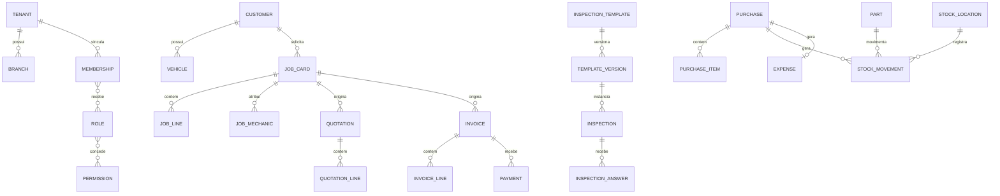

# 4. Modelo de dados

O schema Prisma contém **65 modelos** e **23 enums**. Tabelas de plataforma não usam RLS porque participam da resolução da sessão; tabelas de negócio carregam `tenantId` diretamente ou pertencem a uma raiz que o carrega e são protegidas pelas políticas documentadas em [`packages/database/prisma/rls.sql`](arquivos/01-banco-modelo-e-seguranca.md) §1.2.

## 4.1 Plataforma e acesso

| Modelo | Papel | Campos-chave | Tipo |
|---|---|---|---|
| `Tenant` | empresa/oficina isolada | `id String`, `status TenantStatus`, `createdAt DateTime`, `updatedAt DateTime`, `deletedAt DateTime?` | plataforma |
| `User` | identidade global de uma pessoa | `id String`, `createdAt DateTime`, `updatedAt DateTime`, `deletedAt DateTime?` | plataforma |
| `Session` | sessão Better Auth | `id String`, `createdAt DateTime`, `updatedAt DateTime` | plataforma |
| `Account` | credencial/provedor Better Auth | `id String`, `createdAt DateTime`, `updatedAt DateTime` | plataforma |
| `Verification` | token de verificação Better Auth | `id String`, `createdAt DateTime`, `updatedAt DateTime` | plataforma |
| `Membership` | vínculo de usuário com tenant | `id String`, `tenantId String`, `status MembershipStatus`, `createdAt DateTime`, `updatedAt DateTime` | plataforma |
| `Role` | papel configurável | `id String`, `tenantId String?`, `createdAt DateTime`, `updatedAt DateTime` | plataforma |
| `Permission` | permissão atômica | `id String` | plataforma |
| `RolePermission` | associação papel-permissão | ver schema | plataforma |
| `MembershipRole` | associação vínculo-papel | ver schema | plataforma |

## 4.2 Cadastros

| Modelo | Papel | Campos-chave | Tipo |
|---|---|---|---|
| `Branch` | filial da oficina | `id String`, `tenantId String`, `createdAt DateTime`, `updatedAt DateTime`, `deletedAt DateTime?` | negócio |
| `Customer` | cliente da oficina | `id String`, `tenantId String`, `createdAt DateTime`, `updatedAt DateTime`, `deletedAt DateTime?` | negócio |
| `VehicleBrand` | marca de veículo | `id String`, `tenantId String`, `createdAt DateTime`, `updatedAt DateTime` | negócio |
| `VehicleModel` | modelo de veículo | `id String`, `tenantId String`, `createdAt DateTime`, `updatedAt DateTime` | negócio |
| `VehicleType` | registro de VehicleType | `id String`, `tenantId String`, `createdAt DateTime`, `updatedAt DateTime` | negócio |
| `VehicleColor` | registro de VehicleColor | `id String`, `tenantId String`, `createdAt DateTime`, `updatedAt DateTime` | negócio |
| `VehicleFuelType` | registro de VehicleFuelType | `id String`, `tenantId String`, `createdAt DateTime`, `updatedAt DateTime` | negócio |
| `Vehicle` | veículo atendido | `id String`, `tenantId String`, `createdAt DateTime`, `updatedAt DateTime`, `deletedAt DateTime?` | negócio |
| `VehicleHistory` | registro de VehicleHistory | `id String`, `tenantId String`, `createdAt DateTime` | negócio |
| `Unit` | unidade de medida | `id String`, `tenantId String`, `createdAt DateTime`, `updatedAt DateTime` | negócio |
| `Tax` | imposto configurado | `id String`, `tenantId String`, `createdAt DateTime`, `updatedAt DateTime` | negócio |
| `ServiceCatalog` | serviço/mão de obra de catálogo | `id String`, `tenantId String`, `createdAt DateTime`, `updatedAt DateTime`, `deletedAt DateTime?` | negócio |
| `PartCatalog` | registro de PartCatalog | `id String`, `tenantId String`, `createdAt DateTime`, `updatedAt DateTime`, `deletedAt DateTime?` | negócio |
| `Supplier` | fornecedor | `id String`, `tenantId String`, `createdAt DateTime`, `updatedAt DateTime` | negócio |
| `ServicePart` | registro de ServicePart | `id String`, `tenantId String`, `quantity Decimal` | negócio |
| `JobLineTax` | imposto aplicado ao item | `id String`, `amount Decimal` | negócio |
| `QuotationLineTax` | imposto do item do orçamento | `id String`, `amount Decimal` | negócio |
| `InvoiceLineTax` | imposto do item da fatura | `id String`, `amount Decimal` | negócio |

## 4.3 Operação

| Modelo | Papel | Campos-chave | Tipo |
|---|---|---|---|
| `Appointment` | agendamento | `id String`, `tenantId String`, `status AppointmentStatus`, `createdAt DateTime`, `updatedAt DateTime` | negócio |
| `InspectionTemplate` | identidade de template de inspeção | `id String`, `tenantId String`, `createdAt DateTime`, `updatedAt DateTime` | negócio |
| `InspectionTemplateVersion` | versão imutável/publicável do template | `id String` | negócio |
| `InspectionSection` | seção da versão | `id String` | negócio |
| `InspectionQuestion` | pergunta da seção | `id String` | negócio |
| `InspectionQuestionOption` | registro de InspectionQuestionOption | `id String` | negócio |
| `Inspection` | execução de inspeção | `id String`, `tenantId String`, `status InspectionStatus`, `createdAt DateTime`, `updatedAt DateTime` | negócio |
| `InspectionAnswer` | resposta de pergunta | `id String`, `createdAt DateTime`, `updatedAt DateTime` | negócio |
| `InspectionAnswerAttachment` | registro de InspectionAnswerAttachment | `id String` | negócio |
| `JobCard` | ordem de serviço unificada | `id String`, `tenantId String`, `number String`, `status JobStatus`, `total Decimal`, `createdAt DateTime`, `updatedAt DateTime`, `deletedAt DateTime?` | negócio |
| `JobStatusHistory` | histórico de estado da OS | `id String` | negócio |
| `JobMechanic` | mecânico atribuído | `id String` | negócio |
| `JobChecklistItem` | registro de JobChecklistItem | `id String` | negócio |
| `JobLine` | item da OS | `id String`, `quantity Decimal`, `total Decimal`, `createdAt DateTime`, `updatedAt DateTime` | negócio |
| `Attachment` | metadado de anexo | `id String`, `tenantId String`, `createdAt DateTime` | negócio |
| `Note` | nota associável a entidade | `id String`, `tenantId String`, `createdAt DateTime`, `updatedAt DateTime` | negócio |
| `CustomFieldset` | grupo de campos customizados | `id String`, `tenantId String`, `createdAt DateTime`, `updatedAt DateTime` | negócio |
| `CustomFieldDefinition` | definição de campo customizado | `id String`, `tenantId String`, `createdAt DateTime`, `updatedAt DateTime` | negócio |
| `CustomFieldValue` | valor customizado | `id String`, `tenantId String`, `createdAt DateTime`, `updatedAt DateTime` | negócio |

## 4.4 Financeiro e compras

| Modelo | Papel | Campos-chave | Tipo |
|---|---|---|---|
| `Quotation` | orçamento | `id String`, `tenantId String`, `number String`, `status QuotationStatus`, `total Decimal`, `createdAt DateTime`, `updatedAt DateTime` | negócio |
| `QuotationLine` | item do orçamento | `id String`, `quantity Decimal`, `total Decimal` | negócio |
| `Invoice` | fatura | `id String`, `tenantId String`, `number String`, `status InvoiceStatus`, `total Decimal`, `createdAt DateTime`, `updatedAt DateTime`, `deletedAt DateTime?` | negócio |
| `InvoiceLine` | item da fatura | `id String`, `quantity Decimal`, `total Decimal` | negócio |
| `Payment` | pagamento da fatura | `id String`, `tenantId String`, `amount Decimal`, `createdAt DateTime` | negócio |
| `PaymentMethod` | registro de PaymentMethod | `id String`, `tenantId String`, `createdAt DateTime`, `updatedAt DateTime` | negócio |
| `Expense` | despesa | `id String`, `tenantId String`, `amount Decimal`, `createdAt DateTime` | negócio |
| `Purchase` | compra/recebimento | `id String`, `tenantId String`, `number String`, `status PurchaseStatus`, `total Decimal`, `createdAt DateTime`, `updatedAt DateTime` | negócio |
| `PurchaseItem` | item comprado | `id String`, `quantity Decimal`, `total Decimal` | negócio |

## 4.5 Estoque

| Modelo | Papel | Campos-chave | Tipo |
|---|---|---|---|
| `StockLocation` | local de estoque | `id String`, `tenantId String`, `createdAt DateTime`, `updatedAt DateTime` | negócio |
| `StockMovement` | lançamento imutável do ledger | `id String`, `tenantId String`, `quantity Decimal`, `createdAt DateTime` | negócio |
| `StockBalance` | registro de StockBalance | `id String`, `tenantId String`, `quantity Decimal`, `updatedAt DateTime` | negócio |

## 4.6 Infraestrutura de domínio

| Modelo | Papel | Campos-chave | Tipo |
|---|---|---|---|
| `ProductCategory` | registro de ProductCategory | `id String`, `tenantId String`, `createdAt DateTime`, `updatedAt DateTime` | negócio |
| `BusinessHour` | registro de BusinessHour | `id String`, `tenantId String` | negócio |
| `Holiday` | registro de Holiday | `id String`, `tenantId String`, `createdAt DateTime` | negócio |
| `AuditLog` | registro de AuditLog | `id String`, `tenantId String?`, `createdAt DateTime` | negócio |
| `NumberSequence` | sequência documental por tenant | `id String`, `tenantId String`, `updatedAt DateTime` | negócio |
| `RefreshToken` | registro de RefreshToken | `id String`, `tenantId String?`, `createdAt DateTime` | negócio |

## 4.7 Precisões, controle e exclusão

- Dinheiro: `Decimal(14,2)`.
- Quantidades: `Decimal(14,3)`.
- Datas de auditoria: `createdAt`/`updatedAt`; datas de domínio acompanham emissão, pagamento, execução e estados.
- Soft delete: `deletedAt` onde histórico e referências precisam ser preservados; alguns cadastros usam `isActive`.
- Numeração: `NumberSequence` reserva números por tenant dentro da transação.
- Isolamento: `tenantId` + RLS; o contexto é `app.current_tenant`.

## 4.8 Enums

| Enum | Valores |
|---|---|
| `TenantStatus` | `TRIAL`, `ACTIVE`, `SUSPENDED`, `CANCELLED` |
| `MembershipStatus` | `ACTIVE`, `INVITED`, `DISABLED` |
| `RoleScope` | `SYSTEM`, `TENANT` |
| `CustomerType` | `INDIVIDUAL`, `COMPANY` |
| `OdometerUnit` | `KM`, `MILE` |
| `TransmissionType` | `MANUAL`, `AUTOMATIC`, `CVT` |
| `JobType` | `INSPECTION`, `REPAIR`, `SERVICE` |
| `JobStatus` | `DRAFT`, `SCHEDULED`, `CHECKED_IN`, `IN_INSPECTION`, `WAITING_APPROVAL`, `APPROVED`, `IN_PROGRESS`, `WAITING_PARTS`, `COMPLETED`, `DELIVERED`, `CANCELLED`, `LOCKED` |
| `AppointmentStatus` | `SCHEDULED`, `CONFIRMED`, `CHECKED_IN`, `COMPLETED`, `CANCELLED`, `NO_SHOW` |
| `InspectionStatus` | `PENDING`, `IN_PROGRESS`, `COMPLETED`, `CANCELLED` |
| `InspectionResult` | `OK`, `ATTENTION`, `REPAIR`, `NOT_INSPECTED`, `NOT_APPLICABLE` |
| `ApprovalStatus` | `NOT_REQUIRED`, `PENDING`, `APPROVED`, `REJECTED` |
| `QuestionType` | `TEXT`, `TEXTAREA`, `NUMBER`, `DATE`, `DATETIME`, `BOOLEAN`, `SELECT`, `MULTISELECT`, `CHECKBOX`, `COLOR`, `ATTACHMENT`, `LINK` |
| `SectionDisplayType` | `SECTION`, `NOTE` |
| `QuotationStatus` | `DRAFT`, `SENT`, `APPROVED`, `REJECTED`, `EXPIRED`, `CONVERTED` |
| `InvoiceStatus` | `DRAFT`, `ISSUED`, `PARTIALLY_PAID`, `PAID`, `OVERDUE`, `CANCELLED` |
| `LineItemType` | `LABOR`, `PART`, `SERVICE`, `FEE`, `CUSTOM` |
| `DiscountType` | `PERCENT`, `AMOUNT` |
| `PaymentMethodType` | `CASH`, `CARD`, `TRANSFER`, `PIX`, `OTHER` |
| `StockMovementType` | `INITIAL`, `PURCHASE`, `ISSUE_TO_JOB`, `SALE`, `RETURN_IN`, `ADJUSTMENT`, `TRANSFER` |
| `TaxType` | `PERCENT`, `FIXED` |
| `PurchaseStatus` | `RECEIVED`, `CANCELLED` |
| `CustomFieldType` | `TEXT`, `TEXTAREA`, `NUMBER`, `DATE`, `DATETIME`, `BOOLEAN`, `SELECT`, `MULTISELECT`, `CHECKBOX`, `COLOR`, `LINK` |

## 4.9 Relações principais

- `Tenant` possui filiais, vínculos, papéis e todos os agregados de negócio.
- `Customer` possui veículos e participa de agenda, OS, orçamento e fatura.
- `JobCard` possui itens, impostos por item, mecânicos, histórico de estados, inspeção, orçamentos e faturas.
- `InspectionTemplate` possui versões; cada versão possui seções e perguntas; a execução guarda respostas contra a pergunta versionada.
- `Quotation` e `Invoice` possuem linhas e impostos relacionais por linha.
- `Purchase` possui itens; o recebimento gera `StockMovement` e `Expense` vinculados.
- `Part` e `StockLocation` se encontram pelo ledger `StockMovement`; saldo não é a fonte primária.

