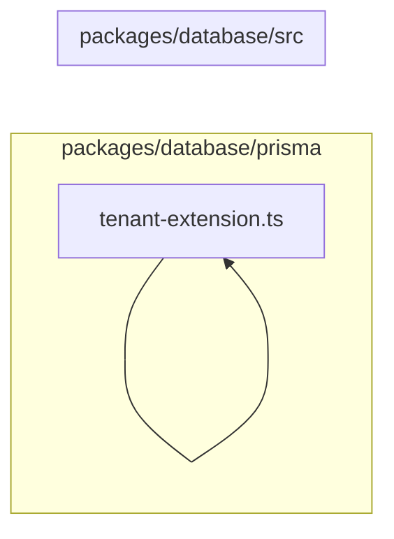

# 1. Banco: modelo, runtime e segurança

Define o schema canônico, o cliente Prisma contextual e as barreiras de isolamento por tenant. Este módulo contém **6 arquivos de código**, sendo **6 fichas completas** e **0 exceções em tabela**.

## Dependências do módulo

As setas representam imports internos confirmados. Dependências com outros módulos aparecem nas fichas individuais.

## 1.1 `packages/database/prisma/app-role.sql`

**Propósito:** Cria/configura o papel de runtime sem BYPASSRLS e concede os privilégios necessários.

**Processo:** O script é executado explicitamente pela preparação/deploy do banco e aplica suas operações de forma reprodutível.

**Estado:** implementado — contém lógica executável e não há marcador explícito de implementação pendente.

**Testes:** sem teste direto — busca pelos exports, nome do recurso e endpoint nas suítes não encontrou cobertura identificável.

**Depende de:** Banco — `Role`.

**Usado por:** nenhum importador interno; é ponto de entrada, script, página, rota ou candidato a código não usado.

**Bibliotecas externas relevantes:** nenhuma.

## 1.2 `packages/database/prisma/rls.sql`

**Propósito:** Ativa e define as políticas PostgreSQL de isolamento por tenant para tabelas de negócio.

**Processo:** O script é executado explicitamente pela preparação/deploy do banco e aplica suas operações de forma reprodutível.

**Estado:** implementado — contém lógica executável e não há marcador explícito de implementação pendente.

**Testes:** sem teste direto — busca pelos exports, nome do recurso e endpoint nas suítes não encontrou cobertura identificável.

**Depende de:** Banco — `Role`, `Tenant`.

**Usado por:** nenhum importador interno; é ponto de entrada, script, página, rota ou candidato a código não usado.

**Bibliotecas externas relevantes:** nenhuma.

## 1.3 `packages/database/prisma/schema.prisma`

**Propósito:** Fonte canônica dos 65 modelos, 23 enums, relações, índices e precisões do banco.

**Processo:** O Prisma lê os blocos de datasource, generator, enums e models; a geração produz o cliente tipado usado pelo servidor.

**Estado:** parcial — há marcador explícito de trabalho pendente no arquivo.

**Testes:** sem teste direto — busca pelos exports, nome do recurso e endpoint nas suítes não encontrou cobertura identificável.

**Depende de:** nenhum arquivo interno, variável ou tabela identificado.

**Usado por:** nenhum importador interno; é ponto de entrada, script, página, rota ou candidato a código não usado.

**Bibliotecas externas relevantes:** nenhuma.

## 1.4 `packages/database/src/index.ts`

**Propósito:** Barrel público do pacote de banco.

**Processo:** Ao ser importado ou executado, o arquivo expõe seu comportamento principal e coordena suas dependências declaradas.

**Estado:** implementado — contém lógica executável e não há marcador explícito de implementação pendente.

**Testes:** sem teste direto — busca pelos exports, nome do recurso e endpoint nas suítes não encontrou cobertura identificável.

**Depende de:** `packages/database/src/tenant-context.ts` — Mantém o tenant corrente em AsyncLocalStorage durante a requisição. `packages/database/src/tenant-extension.ts` — Adiciona defesa em profundidade ao Prisma, filtrando e preenchendo tenantId.

**Usado por:** `apps/web/src/server/db/prisma.ts`, `apps/web/src/server/db/with-tenant.ts`, `apps/web/src/server/http/handle-error.ts`, `apps/web/src/server/services/appointments.service.ts`, `apps/web/src/server/services/branches.service.ts`, `apps/web/src/server/services/customers.service.ts`, `apps/web/src/server/services/expenses.service.ts`, `apps/web/src/server/services/inspection-templates.service.ts`, `apps/web/src/server/services/inspections.service.ts`, `apps/web/src/server/services/invoices.service.ts`, `apps/web/src/server/services/job-cards.service.ts`, `apps/web/src/server/services/number-sequence.service.ts`, `apps/web/src/server/services/parts.service.ts`, `apps/web/src/server/services/purchases.service.ts`, `apps/web/src/server/services/quotations.service.ts`, `apps/web/src/server/services/roles.service.ts`, `apps/web/src/server/services/services.service.ts`, `apps/web/src/server/services/stock.service.ts`, `apps/web/src/server/services/suppliers.service.ts`, `apps/web/src/server/services/users.service.ts`, `apps/web/src/server/services/vehicles.service.ts`, `apps/web/test/regressions.spec.ts`

**Bibliotecas externas relevantes:** `@prisma/client`

## 1.5 `packages/database/src/tenant-context.ts`

**Propósito:** Mantém o tenant corrente em AsyncLocalStorage durante a requisição.

**Processo:** Ao ser importado ou executado, o arquivo expõe `getTenantContext`, `requireTenantId`, `runWithTenant`, `TenantContext` e coordena suas dependências declaradas.

**Estado:** implementado — contém lógica executável e não há marcador explícito de implementação pendente.

**Testes:** `apps/web/test/regressions.spec.ts`

**Depende de:** nenhum arquivo interno, variável ou tabela identificado.

**Usado por:** `packages/database/src/index.ts`, `packages/database/src/tenant-extension.ts`

**Bibliotecas externas relevantes:** `node:async_hooks`

## 1.6 `packages/database/src/tenant-extension.ts`

**Propósito:** Adiciona defesa em profundidade ao Prisma, filtrando e preenchendo tenantId.

**Processo:** Ao ser importado ou executado, o arquivo expõe `createPrismaClient`, `createSystemPrismaClient`, `TENANT_MODELS`, `tenantExtension`, `DatabaseClient` e coordena suas dependências declaradas.

**Estado:** implementado — contém lógica executável e não há marcador explícito de implementação pendente.

**Testes:** sem teste direto — busca pelos exports, nome do recurso e endpoint nas suítes não encontrou cobertura identificável.

**Depende de:** `packages/database/src/tenant-context.ts` — Mantém o tenant corrente em AsyncLocalStorage durante a requisição. `.env.example` — variáveis `APP_DATABASE_URL`.

**Usado por:** `packages/database/src/index.ts`

**Bibliotecas externas relevantes:** `@prisma/client`

## Quadro do módulo

| Arquivo | Estado | Teste | Processo/tela |
|---|---|---|---|
| `packages/database/prisma/app-role.sql` | implementado | sem teste direto | papéis e permissões |
| `packages/database/prisma/rls.sql` | implementado | sem teste direto | infraestrutura |
| `packages/database/prisma/schema.prisma` | parcial | sem teste direto | infraestrutura |
| `packages/database/src/index.ts` | implementado | sem teste direto | infraestrutura |
| `packages/database/src/tenant-context.ts` | implementado | `regressions.spec.ts` | infraestrutura |
| `packages/database/src/tenant-extension.ts` | implementado | sem teste direto | infraestrutura |
