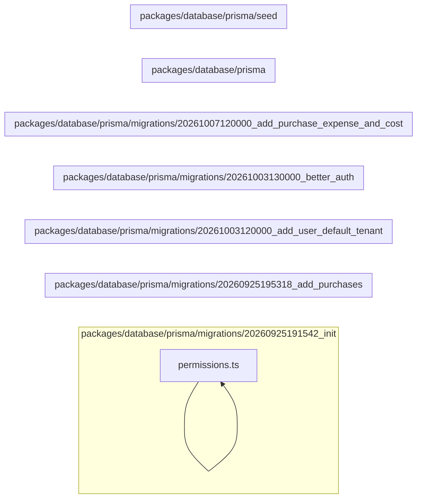

# 2. Banco: seeds, limpeza e migrations

Inicializa dados, produz massa de demonstração, limpa o banco de teste e registra a evolução física do schema. Este módulo contém **10 arquivos de código**, sendo **5 fichas completas** e **5 exceções em tabela**.

## Dependências do módulo

As setas representam imports internos confirmados. Dependências com outros módulos aparecem nas fichas individuais.

## 2.1 `packages/database/prisma/seed-mock.ts`

**Propósito:** Cria dados iniciais ou demonstrativos necessários a seed-mock.ts.

**Processo:** Ao ser importado ou executado, o arquivo expõe seu comportamento principal e coordena suas dependências declaradas.

**Estado:** implementado — contém lógica executável e não há marcador explícito de implementação pendente.

**Testes:** sem teste direto — busca pelos exports, nome do recurso e endpoint nas suítes não encontrou cobertura identificável.

**Depende de:** `packages/database/prisma/seed/mock.ts` — Cria dados iniciais ou demonstrativos necessários a mock. Banco — `Tenant`.

**Usado por:** nenhum importador interno; é ponto de entrada, script, página, rota ou candidato a código não usado.

**Bibliotecas externas relevantes:** `@prisma/client`

## 2.2 `packages/database/prisma/seed.ts`

**Propósito:** Cria dados iniciais ou demonstrativos necessários a seed.ts.

**Processo:** Ao ser importado ou executado, o arquivo expõe seu comportamento principal e coordena suas dependências declaradas.

**Estado:** implementado — contém lógica executável e não há marcador explícito de implementação pendente.

**Testes:** sem teste direto — busca pelos exports, nome do recurso e endpoint nas suítes não encontrou cobertura identificável.

**Depende de:** `packages/database/prisma/seed/permissions.ts` — Cria dados iniciais ou demonstrativos necessários a permissions. `.env.example` — variáveis `SEED_DEMO_TENANT`. Banco — `Branch`, `InspectionTemplate`, `PaymentMethod`, `Tax`, `Tenant`, `Unit`.

**Usado por:** nenhum importador interno; é ponto de entrada, script, página, rota ou candidato a código não usado.

**Bibliotecas externas relevantes:** `@prisma/client`

## 2.3 `packages/database/prisma/seed/mock.ts`

**Propósito:** Cria dados iniciais ou demonstrativos necessários a mock.ts.

**Processo:** Ao ser importado ou executado, o arquivo expõe `seedMockData`, `MockSummary` e coordena suas dependências declaradas.

**Estado:** implementado — contém lógica executável e não há marcador explícito de implementação pendente.

**Testes:** sem teste direto — busca pelos exports, nome do recurso e endpoint nas suítes não encontrou cobertura identificável.

**Depende de:** Banco — `Appointment`, `Branch`, `Customer`, `Expense`, `Inspection`, `InspectionTemplate`, `Invoice`, `InvoiceLine`, `JobCard`, `JobLine`, `JobLineTax`, `JobMechanic`, `JobStatusHistory`, `Membership`, `MembershipRole`, `Note`, `NumberSequence`, `PartCatalog`, `Payment`, `PaymentMethod`, `Purchase`, `PurchaseItem`, `Quotation`, `QuotationLine`, `Role`, `ServiceCatalog`, `ServicePart`, `StockBalance`, `StockLocation`, `StockMovement`, `Supplier`, `Tax`, `Unit`, `User`, `Vehicle`, `VehicleBrand`, `VehicleColor`, `VehicleFuelType`, `VehicleHistory`, `VehicleModel`, `VehicleType`.

**Usado por:** `packages/database/prisma/seed-mock.ts`

**Bibliotecas externas relevantes:** `@prisma/client`, `node:crypto`

## 2.4 `packages/database/prisma/seed/permissions.ts`

**Propósito:** Cria dados iniciais ou demonstrativos necessários a permissions.ts.

**Processo:** Ao ser importado ou executado, o arquivo expõe `seedPermissions`, `seedTenantRoles` e coordena suas dependências declaradas.

**Estado:** implementado — contém lógica executável e não há marcador explícito de implementação pendente.

**Testes:** sem teste direto — busca pelos exports, nome do recurso e endpoint nas suítes não encontrou cobertura identificável.

**Depende de:** `packages/shared/src/index.ts` — Barrel público do pacote compartilhado. Banco — `Permission`, `Role`, `RolePermission`.

**Usado por:** `packages/database/prisma/seed.ts`

**Bibliotecas externas relevantes:** `@prisma/client`

## 2.5 `packages/database/prisma/test-truncate.sql`

**Propósito:** Limpa dados mutáveis do banco de teste entre suítes, preservando a estrutura.

**Processo:** O script é executado explicitamente pela preparação/deploy do banco e aplica suas operações de forma reprodutível.

**Estado:** implementado — contém lógica executável e não há marcador explícito de implementação pendente.

**Testes:** sem teste direto — busca pelos exports, nome do recurso e endpoint nas suítes não encontrou cobertura identificável.

**Depende de:** nenhum arquivo interno, variável ou tabela identificado.

**Usado por:** nenhum importador interno; é ponto de entrada, script, página, rota ou candidato a código não usado.

**Bibliotecas externas relevantes:** nenhuma.

## 2.6 Exceções permitidas

| Caminho | Propósito | Estado | Testes | Motivo da exceção |
|---|---|---|---|---|
| `packages/database/prisma/migrations/20260925191542_init/migration.sql` | Migration Prisma versionada que altera a estrutura física do banco. | implementado | validada por global-setup e suítes de integração | migration gerada/versionada; registrada como artefato de banco |
| `packages/database/prisma/migrations/20260925195318_add_purchases/migration.sql` | Migration Prisma versionada que altera a estrutura física do banco. | implementado | validada por global-setup e suítes de integração | migration gerada/versionada; registrada como artefato de banco |
| `packages/database/prisma/migrations/20261003120000_add_user_default_tenant/migration.sql` | Migration Prisma versionada que altera a estrutura física do banco. | implementado | validada por global-setup e suítes de integração | migration gerada/versionada; registrada como artefato de banco |
| `packages/database/prisma/migrations/20261003130000_better_auth/migration.sql` | Migration Prisma versionada que altera a estrutura física do banco. | implementado | validada por global-setup e suítes de integração | migration gerada/versionada; registrada como artefato de banco |
| `packages/database/prisma/migrations/20261007120000_add_purchase_expense_and_cost/migration.sql` | Migration Prisma versionada que altera a estrutura física do banco. | implementado | validada por global-setup e suítes de integração | migration gerada/versionada; registrada como artefato de banco |

## Quadro do módulo

| Arquivo | Estado | Teste | Processo/tela |
|---|---|---|---|
| `packages/database/prisma/migrations/20260925191542_init/migration.sql` | exceção em tabela | sem teste direto | infraestrutura |
| `packages/database/prisma/migrations/20260925195318_add_purchases/migration.sql` | exceção em tabela | sem teste direto | infraestrutura |
| `packages/database/prisma/migrations/20261003120000_add_user_default_tenant/migration.sql` | exceção em tabela | sem teste direto | infraestrutura |
| `packages/database/prisma/migrations/20261003130000_better_auth/migration.sql` | exceção em tabela | sem teste direto | infraestrutura |
| `packages/database/prisma/migrations/20261007120000_add_purchase_expense_and_cost/migration.sql` | exceção em tabela | sem teste direto | infraestrutura |
| `packages/database/prisma/seed-mock.ts` | implementado | sem teste direto | infraestrutura |
| `packages/database/prisma/seed.ts` | implementado | sem teste direto | infraestrutura |
| `packages/database/prisma/seed/mock.ts` | implementado | sem teste direto | infraestrutura |
| `packages/database/prisma/seed/permissions.ts` | implementado | sem teste direto | infraestrutura |
| `packages/database/prisma/test-truncate.sql` | implementado | sem teste direto | infraestrutura |
