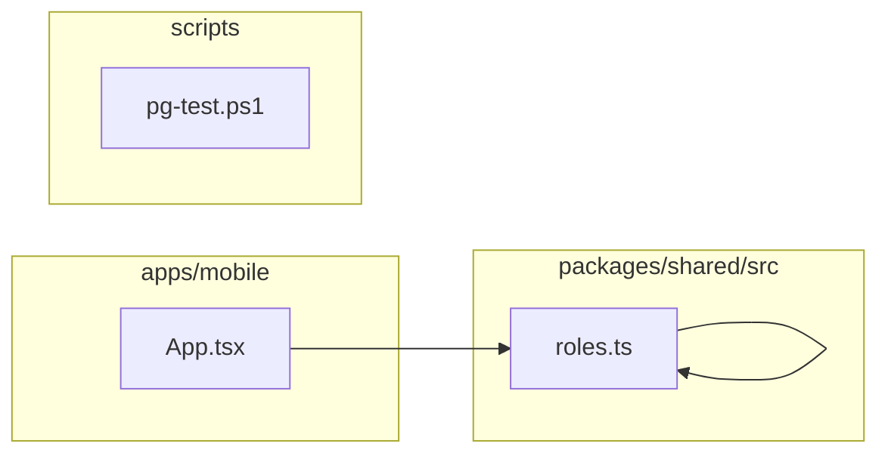

# 3. Código compartilhado, mobile e ferramentas

Centraliza permissões/papéis, contém o esqueleto mobile e automatiza o PostgreSQL portátil de testes. Este módulo contém **5 arquivos de código**, sendo **5 fichas completas** e **0 exceções em tabela**.

## Dependências do módulo

As setas representam imports internos confirmados. Dependências com outros módulos aparecem nas fichas individuais.

## 3.1 `apps/mobile/App.tsx`

**Propósito:** Tela inicial do futuro aplicativo mobile do mecânico.

**Processo:** Ao ser importado ou executado, o arquivo expõe `App` e coordena suas dependências declaradas.

**Estado:** stub — só apresenta a tela inicial; não há navegação, persistência nem sincronização.

**Testes:** sem teste direto — busca pelos exports, nome do recurso e endpoint nas suítes não encontrou cobertura identificável.

**Depende de:** `packages/shared/src/index.ts` — Barrel público do pacote compartilhado.

**Usado por:** nenhum importador interno; é ponto de entrada, script, página, rota ou candidato a código não usado.

**Bibliotecas externas relevantes:** `expo-status-bar`, `react-native`

## 3.2 `packages/shared/src/index.ts`

**Propósito:** Barrel público do pacote compartilhado.

**Processo:** Ao ser importado ou executado, o arquivo expõe `APP_NAME` e coordena suas dependências declaradas.

**Estado:** implementado — contém lógica executável e não há marcador explícito de implementação pendente.

**Testes:** sem teste direto — busca pelos exports, nome do recurso e endpoint nas suítes não encontrou cobertura identificável.

**Depende de:** `packages/shared/src/permissions.ts` — Catálogo único das permissões e agrupamentos funcionais do produto. `packages/shared/src/roles.ts` — Templates dos papéis padrão e suas permissões.

**Usado por:** `apps/mobile/App.tsx`, `apps/web/src/app/layout.tsx`, `apps/web/src/server/auth/provision.ts`, `apps/web/src/server/services/roles.service.ts`, `apps/web/src/server/services/users.service.ts`, `packages/database/prisma/seed/permissions.ts`

**Bibliotecas externas relevantes:** nenhuma.

## 3.3 `packages/shared/src/permissions.ts`

**Propósito:** Catálogo único das permissões e agrupamentos funcionais do produto.

**Processo:** Ao ser importado ou executado, o arquivo expõe `permissionCode`, `listPermissionDefinitions`, `matchesPermissionPattern`, `hasAllPermissions`, `PERMISSION_ACTIONS`, `PermissionAction`, `PERMISSION_CATALOG`, `PermissionFeature`, `PermissionDefinition` e coordena suas dependências declaradas.

**Estado:** implementado — contém lógica executável e não há marcador explícito de implementação pendente.

**Testes:** sem teste direto — busca pelos exports, nome do recurso e endpoint nas suítes não encontrou cobertura identificável.

**Depende de:** nenhum arquivo interno, variável ou tabela identificado.

**Usado por:** `packages/shared/src/index.ts`, `packages/shared/src/roles.ts`

**Bibliotecas externas relevantes:** nenhuma.

## 3.4 `packages/shared/src/roles.ts`

**Propósito:** Templates dos papéis padrão e suas permissões.

**Processo:** Ao ser importado ou executado, o arquivo expõe `resolveRolePermissions`, `RoleTemplate`, `ROLE_TEMPLATES` e coordena suas dependências declaradas.

**Estado:** implementado — contém lógica executável e não há marcador explícito de implementação pendente.

**Testes:** sem teste direto — busca pelos exports, nome do recurso e endpoint nas suítes não encontrou cobertura identificável.

**Depende de:** `packages/shared/src/permissions.ts` — Catálogo único das permissões e agrupamentos funcionais do produto.

**Usado por:** `packages/shared/src/index.ts`

**Bibliotecas externas relevantes:** nenhuma.

## 3.5 `scripts/pg-test.ps1`

**Propósito:** Baixa e controla uma instância PostgreSQL portátil exclusiva para testes locais.

**Processo:** O comando interpreta a ação solicitada, verifica binários/dados, inicia ou encerra o PostgreSQL e reporta o estado.

**Estado:** implementado — contém lógica executável e não há marcador explícito de implementação pendente.

**Testes:** sem teste direto — busca pelos exports, nome do recurso e endpoint nas suítes não encontrou cobertura identificável.

**Depende de:** nenhum arquivo interno, variável ou tabela identificado.

**Usado por:** nenhum importador interno; é ponto de entrada, script, página, rota ou candidato a código não usado.

**Bibliotecas externas relevantes:** nenhuma.

## Quadro do módulo

| Arquivo | Estado | Teste | Processo/tela |
|---|---|---|---|
| `apps/mobile/App.tsx` | stub | sem teste direto | infraestrutura |
| `packages/shared/src/index.ts` | implementado | sem teste direto | infraestrutura |
| `packages/shared/src/permissions.ts` | implementado | sem teste direto | infraestrutura |
| `packages/shared/src/roles.ts` | implementado | sem teste direto | papéis e permissões |
| `scripts/pg-test.ps1` | implementado | sem teste direto | infraestrutura |
