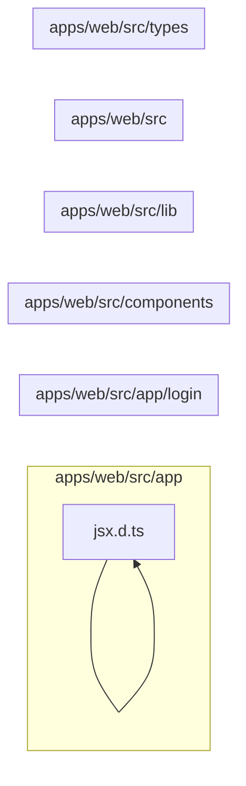

# 4. Frontend compartilhado

Fornece shell, autenticação no navegador, cliente HTTP, tipos, formatação, componentes visuais e estilos. Este módulo contém **17 arquivos de código**, sendo **17 fichas completas** e **0 exceções em tabela**.

## Dependências do módulo

As setas representam imports internos confirmados. Dependências com outros módulos aparecem nas fichas individuais.

## 4.1 `apps/web/src/app/globals.css`

**Propósito:** Tokens visuais, base Tailwind, tema claro/escuro e estilos globais.

**Processo:** Ao ser importado ou executado, o arquivo expõe seu comportamento principal e coordena suas dependências declaradas.

**Estado:** implementado — contém lógica executável e não há marcador explícito de implementação pendente.

**Testes:** sem teste direto — busca pelos exports, nome do recurso e endpoint nas suítes não encontrou cobertura identificável.

**Depende de:** nenhum arquivo interno, variável ou tabela identificado.

**Usado por:** `apps/web/src/app/layout.tsx`

**Bibliotecas externas relevantes:** nenhuma.

## 4.2 `apps/web/src/app/layout.tsx`

**Propósito:** Layout raiz do Next.js e ponto de montagem dos provedores globais.

**Processo:** Ao ser importado ou executado, o arquivo expõe `metadata`, `RootLayout` e coordena suas dependências declaradas.

**Estado:** implementado — contém lógica executável e não há marcador explícito de implementação pendente.

**Testes:** sem teste direto — busca pelos exports, nome do recurso e endpoint nas suítes não encontrou cobertura identificável.

**Depende de:** `apps/web/src/app/globals.css` — Tokens visuais, base Tailwind, tema claro/escuro e estilos globais. `apps/web/src/components/providers.tsx` — Compõe provedores globais, incluindo React Query e autenticação. `packages/shared/src/index.ts` — Barrel público do pacote compartilhado.

**Usado por:** nenhum importador interno; é ponto de entrada, script, página, rota ou candidato a código não usado.

**Bibliotecas externas relevantes:** `next`

## 4.3 `apps/web/src/app/login/page.tsx`

**Propósito:** Implementa a página `/login` para consultar e operar login no painel.

**Processo:** O componente monta o estado e as consultas da tela, trata carregamento/erro e renderiza as ações disponíveis ao usuário.

**Estado:** implementado — contém lógica executável e não há marcador explícito de implementação pendente.

**Testes:** sem teste direto — busca pelos exports, nome do recurso e endpoint nas suítes não encontrou cobertura identificável.

**Depende de:** `apps/web/src/components/auth-provider.tsx` — Disponibiliza sessão e ações de autenticação à árvore React. `apps/web/src/components/theme-toggle.tsx` — Alterna e persiste o tema claro/escuro. `apps/web/src/components/ui.tsx` — Biblioteca local de componentes visuais básicos do painel.

**Usado por:** nenhum importador interno; é ponto de entrada, script, página, rota ou candidato a código não usado.

**Bibliotecas externas relevantes:** `lucide-react`, `next`, `react`

**Rota da página:** `/login` · **O que o usuário vê e faz:** consulta login, usa filtros/formulários e executa as ações oferecidas pelo componente.

**APIs que chama:** nenhuma diretamente · **Guardas:** pública/redirecionamento.

## 4.4 `apps/web/src/app/page.tsx`

**Propósito:** Implementa a página `/` para consultar e operar page.tsx no painel.

**Processo:** O componente monta o estado e as consultas da tela, trata carregamento/erro e renderiza as ações disponíveis ao usuário.

**Estado:** implementado — contém lógica executável e não há marcador explícito de implementação pendente.

**Testes:** sem teste direto — busca pelos exports, nome do recurso e endpoint nas suítes não encontrou cobertura identificável.

**Depende de:** nenhum arquivo interno, variável ou tabela identificado.

**Usado por:** nenhum importador interno; é ponto de entrada, script, página, rota ou candidato a código não usado.

**Bibliotecas externas relevantes:** `next`

**Rota da página:** `/` · **O que o usuário vê e faz:** consulta page.tsx, usa filtros/formulários e executa as ações oferecidas pelo componente.

**APIs que chama:** nenhuma diretamente · **Guardas:** pública/redirecionamento.

## 4.5 `apps/web/src/components/app-shell.tsx`

**Propósito:** Shell autenticado com navegação, cabeçalho e área principal.

**Processo:** Ao ser importado ou executado, o arquivo expõe `AppShell` e coordena suas dependências declaradas.

**Estado:** implementado — contém lógica executável e não há marcador explícito de implementação pendente.

**Testes:** sem teste direto — busca pelos exports, nome do recurso e endpoint nas suítes não encontrou cobertura identificável.

**Depende de:** `apps/web/src/components/auth-provider.tsx` — Disponibiliza sessão e ações de autenticação à árvore React. `apps/web/src/components/theme-toggle.tsx` — Alterna e persiste o tema claro/escuro. `apps/web/src/components/ui.tsx` — Biblioteca local de componentes visuais básicos do painel.

**Usado por:** `apps/web/src/app/(app)/layout.tsx`

**Bibliotecas externas relevantes:** `lucide-react`, `next`, `react`

## 4.6 `apps/web/src/components/auth-provider.tsx`

**Propósito:** Disponibiliza sessão e ações de autenticação à árvore React.

**Processo:** Ao ser importado ou executado, o arquivo expõe `AuthProvider`, `useAuth`, `Session` e coordena suas dependências declaradas.

**Estado:** implementado — contém lógica executável e não há marcador explícito de implementação pendente.

**Testes:** sem teste direto — busca pelos exports, nome do recurso e endpoint nas suítes não encontrou cobertura identificável.

**Depende de:** `apps/web/src/lib/auth-client.ts` — Cliente Better Auth usado pelo navegador para sessão, login e logout.

**Usado por:** `apps/web/src/app/(app)/layout.tsx`, `apps/web/src/app/login/page.tsx`, `apps/web/src/components/app-shell.tsx`, `apps/web/src/components/providers.tsx`

**Bibliotecas externas relevantes:** `react`

## 4.7 `apps/web/src/components/charts.tsx`

**Propósito:** Componentes SVG simples usados nos indicadores e relatórios.

**Processo:** Ao ser importado ou executado, o arquivo expõe `BarList`, `DonutChart`, `CHART_COLORS`, `ChartDatum` e coordena suas dependências declaradas.

**Estado:** implementado — contém lógica executável e não há marcador explícito de implementação pendente.

**Testes:** sem teste direto — busca pelos exports, nome do recurso e endpoint nas suítes não encontrou cobertura identificável.

**Depende de:** `apps/web/src/lib/format.ts` — Formatadores de dinheiro, datas e valores exibidos pela interface.

**Usado por:** `apps/web/src/app/(app)/dashboard/page.tsx`

**Bibliotecas externas relevantes:** nenhuma.

## 4.8 `apps/web/src/components/providers.tsx`

**Propósito:** Compõe provedores globais, incluindo React Query e autenticação.

**Processo:** Ao ser importado ou executado, o arquivo expõe `Providers` e coordena suas dependências declaradas.

**Estado:** implementado — contém lógica executável e não há marcador explícito de implementação pendente.

**Testes:** sem teste direto — busca pelos exports, nome do recurso e endpoint nas suítes não encontrou cobertura identificável.

**Depende de:** `apps/web/src/components/auth-provider.tsx` — Disponibiliza sessão e ações de autenticação à árvore React.

**Usado por:** `apps/web/src/app/layout.tsx`

**Bibliotecas externas relevantes:** `@tanstack/react-query`, `react`

## 4.9 `apps/web/src/components/theme-toggle.tsx`

**Propósito:** Alterna e persiste o tema claro/escuro.

**Processo:** Ao ser importado ou executado, o arquivo expõe `ThemeToggle` e coordena suas dependências declaradas.

**Estado:** implementado — contém lógica executável e não há marcador explícito de implementação pendente.

**Testes:** sem teste direto — busca pelos exports, nome do recurso e endpoint nas suítes não encontrou cobertura identificável.

**Depende de:** nenhum arquivo interno, variável ou tabela identificado.

**Usado por:** `apps/web/src/app/login/page.tsx`, `apps/web/src/components/app-shell.tsx`

**Bibliotecas externas relevantes:** `lucide-react`, `react`

## 4.10 `apps/web/src/components/ui.tsx`

**Propósito:** Biblioteca local de componentes visuais básicos do painel.

**Processo:** Ao ser importado ou executado, o arquivo expõe `cn`, `Button`, `Input`, `Select`, `Textarea`, `Field`, `Card`, `Badge`, `PageHeader`, `Modal`, `ErrorText`, `EmptyState`, `Spinner`, `Th`, `Td` e coordena suas dependências declaradas.

**Estado:** implementado — contém lógica executável e não há marcador explícito de implementação pendente.

**Testes:** sem teste direto — busca pelos exports, nome do recurso e endpoint nas suítes não encontrou cobertura identificável.

**Depende de:** nenhum arquivo interno, variável ou tabela identificado.

**Usado por:** `apps/web/src/app/(app)/appointments/page.tsx`, `apps/web/src/app/(app)/branches/page.tsx`, `apps/web/src/app/(app)/customers/page.tsx`, `apps/web/src/app/(app)/dashboard/page.tsx`, `apps/web/src/app/(app)/expenses/page.tsx`, `apps/web/src/app/(app)/inspection-templates/[id]/page.tsx`, `apps/web/src/app/(app)/inspection-templates/page.tsx`, `apps/web/src/app/(app)/inspections/[id]/page.tsx`, `apps/web/src/app/(app)/inspections/page.tsx`, `apps/web/src/app/(app)/invoices/[id]/page.tsx`, `apps/web/src/app/(app)/invoices/page.tsx`, `apps/web/src/app/(app)/job-cards/[id]/page.tsx`, `apps/web/src/app/(app)/job-cards/page.tsx`, `apps/web/src/app/(app)/layout.tsx`, `apps/web/src/app/(app)/parts/page.tsx`, `apps/web/src/app/(app)/purchases/page.tsx`, `apps/web/src/app/(app)/quotations/[id]/page.tsx`, `apps/web/src/app/(app)/quotations/page.tsx`, `apps/web/src/app/(app)/roles/page.tsx`, `apps/web/src/app/(app)/services/page.tsx`, `apps/web/src/app/(app)/stock/page.tsx`, `apps/web/src/app/(app)/suppliers/page.tsx`, `apps/web/src/app/(app)/team/page.tsx`, `apps/web/src/app/(app)/vehicles/page.tsx`, `apps/web/src/app/login/page.tsx`, `apps/web/src/components/app-shell.tsx`

**Bibliotecas externas relevantes:** `react`

## 4.11 `apps/web/src/lib/api.ts`

**Propósito:** Cliente HTTP comum do navegador, com JSON, cookies e tratamento uniforme de erros.

**Processo:** Ao ser importado ou executado, o arquivo expõe `apiFetch`, `apiFetchText`, `buildQuery`, `API_URL`, `ApiError`, `ApiFetchOptions` e coordena suas dependências declaradas.

**Estado:** implementado — contém lógica executável e não há marcador explícito de implementação pendente.

**Testes:** sem teste direto — busca pelos exports, nome do recurso e endpoint nas suítes não encontrou cobertura identificável.

**Depende de:** `.env.example` — variáveis `NEXT_PUBLIC_API_URL`.

**Usado por:** `apps/web/src/app/(app)/appointments/page.tsx`, `apps/web/src/app/(app)/branches/page.tsx`, `apps/web/src/app/(app)/customers/page.tsx`, `apps/web/src/app/(app)/dashboard/page.tsx`, `apps/web/src/app/(app)/expenses/page.tsx`, `apps/web/src/app/(app)/inspection-templates/[id]/page.tsx`, `apps/web/src/app/(app)/inspection-templates/page.tsx`, `apps/web/src/app/(app)/inspections/[id]/page.tsx`, `apps/web/src/app/(app)/inspections/page.tsx`, `apps/web/src/app/(app)/invoices/[id]/page.tsx`, `apps/web/src/app/(app)/invoices/page.tsx`, `apps/web/src/app/(app)/job-cards/[id]/page.tsx`, `apps/web/src/app/(app)/job-cards/page.tsx`, `apps/web/src/app/(app)/parts/page.tsx`, `apps/web/src/app/(app)/purchases/page.tsx`, `apps/web/src/app/(app)/quotations/[id]/page.tsx`, `apps/web/src/app/(app)/quotations/page.tsx`, `apps/web/src/app/(app)/roles/page.tsx`, `apps/web/src/app/(app)/services/page.tsx`, `apps/web/src/app/(app)/stock/page.tsx`, `apps/web/src/app/(app)/suppliers/page.tsx`, `apps/web/src/app/(app)/team/page.tsx`, `apps/web/src/app/(app)/vehicles/page.tsx`, `apps/web/src/lib/queries.ts`

**Bibliotecas externas relevantes:** nenhuma.

## 4.12 `apps/web/src/lib/auth-client.ts`

**Propósito:** Cliente Better Auth usado pelo navegador para sessão, login e logout.

**Processo:** Ao ser importado ou executado, o arquivo expõe `authClient` e coordena suas dependências declaradas.

**Estado:** implementado — contém lógica executável e não há marcador explícito de implementação pendente.

**Testes:** sem teste direto — busca pelos exports, nome do recurso e endpoint nas suítes não encontrou cobertura identificável.

**Depende de:** nenhum arquivo interno, variável ou tabela identificado.

**Usado por:** `apps/web/src/components/auth-provider.tsx`

**Bibliotecas externas relevantes:** `better-auth`

## 4.13 `apps/web/src/lib/format.ts`

**Propósito:** Formatadores de dinheiro, datas e valores exibidos pela interface.

**Processo:** Ao ser importado ou executado, o arquivo expõe `formatMoney`, `formatNumber`, `formatDate`, `formatDateTime`, `toInputDate` e coordena suas dependências declaradas.

**Estado:** implementado — contém lógica executável e não há marcador explícito de implementação pendente.

**Testes:** sem teste direto — busca pelos exports, nome do recurso e endpoint nas suítes não encontrou cobertura identificável.

**Depende de:** nenhum arquivo interno, variável ou tabela identificado.

**Usado por:** `apps/web/src/app/(app)/appointments/page.tsx`, `apps/web/src/app/(app)/dashboard/page.tsx`, `apps/web/src/app/(app)/expenses/page.tsx`, `apps/web/src/app/(app)/inspection-templates/[id]/page.tsx`, `apps/web/src/app/(app)/inspections/[id]/page.tsx`, `apps/web/src/app/(app)/inspections/page.tsx`, `apps/web/src/app/(app)/invoices/[id]/page.tsx`, `apps/web/src/app/(app)/invoices/page.tsx`, `apps/web/src/app/(app)/job-cards/[id]/page.tsx`, `apps/web/src/app/(app)/job-cards/page.tsx`, `apps/web/src/app/(app)/parts/page.tsx`, `apps/web/src/app/(app)/purchases/page.tsx`, `apps/web/src/app/(app)/quotations/[id]/page.tsx`, `apps/web/src/app/(app)/quotations/page.tsx`, `apps/web/src/app/(app)/services/page.tsx`, `apps/web/src/app/(app)/stock/page.tsx`, `apps/web/src/components/charts.tsx`

**Bibliotecas externas relevantes:** nenhuma.

## 4.14 `apps/web/src/lib/queries.ts`

**Propósito:** Hooks React Query reutilizáveis para opções e catálogos frequentes.

**Processo:** Ao ser importado ou executado, o arquivo expõe `useBranches`, `useCustomers`, `useVehicles`, `useServices`, `Branch` e coordena suas dependências declaradas.

**Estado:** implementado — contém lógica executável e não há marcador explícito de implementação pendente.

**Testes:** sem teste direto — busca pelos exports, nome do recurso e endpoint nas suítes não encontrou cobertura identificável.

**Depende de:** `apps/web/src/lib/api.ts` — Cliente HTTP comum do navegador, com JSON, cookies e tratamento uniforme de erros. `apps/web/src/lib/types.ts` — Tipos de transporte consumidos pelas páginas do painel.

**Usado por:** `apps/web/src/app/(app)/appointments/page.tsx`, `apps/web/src/app/(app)/expenses/page.tsx`, `apps/web/src/app/(app)/inspections/page.tsx`, `apps/web/src/app/(app)/job-cards/[id]/page.tsx`, `apps/web/src/app/(app)/job-cards/page.tsx`, `apps/web/src/app/(app)/purchases/page.tsx`, `apps/web/src/app/(app)/quotations/[id]/page.tsx`, `apps/web/src/app/(app)/quotations/page.tsx`, `apps/web/src/app/(app)/stock/page.tsx`, `apps/web/src/app/(app)/team/page.tsx`, `apps/web/src/app/(app)/vehicles/page.tsx`

**Bibliotecas externas relevantes:** `@tanstack/react-query`

## 4.15 `apps/web/src/lib/types.ts`

**Propósito:** Tipos de transporte consumidos pelas páginas do painel.

**Processo:** Ao ser importado ou executado, o arquivo expõe `Paginated`, `Customer`, `Vehicle`, `JobStatus`, `JobLine`, `JobCard`, `Appointment`, `Quotation`, `Invoice`, `ServiceItem`, `Part`, `StockBalance`, `StockLocation`, `Purchase`, `Supplier`, `Expense`, `ExpenseList`, `StockMovement`, `JobMechanic`, `InspectionStatus`, `InspectionResult`, `ApprovalStatus`, `InspectionOption`, `InspectionQuestion`, `InspectionAnswer`, `Inspection`, `InspectionTemplateSection`, `InspectionTemplateVersion`, `InspectionTemplate`, `BranchFull`, `MembershipStatus`, `RoleRef`, `TeamMember`, `Role`, `Permission` e coordena suas dependências declaradas.

**Estado:** implementado — contém lógica executável e não há marcador explícito de implementação pendente.

**Testes:** sem teste direto — busca pelos exports, nome do recurso e endpoint nas suítes não encontrou cobertura identificável.

**Depende de:** nenhum arquivo interno, variável ou tabela identificado.

**Usado por:** `apps/web/src/app/(app)/appointments/page.tsx`, `apps/web/src/app/(app)/branches/page.tsx`, `apps/web/src/app/(app)/customers/page.tsx`, `apps/web/src/app/(app)/expenses/page.tsx`, `apps/web/src/app/(app)/inspection-templates/[id]/page.tsx`, `apps/web/src/app/(app)/inspection-templates/page.tsx`, `apps/web/src/app/(app)/inspections/[id]/page.tsx`, `apps/web/src/app/(app)/inspections/page.tsx`, `apps/web/src/app/(app)/invoices/[id]/page.tsx`, `apps/web/src/app/(app)/invoices/page.tsx`, `apps/web/src/app/(app)/job-cards/[id]/page.tsx`, `apps/web/src/app/(app)/job-cards/page.tsx`, `apps/web/src/app/(app)/parts/page.tsx`, `apps/web/src/app/(app)/purchases/page.tsx`, `apps/web/src/app/(app)/quotations/[id]/page.tsx`, `apps/web/src/app/(app)/quotations/page.tsx`, `apps/web/src/app/(app)/roles/page.tsx`, `apps/web/src/app/(app)/services/page.tsx`, `apps/web/src/app/(app)/stock/page.tsx`, `apps/web/src/app/(app)/suppliers/page.tsx`, `apps/web/src/app/(app)/team/page.tsx`, `apps/web/src/app/(app)/vehicles/page.tsx`, `apps/web/src/lib/queries.ts`

**Bibliotecas externas relevantes:** nenhuma.

## 4.16 `apps/web/src/middleware.ts`

**Propósito:** Protege a navegação de páginas pela presença do cookie de sessão e redireciona para login.

**Processo:** Ao ser importado ou executado, o arquivo expõe `middleware`, `config` e coordena suas dependências declaradas.

**Estado:** implementado — contém lógica executável e não há marcador explícito de implementação pendente.

**Testes:** sem teste direto — busca pelos exports, nome do recurso e endpoint nas suítes não encontrou cobertura identificável.

**Depende de:** `.env.example` — variáveis `BETTER_AUTH_SECRET`.

**Usado por:** nenhum importador interno; é ponto de entrada, script, página, rota ou candidato a código não usado.

**Bibliotecas externas relevantes:** `better-auth`, `next`

## 4.17 `apps/web/src/types/jsx.d.ts`

**Propósito:** Complementa a declaração global do namespace JSX para o build atual.

**Processo:** Ao ser importado ou executado, o arquivo expõe seu comportamento principal e coordena suas dependências declaradas.

**Estado:** parcial — compatibilidade de tipos local; deve ser removida quando a dependência de tipos dispensar o ajuste.

**Testes:** sem teste direto — busca pelos exports, nome do recurso e endpoint nas suítes não encontrou cobertura identificável.

**Depende de:** nenhum arquivo interno, variável ou tabela identificado.

**Usado por:** nenhum importador interno; é ponto de entrada, script, página, rota ou candidato a código não usado.

**Bibliotecas externas relevantes:** `react`

## Quadro do módulo

| Arquivo | Estado | Teste | Processo/tela |
|---|---|---|---|
| `apps/web/src/app/globals.css` | implementado | sem teste direto | infraestrutura |
| `apps/web/src/app/layout.tsx` | implementado | sem teste direto | infraestrutura |
| `apps/web/src/app/login/page.tsx` | implementado | sem teste direto | /login |
| `apps/web/src/app/page.tsx` | implementado | sem teste direto | / |
| `apps/web/src/components/app-shell.tsx` | implementado | sem teste direto | infraestrutura |
| `apps/web/src/components/auth-provider.tsx` | implementado | sem teste direto | infraestrutura |
| `apps/web/src/components/charts.tsx` | implementado | sem teste direto | infraestrutura |
| `apps/web/src/components/providers.tsx` | implementado | sem teste direto | infraestrutura |
| `apps/web/src/components/theme-toggle.tsx` | implementado | sem teste direto | infraestrutura |
| `apps/web/src/components/ui.tsx` | implementado | sem teste direto | infraestrutura |
| `apps/web/src/lib/api.ts` | implementado | sem teste direto | infraestrutura |
| `apps/web/src/lib/auth-client.ts` | implementado | sem teste direto | infraestrutura |
| `apps/web/src/lib/format.ts` | implementado | sem teste direto | infraestrutura |
| `apps/web/src/lib/queries.ts` | implementado | sem teste direto | infraestrutura |
| `apps/web/src/lib/types.ts` | implementado | sem teste direto | infraestrutura |
| `apps/web/src/middleware.ts` | implementado | sem teste direto | infraestrutura |
| `apps/web/src/types/jsx.d.ts` | parcial | sem teste direto | infraestrutura |
