# 5. Páginas e layouts web

Implementa a navegação e as telas do painel administrativo. Este módulo contém **24 arquivos de código**, sendo **24 fichas completas** e **0 exceções em tabela**.

## Dependências do módulo

```mermaid
flowchart LR
  subgraph sg0_1["apps/web/src/app/(app)/appointments"]
    f_617070732f7765622f["page.tsx"]
  end
  subgraph sg0_2["apps/web/src/app/(app)/branches"]
    f_617070732f7765622f["page.tsx"]
  end
  subgraph sg0_3["apps/web/src/app/(app)/customers"]
    f_617070732f7765622f["page.tsx"]
  end
  subgraph sg0_4["apps/web/src/app/(app)/dashboard"]
    f_617070732f7765622f["page.tsx"]
  end
  subgraph sg0_5["apps/web/src/app/(app)/expenses"]
    f_617070732f7765622f["page.tsx"]
  end
  subgraph sg0_6["apps/web/src/app/(app)/inspection-templates/[id]"]
    f_617070732f7765622f["page.tsx"]
  end
  subgraph sg0_7["apps/web/src/app/(app)/inspection-templates"]
    f_617070732f7765622f["page.tsx"]
  end
  subgraph sg0_8["apps/web/src/app/(app)/inspections/[id]"]
    f_617070732f7765622f["page.tsx"]
  end
  subgraph sg0_9["apps/web/src/app/(app)/inspections"]
    f_617070732f7765622f["page.tsx"]
  end
  subgraph sg0_10["apps/web/src/app/(app)/invoices/[id]"]
    f_617070732f7765622f["page.tsx"]
  end
  subgraph sg0_11["apps/web/src/app/(app)/invoices"]
    f_617070732f7765622f["page.tsx"]
  end
  subgraph sg0_12["apps/web/src/app/(app)/job-cards/[id]"]
    f_617070732f7765622f["page.tsx"]
  end
  subgraph sg0_13["apps/web/src/app/(app)/job-cards"]
    f_617070732f7765622f["page.tsx"]
  end
  subgraph sg0_14["apps/web/src/app/(app)"]
    f_617070732f7765622f["layout.tsx"]
  end
  subgraph sg0_15["apps/web/src/app/(app)/parts"]
    f_617070732f7765622f["page.tsx"]
  end
  subgraph sg0_16["apps/web/src/app/(app)/purchases"]
    f_617070732f7765622f["page.tsx"]
  end
  subgraph sg0_17["apps/web/src/app/(app)/quotations/[id]"]
    f_617070732f7765622f["page.tsx"]
  end
  subgraph sg0_18["apps/web/src/app/(app)/quotations"]
    f_617070732f7765622f["page.tsx"]
  end
  subgraph sg0_19["apps/web/src/app/(app)/roles"]
    f_617070732f7765622f["page.tsx"]
  end
  subgraph sg0_20["apps/web/src/app/(app)/services"]
    f_617070732f7765622f["page.tsx"]
  end
  subgraph sg0_21["apps/web/src/app/(app)/stock"]
    f_617070732f7765622f["page.tsx"]
  end
  subgraph sg0_22["apps/web/src/app/(app)/suppliers"]
    f_617070732f7765622f["page.tsx"]
  end
  subgraph sg0_23["apps/web/src/app/(app)/team"]
    f_617070732f7765622f["page.tsx"]
  end
  subgraph sg0_24["apps/web/src/app/(app)/vehicles"]
    f_617070732f7765622f["page.tsx"]
  end
  f_617070732f7765622f -. "mesmo módulo" .-> f_617070732f7765622f
```

As setas representam imports internos confirmados. Dependências com outros módulos aparecem nas fichas individuais.

## 5.1 `apps/web/src/app/(app)/appointments/page.tsx`

**Propósito:** Implementa a página `/appointments` para consultar e operar agendamentos no painel.

**Processo:** O componente monta o estado e as consultas da tela, chama `/api/appointments`, `/api/appointments/:id/status`, `/api/appointments:id)}`, trata carregamento/erro e renderiza as ações disponíveis ao usuário.

**Estado:** parcial — há marcador explícito de trabalho pendente no arquivo.

**Testes:** sem teste direto — busca pelos exports, nome do recurso e endpoint nas suítes não encontrou cobertura identificável.

**Depende de:** `apps/web/src/components/ui.tsx` — Biblioteca local de componentes visuais básicos do painel. `apps/web/src/lib/api.ts` — Cliente HTTP comum do navegador, com JSON, cookies e tratamento uniforme de erros. `apps/web/src/lib/format.ts` — Formatadores de dinheiro, datas e valores exibidos pela interface. `apps/web/src/lib/queries.ts` — Hooks React Query reutilizáveis para opções e catálogos frequentes. `apps/web/src/lib/types.ts` — Tipos de transporte consumidos pelas páginas do painel.

**Usado por:** nenhum importador interno; é ponto de entrada, script, página, rota ou candidato a código não usado.

**Bibliotecas externas relevantes:** `@tanstack/react-query`, `react`

**Rota da página:** `/appointments` · **O que o usuário vê e faz:** consulta agendamentos, usa filtros/formulários e executa as ações oferecidas pelo componente.

**APIs que chama:** `/api/appointments`, `/api/appointments/:id/status`, `/api/appointments:id)}` · **Guardas:** sessão exigida pelo middleware e pelo layout autenticado; a autorização efetiva ocorre novamente na API.

## 5.2 `apps/web/src/app/(app)/branches/page.tsx`

**Propósito:** Implementa a página `/branches` para consultar e operar filiais no painel.

**Processo:** O componente monta o estado e as consultas da tela, chama `/api/branches`, `/api/branches/:id`, trata carregamento/erro e renderiza as ações disponíveis ao usuário.

**Estado:** implementado — contém lógica executável e não há marcador explícito de implementação pendente.

**Testes:** sem teste direto — busca pelos exports, nome do recurso e endpoint nas suítes não encontrou cobertura identificável.

**Depende de:** `apps/web/src/components/ui.tsx` — Biblioteca local de componentes visuais básicos do painel. `apps/web/src/lib/api.ts` — Cliente HTTP comum do navegador, com JSON, cookies e tratamento uniforme de erros. `apps/web/src/lib/types.ts` — Tipos de transporte consumidos pelas páginas do painel.

**Usado por:** nenhum importador interno; é ponto de entrada, script, página, rota ou candidato a código não usado.

**Bibliotecas externas relevantes:** `@tanstack/react-query`, `react`

**Rota da página:** `/branches` · **O que o usuário vê e faz:** consulta filiais, usa filtros/formulários e executa as ações oferecidas pelo componente.

**APIs que chama:** `/api/branches`, `/api/branches/:id` · **Guardas:** sessão exigida pelo middleware e pelo layout autenticado; a autorização efetiva ocorre novamente na API.

## 5.3 `apps/web/src/app/(app)/customers/page.tsx`

**Propósito:** Implementa a página `/customers` para consultar e operar clientes no painel.

**Processo:** O componente monta o estado e as consultas da tela, chama `/api/customers`, `/api/customers/:id`, `/api/customers:id)}`, trata carregamento/erro e renderiza as ações disponíveis ao usuário.

**Estado:** implementado — contém lógica executável e não há marcador explícito de implementação pendente.

**Testes:** sem teste direto — busca pelos exports, nome do recurso e endpoint nas suítes não encontrou cobertura identificável.

**Depende de:** `apps/web/src/components/ui.tsx` — Biblioteca local de componentes visuais básicos do painel. `apps/web/src/lib/api.ts` — Cliente HTTP comum do navegador, com JSON, cookies e tratamento uniforme de erros. `apps/web/src/lib/types.ts` — Tipos de transporte consumidos pelas páginas do painel.

**Usado por:** nenhum importador interno; é ponto de entrada, script, página, rota ou candidato a código não usado.

**Bibliotecas externas relevantes:** `@tanstack/react-query`, `react`

**Rota da página:** `/customers` · **O que o usuário vê e faz:** consulta clientes, usa filtros/formulários e executa as ações oferecidas pelo componente.

**APIs que chama:** `/api/customers`, `/api/customers/:id`, `/api/customers:id)}` · **Guardas:** sessão exigida pelo middleware e pelo layout autenticado; a autorização efetiva ocorre novamente na API.

## 5.4 `apps/web/src/app/(app)/dashboard/page.tsx`

**Propósito:** Implementa a página `/dashboard` para consultar e operar dashboard no painel.

**Processo:** O componente monta o estado e as consultas da tela, chama `/api/reports/financial`, `/api/reports/job-cards`, `/api/reports/stock`, trata carregamento/erro e renderiza as ações disponíveis ao usuário.

**Estado:** implementado — contém lógica executável e não há marcador explícito de implementação pendente.

**Testes:** sem teste direto — busca pelos exports, nome do recurso e endpoint nas suítes não encontrou cobertura identificável.

**Depende de:** `apps/web/src/components/charts.tsx` — Componentes SVG simples usados nos indicadores e relatórios. `apps/web/src/components/ui.tsx` — Biblioteca local de componentes visuais básicos do painel. `apps/web/src/lib/api.ts` — Cliente HTTP comum do navegador, com JSON, cookies e tratamento uniforme de erros. `apps/web/src/lib/format.ts` — Formatadores de dinheiro, datas e valores exibidos pela interface.

**Usado por:** nenhum importador interno; é ponto de entrada, script, página, rota ou candidato a código não usado.

**Bibliotecas externas relevantes:** `@tanstack/react-query`, `next`

**Rota da página:** `/dashboard` · **O que o usuário vê e faz:** consulta dashboard, usa filtros/formulários e executa as ações oferecidas pelo componente.

**APIs que chama:** `/api/reports/financial`, `/api/reports/job-cards`, `/api/reports/stock` · **Guardas:** sessão exigida pelo middleware e pelo layout autenticado; a autorização efetiva ocorre novamente na API.

## 5.5 `apps/web/src/app/(app)/expenses/page.tsx`

**Propósito:** Implementa a página `/expenses` para consultar e operar despesas no painel.

**Processo:** O componente monta o estado e as consultas da tela, chama `/api/expenses`, `/api/expenses/:id`, `/api/expenses:id)}`, trata carregamento/erro e renderiza as ações disponíveis ao usuário.

**Estado:** implementado — contém lógica executável e não há marcador explícito de implementação pendente.

**Testes:** sem teste direto — busca pelos exports, nome do recurso e endpoint nas suítes não encontrou cobertura identificável.

**Depende de:** `apps/web/src/components/ui.tsx` — Biblioteca local de componentes visuais básicos do painel. `apps/web/src/lib/api.ts` — Cliente HTTP comum do navegador, com JSON, cookies e tratamento uniforme de erros. `apps/web/src/lib/format.ts` — Formatadores de dinheiro, datas e valores exibidos pela interface. `apps/web/src/lib/queries.ts` — Hooks React Query reutilizáveis para opções e catálogos frequentes. `apps/web/src/lib/types.ts` — Tipos de transporte consumidos pelas páginas do painel.

**Usado por:** nenhum importador interno; é ponto de entrada, script, página, rota ou candidato a código não usado.

**Bibliotecas externas relevantes:** `@tanstack/react-query`, `react`

**Rota da página:** `/expenses` · **O que o usuário vê e faz:** consulta despesas, usa filtros/formulários e executa as ações oferecidas pelo componente.

**APIs que chama:** `/api/expenses`, `/api/expenses/:id`, `/api/expenses:id)}` · **Guardas:** sessão exigida pelo middleware e pelo layout autenticado; a autorização efetiva ocorre novamente na API.

## 5.6 `apps/web/src/app/(app)/inspection-templates/[id]/page.tsx`

**Propósito:** Implementa a página `/inspection-templates/:id` para consultar e operar templates de inspeção no painel.

**Processo:** O componente monta o estado e as consultas da tela, chama `/api/inspection-templates/:id`, `/api/inspection-templates/:id/publish`, trata carregamento/erro e renderiza as ações disponíveis ao usuário.

**Estado:** implementado — contém lógica executável e não há marcador explícito de implementação pendente.

**Testes:** sem teste direto — busca pelos exports, nome do recurso e endpoint nas suítes não encontrou cobertura identificável.

**Depende de:** `apps/web/src/components/ui.tsx` — Biblioteca local de componentes visuais básicos do painel. `apps/web/src/lib/api.ts` — Cliente HTTP comum do navegador, com JSON, cookies e tratamento uniforme de erros. `apps/web/src/lib/format.ts` — Formatadores de dinheiro, datas e valores exibidos pela interface. `apps/web/src/lib/types.ts` — Tipos de transporte consumidos pelas páginas do painel.

**Usado por:** nenhum importador interno; é ponto de entrada, script, página, rota ou candidato a código não usado.

**Bibliotecas externas relevantes:** `@tanstack/react-query`, `next`, `react`

**Rota da página:** `/inspection-templates/:id` · **O que o usuário vê e faz:** consulta templates de inspeção, usa filtros/formulários e executa as ações oferecidas pelo componente.

**APIs que chama:** `/api/inspection-templates/:id`, `/api/inspection-templates/:id/publish` · **Guardas:** sessão exigida pelo middleware e pelo layout autenticado; a autorização efetiva ocorre novamente na API.

## 5.7 `apps/web/src/app/(app)/inspection-templates/page.tsx`

**Propósito:** Implementa a página `/inspection-templates` para consultar e operar templates de inspeção no painel.

**Processo:** O componente monta o estado e as consultas da tela, chama `/api/inspection-templates`, `/api/inspection-templates:id)}`, trata carregamento/erro e renderiza as ações disponíveis ao usuário.

**Estado:** implementado — contém lógica executável e não há marcador explícito de implementação pendente.

**Testes:** sem teste direto — busca pelos exports, nome do recurso e endpoint nas suítes não encontrou cobertura identificável.

**Depende de:** `apps/web/src/components/ui.tsx` — Biblioteca local de componentes visuais básicos do painel. `apps/web/src/lib/api.ts` — Cliente HTTP comum do navegador, com JSON, cookies e tratamento uniforme de erros. `apps/web/src/lib/types.ts` — Tipos de transporte consumidos pelas páginas do painel.

**Usado por:** nenhum importador interno; é ponto de entrada, script, página, rota ou candidato a código não usado.

**Bibliotecas externas relevantes:** `@tanstack/react-query`, `next`, `react`

**Rota da página:** `/inspection-templates` · **O que o usuário vê e faz:** consulta templates de inspeção, usa filtros/formulários e executa as ações oferecidas pelo componente.

**APIs que chama:** `/api/inspection-templates`, `/api/inspection-templates:id)}` · **Guardas:** sessão exigida pelo middleware e pelo layout autenticado; a autorização efetiva ocorre novamente na API.

## 5.8 `apps/web/src/app/(app)/inspections/[id]/page.tsx`

**Propósito:** Implementa a página `/inspections/:id` para consultar e operar inspeções no painel.

**Processo:** O componente monta o estado e as consultas da tela, chama `/api/inspections/:id`, `/api/inspections/:id/answers/:id`, `/api/inspections/:id/complete`, trata carregamento/erro e renderiza as ações disponíveis ao usuário.

**Estado:** implementado — contém lógica executável e não há marcador explícito de implementação pendente.

**Testes:** sem teste direto — busca pelos exports, nome do recurso e endpoint nas suítes não encontrou cobertura identificável.

**Depende de:** `apps/web/src/components/ui.tsx` — Biblioteca local de componentes visuais básicos do painel. `apps/web/src/lib/api.ts` — Cliente HTTP comum do navegador, com JSON, cookies e tratamento uniforme de erros. `apps/web/src/lib/format.ts` — Formatadores de dinheiro, datas e valores exibidos pela interface. `apps/web/src/lib/types.ts` — Tipos de transporte consumidos pelas páginas do painel.

**Usado por:** nenhum importador interno; é ponto de entrada, script, página, rota ou candidato a código não usado.

**Bibliotecas externas relevantes:** `@tanstack/react-query`, `next`, `react`

**Rota da página:** `/inspections/:id` · **O que o usuário vê e faz:** consulta inspeções, usa filtros/formulários e executa as ações oferecidas pelo componente.

**APIs que chama:** `/api/inspections/:id`, `/api/inspections/:id/answers/:id`, `/api/inspections/:id/complete` · **Guardas:** sessão exigida pelo middleware e pelo layout autenticado; a autorização efetiva ocorre novamente na API.

## 5.9 `apps/web/src/app/(app)/inspections/page.tsx`

**Propósito:** Implementa a página `/inspections` para consultar e operar inspeções no painel.

**Processo:** O componente monta o estado e as consultas da tela, chama `/api/inspection-templates:id)}`, `/api/inspections`, `/api/inspections:id)}`, trata carregamento/erro e renderiza as ações disponíveis ao usuário.

**Estado:** parcial — há marcador explícito de trabalho pendente no arquivo.

**Testes:** sem teste direto — busca pelos exports, nome do recurso e endpoint nas suítes não encontrou cobertura identificável.

**Depende de:** `apps/web/src/components/ui.tsx` — Biblioteca local de componentes visuais básicos do painel. `apps/web/src/lib/api.ts` — Cliente HTTP comum do navegador, com JSON, cookies e tratamento uniforme de erros. `apps/web/src/lib/format.ts` — Formatadores de dinheiro, datas e valores exibidos pela interface. `apps/web/src/lib/queries.ts` — Hooks React Query reutilizáveis para opções e catálogos frequentes. `apps/web/src/lib/types.ts` — Tipos de transporte consumidos pelas páginas do painel.

**Usado por:** nenhum importador interno; é ponto de entrada, script, página, rota ou candidato a código não usado.

**Bibliotecas externas relevantes:** `@tanstack/react-query`, `next`, `react`

**Rota da página:** `/inspections` · **O que o usuário vê e faz:** consulta inspeções, usa filtros/formulários e executa as ações oferecidas pelo componente.

**APIs que chama:** `/api/inspection-templates:id)}`, `/api/inspections`, `/api/inspections:id)}` · **Guardas:** sessão exigida pelo middleware e pelo layout autenticado; a autorização efetiva ocorre novamente na API.

## 5.10 `apps/web/src/app/(app)/invoices/[id]/page.tsx`

**Propósito:** Implementa a página `/invoices/:id` para consultar e operar faturas no painel.

**Processo:** O componente monta o estado e as consultas da tela, chama `/api/invoices/:id`, `/api/invoices/:id/cancel`, `/api/invoices/:id/issue`, `/api/invoices/:id/payments`, trata carregamento/erro e renderiza as ações disponíveis ao usuário.

**Estado:** implementado — contém lógica executável e não há marcador explícito de implementação pendente.

**Testes:** sem teste direto — busca pelos exports, nome do recurso e endpoint nas suítes não encontrou cobertura identificável.

**Depende de:** `apps/web/src/components/ui.tsx` — Biblioteca local de componentes visuais básicos do painel. `apps/web/src/lib/api.ts` — Cliente HTTP comum do navegador, com JSON, cookies e tratamento uniforme de erros. `apps/web/src/lib/format.ts` — Formatadores de dinheiro, datas e valores exibidos pela interface. `apps/web/src/lib/types.ts` — Tipos de transporte consumidos pelas páginas do painel.

**Usado por:** nenhum importador interno; é ponto de entrada, script, página, rota ou candidato a código não usado.

**Bibliotecas externas relevantes:** `@tanstack/react-query`, `next`, `react`

**Rota da página:** `/invoices/:id` · **O que o usuário vê e faz:** consulta faturas, usa filtros/formulários e executa as ações oferecidas pelo componente.

**APIs que chama:** `/api/invoices/:id`, `/api/invoices/:id/cancel`, `/api/invoices/:id/issue`, `/api/invoices/:id/payments` · **Guardas:** sessão exigida pelo middleware e pelo layout autenticado; a autorização efetiva ocorre novamente na API.

## 5.11 `apps/web/src/app/(app)/invoices/page.tsx`

**Propósito:** Implementa a página `/invoices` para consultar e operar faturas no painel.

**Processo:** O componente monta o estado e as consultas da tela, chama `/api/invoices:id)}`, trata carregamento/erro e renderiza as ações disponíveis ao usuário.

**Estado:** parcial — há marcador explícito de trabalho pendente no arquivo.

**Testes:** sem teste direto — busca pelos exports, nome do recurso e endpoint nas suítes não encontrou cobertura identificável.

**Depende de:** `apps/web/src/components/ui.tsx` — Biblioteca local de componentes visuais básicos do painel. `apps/web/src/lib/api.ts` — Cliente HTTP comum do navegador, com JSON, cookies e tratamento uniforme de erros. `apps/web/src/lib/format.ts` — Formatadores de dinheiro, datas e valores exibidos pela interface. `apps/web/src/lib/types.ts` — Tipos de transporte consumidos pelas páginas do painel.

**Usado por:** nenhum importador interno; é ponto de entrada, script, página, rota ou candidato a código não usado.

**Bibliotecas externas relevantes:** `@tanstack/react-query`, `next`, `react`

**Rota da página:** `/invoices` · **O que o usuário vê e faz:** consulta faturas, usa filtros/formulários e executa as ações oferecidas pelo componente.

**APIs que chama:** `/api/invoices:id)}` · **Guardas:** sessão exigida pelo middleware e pelo layout autenticado; a autorização efetiva ocorre novamente na API.

## 5.12 `apps/web/src/app/(app)/job-cards/[id]/page.tsx`

**Propósito:** Implementa a página `/job-cards/:id` para consultar e operar ordens de serviço no painel.

**Processo:** O componente monta o estado e as consultas da tela, chama `/api/job-cards/:id`, `/api/job-cards/:id/lines`, `/api/job-cards/:id/lines/:id`, `/api/job-cards/:id/mechanics`, `/api/job-cards/:id/mechanics/:id`, `/api/job-cards/:id/transition`, `/api/services`, `/api/users?pageSize=100`, trata carregamento/erro e renderiza as ações disponíveis ao usuário.

**Estado:** implementado — contém lógica executável e não há marcador explícito de implementação pendente.

**Testes:** sem teste direto — busca pelos exports, nome do recurso e endpoint nas suítes não encontrou cobertura identificável.

**Depende de:** `apps/web/src/components/ui.tsx` — Biblioteca local de componentes visuais básicos do painel. `apps/web/src/lib/api.ts` — Cliente HTTP comum do navegador, com JSON, cookies e tratamento uniforme de erros. `apps/web/src/lib/format.ts` — Formatadores de dinheiro, datas e valores exibidos pela interface. `apps/web/src/lib/queries.ts` — Hooks React Query reutilizáveis para opções e catálogos frequentes. `apps/web/src/lib/types.ts` — Tipos de transporte consumidos pelas páginas do painel.

**Usado por:** nenhum importador interno; é ponto de entrada, script, página, rota ou candidato a código não usado.

**Bibliotecas externas relevantes:** `@tanstack/react-query`, `next`, `react`

**Rota da página:** `/job-cards/:id` · **O que o usuário vê e faz:** consulta ordens de serviço, usa filtros/formulários e executa as ações oferecidas pelo componente.

**APIs que chama:** `/api/job-cards/:id`, `/api/job-cards/:id/lines`, `/api/job-cards/:id/lines/:id`, `/api/job-cards/:id/mechanics`, `/api/job-cards/:id/mechanics/:id`, `/api/job-cards/:id/transition`, `/api/services`, `/api/users?pageSize=100` · **Guardas:** sessão exigida pelo middleware e pelo layout autenticado; a autorização efetiva ocorre novamente na API.

## 5.13 `apps/web/src/app/(app)/job-cards/page.tsx`

**Propósito:** Implementa a página `/job-cards` para consultar e operar ordens de serviço no painel.

**Processo:** O componente monta o estado e as consultas da tela, chama `/api/job-cards`, `/api/job-cards:id)}`, trata carregamento/erro e renderiza as ações disponíveis ao usuário.

**Estado:** parcial — há marcador explícito de trabalho pendente no arquivo.

**Testes:** sem teste direto — busca pelos exports, nome do recurso e endpoint nas suítes não encontrou cobertura identificável.

**Depende de:** `apps/web/src/components/ui.tsx` — Biblioteca local de componentes visuais básicos do painel. `apps/web/src/lib/api.ts` — Cliente HTTP comum do navegador, com JSON, cookies e tratamento uniforme de erros. `apps/web/src/lib/format.ts` — Formatadores de dinheiro, datas e valores exibidos pela interface. `apps/web/src/lib/queries.ts` — Hooks React Query reutilizáveis para opções e catálogos frequentes. `apps/web/src/lib/types.ts` — Tipos de transporte consumidos pelas páginas do painel.

**Usado por:** nenhum importador interno; é ponto de entrada, script, página, rota ou candidato a código não usado.

**Bibliotecas externas relevantes:** `@tanstack/react-query`, `next`, `react`

**Rota da página:** `/job-cards` · **O que o usuário vê e faz:** consulta ordens de serviço, usa filtros/formulários e executa as ações oferecidas pelo componente.

**APIs que chama:** `/api/job-cards`, `/api/job-cards:id)}` · **Guardas:** sessão exigida pelo middleware e pelo layout autenticado; a autorização efetiva ocorre novamente na API.

## 5.14 `apps/web/src/app/(app)/layout.tsx`

**Propósito:** Layout do painel autenticado que envolve as páginas com o shell.

**Processo:** Ao ser importado ou executado, o arquivo expõe `AppLayout` e coordena suas dependências declaradas.

**Estado:** implementado — contém lógica executável e não há marcador explícito de implementação pendente.

**Testes:** sem teste direto — busca pelos exports, nome do recurso e endpoint nas suítes não encontrou cobertura identificável.

**Depende de:** `apps/web/src/components/app-shell.tsx` — Shell autenticado com navegação, cabeçalho e área principal. `apps/web/src/components/auth-provider.tsx` — Disponibiliza sessão e ações de autenticação à árvore React. `apps/web/src/components/ui.tsx` — Biblioteca local de componentes visuais básicos do painel.

**Usado por:** nenhum importador interno; é ponto de entrada, script, página, rota ou candidato a código não usado.

**Bibliotecas externas relevantes:** `next`, `react`

## 5.15 `apps/web/src/app/(app)/parts/page.tsx`

**Propósito:** Implementa a página `/parts` para consultar e operar peças no painel.

**Processo:** O componente monta o estado e as consultas da tela, chama `/api/parts`, `/api/parts/:id`, `/api/parts:id)}`, trata carregamento/erro e renderiza as ações disponíveis ao usuário.

**Estado:** implementado — contém lógica executável e não há marcador explícito de implementação pendente.

**Testes:** sem teste direto — busca pelos exports, nome do recurso e endpoint nas suítes não encontrou cobertura identificável.

**Depende de:** `apps/web/src/components/ui.tsx` — Biblioteca local de componentes visuais básicos do painel. `apps/web/src/lib/api.ts` — Cliente HTTP comum do navegador, com JSON, cookies e tratamento uniforme de erros. `apps/web/src/lib/format.ts` — Formatadores de dinheiro, datas e valores exibidos pela interface. `apps/web/src/lib/types.ts` — Tipos de transporte consumidos pelas páginas do painel.

**Usado por:** nenhum importador interno; é ponto de entrada, script, página, rota ou candidato a código não usado.

**Bibliotecas externas relevantes:** `@tanstack/react-query`, `react`

**Rota da página:** `/parts` · **O que o usuário vê e faz:** consulta peças, usa filtros/formulários e executa as ações oferecidas pelo componente.

**APIs que chama:** `/api/parts`, `/api/parts/:id`, `/api/parts:id)}` · **Guardas:** sessão exigida pelo middleware e pelo layout autenticado; a autorização efetiva ocorre novamente na API.

## 5.16 `apps/web/src/app/(app)/purchases/page.tsx`

**Propósito:** Implementa a página `/purchases` para consultar e operar compras no painel.

**Processo:** O componente monta o estado e as consultas da tela, chama `/api/parts:id)}`, `/api/purchases`, `/api/purchases/:id/cancel`, `/api/purchases:id)}`, `/api/stock/locations`, `/api/suppliers:id)}`, trata carregamento/erro e renderiza as ações disponíveis ao usuário.

**Estado:** implementado — contém lógica executável e não há marcador explícito de implementação pendente.

**Testes:** sem teste direto — busca pelos exports, nome do recurso e endpoint nas suítes não encontrou cobertura identificável.

**Depende de:** `apps/web/src/components/ui.tsx` — Biblioteca local de componentes visuais básicos do painel. `apps/web/src/lib/api.ts` — Cliente HTTP comum do navegador, com JSON, cookies e tratamento uniforme de erros. `apps/web/src/lib/format.ts` — Formatadores de dinheiro, datas e valores exibidos pela interface. `apps/web/src/lib/queries.ts` — Hooks React Query reutilizáveis para opções e catálogos frequentes. `apps/web/src/lib/types.ts` — Tipos de transporte consumidos pelas páginas do painel.

**Usado por:** nenhum importador interno; é ponto de entrada, script, página, rota ou candidato a código não usado.

**Bibliotecas externas relevantes:** `@tanstack/react-query`, `react`

**Rota da página:** `/purchases` · **O que o usuário vê e faz:** consulta compras, usa filtros/formulários e executa as ações oferecidas pelo componente.

**APIs que chama:** `/api/parts:id)}`, `/api/purchases`, `/api/purchases/:id/cancel`, `/api/purchases:id)}`, `/api/stock/locations`, `/api/suppliers:id)}` · **Guardas:** sessão exigida pelo middleware e pelo layout autenticado; a autorização efetiva ocorre novamente na API.

## 5.17 `apps/web/src/app/(app)/quotations/[id]/page.tsx`

**Propósito:** Implementa a página `/quotations/:id` para consultar e operar orçamentos no painel.

**Processo:** O componente monta o estado e as consultas da tela, chama `/api/quotations/:id`, `/api/quotations/:id/convert-to-invoice`, `/api/quotations/:id/lines`, `/api/quotations/:id/lines/:id`, `/api/services`, trata carregamento/erro e renderiza as ações disponíveis ao usuário.

**Estado:** implementado — contém lógica executável e não há marcador explícito de implementação pendente.

**Testes:** sem teste direto — busca pelos exports, nome do recurso e endpoint nas suítes não encontrou cobertura identificável.

**Depende de:** `apps/web/src/components/ui.tsx` — Biblioteca local de componentes visuais básicos do painel. `apps/web/src/lib/api.ts` — Cliente HTTP comum do navegador, com JSON, cookies e tratamento uniforme de erros. `apps/web/src/lib/format.ts` — Formatadores de dinheiro, datas e valores exibidos pela interface. `apps/web/src/lib/queries.ts` — Hooks React Query reutilizáveis para opções e catálogos frequentes. `apps/web/src/lib/types.ts` — Tipos de transporte consumidos pelas páginas do painel.

**Usado por:** nenhum importador interno; é ponto de entrada, script, página, rota ou candidato a código não usado.

**Bibliotecas externas relevantes:** `@tanstack/react-query`, `next`, `react`

**Rota da página:** `/quotations/:id` · **O que o usuário vê e faz:** consulta orçamentos, usa filtros/formulários e executa as ações oferecidas pelo componente.

**APIs que chama:** `/api/quotations/:id`, `/api/quotations/:id/convert-to-invoice`, `/api/quotations/:id/lines`, `/api/quotations/:id/lines/:id`, `/api/services` · **Guardas:** sessão exigida pelo middleware e pelo layout autenticado; a autorização efetiva ocorre novamente na API.

## 5.18 `apps/web/src/app/(app)/quotations/page.tsx`

**Propósito:** Implementa a página `/quotations` para consultar e operar orçamentos no painel.

**Processo:** O componente monta o estado e as consultas da tela, chama `/api/job-cards:id)}`, `/api/quotations`, `/api/quotations:id)}`, trata carregamento/erro e renderiza as ações disponíveis ao usuário.

**Estado:** parcial — há marcador explícito de trabalho pendente no arquivo.

**Testes:** sem teste direto — busca pelos exports, nome do recurso e endpoint nas suítes não encontrou cobertura identificável.

**Depende de:** `apps/web/src/components/ui.tsx` — Biblioteca local de componentes visuais básicos do painel. `apps/web/src/lib/api.ts` — Cliente HTTP comum do navegador, com JSON, cookies e tratamento uniforme de erros. `apps/web/src/lib/format.ts` — Formatadores de dinheiro, datas e valores exibidos pela interface. `apps/web/src/lib/queries.ts` — Hooks React Query reutilizáveis para opções e catálogos frequentes. `apps/web/src/lib/types.ts` — Tipos de transporte consumidos pelas páginas do painel.

**Usado por:** nenhum importador interno; é ponto de entrada, script, página, rota ou candidato a código não usado.

**Bibliotecas externas relevantes:** `@tanstack/react-query`, `next`, `react`

**Rota da página:** `/quotations` · **O que o usuário vê e faz:** consulta orçamentos, usa filtros/formulários e executa as ações oferecidas pelo componente.

**APIs que chama:** `/api/job-cards:id)}`, `/api/quotations`, `/api/quotations:id)}` · **Guardas:** sessão exigida pelo middleware e pelo layout autenticado; a autorização efetiva ocorre novamente na API.

## 5.19 `apps/web/src/app/(app)/roles/page.tsx`

**Propósito:** Implementa a página `/roles` para consultar e operar papéis e permissões no painel.

**Processo:** O componente monta o estado e as consultas da tela, chama `/api/roles`, `/api/roles/:id`, `/api/roles/permissions`, trata carregamento/erro e renderiza as ações disponíveis ao usuário.

**Estado:** implementado — contém lógica executável e não há marcador explícito de implementação pendente.

**Testes:** sem teste direto — busca pelos exports, nome do recurso e endpoint nas suítes não encontrou cobertura identificável.

**Depende de:** `apps/web/src/components/ui.tsx` — Biblioteca local de componentes visuais básicos do painel. `apps/web/src/lib/api.ts` — Cliente HTTP comum do navegador, com JSON, cookies e tratamento uniforme de erros. `apps/web/src/lib/types.ts` — Tipos de transporte consumidos pelas páginas do painel.

**Usado por:** nenhum importador interno; é ponto de entrada, script, página, rota ou candidato a código não usado.

**Bibliotecas externas relevantes:** `@tanstack/react-query`, `react`

**Rota da página:** `/roles` · **O que o usuário vê e faz:** consulta papéis e permissões, usa filtros/formulários e executa as ações oferecidas pelo componente.

**APIs que chama:** `/api/roles`, `/api/roles/:id`, `/api/roles/permissions` · **Guardas:** sessão exigida pelo middleware e pelo layout autenticado; a autorização efetiva ocorre novamente na API.

## 5.20 `apps/web/src/app/(app)/services/page.tsx`

**Propósito:** Implementa a página `/services` para consultar e operar catálogo de serviços no painel.

**Processo:** O componente monta o estado e as consultas da tela, chama `/api/services`, `/api/services/:id`, `/api/services:id)}`, trata carregamento/erro e renderiza as ações disponíveis ao usuário.

**Estado:** implementado — contém lógica executável e não há marcador explícito de implementação pendente.

**Testes:** `apps/web/test/flows.spec.ts`, `apps/web/test/regressions.spec.ts`, `apps/web/test/rls.spec.ts`

**Depende de:** `apps/web/src/components/ui.tsx` — Biblioteca local de componentes visuais básicos do painel. `apps/web/src/lib/api.ts` — Cliente HTTP comum do navegador, com JSON, cookies e tratamento uniforme de erros. `apps/web/src/lib/format.ts` — Formatadores de dinheiro, datas e valores exibidos pela interface. `apps/web/src/lib/types.ts` — Tipos de transporte consumidos pelas páginas do painel.

**Usado por:** nenhum importador interno; é ponto de entrada, script, página, rota ou candidato a código não usado.

**Bibliotecas externas relevantes:** `@tanstack/react-query`, `react`

**Rota da página:** `/services` · **O que o usuário vê e faz:** consulta catálogo de serviços, usa filtros/formulários e executa as ações oferecidas pelo componente.

**APIs que chama:** `/api/services`, `/api/services/:id`, `/api/services:id)}` · **Guardas:** sessão exigida pelo middleware e pelo layout autenticado; a autorização efetiva ocorre novamente na API.

## 5.21 `apps/web/src/app/(app)/stock/page.tsx`

**Propósito:** Implementa a página `/stock` para consultar e operar estoque no painel.

**Processo:** O componente monta o estado e as consultas da tela, chama `/api/job-cards:id)}`, `/api/parts:id)}`, `/api/stock/balances`, `/api/stock/issues`, `/api/stock/locations`, `/api/stock/movements`, trata carregamento/erro e renderiza as ações disponíveis ao usuário.

**Estado:** implementado — contém lógica executável e não há marcador explícito de implementação pendente.

**Testes:** sem teste direto — busca pelos exports, nome do recurso e endpoint nas suítes não encontrou cobertura identificável.

**Depende de:** `apps/web/src/components/ui.tsx` — Biblioteca local de componentes visuais básicos do painel. `apps/web/src/lib/api.ts` — Cliente HTTP comum do navegador, com JSON, cookies e tratamento uniforme de erros. `apps/web/src/lib/format.ts` — Formatadores de dinheiro, datas e valores exibidos pela interface. `apps/web/src/lib/queries.ts` — Hooks React Query reutilizáveis para opções e catálogos frequentes. `apps/web/src/lib/types.ts` — Tipos de transporte consumidos pelas páginas do painel.

**Usado por:** nenhum importador interno; é ponto de entrada, script, página, rota ou candidato a código não usado.

**Bibliotecas externas relevantes:** `@tanstack/react-query`, `react`

**Rota da página:** `/stock` · **O que o usuário vê e faz:** consulta estoque, usa filtros/formulários e executa as ações oferecidas pelo componente.

**APIs que chama:** `/api/job-cards:id)}`, `/api/parts:id)}`, `/api/stock/balances`, `/api/stock/issues`, `/api/stock/locations`, `/api/stock/movements` · **Guardas:** sessão exigida pelo middleware e pelo layout autenticado; a autorização efetiva ocorre novamente na API.

## 5.22 `apps/web/src/app/(app)/suppliers/page.tsx`

**Propósito:** Implementa a página `/suppliers` para consultar e operar fornecedores no painel.

**Processo:** O componente monta o estado e as consultas da tela, chama `/api/suppliers`, `/api/suppliers/:id`, `/api/suppliers:id)}`, trata carregamento/erro e renderiza as ações disponíveis ao usuário.

**Estado:** implementado — contém lógica executável e não há marcador explícito de implementação pendente.

**Testes:** sem teste direto — busca pelos exports, nome do recurso e endpoint nas suítes não encontrou cobertura identificável.

**Depende de:** `apps/web/src/components/ui.tsx` — Biblioteca local de componentes visuais básicos do painel. `apps/web/src/lib/api.ts` — Cliente HTTP comum do navegador, com JSON, cookies e tratamento uniforme de erros. `apps/web/src/lib/types.ts` — Tipos de transporte consumidos pelas páginas do painel.

**Usado por:** nenhum importador interno; é ponto de entrada, script, página, rota ou candidato a código não usado.

**Bibliotecas externas relevantes:** `@tanstack/react-query`, `react`

**Rota da página:** `/suppliers` · **O que o usuário vê e faz:** consulta fornecedores, usa filtros/formulários e executa as ações oferecidas pelo componente.

**APIs que chama:** `/api/suppliers`, `/api/suppliers/:id`, `/api/suppliers:id)}` · **Guardas:** sessão exigida pelo middleware e pelo layout autenticado; a autorização efetiva ocorre novamente na API.

## 5.23 `apps/web/src/app/(app)/team/page.tsx`

**Propósito:** Implementa a página `/team` para consultar e operar team no painel.

**Processo:** O componente monta o estado e as consultas da tela, chama `/api/roles`, `/api/users`, `/api/users/:id`, `/api/users:id)}`, trata carregamento/erro e renderiza as ações disponíveis ao usuário.

**Estado:** implementado — contém lógica executável e não há marcador explícito de implementação pendente.

**Testes:** sem teste direto — busca pelos exports, nome do recurso e endpoint nas suítes não encontrou cobertura identificável.

**Depende de:** `apps/web/src/components/ui.tsx` — Biblioteca local de componentes visuais básicos do painel. `apps/web/src/lib/api.ts` — Cliente HTTP comum do navegador, com JSON, cookies e tratamento uniforme de erros. `apps/web/src/lib/queries.ts` — Hooks React Query reutilizáveis para opções e catálogos frequentes. `apps/web/src/lib/types.ts` — Tipos de transporte consumidos pelas páginas do painel.

**Usado por:** nenhum importador interno; é ponto de entrada, script, página, rota ou candidato a código não usado.

**Bibliotecas externas relevantes:** `@tanstack/react-query`, `react`

**Rota da página:** `/team` · **O que o usuário vê e faz:** consulta team, usa filtros/formulários e executa as ações oferecidas pelo componente.

**APIs que chama:** `/api/roles`, `/api/users`, `/api/users/:id`, `/api/users:id)}` · **Guardas:** sessão exigida pelo middleware e pelo layout autenticado; a autorização efetiva ocorre novamente na API.

## 5.24 `apps/web/src/app/(app)/vehicles/page.tsx`

**Propósito:** Implementa a página `/vehicles` para consultar e operar veículos no painel.

**Processo:** O componente monta o estado e as consultas da tela, chama `/api/vehicles`, `/api/vehicles/:id`, `/api/vehicles:id)}`, trata carregamento/erro e renderiza as ações disponíveis ao usuário.

**Estado:** implementado — contém lógica executável e não há marcador explícito de implementação pendente.

**Testes:** sem teste direto — busca pelos exports, nome do recurso e endpoint nas suítes não encontrou cobertura identificável.

**Depende de:** `apps/web/src/components/ui.tsx` — Biblioteca local de componentes visuais básicos do painel. `apps/web/src/lib/api.ts` — Cliente HTTP comum do navegador, com JSON, cookies e tratamento uniforme de erros. `apps/web/src/lib/queries.ts` — Hooks React Query reutilizáveis para opções e catálogos frequentes. `apps/web/src/lib/types.ts` — Tipos de transporte consumidos pelas páginas do painel.

**Usado por:** nenhum importador interno; é ponto de entrada, script, página, rota ou candidato a código não usado.

**Bibliotecas externas relevantes:** `@tanstack/react-query`, `react`

**Rota da página:** `/vehicles` · **O que o usuário vê e faz:** consulta veículos, usa filtros/formulários e executa as ações oferecidas pelo componente.

**APIs que chama:** `/api/vehicles`, `/api/vehicles/:id`, `/api/vehicles:id)}` · **Guardas:** sessão exigida pelo middleware e pelo layout autenticado; a autorização efetiva ocorre novamente na API.

## Quadro do módulo

| Arquivo | Estado | Teste | Processo/tela |
|---|---|---|---|
| `apps/web/src/app/(app)/appointments/page.tsx` | parcial | sem teste direto | /appointments |
| `apps/web/src/app/(app)/branches/page.tsx` | implementado | sem teste direto | /branches |
| `apps/web/src/app/(app)/customers/page.tsx` | implementado | sem teste direto | /customers |
| `apps/web/src/app/(app)/dashboard/page.tsx` | implementado | sem teste direto | /dashboard |
| `apps/web/src/app/(app)/expenses/page.tsx` | implementado | sem teste direto | /expenses |
| `apps/web/src/app/(app)/inspection-templates/[id]/page.tsx` | implementado | sem teste direto | /inspection-templates/:id |
| `apps/web/src/app/(app)/inspection-templates/page.tsx` | implementado | sem teste direto | /inspection-templates |
| `apps/web/src/app/(app)/inspections/[id]/page.tsx` | implementado | sem teste direto | /inspections/:id |
| `apps/web/src/app/(app)/inspections/page.tsx` | parcial | sem teste direto | /inspections |
| `apps/web/src/app/(app)/invoices/[id]/page.tsx` | implementado | sem teste direto | /invoices/:id |
| `apps/web/src/app/(app)/invoices/page.tsx` | parcial | sem teste direto | /invoices |
| `apps/web/src/app/(app)/job-cards/[id]/page.tsx` | implementado | sem teste direto | /job-cards/:id |
| `apps/web/src/app/(app)/job-cards/page.tsx` | parcial | sem teste direto | /job-cards |
| `apps/web/src/app/(app)/layout.tsx` | implementado | sem teste direto | infraestrutura |
| `apps/web/src/app/(app)/parts/page.tsx` | implementado | sem teste direto | /parts |
| `apps/web/src/app/(app)/purchases/page.tsx` | implementado | sem teste direto | /purchases |
| `apps/web/src/app/(app)/quotations/[id]/page.tsx` | implementado | sem teste direto | /quotations/:id |
| `apps/web/src/app/(app)/quotations/page.tsx` | parcial | sem teste direto | /quotations |
| `apps/web/src/app/(app)/roles/page.tsx` | implementado | sem teste direto | /roles |
| `apps/web/src/app/(app)/services/page.tsx` | implementado | `flows.spec.ts`, `regressions.spec.ts`, `rls.spec.ts` | /services |
| `apps/web/src/app/(app)/stock/page.tsx` | implementado | sem teste direto | /stock |
| `apps/web/src/app/(app)/suppliers/page.tsx` | implementado | sem teste direto | /suppliers |
| `apps/web/src/app/(app)/team/page.tsx` | implementado | sem teste direto | /team |
| `apps/web/src/app/(app)/vehicles/page.tsx` | implementado | sem teste direto | /vehicles |
