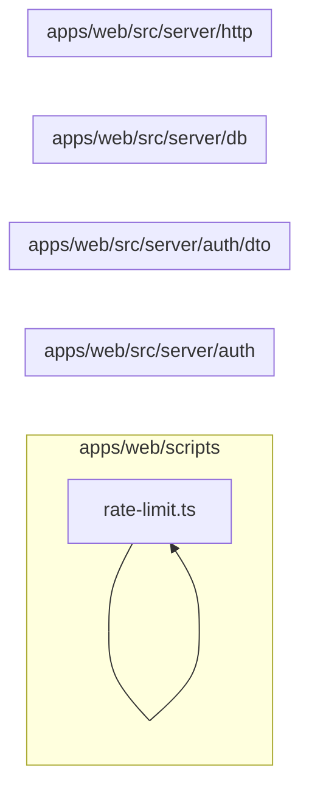

# 6. Infraestrutura do servidor

Resolve autenticação, autorização, transação por tenant, erros HTTP e provisionamento. Este módulo contém **14 arquivos de código**, sendo **14 fichas completas** e **0 exceções em tabela**.

## Dependências do módulo

As setas representam imports internos confirmados. Dependências com outros módulos aparecem nas fichas individuais.

## 6.1 `apps/web/scripts/seed-owner.ts`

**Propósito:** Cria ou atualiza o usuário proprietário por meio do Better Auth.

**Processo:** Ao ser importado ou executado, o arquivo expõe seu comportamento principal e coordena suas dependências declaradas.

**Estado:** implementado — contém lógica executável e não há marcador explícito de implementação pendente.

**Testes:** sem teste direto — busca pelos exports, nome do recurso e endpoint nas suítes não encontrou cobertura identificável.

**Depende de:** `apps/web/src/server/auth/auth.ts` — Configura o Better Auth com Prisma e cookies da aplicação. `apps/web/src/server/db/prisma.ts` — Cria os clientes Prisma de aplicação e sistema e entrega a conexão contextual. `.env.example` — variáveis `SEED_OWNER_EMAIL`, `SEED_OWNER_PASSWORD`. Banco — `Branch`, `Membership`, `MembershipRole`, `Role`, `Tenant`, `User`.

**Usado por:** nenhum importador interno; é ponto de entrada, script, página, rota ou candidato a código não usado.

**Bibliotecas externas relevantes:** nenhuma.

## 6.2 `apps/web/src/server/auth/auth.ts`

**Propósito:** Configura o Better Auth com Prisma e cookies da aplicação.

**Processo:** Ao ser importado ou executado, o arquivo expõe `auth` e coordena suas dependências declaradas.

**Estado:** implementado — contém lógica executável e não há marcador explícito de implementação pendente.

**Testes:** `apps/web/test/auth.spec.ts`

**Depende de:** `apps/web/src/server/db/prisma.ts` — Cria os clientes Prisma de aplicação e sistema e entrega a conexão contextual. `.env.example` — variáveis `BETTER_AUTH_SECRET`, `BETTER_AUTH_URL`.

**Usado por:** `apps/web/scripts/seed-owner.ts`, `apps/web/src/app/api/auth/[...all]/route.ts`, `apps/web/src/server/auth/provision.ts`, `apps/web/src/server/auth/require-session.ts`, `apps/web/src/server/services/users.service.ts`, `apps/web/test/auth.spec.ts`

**Bibliotecas externas relevantes:** `better-auth`

## 6.3 `apps/web/src/server/auth/dto/register-tenant.dto.ts`

**Propósito:** Implementa a responsabilidade de register-tenant.dto.ts na camada infraestrutura do servidor.

**Processo:** Ao ser importado ou executado, o arquivo expõe `RegisterTenantDto` e coordena suas dependências declaradas.

**Estado:** implementado — contém lógica executável e não há marcador explícito de implementação pendente.

**Testes:** sem teste direto — busca pelos exports, nome do recurso e endpoint nas suítes não encontrou cobertura identificável.

**Depende de:** nenhum arquivo interno, variável ou tabela identificado.

**Usado por:** `apps/web/src/app/api/register/route.ts`, `apps/web/src/server/auth/provision.ts`

**Bibliotecas externas relevantes:** `class-validator`

## 6.4 `apps/web/src/server/auth/provision.ts`

**Propósito:** Provisiona atomicamente usuário, tenant, filial, vínculo e papel owner.

**Processo:** Ao ser importado ou executado, o arquivo expõe `provisionTenant`, `ProvisionedTenant` e coordena suas dependências declaradas.

**Estado:** implementado — contém lógica executável e não há marcador explícito de implementação pendente.

**Testes:** `apps/web/test/auth.spec.ts`

**Depende de:** `apps/web/src/server/auth/auth.ts` — Configura o Better Auth com Prisma e cookies da aplicação. `apps/web/src/server/auth/dto/register-tenant.dto.ts` — Implementa a responsabilidade de register-tenant. `apps/web/src/server/db/prisma.ts` — Cria os clientes Prisma de aplicação e sistema e entrega a conexão contextual. `apps/web/src/server/http/errors.ts` — Define erros HTTP tipados do servidor. `packages/shared/src/index.ts` — Barrel público do pacote compartilhado. Banco — `Branch`, `Membership`, `MembershipRole`, `Permission`, `Role`, `RolePermission`, `Tenant`, `User`.

**Usado por:** `apps/web/src/app/api/register/route.ts`, `apps/web/test/auth.spec.ts`, `apps/web/test/helpers.ts`

**Bibliotecas externas relevantes:** `server-only`

## 6.5 `apps/web/src/server/auth/require-session.ts`

**Propósito:** Resolve usuário, tenant ativo, vínculo, papéis e permissões da sessão.

**Processo:** Ao ser importado ou executado, o arquivo expõe `requireSession`, `SessionContext` e coordena suas dependências declaradas.

**Estado:** implementado — contém lógica executável e não há marcador explícito de implementação pendente.

**Testes:** sem teste direto — busca pelos exports, nome do recurso e endpoint nas suítes não encontrou cobertura identificável.

**Depende de:** `apps/web/src/server/auth/auth.ts` — Configura o Better Auth com Prisma e cookies da aplicação. `apps/web/src/server/db/prisma.ts` — Cria os clientes Prisma de aplicação e sistema e entrega a conexão contextual. `apps/web/src/server/http/errors.ts` — Define erros HTTP tipados do servidor. Banco — `Membership`, `User`.

**Usado por:** `apps/web/src/server/auth/with-route.ts`

**Bibliotecas externas relevantes:** `next`, `server-only`

## 6.6 `apps/web/src/server/auth/with-route.ts`

**Propósito:** Wrapper das rotas que aplica sessão, RBAC, tenant, transação e tradução de erro.

**Processo:** Ao ser importado ou executado, o arquivo expõe `runRoute`, `RouteOptions`, `AuthedHandler` e coordena suas dependências declaradas.

**Estado:** implementado — contém lógica executável e não há marcador explícito de implementação pendente.

**Testes:** sem teste direto — busca pelos exports, nome do recurso e endpoint nas suítes não encontrou cobertura identificável.

**Depende de:** `apps/web/src/server/auth/require-session.ts` — Resolve usuário, tenant ativo, vínculo, papéis e permissões da sessão. `apps/web/src/server/db/with-tenant.ts` — Abre a transação, define app. `apps/web/src/server/http/errors.ts` — Define erros HTTP tipados do servidor. `apps/web/src/server/http/handle-error.ts` — Converte exceções conhecidas em respostas JSON seguras.

**Usado por:** `apps/web/src/app/api/appointments/[id]/route.ts`, `apps/web/src/app/api/appointments/[id]/status/route.ts`, `apps/web/src/app/api/appointments/route.ts`, `apps/web/src/app/api/branches/[id]/route.ts`, `apps/web/src/app/api/branches/route.ts`, `apps/web/src/app/api/customers/[id]/route.ts`, `apps/web/src/app/api/customers/route.ts`, `apps/web/src/app/api/expenses/[id]/route.ts`, `apps/web/src/app/api/expenses/route.ts`, `apps/web/src/app/api/inspection-templates/[id]/publish/route.ts`, `apps/web/src/app/api/inspection-templates/[id]/route.ts`, `apps/web/src/app/api/inspection-templates/route.ts`, `apps/web/src/app/api/inspections/[id]/answers/[questionId]/route.ts`, `apps/web/src/app/api/inspections/[id]/complete/route.ts`, `apps/web/src/app/api/inspections/[id]/route.ts`, `apps/web/src/app/api/inspections/route.ts`, `apps/web/src/app/api/invoices/[id]/cancel/route.ts`, `apps/web/src/app/api/invoices/[id]/document/route.ts`, `apps/web/src/app/api/invoices/[id]/issue/route.ts`, `apps/web/src/app/api/invoices/[id]/payments/[paymentId]/route.ts`, `apps/web/src/app/api/invoices/[id]/payments/route.ts`, `apps/web/src/app/api/invoices/[id]/route.ts`, `apps/web/src/app/api/invoices/from-job/[jobCardId]/route.ts`, `apps/web/src/app/api/invoices/route.ts`, `apps/web/src/app/api/job-cards/[id]/lines/[lineId]/route.ts`, `apps/web/src/app/api/job-cards/[id]/lines/route.ts`, `apps/web/src/app/api/job-cards/[id]/mechanics/[userId]/route.ts`, `apps/web/src/app/api/job-cards/[id]/mechanics/route.ts`, `apps/web/src/app/api/job-cards/[id]/route.ts`, `apps/web/src/app/api/job-cards/[id]/transition/route.ts`, `apps/web/src/app/api/job-cards/route.ts`, `apps/web/src/app/api/me/route.ts`, `apps/web/src/app/api/parts/[id]/route.ts`, `apps/web/src/app/api/parts/route.ts`, `apps/web/src/app/api/purchases/[id]/cancel/route.ts`, `apps/web/src/app/api/purchases/[id]/route.ts`, `apps/web/src/app/api/purchases/route.ts`, `apps/web/src/app/api/quotations/[id]/approve/route.ts`, `apps/web/src/app/api/quotations/[id]/convert-to-invoice/route.ts`, `apps/web/src/app/api/quotations/[id]/lines/[lineId]/route.ts`, `apps/web/src/app/api/quotations/[id]/lines/route.ts`, `apps/web/src/app/api/quotations/[id]/reject/route.ts`, `apps/web/src/app/api/quotations/[id]/route.ts`, `apps/web/src/app/api/quotations/[id]/send/route.ts`, `apps/web/src/app/api/quotations/route.ts`, `apps/web/src/app/api/reports/financial/route.ts`, `apps/web/src/app/api/reports/job-cards/route.ts`, `apps/web/src/app/api/reports/stock/route.ts`, `apps/web/src/app/api/roles/[id]/route.ts`, `apps/web/src/app/api/roles/permissions/route.ts`, `apps/web/src/app/api/roles/route.ts`, `apps/web/src/app/api/services/[id]/route.ts`, `apps/web/src/app/api/services/route.ts`, `apps/web/src/app/api/stock/balances/route.ts`, `apps/web/src/app/api/stock/issues/route.ts`, `apps/web/src/app/api/stock/locations/route.ts`, `apps/web/src/app/api/stock/movements/route.ts`, `apps/web/src/app/api/suppliers/[id]/route.ts`, `apps/web/src/app/api/suppliers/route.ts`, `apps/web/src/app/api/users/[id]/route.ts`, `apps/web/src/app/api/users/route.ts`, `apps/web/src/app/api/vehicles/[id]/route.ts`, `apps/web/src/app/api/vehicles/route.ts`

**Bibliotecas externas relevantes:** `next`, `server-only`

## 6.7 `apps/web/src/server/db/prisma-context.ts`

**Propósito:** Guarda a transação Prisma corrente no contexto assíncrono.

**Processo:** Ao ser importado ou executado, o arquivo expõe `prismaContext` e coordena suas dependências declaradas.

**Estado:** implementado — contém lógica executável e não há marcador explícito de implementação pendente.

**Testes:** sem teste direto — busca pelos exports, nome do recurso e endpoint nas suítes não encontrou cobertura identificável.

**Depende de:** nenhum arquivo interno, variável ou tabela identificado.

**Usado por:** `apps/web/src/server/db/prisma.ts`, `apps/web/src/server/db/with-tenant.ts`

**Bibliotecas externas relevantes:** `node:async_hooks`

## 6.8 `apps/web/src/server/db/prisma.ts`

**Propósito:** Cria os clientes Prisma de aplicação e sistema e entrega a conexão contextual.

**Processo:** Ao ser importado ou executado, o arquivo expõe `getDb`, `base`, `system` e coordena suas dependências declaradas.

**Estado:** implementado — contém lógica executável e não há marcador explícito de implementação pendente.

**Testes:** `apps/web/test/auth.spec.ts`, `apps/web/test/regressions.spec.ts`, `apps/web/test/rls.spec.ts`

**Depende de:** `apps/web/src/server/db/prisma-context.ts` — Guarda a transação Prisma corrente no contexto assíncrono. `packages/database/src/index.ts` — Barrel público do pacote de banco. `.env.example` — variáveis `NODE_ENV`.

**Usado por:** `apps/web/scripts/seed-owner.ts`, `apps/web/src/app/api/health/route.ts`, `apps/web/src/app/api/me/route.ts`, `apps/web/src/server/auth/auth.ts`, `apps/web/src/server/auth/provision.ts`, `apps/web/src/server/auth/require-session.ts`, `apps/web/src/server/db/with-tenant.ts`, `apps/web/src/server/services/appointments.service.ts`, `apps/web/src/server/services/branches.service.ts`, `apps/web/src/server/services/customers.service.ts`, `apps/web/src/server/services/expenses.service.ts`, `apps/web/src/server/services/inspection-templates.service.ts`, `apps/web/src/server/services/inspections.service.ts`, `apps/web/src/server/services/invoices.service.ts`, `apps/web/src/server/services/job-cards.service.ts`, `apps/web/src/server/services/line-calculator.service.ts`, `apps/web/src/server/services/number-sequence.service.ts`, `apps/web/src/server/services/parts.service.ts`, `apps/web/src/server/services/purchases.service.ts`, `apps/web/src/server/services/quotations.service.ts`, `apps/web/src/server/services/references.service.ts`, `apps/web/src/server/services/reports.service.ts`, `apps/web/src/server/services/roles.service.ts`, `apps/web/src/server/services/services.service.ts`, `apps/web/src/server/services/stock.service.ts`, `apps/web/src/server/services/suppliers.service.ts`, `apps/web/src/server/services/users.service.ts`, `apps/web/src/server/services/vehicles.service.ts`, `apps/web/test/auth.spec.ts`, `apps/web/test/regressions.spec.ts`, `apps/web/test/rls.spec.ts`

**Bibliotecas externas relevantes:** nenhuma.

## 6.9 `apps/web/src/server/db/with-tenant.ts`

**Propósito:** Abre a transação, define app.current_tenant e executa a requisição sob RLS.

**Processo:** Ao ser importado ou executado, o arquivo expõe `withTenant` e coordena suas dependências declaradas.

**Estado:** implementado — contém lógica executável e não há marcador explícito de implementação pendente.

**Testes:** sem teste direto — busca pelos exports, nome do recurso e endpoint nas suítes não encontrou cobertura identificável.

**Depende de:** `apps/web/src/server/db/prisma-context.ts` — Guarda a transação Prisma corrente no contexto assíncrono. `apps/web/src/server/db/prisma.ts` — Cria os clientes Prisma de aplicação e sistema e entrega a conexão contextual. `packages/database/src/index.ts` — Barrel público do pacote de banco.

**Usado por:** `apps/web/src/server/auth/with-route.ts`, `apps/web/test/helpers.ts`

**Bibliotecas externas relevantes:** nenhuma.

## 6.10 `apps/web/src/server/http/errors.ts`

**Propósito:** Define erros HTTP tipados do servidor.

**Processo:** Ao ser importado ou executado, o arquivo expõe `HttpError`, `BadRequestError`, `UnauthorizedError`, `ForbiddenError`, `NotFoundError`, `ConflictError`, `TooManyRequestsError` e coordena suas dependências declaradas.

**Estado:** implementado — contém lógica executável e não há marcador explícito de implementação pendente.

**Testes:** sem teste direto — busca pelos exports, nome do recurso e endpoint nas suítes não encontrou cobertura identificável.

**Depende de:** nenhum arquivo interno, variável ou tabela identificado.

**Usado por:** `apps/web/src/app/api/me/route.ts`, `apps/web/src/server/auth/provision.ts`, `apps/web/src/server/auth/require-session.ts`, `apps/web/src/server/auth/with-route.ts`, `apps/web/src/server/http/handle-error.ts`, `apps/web/src/server/http/params.ts`, `apps/web/src/server/http/parse-body.ts`, `apps/web/src/server/http/rate-limit.ts`, `apps/web/src/server/services/appointments.service.ts`, `apps/web/src/server/services/branches.service.ts`, `apps/web/src/server/services/customers.service.ts`, `apps/web/src/server/services/expenses.service.ts`, `apps/web/src/server/services/inspection-templates.service.ts`, `apps/web/src/server/services/inspections.service.ts`, `apps/web/src/server/services/invoices.service.ts`, `apps/web/src/server/services/job-cards.service.ts`, `apps/web/src/server/services/line-calculator.service.ts`, `apps/web/src/server/services/parts.service.ts`, `apps/web/src/server/services/purchases.service.ts`, `apps/web/src/server/services/quotations.service.ts`, `apps/web/src/server/services/references.service.ts`, `apps/web/src/server/services/roles.service.ts`, `apps/web/src/server/services/services.service.ts`, `apps/web/src/server/services/stock.service.ts`, `apps/web/src/server/services/suppliers.service.ts`, `apps/web/src/server/services/users.service.ts`, `apps/web/src/server/services/vehicles.service.ts`

**Bibliotecas externas relevantes:** nenhuma.

## 6.11 `apps/web/src/server/http/handle-error.ts`

**Propósito:** Converte exceções conhecidas em respostas JSON seguras.

**Processo:** Ao ser importado ou executado, o arquivo expõe `handleError` e coordena suas dependências declaradas.

**Estado:** implementado — contém lógica executável e não há marcador explícito de implementação pendente.

**Testes:** sem teste direto — busca pelos exports, nome do recurso e endpoint nas suítes não encontrou cobertura identificável.

**Depende de:** `apps/web/src/server/http/errors.ts` — Define erros HTTP tipados do servidor. `packages/database/src/index.ts` — Barrel público do pacote de banco.

**Usado por:** `apps/web/src/app/api/register/route.ts`, `apps/web/src/server/auth/with-route.ts`

**Bibliotecas externas relevantes:** `next`

## 6.12 `apps/web/src/server/http/params.ts`

**Propósito:** Valida parâmetros de rota, especialmente UUIDs.

**Processo:** Ao ser importado ou executado, o arquivo expõe `assertUuid` e coordena suas dependências declaradas.

**Estado:** implementado — contém lógica executável e não há marcador explícito de implementação pendente.

**Testes:** sem teste direto — busca pelos exports, nome do recurso e endpoint nas suítes não encontrou cobertura identificável.

**Depende de:** `apps/web/src/server/http/errors.ts` — Define erros HTTP tipados do servidor.

**Usado por:** `apps/web/src/app/api/appointments/[id]/route.ts`, `apps/web/src/app/api/appointments/[id]/status/route.ts`, `apps/web/src/app/api/branches/[id]/route.ts`, `apps/web/src/app/api/customers/[id]/route.ts`, `apps/web/src/app/api/expenses/[id]/route.ts`, `apps/web/src/app/api/inspection-templates/[id]/publish/route.ts`, `apps/web/src/app/api/inspection-templates/[id]/route.ts`, `apps/web/src/app/api/inspections/[id]/answers/[questionId]/route.ts`, `apps/web/src/app/api/inspections/[id]/complete/route.ts`, `apps/web/src/app/api/inspections/[id]/route.ts`, `apps/web/src/app/api/invoices/[id]/cancel/route.ts`, `apps/web/src/app/api/invoices/[id]/document/route.ts`, `apps/web/src/app/api/invoices/[id]/issue/route.ts`, `apps/web/src/app/api/invoices/[id]/payments/[paymentId]/route.ts`, `apps/web/src/app/api/invoices/[id]/payments/route.ts`, `apps/web/src/app/api/invoices/[id]/route.ts`, `apps/web/src/app/api/invoices/from-job/[jobCardId]/route.ts`, `apps/web/src/app/api/job-cards/[id]/lines/[lineId]/route.ts`, `apps/web/src/app/api/job-cards/[id]/lines/route.ts`, `apps/web/src/app/api/job-cards/[id]/mechanics/[userId]/route.ts`, `apps/web/src/app/api/job-cards/[id]/mechanics/route.ts`, `apps/web/src/app/api/job-cards/[id]/route.ts`, `apps/web/src/app/api/job-cards/[id]/transition/route.ts`, `apps/web/src/app/api/parts/[id]/route.ts`, `apps/web/src/app/api/purchases/[id]/cancel/route.ts`, `apps/web/src/app/api/purchases/[id]/route.ts`, `apps/web/src/app/api/quotations/[id]/approve/route.ts`, `apps/web/src/app/api/quotations/[id]/convert-to-invoice/route.ts`, `apps/web/src/app/api/quotations/[id]/lines/[lineId]/route.ts`, `apps/web/src/app/api/quotations/[id]/lines/route.ts`, `apps/web/src/app/api/quotations/[id]/reject/route.ts`, `apps/web/src/app/api/quotations/[id]/route.ts`, `apps/web/src/app/api/quotations/[id]/send/route.ts`, `apps/web/src/app/api/roles/[id]/route.ts`, `apps/web/src/app/api/services/[id]/route.ts`, `apps/web/src/app/api/suppliers/[id]/route.ts`, `apps/web/src/app/api/users/[id]/route.ts`, `apps/web/src/app/api/vehicles/[id]/route.ts`

**Bibliotecas externas relevantes:** nenhuma.

## 6.13 `apps/web/src/server/http/parse-body.ts`

**Propósito:** Transforma e valida body/query com class-transformer e class-validator.

**Processo:** Ao ser importado ou executado, o arquivo expõe `parseBody`, `parseQuery` e coordena suas dependências declaradas.

**Estado:** implementado — contém lógica executável e não há marcador explícito de implementação pendente.

**Testes:** `apps/web/test/regressions.spec.ts`

**Depende de:** `apps/web/src/server/dtos/partial-type.ts` — Define o contrato validado PartialType, isPartialDto usado nas entradas de peças. `apps/web/src/server/http/errors.ts` — Define erros HTTP tipados do servidor.

**Usado por:** `apps/web/src/app/api/appointments/[id]/route.ts`, `apps/web/src/app/api/appointments/[id]/status/route.ts`, `apps/web/src/app/api/appointments/route.ts`, `apps/web/src/app/api/branches/[id]/route.ts`, `apps/web/src/app/api/branches/route.ts`, `apps/web/src/app/api/customers/[id]/route.ts`, `apps/web/src/app/api/customers/route.ts`, `apps/web/src/app/api/expenses/[id]/route.ts`, `apps/web/src/app/api/expenses/route.ts`, `apps/web/src/app/api/inspection-templates/route.ts`, `apps/web/src/app/api/inspections/[id]/answers/[questionId]/route.ts`, `apps/web/src/app/api/inspections/[id]/route.ts`, `apps/web/src/app/api/inspections/route.ts`, `apps/web/src/app/api/invoices/[id]/payments/route.ts`, `apps/web/src/app/api/invoices/[id]/route.ts`, `apps/web/src/app/api/invoices/route.ts`, `apps/web/src/app/api/job-cards/[id]/lines/[lineId]/route.ts`, `apps/web/src/app/api/job-cards/[id]/lines/route.ts`, `apps/web/src/app/api/job-cards/[id]/mechanics/route.ts`, `apps/web/src/app/api/job-cards/[id]/route.ts`, `apps/web/src/app/api/job-cards/[id]/transition/route.ts`, `apps/web/src/app/api/job-cards/route.ts`, `apps/web/src/app/api/parts/[id]/route.ts`, `apps/web/src/app/api/parts/route.ts`, `apps/web/src/app/api/purchases/route.ts`, `apps/web/src/app/api/quotations/[id]/lines/[lineId]/route.ts`, `apps/web/src/app/api/quotations/[id]/lines/route.ts`, `apps/web/src/app/api/quotations/[id]/route.ts`, `apps/web/src/app/api/quotations/route.ts`, `apps/web/src/app/api/register/route.ts`, `apps/web/src/app/api/reports/financial/route.ts`, `apps/web/src/app/api/roles/[id]/route.ts`, `apps/web/src/app/api/roles/route.ts`, `apps/web/src/app/api/services/[id]/route.ts`, `apps/web/src/app/api/services/route.ts`, `apps/web/src/app/api/stock/balances/route.ts`, `apps/web/src/app/api/stock/issues/route.ts`, `apps/web/src/app/api/stock/locations/route.ts`, `apps/web/src/app/api/stock/movements/route.ts`, `apps/web/src/app/api/suppliers/[id]/route.ts`, `apps/web/src/app/api/suppliers/route.ts`, `apps/web/src/app/api/users/[id]/route.ts`, `apps/web/src/app/api/users/route.ts`, `apps/web/src/app/api/vehicles/[id]/route.ts`, `apps/web/src/app/api/vehicles/route.ts`, `apps/web/test/regressions.spec.ts`

**Bibliotecas externas relevantes:** `class-transformer`, `class-validator`, `reflect-metadata`, `server-only`

## 6.14 `apps/web/src/server/http/rate-limit.ts`

**Propósito:** Implementa limitação simples de requisições em memória.

**Processo:** Ao ser importado ou executado, o arquivo expõe `rateLimit`, `sweepRateLimitBuckets`, `clientIp` e coordena suas dependências declaradas.

**Estado:** implementado — contém lógica executável e não há marcador explícito de implementação pendente.

**Testes:** `apps/web/test/regressions.spec.ts`

**Depende de:** `apps/web/src/server/http/errors.ts` — Define erros HTTP tipados do servidor.

**Usado por:** `apps/web/src/app/api/register/route.ts`, `apps/web/test/regressions.spec.ts`

**Bibliotecas externas relevantes:** nenhuma.

## Quadro do módulo

| Arquivo | Estado | Teste | Processo/tela |
|---|---|---|---|
| `apps/web/scripts/seed-owner.ts` | implementado | sem teste direto | infraestrutura |
| `apps/web/src/server/auth/auth.ts` | implementado | `auth.spec.ts` | infraestrutura |
| `apps/web/src/server/auth/dto/register-tenant.dto.ts` | implementado | sem teste direto | infraestrutura |
| `apps/web/src/server/auth/provision.ts` | implementado | `auth.spec.ts` | infraestrutura |
| `apps/web/src/server/auth/require-session.ts` | implementado | sem teste direto | infraestrutura |
| `apps/web/src/server/auth/with-route.ts` | implementado | sem teste direto | infraestrutura |
| `apps/web/src/server/db/prisma-context.ts` | implementado | sem teste direto | infraestrutura |
| `apps/web/src/server/db/prisma.ts` | implementado | `auth.spec.ts`, `regressions.spec.ts`, `rls.spec.ts` | infraestrutura |
| `apps/web/src/server/db/with-tenant.ts` | implementado | sem teste direto | infraestrutura |
| `apps/web/src/server/http/errors.ts` | implementado | sem teste direto | infraestrutura |
| `apps/web/src/server/http/handle-error.ts` | implementado | sem teste direto | infraestrutura |
| `apps/web/src/server/http/params.ts` | implementado | sem teste direto | infraestrutura |
| `apps/web/src/server/http/parse-body.ts` | implementado | `regressions.spec.ts` | infraestrutura |
| `apps/web/src/server/http/rate-limit.ts` | implementado | `regressions.spec.ts` | infraestrutura |
