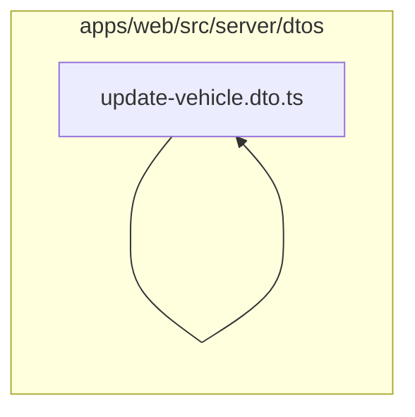

# 7. DTOs comuns e de cadastros

Valida paginação e entradas de filiais, clientes, veículos, peças, serviços, fornecedores, usuários e papéis. Este módulo contém **25 arquivos de código**, sendo **25 fichas completas** e **0 exceções em tabela**.

## Dependências do módulo

As setas representam imports internos confirmados. Dependências com outros módulos aparecem nas fichas individuais.

## 7.1 `apps/web/src/server/dtos/create-branch.dto.ts`

**Propósito:** Define o contrato validado CreateBranchDto usado nas entradas de filiais.

**Processo:** O transformador instancia `CreateBranchDto`; os decorators validam tipos, obrigatoriedade, limites e enums antes de o service receber os dados.

**Estado:** implementado — contém lógica executável e não há marcador explícito de implementação pendente.

**Testes:** sem teste direto — busca pelos exports, nome do recurso e endpoint nas suítes não encontrou cobertura identificável.

**Depende de:** nenhum arquivo interno, variável ou tabela identificado.

**Usado por:** `apps/web/src/app/api/branches/route.ts`, `apps/web/src/server/services/branches.service.ts`

**Bibliotecas externas relevantes:** `class-validator`

## 7.2 `apps/web/src/server/dtos/create-customer.dto.ts`

**Propósito:** Define o contrato validado CreateCustomerDto usado nas entradas de clientes.

**Processo:** O transformador instancia `CreateCustomerDto`; os decorators validam tipos, obrigatoriedade, limites e enums antes de o service receber os dados.

**Estado:** implementado — contém lógica executável e não há marcador explícito de implementação pendente.

**Testes:** `apps/web/test/regressions.spec.ts`

**Depende de:** nenhum arquivo interno, variável ou tabela identificado.

**Usado por:** `apps/web/src/app/api/customers/route.ts`, `apps/web/src/server/dtos/update-customer.dto.ts`, `apps/web/src/server/services/customers.service.ts`, `apps/web/test/regressions.spec.ts`

**Bibliotecas externas relevantes:** `@prisma/client`, `class-validator`

## 7.3 `apps/web/src/server/dtos/create-part.dto.ts`

**Propósito:** Define o contrato validado CreatePartDto usado nas entradas de peças.

**Processo:** O transformador instancia `CreatePartDto`; os decorators validam tipos, obrigatoriedade, limites e enums antes de o service receber os dados.

**Estado:** implementado — contém lógica executável e não há marcador explícito de implementação pendente.

**Testes:** sem teste direto — busca pelos exports, nome do recurso e endpoint nas suítes não encontrou cobertura identificável.

**Depende de:** nenhum arquivo interno, variável ou tabela identificado.

**Usado por:** `apps/web/src/app/api/parts/route.ts`, `apps/web/src/server/dtos/update-part.dto.ts`, `apps/web/src/server/services/parts.service.ts`

**Bibliotecas externas relevantes:** `class-validator`

## 7.4 `apps/web/src/server/dtos/create-role.dto.ts`

**Propósito:** Define o contrato validado CreateRoleDto usado nas entradas de papéis e permissões.

**Processo:** O transformador instancia `CreateRoleDto`; os decorators validam tipos, obrigatoriedade, limites e enums antes de o service receber os dados.

**Estado:** implementado — contém lógica executável e não há marcador explícito de implementação pendente.

**Testes:** sem teste direto — busca pelos exports, nome do recurso e endpoint nas suítes não encontrou cobertura identificável.

**Depende de:** nenhum arquivo interno, variável ou tabela identificado.

**Usado por:** `apps/web/src/app/api/roles/route.ts`, `apps/web/src/server/services/roles.service.ts`

**Bibliotecas externas relevantes:** `class-validator`

## 7.5 `apps/web/src/server/dtos/create-service.dto.ts`

**Propósito:** Define o contrato validado CreateServiceDto usado nas entradas de catálogo de serviços.

**Processo:** O transformador instancia `CreateServiceDto`; os decorators validam tipos, obrigatoriedade, limites e enums antes de o service receber os dados.

**Estado:** implementado — contém lógica executável e não há marcador explícito de implementação pendente.

**Testes:** `apps/web/test/flows.spec.ts`, `apps/web/test/regressions.spec.ts`, `apps/web/test/rls.spec.ts`

**Depende de:** nenhum arquivo interno, variável ou tabela identificado.

**Usado por:** `apps/web/src/app/api/services/route.ts`, `apps/web/src/server/dtos/update-service.dto.ts`, `apps/web/src/server/services/services.service.ts`

**Bibliotecas externas relevantes:** `class-validator`

## 7.6 `apps/web/src/server/dtos/create-supplier.dto.ts`

**Propósito:** Define o contrato validado CreateSupplierDto usado nas entradas de fornecedores.

**Processo:** O transformador instancia `CreateSupplierDto`; os decorators validam tipos, obrigatoriedade, limites e enums antes de o service receber os dados.

**Estado:** implementado — contém lógica executável e não há marcador explícito de implementação pendente.

**Testes:** sem teste direto — busca pelos exports, nome do recurso e endpoint nas suítes não encontrou cobertura identificável.

**Depende de:** nenhum arquivo interno, variável ou tabela identificado.

**Usado por:** `apps/web/src/app/api/suppliers/route.ts`, `apps/web/src/server/dtos/update-supplier.dto.ts`, `apps/web/src/server/services/suppliers.service.ts`

**Bibliotecas externas relevantes:** `class-validator`

## 7.7 `apps/web/src/server/dtos/create-user.dto.ts`

**Propósito:** Define o contrato validado CreateUserDto usado nas entradas de usuários/equipe.

**Processo:** O transformador instancia `CreateUserDto`; os decorators validam tipos, obrigatoriedade, limites e enums antes de o service receber os dados.

**Estado:** implementado — contém lógica executável e não há marcador explícito de implementação pendente.

**Testes:** sem teste direto — busca pelos exports, nome do recurso e endpoint nas suítes não encontrou cobertura identificável.

**Depende de:** nenhum arquivo interno, variável ou tabela identificado.

**Usado por:** `apps/web/src/app/api/users/route.ts`, `apps/web/src/server/services/users.service.ts`

**Bibliotecas externas relevantes:** `class-validator`

## 7.8 `apps/web/src/server/dtos/create-vehicle.dto.ts`

**Propósito:** Define o contrato validado CreateVehicleDto usado nas entradas de veículos.

**Processo:** O transformador instancia `CreateVehicleDto`; os decorators validam tipos, obrigatoriedade, limites e enums antes de o service receber os dados.

**Estado:** implementado — contém lógica executável e não há marcador explícito de implementação pendente.

**Testes:** sem teste direto — busca pelos exports, nome do recurso e endpoint nas suítes não encontrou cobertura identificável.

**Depende de:** nenhum arquivo interno, variável ou tabela identificado.

**Usado por:** `apps/web/src/app/api/vehicles/route.ts`, `apps/web/src/server/dtos/update-vehicle.dto.ts`, `apps/web/src/server/services/vehicles.service.ts`

**Bibliotecas externas relevantes:** `@prisma/client`, `class-validator`

## 7.9 `apps/web/src/server/dtos/pagination.dto.ts`

**Propósito:** Define o contrato validado PaginationDto usado nas entradas de pagination.dto.ts.

**Processo:** O transformador instancia `PaginationDto`; os decorators validam tipos, obrigatoriedade, limites e enums antes de o service receber os dados.

**Estado:** implementado — contém lógica executável e não há marcador explícito de implementação pendente.

**Testes:** sem teste direto — busca pelos exports, nome do recurso e endpoint nas suítes não encontrou cobertura identificável.

**Depende de:** nenhum arquivo interno, variável ou tabela identificado.

**Usado por:** `apps/web/src/server/dtos/query-appointment.dto.ts`, `apps/web/src/server/dtos/query-expense.dto.ts`, `apps/web/src/server/dtos/query-inspection-template.dto.ts`, `apps/web/src/server/dtos/query-inspection.dto.ts`, `apps/web/src/server/dtos/query-invoice.dto.ts`, `apps/web/src/server/dtos/query-job-card.dto.ts`, `apps/web/src/server/dtos/query-movement.dto.ts`, `apps/web/src/server/dtos/query-part.dto.ts`, `apps/web/src/server/dtos/query-purchase.dto.ts`, `apps/web/src/server/dtos/query-quotation.dto.ts`, `apps/web/src/server/dtos/query-service.dto.ts`, `apps/web/src/server/dtos/query-supplier.dto.ts`, `apps/web/src/server/dtos/query-user.dto.ts`

**Bibliotecas externas relevantes:** `class-transformer`, `class-validator`, `reflect-metadata`

## 7.10 `apps/web/src/server/dtos/partial-type.ts`

**Propósito:** Define o contrato validado PartialType, isPartialDto usado nas entradas de peças.

**Processo:** O transformador instancia `PartialType`, `isPartialDto`; os decorators validam tipos, obrigatoriedade, limites e enums antes de o service receber os dados.

**Estado:** implementado — contém lógica executável e não há marcador explícito de implementação pendente.

**Testes:** sem teste direto — busca pelos exports, nome do recurso e endpoint nas suítes não encontrou cobertura identificável.

**Depende de:** nenhum arquivo interno, variável ou tabela identificado.

**Usado por:** `apps/web/src/server/dtos/update-appointment.dto.ts`, `apps/web/src/server/dtos/update-customer.dto.ts`, `apps/web/src/server/dtos/update-expense.dto.ts`, `apps/web/src/server/dtos/update-job-card.dto.ts`, `apps/web/src/server/dtos/update-job-line.dto.ts`, `apps/web/src/server/dtos/update-part.dto.ts`, `apps/web/src/server/dtos/update-quotation.dto.ts`, `apps/web/src/server/dtos/update-service.dto.ts`, `apps/web/src/server/dtos/update-supplier.dto.ts`, `apps/web/src/server/dtos/update-vehicle.dto.ts`, `apps/web/src/server/http/parse-body.ts`

**Bibliotecas externas relevantes:** nenhuma.

## 7.11 `apps/web/src/server/dtos/query-balance.dto.ts`

**Propósito:** Define o contrato validado QueryBalanceDto usado nas entradas de estoque.

**Processo:** O transformador instancia `QueryBalanceDto`; os decorators validam tipos, obrigatoriedade, limites e enums antes de o service receber os dados.

**Estado:** implementado — contém lógica executável e não há marcador explícito de implementação pendente.

**Testes:** sem teste direto — busca pelos exports, nome do recurso e endpoint nas suítes não encontrou cobertura identificável.

**Depende de:** nenhum arquivo interno, variável ou tabela identificado.

**Usado por:** `apps/web/src/app/api/stock/balances/route.ts`, `apps/web/src/server/services/stock.service.ts`

**Bibliotecas externas relevantes:** `class-transformer`, `class-validator`, `reflect-metadata`

## 7.12 `apps/web/src/server/dtos/query-customer.dto.ts`

**Propósito:** Define o contrato validado QueryCustomerDto usado nas entradas de clientes.

**Processo:** O transformador instancia `QueryCustomerDto`; os decorators validam tipos, obrigatoriedade, limites e enums antes de o service receber os dados.

**Estado:** implementado — contém lógica executável e não há marcador explícito de implementação pendente.

**Testes:** sem teste direto — busca pelos exports, nome do recurso e endpoint nas suítes não encontrou cobertura identificável.

**Depende de:** nenhum arquivo interno, variável ou tabela identificado.

**Usado por:** `apps/web/src/app/api/customers/route.ts`, `apps/web/src/server/services/customers.service.ts`

**Bibliotecas externas relevantes:** `class-transformer`, `class-validator`, `reflect-metadata`

## 7.13 `apps/web/src/server/dtos/query-part.dto.ts`

**Propósito:** Define o contrato validado QueryPartDto usado nas entradas de peças.

**Processo:** O transformador instancia `QueryPartDto`; os decorators validam tipos, obrigatoriedade, limites e enums antes de o service receber os dados.

**Estado:** implementado — contém lógica executável e não há marcador explícito de implementação pendente.

**Testes:** sem teste direto — busca pelos exports, nome do recurso e endpoint nas suítes não encontrou cobertura identificável.

**Depende de:** `apps/web/src/server/dtos/pagination.dto.ts` — Define o contrato validado PaginationDto usado nas entradas de pagination.

**Usado por:** `apps/web/src/app/api/parts/route.ts`, `apps/web/src/server/services/parts.service.ts`

**Bibliotecas externas relevantes:** `class-validator`

## 7.14 `apps/web/src/server/dtos/query-service.dto.ts`

**Propósito:** Define o contrato validado QueryServiceDto usado nas entradas de catálogo de serviços.

**Processo:** O transformador instancia `QueryServiceDto`; os decorators validam tipos, obrigatoriedade, limites e enums antes de o service receber os dados.

**Estado:** implementado — contém lógica executável e não há marcador explícito de implementação pendente.

**Testes:** `apps/web/test/flows.spec.ts`, `apps/web/test/regressions.spec.ts`, `apps/web/test/rls.spec.ts`

**Depende de:** `apps/web/src/server/dtos/pagination.dto.ts` — Define o contrato validado PaginationDto usado nas entradas de pagination.

**Usado por:** `apps/web/src/app/api/services/route.ts`, `apps/web/src/server/services/services.service.ts`

**Bibliotecas externas relevantes:** `class-validator`

## 7.15 `apps/web/src/server/dtos/query-supplier.dto.ts`

**Propósito:** Define o contrato validado QuerySupplierDto usado nas entradas de fornecedores.

**Processo:** O transformador instancia `QuerySupplierDto`; os decorators validam tipos, obrigatoriedade, limites e enums antes de o service receber os dados.

**Estado:** implementado — contém lógica executável e não há marcador explícito de implementação pendente.

**Testes:** sem teste direto — busca pelos exports, nome do recurso e endpoint nas suítes não encontrou cobertura identificável.

**Depende de:** `apps/web/src/server/dtos/pagination.dto.ts` — Define o contrato validado PaginationDto usado nas entradas de pagination.

**Usado por:** `apps/web/src/app/api/suppliers/route.ts`, `apps/web/src/server/services/suppliers.service.ts`

**Bibliotecas externas relevantes:** `class-validator`

## 7.16 `apps/web/src/server/dtos/query-user.dto.ts`

**Propósito:** Define o contrato validado QueryUserDto usado nas entradas de usuários/equipe.

**Processo:** O transformador instancia `QueryUserDto`; os decorators validam tipos, obrigatoriedade, limites e enums antes de o service receber os dados.

**Estado:** implementado — contém lógica executável e não há marcador explícito de implementação pendente.

**Testes:** sem teste direto — busca pelos exports, nome do recurso e endpoint nas suítes não encontrou cobertura identificável.

**Depende de:** `apps/web/src/server/dtos/pagination.dto.ts` — Define o contrato validado PaginationDto usado nas entradas de pagination.

**Usado por:** `apps/web/src/app/api/users/route.ts`, `apps/web/src/server/services/users.service.ts`

**Bibliotecas externas relevantes:** `class-validator`

## 7.17 `apps/web/src/server/dtos/query-vehicle.dto.ts`

**Propósito:** Define o contrato validado QueryVehicleDto usado nas entradas de veículos.

**Processo:** O transformador instancia `QueryVehicleDto`; os decorators validam tipos, obrigatoriedade, limites e enums antes de o service receber os dados.

**Estado:** implementado — contém lógica executável e não há marcador explícito de implementação pendente.

**Testes:** sem teste direto — busca pelos exports, nome do recurso e endpoint nas suítes não encontrou cobertura identificável.

**Depende de:** nenhum arquivo interno, variável ou tabela identificado.

**Usado por:** `apps/web/src/app/api/vehicles/route.ts`, `apps/web/src/server/services/vehicles.service.ts`

**Bibliotecas externas relevantes:** `class-transformer`, `class-validator`, `reflect-metadata`

## 7.18 `apps/web/src/server/dtos/update-branch.dto.ts`

**Propósito:** Define o contrato validado UpdateBranchDto usado nas entradas de filiais.

**Processo:** O transformador instancia `UpdateBranchDto`; os decorators validam tipos, obrigatoriedade, limites e enums antes de o service receber os dados.

**Estado:** implementado — contém lógica executável e não há marcador explícito de implementação pendente.

**Testes:** sem teste direto — busca pelos exports, nome do recurso e endpoint nas suítes não encontrou cobertura identificável.

**Depende de:** nenhum arquivo interno, variável ou tabela identificado.

**Usado por:** `apps/web/src/app/api/branches/[id]/route.ts`, `apps/web/src/server/services/branches.service.ts`

**Bibliotecas externas relevantes:** `class-validator`

## 7.19 `apps/web/src/server/dtos/update-customer.dto.ts`

**Propósito:** Define o contrato validado UpdateCustomerDto usado nas entradas de clientes.

**Processo:** O transformador instancia `UpdateCustomerDto`; os decorators validam tipos, obrigatoriedade, limites e enums antes de o service receber os dados.

**Estado:** implementado — contém lógica executável e não há marcador explícito de implementação pendente.

**Testes:** `apps/web/test/regressions.spec.ts`

**Depende de:** `apps/web/src/server/dtos/create-customer.dto.ts` — Define o contrato validado CreateCustomerDto usado nas entradas de clientes. `apps/web/src/server/dtos/partial-type.ts` — Define o contrato validado PartialType, isPartialDto usado nas entradas de peças.

**Usado por:** `apps/web/src/app/api/customers/[id]/route.ts`, `apps/web/src/server/services/customers.service.ts`, `apps/web/test/regressions.spec.ts`

**Bibliotecas externas relevantes:** nenhuma.

## 7.20 `apps/web/src/server/dtos/update-part.dto.ts`

**Propósito:** Define o contrato validado UpdatePartDto usado nas entradas de peças.

**Processo:** O transformador instancia `UpdatePartDto`; os decorators validam tipos, obrigatoriedade, limites e enums antes de o service receber os dados.

**Estado:** implementado — contém lógica executável e não há marcador explícito de implementação pendente.

**Testes:** sem teste direto — busca pelos exports, nome do recurso e endpoint nas suítes não encontrou cobertura identificável.

**Depende de:** `apps/web/src/server/dtos/create-part.dto.ts` — Define o contrato validado CreatePartDto usado nas entradas de peças. `apps/web/src/server/dtos/partial-type.ts` — Define o contrato validado PartialType, isPartialDto usado nas entradas de peças.

**Usado por:** `apps/web/src/app/api/parts/[id]/route.ts`, `apps/web/src/server/services/parts.service.ts`

**Bibliotecas externas relevantes:** nenhuma.

## 7.21 `apps/web/src/server/dtos/update-role.dto.ts`

**Propósito:** Define o contrato validado UpdateRoleDto usado nas entradas de papéis e permissões.

**Processo:** O transformador instancia `UpdateRoleDto`; os decorators validam tipos, obrigatoriedade, limites e enums antes de o service receber os dados.

**Estado:** implementado — contém lógica executável e não há marcador explícito de implementação pendente.

**Testes:** sem teste direto — busca pelos exports, nome do recurso e endpoint nas suítes não encontrou cobertura identificável.

**Depende de:** nenhum arquivo interno, variável ou tabela identificado.

**Usado por:** `apps/web/src/app/api/roles/[id]/route.ts`, `apps/web/src/server/services/roles.service.ts`

**Bibliotecas externas relevantes:** `class-validator`

## 7.22 `apps/web/src/server/dtos/update-service.dto.ts`

**Propósito:** Define o contrato validado UpdateServiceDto usado nas entradas de catálogo de serviços.

**Processo:** O transformador instancia `UpdateServiceDto`; os decorators validam tipos, obrigatoriedade, limites e enums antes de o service receber os dados.

**Estado:** implementado — contém lógica executável e não há marcador explícito de implementação pendente.

**Testes:** `apps/web/test/flows.spec.ts`, `apps/web/test/regressions.spec.ts`, `apps/web/test/rls.spec.ts`

**Depende de:** `apps/web/src/server/dtos/create-service.dto.ts` — Define o contrato validado CreateServiceDto usado nas entradas de catálogo de serviços. `apps/web/src/server/dtos/partial-type.ts` — Define o contrato validado PartialType, isPartialDto usado nas entradas de peças.

**Usado por:** `apps/web/src/app/api/services/[id]/route.ts`, `apps/web/src/server/services/services.service.ts`

**Bibliotecas externas relevantes:** nenhuma.

## 7.23 `apps/web/src/server/dtos/update-supplier.dto.ts`

**Propósito:** Define o contrato validado UpdateSupplierDto usado nas entradas de fornecedores.

**Processo:** O transformador instancia `UpdateSupplierDto`; os decorators validam tipos, obrigatoriedade, limites e enums antes de o service receber os dados.

**Estado:** implementado — contém lógica executável e não há marcador explícito de implementação pendente.

**Testes:** sem teste direto — busca pelos exports, nome do recurso e endpoint nas suítes não encontrou cobertura identificável.

**Depende de:** `apps/web/src/server/dtos/create-supplier.dto.ts` — Define o contrato validado CreateSupplierDto usado nas entradas de fornecedores. `apps/web/src/server/dtos/partial-type.ts` — Define o contrato validado PartialType, isPartialDto usado nas entradas de peças.

**Usado por:** `apps/web/src/app/api/suppliers/[id]/route.ts`, `apps/web/src/server/services/suppliers.service.ts`

**Bibliotecas externas relevantes:** nenhuma.

## 7.24 `apps/web/src/server/dtos/update-user.dto.ts`

**Propósito:** Define o contrato validado UpdateUserDto usado nas entradas de usuários/equipe.

**Processo:** O transformador instancia `UpdateUserDto`; os decorators validam tipos, obrigatoriedade, limites e enums antes de o service receber os dados.

**Estado:** implementado — contém lógica executável e não há marcador explícito de implementação pendente.

**Testes:** sem teste direto — busca pelos exports, nome do recurso e endpoint nas suítes não encontrou cobertura identificável.

**Depende de:** nenhum arquivo interno, variável ou tabela identificado.

**Usado por:** `apps/web/src/app/api/users/[id]/route.ts`, `apps/web/src/server/services/users.service.ts`

**Bibliotecas externas relevantes:** `@prisma/client`, `class-validator`

## 7.25 `apps/web/src/server/dtos/update-vehicle.dto.ts`

**Propósito:** Define o contrato validado UpdateVehicleDto usado nas entradas de veículos.

**Processo:** O transformador instancia `UpdateVehicleDto`; os decorators validam tipos, obrigatoriedade, limites e enums antes de o service receber os dados.

**Estado:** implementado — contém lógica executável e não há marcador explícito de implementação pendente.

**Testes:** sem teste direto — busca pelos exports, nome do recurso e endpoint nas suítes não encontrou cobertura identificável.

**Depende de:** `apps/web/src/server/dtos/create-vehicle.dto.ts` — Define o contrato validado CreateVehicleDto usado nas entradas de veículos. `apps/web/src/server/dtos/partial-type.ts` — Define o contrato validado PartialType, isPartialDto usado nas entradas de peças.

**Usado por:** `apps/web/src/app/api/vehicles/[id]/route.ts`, `apps/web/src/server/services/vehicles.service.ts`

**Bibliotecas externas relevantes:** nenhuma.

## Quadro do módulo

| Arquivo | Estado | Teste | Processo/tela |
|---|---|---|---|
| `apps/web/src/server/dtos/create-branch.dto.ts` | implementado | sem teste direto | filiais |
| `apps/web/src/server/dtos/create-customer.dto.ts` | implementado | `regressions.spec.ts` | clientes |
| `apps/web/src/server/dtos/create-part.dto.ts` | implementado | sem teste direto | peças |
| `apps/web/src/server/dtos/create-role.dto.ts` | implementado | sem teste direto | papéis e permissões |
| `apps/web/src/server/dtos/create-service.dto.ts` | implementado | `flows.spec.ts`, `regressions.spec.ts`, `rls.spec.ts` | catálogo de serviços |
| `apps/web/src/server/dtos/create-supplier.dto.ts` | implementado | sem teste direto | fornecedores |
| `apps/web/src/server/dtos/create-user.dto.ts` | implementado | sem teste direto | usuários/equipe |
| `apps/web/src/server/dtos/create-vehicle.dto.ts` | implementado | sem teste direto | veículos |
| `apps/web/src/server/dtos/pagination.dto.ts` | implementado | sem teste direto | infraestrutura |
| `apps/web/src/server/dtos/partial-type.ts` | implementado | sem teste direto | peças |
| `apps/web/src/server/dtos/query-balance.dto.ts` | implementado | sem teste direto | estoque |
| `apps/web/src/server/dtos/query-customer.dto.ts` | implementado | sem teste direto | clientes |
| `apps/web/src/server/dtos/query-part.dto.ts` | implementado | sem teste direto | peças |
| `apps/web/src/server/dtos/query-service.dto.ts` | implementado | `flows.spec.ts`, `regressions.spec.ts`, `rls.spec.ts` | catálogo de serviços |
| `apps/web/src/server/dtos/query-supplier.dto.ts` | implementado | sem teste direto | fornecedores |
| `apps/web/src/server/dtos/query-user.dto.ts` | implementado | sem teste direto | usuários/equipe |
| `apps/web/src/server/dtos/query-vehicle.dto.ts` | implementado | sem teste direto | veículos |
| `apps/web/src/server/dtos/update-branch.dto.ts` | implementado | sem teste direto | filiais |
| `apps/web/src/server/dtos/update-customer.dto.ts` | implementado | `regressions.spec.ts` | clientes |
| `apps/web/src/server/dtos/update-part.dto.ts` | implementado | sem teste direto | peças |
| `apps/web/src/server/dtos/update-role.dto.ts` | implementado | sem teste direto | papéis e permissões |
| `apps/web/src/server/dtos/update-service.dto.ts` | implementado | `flows.spec.ts`, `regressions.spec.ts`, `rls.spec.ts` | catálogo de serviços |
| `apps/web/src/server/dtos/update-supplier.dto.ts` | implementado | sem teste direto | fornecedores |
| `apps/web/src/server/dtos/update-user.dto.ts` | implementado | sem teste direto | usuários/equipe |
| `apps/web/src/server/dtos/update-vehicle.dto.ts` | implementado | sem teste direto | veículos |
