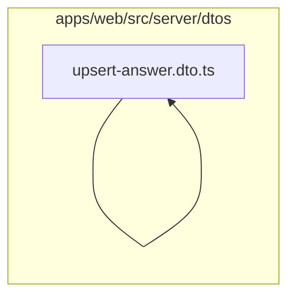

# 8. DTOs de operação

Valida agenda, inspeções, ordens de serviço, mecânicos e estoque. Este módulo contém **21 arquivos de código**, sendo **21 fichas completas** e **0 exceções em tabela**.

## Dependências do módulo

As setas representam imports internos confirmados. Dependências com outros módulos aparecem nas fichas individuais.

## 8.1 `apps/web/src/server/dtos/assign-mechanic.dto.ts`

**Propósito:** Define o contrato validado AssignMechanicDto usado nas entradas de ordens de serviço.

**Processo:** O transformador instancia `AssignMechanicDto`; os decorators validam tipos, obrigatoriedade, limites e enums antes de o service receber os dados.

**Estado:** implementado — contém lógica executável e não há marcador explícito de implementação pendente.

**Testes:** sem teste direto — busca pelos exports, nome do recurso e endpoint nas suítes não encontrou cobertura identificável.

**Depende de:** nenhum arquivo interno, variável ou tabela identificado.

**Usado por:** `apps/web/src/app/api/job-cards/[id]/mechanics/route.ts`, `apps/web/src/server/services/job-cards.service.ts`

**Bibliotecas externas relevantes:** `class-validator`

## 8.2 `apps/web/src/server/dtos/create-appointment.dto.ts`

**Propósito:** Define o contrato validado CreateAppointmentDto usado nas entradas de agendamentos.

**Processo:** O transformador instancia `CreateAppointmentDto`; os decorators validam tipos, obrigatoriedade, limites e enums antes de o service receber os dados.

**Estado:** implementado — contém lógica executável e não há marcador explícito de implementação pendente.

**Testes:** sem teste direto — busca pelos exports, nome do recurso e endpoint nas suítes não encontrou cobertura identificável.

**Depende de:** nenhum arquivo interno, variável ou tabela identificado.

**Usado por:** `apps/web/src/app/api/appointments/route.ts`, `apps/web/src/server/dtos/update-appointment.dto.ts`, `apps/web/src/server/services/appointments.service.ts`

**Bibliotecas externas relevantes:** `@prisma/client`, `class-validator`

## 8.3 `apps/web/src/server/dtos/create-inspection-template.dto.ts`

**Propósito:** Define o contrato validado CreateQuestionOptionDto, CreateQuestionDto, CreateSectionDto, CreateInspectionTemplateDto usado nas entradas de inspeções.

**Processo:** O transformador instancia `CreateQuestionOptionDto`, `CreateQuestionDto`, `CreateSectionDto`, `CreateInspectionTemplateDto`; os decorators validam tipos, obrigatoriedade, limites e enums antes de o service receber os dados.

**Estado:** implementado — contém lógica executável e não há marcador explícito de implementação pendente.

**Testes:** sem teste direto — busca pelos exports, nome do recurso e endpoint nas suítes não encontrou cobertura identificável.

**Depende de:** nenhum arquivo interno, variável ou tabela identificado.

**Usado por:** `apps/web/src/app/api/inspection-templates/route.ts`, `apps/web/src/server/services/inspection-templates.service.ts`

**Bibliotecas externas relevantes:** `@prisma/client`, `class-transformer`, `class-validator`, `reflect-metadata`

## 8.4 `apps/web/src/server/dtos/create-job-card.dto.ts`

**Propósito:** Define o contrato validado CreateJobCardDto usado nas entradas de ordens de serviço.

**Processo:** O transformador instancia `CreateJobCardDto`; os decorators validam tipos, obrigatoriedade, limites e enums antes de o service receber os dados.

**Estado:** implementado — contém lógica executável e não há marcador explícito de implementação pendente.

**Testes:** sem teste direto — busca pelos exports, nome do recurso e endpoint nas suítes não encontrou cobertura identificável.

**Depende de:** nenhum arquivo interno, variável ou tabela identificado.

**Usado por:** `apps/web/src/app/api/job-cards/route.ts`, `apps/web/src/server/dtos/update-job-card.dto.ts`, `apps/web/src/server/services/job-cards.service.ts`

**Bibliotecas externas relevantes:** `@prisma/client`, `class-validator`

## 8.5 `apps/web/src/server/dtos/create-job-line.dto.ts`

**Propósito:** Define o contrato validado CreateJobLineDto usado nas entradas de ordens de serviço.

**Processo:** O transformador instancia `CreateJobLineDto`; os decorators validam tipos, obrigatoriedade, limites e enums antes de o service receber os dados.

**Estado:** implementado — contém lógica executável e não há marcador explícito de implementação pendente.

**Testes:** sem teste direto — busca pelos exports, nome do recurso e endpoint nas suítes não encontrou cobertura identificável.

**Depende de:** nenhum arquivo interno, variável ou tabela identificado.

**Usado por:** `apps/web/src/app/api/job-cards/[id]/lines/route.ts`, `apps/web/src/server/dtos/update-job-line.dto.ts`, `apps/web/src/server/services/job-cards.service.ts`

**Bibliotecas externas relevantes:** `@prisma/client`, `class-validator`

## 8.6 `apps/web/src/server/dtos/create-location.dto.ts`

**Propósito:** Define o contrato validado CreateLocationDto usado nas entradas de estoque.

**Processo:** O transformador instancia `CreateLocationDto`; os decorators validam tipos, obrigatoriedade, limites e enums antes de o service receber os dados.

**Estado:** implementado — contém lógica executável e não há marcador explícito de implementação pendente.

**Testes:** sem teste direto — busca pelos exports, nome do recurso e endpoint nas suítes não encontrou cobertura identificável.

**Depende de:** nenhum arquivo interno, variável ou tabela identificado.

**Usado por:** `apps/web/src/app/api/stock/locations/route.ts`, `apps/web/src/server/services/stock.service.ts`

**Bibliotecas externas relevantes:** `class-validator`

## 8.7 `apps/web/src/server/dtos/create-movement.dto.ts`

**Propósito:** Define o contrato validado CreateMovementDto usado nas entradas de estoque.

**Processo:** O transformador instancia `CreateMovementDto`; os decorators validam tipos, obrigatoriedade, limites e enums antes de o service receber os dados.

**Estado:** implementado — contém lógica executável e não há marcador explícito de implementação pendente.

**Testes:** sem teste direto — busca pelos exports, nome do recurso e endpoint nas suítes não encontrou cobertura identificável.

**Depende de:** nenhum arquivo interno, variável ou tabela identificado.

**Usado por:** `apps/web/src/app/api/stock/movements/route.ts`, `apps/web/src/server/services/stock.service.ts`

**Bibliotecas externas relevantes:** `@prisma/client`, `class-validator`

## 8.8 `apps/web/src/server/dtos/issue-to-job.dto.ts`

**Propósito:** Define o contrato validado IssueToJobDto usado nas entradas de issue-to-job.dto.ts.

**Processo:** O transformador instancia `IssueToJobDto`; os decorators validam tipos, obrigatoriedade, limites e enums antes de o service receber os dados.

**Estado:** implementado — contém lógica executável e não há marcador explícito de implementação pendente.

**Testes:** sem teste direto — busca pelos exports, nome do recurso e endpoint nas suítes não encontrou cobertura identificável.

**Depende de:** nenhum arquivo interno, variável ou tabela identificado.

**Usado por:** `apps/web/src/app/api/stock/issues/route.ts`, `apps/web/src/server/services/stock.service.ts`

**Bibliotecas externas relevantes:** `class-validator`

## 8.9 `apps/web/src/server/dtos/query-appointment.dto.ts`

**Propósito:** Define o contrato validado QueryAppointmentDto usado nas entradas de agendamentos.

**Processo:** O transformador instancia `QueryAppointmentDto`; os decorators validam tipos, obrigatoriedade, limites e enums antes de o service receber os dados.

**Estado:** implementado — contém lógica executável e não há marcador explícito de implementação pendente.

**Testes:** sem teste direto — busca pelos exports, nome do recurso e endpoint nas suítes não encontrou cobertura identificável.

**Depende de:** `apps/web/src/server/dtos/pagination.dto.ts` — Define o contrato validado PaginationDto usado nas entradas de pagination.

**Usado por:** `apps/web/src/app/api/appointments/route.ts`, `apps/web/src/server/services/appointments.service.ts`

**Bibliotecas externas relevantes:** `@prisma/client`, `class-validator`

## 8.10 `apps/web/src/server/dtos/query-inspection-template.dto.ts`

**Propósito:** Define o contrato validado QueryInspectionTemplateDto usado nas entradas de inspeções.

**Processo:** O transformador instancia `QueryInspectionTemplateDto`; os decorators validam tipos, obrigatoriedade, limites e enums antes de o service receber os dados.

**Estado:** implementado — contém lógica executável e não há marcador explícito de implementação pendente.

**Testes:** sem teste direto — busca pelos exports, nome do recurso e endpoint nas suítes não encontrou cobertura identificável.

**Depende de:** `apps/web/src/server/dtos/pagination.dto.ts` — Define o contrato validado PaginationDto usado nas entradas de pagination.

**Usado por:** `apps/web/src/app/api/inspection-templates/route.ts`, `apps/web/src/server/services/inspection-templates.service.ts`

**Bibliotecas externas relevantes:** `class-validator`

## 8.11 `apps/web/src/server/dtos/query-inspection.dto.ts`

**Propósito:** Define o contrato validado QueryInspectionDto usado nas entradas de inspeções.

**Processo:** O transformador instancia `QueryInspectionDto`; os decorators validam tipos, obrigatoriedade, limites e enums antes de o service receber os dados.

**Estado:** implementado — contém lógica executável e não há marcador explícito de implementação pendente.

**Testes:** sem teste direto — busca pelos exports, nome do recurso e endpoint nas suítes não encontrou cobertura identificável.

**Depende de:** `apps/web/src/server/dtos/pagination.dto.ts` — Define o contrato validado PaginationDto usado nas entradas de pagination.

**Usado por:** `apps/web/src/app/api/inspections/route.ts`, `apps/web/src/server/services/inspections.service.ts`

**Bibliotecas externas relevantes:** `@prisma/client`, `class-validator`

## 8.12 `apps/web/src/server/dtos/query-job-card.dto.ts`

**Propósito:** Define o contrato validado QueryJobCardDto usado nas entradas de ordens de serviço.

**Processo:** O transformador instancia `QueryJobCardDto`; os decorators validam tipos, obrigatoriedade, limites e enums antes de o service receber os dados.

**Estado:** implementado — contém lógica executável e não há marcador explícito de implementação pendente.

**Testes:** sem teste direto — busca pelos exports, nome do recurso e endpoint nas suítes não encontrou cobertura identificável.

**Depende de:** `apps/web/src/server/dtos/pagination.dto.ts` — Define o contrato validado PaginationDto usado nas entradas de pagination.

**Usado por:** `apps/web/src/app/api/job-cards/route.ts`, `apps/web/src/server/services/job-cards.service.ts`

**Bibliotecas externas relevantes:** `@prisma/client`, `class-validator`

## 8.13 `apps/web/src/server/dtos/query-movement.dto.ts`

**Propósito:** Define o contrato validado QueryMovementDto usado nas entradas de estoque.

**Processo:** O transformador instancia `QueryMovementDto`; os decorators validam tipos, obrigatoriedade, limites e enums antes de o service receber os dados.

**Estado:** implementado — contém lógica executável e não há marcador explícito de implementação pendente.

**Testes:** sem teste direto — busca pelos exports, nome do recurso e endpoint nas suítes não encontrou cobertura identificável.

**Depende de:** `apps/web/src/server/dtos/pagination.dto.ts` — Define o contrato validado PaginationDto usado nas entradas de pagination.

**Usado por:** `apps/web/src/app/api/stock/movements/route.ts`, `apps/web/src/server/services/stock.service.ts`

**Bibliotecas externas relevantes:** `@prisma/client`, `class-validator`

## 8.14 `apps/web/src/server/dtos/start-inspection.dto.ts`

**Propósito:** Define o contrato validado StartInspectionDto usado nas entradas de inspeções.

**Processo:** O transformador instancia `StartInspectionDto`; os decorators validam tipos, obrigatoriedade, limites e enums antes de o service receber os dados.

**Estado:** implementado — contém lógica executável e não há marcador explícito de implementação pendente.

**Testes:** sem teste direto — busca pelos exports, nome do recurso e endpoint nas suítes não encontrou cobertura identificável.

**Depende de:** nenhum arquivo interno, variável ou tabela identificado.

**Usado por:** `apps/web/src/app/api/inspections/route.ts`, `apps/web/src/server/services/inspections.service.ts`

**Bibliotecas externas relevantes:** `class-validator`

## 8.15 `apps/web/src/server/dtos/transition-job-card.dto.ts`

**Propósito:** Define o contrato validado TransitionJobCardDto usado nas entradas de ordens de serviço.

**Processo:** O transformador instancia `TransitionJobCardDto`; os decorators validam tipos, obrigatoriedade, limites e enums antes de o service receber os dados.

**Estado:** implementado — contém lógica executável e não há marcador explícito de implementação pendente.

**Testes:** sem teste direto — busca pelos exports, nome do recurso e endpoint nas suítes não encontrou cobertura identificável.

**Depende de:** nenhum arquivo interno, variável ou tabela identificado.

**Usado por:** `apps/web/src/app/api/job-cards/[id]/transition/route.ts`, `apps/web/src/server/services/job-cards.service.ts`

**Bibliotecas externas relevantes:** `@prisma/client`, `class-validator`

## 8.16 `apps/web/src/server/dtos/update-appointment-status.dto.ts`

**Propósito:** Define o contrato validado UpdateAppointmentStatusDto usado nas entradas de agendamentos.

**Processo:** O transformador instancia `UpdateAppointmentStatusDto`; os decorators validam tipos, obrigatoriedade, limites e enums antes de o service receber os dados.

**Estado:** implementado — contém lógica executável e não há marcador explícito de implementação pendente.

**Testes:** sem teste direto — busca pelos exports, nome do recurso e endpoint nas suítes não encontrou cobertura identificável.

**Depende de:** nenhum arquivo interno, variável ou tabela identificado.

**Usado por:** `apps/web/src/app/api/appointments/[id]/status/route.ts`, `apps/web/src/server/services/appointments.service.ts`

**Bibliotecas externas relevantes:** `@prisma/client`, `class-validator`

## 8.17 `apps/web/src/server/dtos/update-appointment.dto.ts`

**Propósito:** Define o contrato validado UpdateAppointmentDto usado nas entradas de agendamentos.

**Processo:** O transformador instancia `UpdateAppointmentDto`; os decorators validam tipos, obrigatoriedade, limites e enums antes de o service receber os dados.

**Estado:** implementado — contém lógica executável e não há marcador explícito de implementação pendente.

**Testes:** sem teste direto — busca pelos exports, nome do recurso e endpoint nas suítes não encontrou cobertura identificável.

**Depende de:** `apps/web/src/server/dtos/create-appointment.dto.ts` — Define o contrato validado CreateAppointmentDto usado nas entradas de agendamentos. `apps/web/src/server/dtos/partial-type.ts` — Define o contrato validado PartialType, isPartialDto usado nas entradas de peças.

**Usado por:** `apps/web/src/app/api/appointments/[id]/route.ts`, `apps/web/src/server/services/appointments.service.ts`

**Bibliotecas externas relevantes:** nenhuma.

## 8.18 `apps/web/src/server/dtos/update-inspection.dto.ts`

**Propósito:** Define o contrato validado UpdateInspectionDto usado nas entradas de inspeções.

**Processo:** O transformador instancia `UpdateInspectionDto`; os decorators validam tipos, obrigatoriedade, limites e enums antes de o service receber os dados.

**Estado:** implementado — contém lógica executável e não há marcador explícito de implementação pendente.

**Testes:** sem teste direto — busca pelos exports, nome do recurso e endpoint nas suítes não encontrou cobertura identificável.

**Depende de:** nenhum arquivo interno, variável ou tabela identificado.

**Usado por:** `apps/web/src/app/api/inspections/[id]/route.ts`, `apps/web/src/server/services/inspections.service.ts`

**Bibliotecas externas relevantes:** `@prisma/client`, `class-validator`

## 8.19 `apps/web/src/server/dtos/update-job-card.dto.ts`

**Propósito:** Define o contrato validado UpdateJobCardDto usado nas entradas de ordens de serviço.

**Processo:** O transformador instancia `UpdateJobCardDto`; os decorators validam tipos, obrigatoriedade, limites e enums antes de o service receber os dados.

**Estado:** implementado — contém lógica executável e não há marcador explícito de implementação pendente.

**Testes:** sem teste direto — busca pelos exports, nome do recurso e endpoint nas suítes não encontrou cobertura identificável.

**Depende de:** `apps/web/src/server/dtos/create-job-card.dto.ts` — Define o contrato validado CreateJobCardDto usado nas entradas de ordens de serviço. `apps/web/src/server/dtos/partial-type.ts` — Define o contrato validado PartialType, isPartialDto usado nas entradas de peças.

**Usado por:** `apps/web/src/app/api/job-cards/[id]/route.ts`, `apps/web/src/server/services/job-cards.service.ts`

**Bibliotecas externas relevantes:** nenhuma.

## 8.20 `apps/web/src/server/dtos/update-job-line.dto.ts`

**Propósito:** Define o contrato validado UpdateJobLineDto usado nas entradas de ordens de serviço.

**Processo:** O transformador instancia `UpdateJobLineDto`; os decorators validam tipos, obrigatoriedade, limites e enums antes de o service receber os dados.

**Estado:** implementado — contém lógica executável e não há marcador explícito de implementação pendente.

**Testes:** sem teste direto — busca pelos exports, nome do recurso e endpoint nas suítes não encontrou cobertura identificável.

**Depende de:** `apps/web/src/server/dtos/create-job-line.dto.ts` — Define o contrato validado CreateJobLineDto usado nas entradas de ordens de serviço. `apps/web/src/server/dtos/partial-type.ts` — Define o contrato validado PartialType, isPartialDto usado nas entradas de peças.

**Usado por:** `apps/web/src/app/api/job-cards/[id]/lines/[lineId]/route.ts`, `apps/web/src/server/services/job-cards.service.ts`

**Bibliotecas externas relevantes:** nenhuma.

## 8.21 `apps/web/src/server/dtos/upsert-answer.dto.ts`

**Propósito:** Define o contrato validado UpsertAnswerDto usado nas entradas de inspeções.

**Processo:** O transformador instancia `UpsertAnswerDto`; os decorators validam tipos, obrigatoriedade, limites e enums antes de o service receber os dados.

**Estado:** implementado — contém lógica executável e não há marcador explícito de implementação pendente.

**Testes:** sem teste direto — busca pelos exports, nome do recurso e endpoint nas suítes não encontrou cobertura identificável.

**Depende de:** nenhum arquivo interno, variável ou tabela identificado.

**Usado por:** `apps/web/src/app/api/inspections/[id]/answers/[questionId]/route.ts`, `apps/web/src/server/services/inspections.service.ts`

**Bibliotecas externas relevantes:** `@prisma/client`, `class-validator`

## Quadro do módulo

| Arquivo | Estado | Teste | Processo/tela |
|---|---|---|---|
| `apps/web/src/server/dtos/assign-mechanic.dto.ts` | implementado | sem teste direto | ordens de serviço |
| `apps/web/src/server/dtos/create-appointment.dto.ts` | implementado | sem teste direto | agendamentos |
| `apps/web/src/server/dtos/create-inspection-template.dto.ts` | implementado | sem teste direto | inspeções |
| `apps/web/src/server/dtos/create-job-card.dto.ts` | implementado | sem teste direto | ordens de serviço |
| `apps/web/src/server/dtos/create-job-line.dto.ts` | implementado | sem teste direto | ordens de serviço |
| `apps/web/src/server/dtos/create-location.dto.ts` | implementado | sem teste direto | estoque |
| `apps/web/src/server/dtos/create-movement.dto.ts` | implementado | sem teste direto | estoque |
| `apps/web/src/server/dtos/issue-to-job.dto.ts` | implementado | sem teste direto | infraestrutura |
| `apps/web/src/server/dtos/query-appointment.dto.ts` | implementado | sem teste direto | agendamentos |
| `apps/web/src/server/dtos/query-inspection-template.dto.ts` | implementado | sem teste direto | inspeções |
| `apps/web/src/server/dtos/query-inspection.dto.ts` | implementado | sem teste direto | inspeções |
| `apps/web/src/server/dtos/query-job-card.dto.ts` | implementado | sem teste direto | ordens de serviço |
| `apps/web/src/server/dtos/query-movement.dto.ts` | implementado | sem teste direto | estoque |
| `apps/web/src/server/dtos/start-inspection.dto.ts` | implementado | sem teste direto | inspeções |
| `apps/web/src/server/dtos/transition-job-card.dto.ts` | implementado | sem teste direto | ordens de serviço |
| `apps/web/src/server/dtos/update-appointment-status.dto.ts` | implementado | sem teste direto | agendamentos |
| `apps/web/src/server/dtos/update-appointment.dto.ts` | implementado | sem teste direto | agendamentos |
| `apps/web/src/server/dtos/update-inspection.dto.ts` | implementado | sem teste direto | inspeções |
| `apps/web/src/server/dtos/update-job-card.dto.ts` | implementado | sem teste direto | ordens de serviço |
| `apps/web/src/server/dtos/update-job-line.dto.ts` | implementado | sem teste direto | ordens de serviço |
| `apps/web/src/server/dtos/upsert-answer.dto.ts` | implementado | sem teste direto | inspeções |
