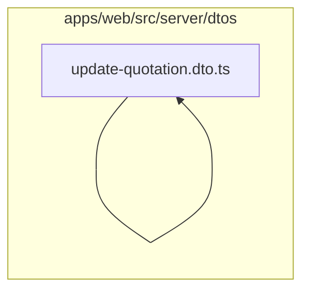

# 9. DTOs financeiros

Valida despesas, compras, orçamentos, faturas, pagamentos e filtros de relatórios. Este módulo contém **13 arquivos de código**, sendo **13 fichas completas** e **0 exceções em tabela**.

## Dependências do módulo

As setas representam imports internos confirmados. Dependências com outros módulos aparecem nas fichas individuais.

## 9.1 `apps/web/src/server/dtos/create-expense.dto.ts`

**Propósito:** Define o contrato validado CreateExpenseDto usado nas entradas de despesas.

**Processo:** O transformador instancia `CreateExpenseDto`; os decorators validam tipos, obrigatoriedade, limites e enums antes de o service receber os dados.

**Estado:** implementado — contém lógica executável e não há marcador explícito de implementação pendente.

**Testes:** sem teste direto — busca pelos exports, nome do recurso e endpoint nas suítes não encontrou cobertura identificável.

**Depende de:** nenhum arquivo interno, variável ou tabela identificado.

**Usado por:** `apps/web/src/app/api/expenses/route.ts`, `apps/web/src/server/dtos/update-expense.dto.ts`, `apps/web/src/server/services/expenses.service.ts`

**Bibliotecas externas relevantes:** `class-validator`

## 9.2 `apps/web/src/server/dtos/create-payment.dto.ts`

**Propósito:** Define o contrato validado CreatePaymentDto usado nas entradas de faturas.

**Processo:** O transformador instancia `CreatePaymentDto`; os decorators validam tipos, obrigatoriedade, limites e enums antes de o service receber os dados.

**Estado:** implementado — contém lógica executável e não há marcador explícito de implementação pendente.

**Testes:** sem teste direto — busca pelos exports, nome do recurso e endpoint nas suítes não encontrou cobertura identificável.

**Depende de:** nenhum arquivo interno, variável ou tabela identificado.

**Usado por:** `apps/web/src/app/api/invoices/[id]/payments/route.ts`, `apps/web/src/server/services/invoices.service.ts`

**Bibliotecas externas relevantes:** `class-validator`

## 9.3 `apps/web/src/server/dtos/create-purchase.dto.ts`

**Propósito:** Define o contrato validado CreatePurchaseItemDto, CreatePurchaseDto usado nas entradas de compras.

**Processo:** O transformador instancia `CreatePurchaseItemDto`, `CreatePurchaseDto`; os decorators validam tipos, obrigatoriedade, limites e enums antes de o service receber os dados.

**Estado:** implementado — contém lógica executável e não há marcador explícito de implementação pendente.

**Testes:** sem teste direto — busca pelos exports, nome do recurso e endpoint nas suítes não encontrou cobertura identificável.

**Depende de:** nenhum arquivo interno, variável ou tabela identificado.

**Usado por:** `apps/web/src/app/api/purchases/route.ts`, `apps/web/src/server/services/purchases.service.ts`

**Bibliotecas externas relevantes:** `class-transformer`, `class-validator`, `reflect-metadata`

## 9.4 `apps/web/src/server/dtos/create-quotation.dto.ts`

**Propósito:** Define o contrato validado CreateQuotationDto usado nas entradas de orçamentos.

**Processo:** O transformador instancia `CreateQuotationDto`; os decorators validam tipos, obrigatoriedade, limites e enums antes de o service receber os dados.

**Estado:** implementado — contém lógica executável e não há marcador explícito de implementação pendente.

**Testes:** sem teste direto — busca pelos exports, nome do recurso e endpoint nas suítes não encontrou cobertura identificável.

**Depende de:** nenhum arquivo interno, variável ou tabela identificado.

**Usado por:** `apps/web/src/app/api/quotations/route.ts`, `apps/web/src/server/dtos/update-quotation.dto.ts`, `apps/web/src/server/services/quotations.service.ts`

**Bibliotecas externas relevantes:** `class-validator`

## 9.5 `apps/web/src/server/dtos/line-item.dto.ts`

**Propósito:** Define o contrato validado CreateLineItemDto, UpdateLineItemDto usado nas entradas de line-item.dto.ts.

**Processo:** O transformador instancia `CreateLineItemDto`, `UpdateLineItemDto`; os decorators validam tipos, obrigatoriedade, limites e enums antes de o service receber os dados.

**Estado:** implementado — contém lógica executável e não há marcador explícito de implementação pendente.

**Testes:** sem teste direto — busca pelos exports, nome do recurso e endpoint nas suítes não encontrou cobertura identificável.

**Depende de:** nenhum arquivo interno, variável ou tabela identificado.

**Usado por:** `apps/web/src/app/api/quotations/[id]/lines/[lineId]/route.ts`, `apps/web/src/app/api/quotations/[id]/lines/route.ts`, `apps/web/src/server/services/quotations.service.ts`

**Bibliotecas externas relevantes:** `@prisma/client`, `class-validator`

## 9.6 `apps/web/src/server/dtos/query-expense.dto.ts`

**Propósito:** Define o contrato validado QueryExpenseDto usado nas entradas de despesas.

**Processo:** O transformador instancia `QueryExpenseDto`; os decorators validam tipos, obrigatoriedade, limites e enums antes de o service receber os dados.

**Estado:** implementado — contém lógica executável e não há marcador explícito de implementação pendente.

**Testes:** sem teste direto — busca pelos exports, nome do recurso e endpoint nas suítes não encontrou cobertura identificável.

**Depende de:** `apps/web/src/server/dtos/pagination.dto.ts` — Define o contrato validado PaginationDto usado nas entradas de pagination.

**Usado por:** `apps/web/src/app/api/expenses/route.ts`, `apps/web/src/server/services/expenses.service.ts`

**Bibliotecas externas relevantes:** `class-validator`

## 9.7 `apps/web/src/server/dtos/query-invoice.dto.ts`

**Propósito:** Define o contrato validado QueryInvoiceDto usado nas entradas de faturas.

**Processo:** O transformador instancia `QueryInvoiceDto`; os decorators validam tipos, obrigatoriedade, limites e enums antes de o service receber os dados.

**Estado:** implementado — contém lógica executável e não há marcador explícito de implementação pendente.

**Testes:** sem teste direto — busca pelos exports, nome do recurso e endpoint nas suítes não encontrou cobertura identificável.

**Depende de:** `apps/web/src/server/dtos/pagination.dto.ts` — Define o contrato validado PaginationDto usado nas entradas de pagination.

**Usado por:** `apps/web/src/app/api/invoices/route.ts`, `apps/web/src/server/services/invoices.service.ts`

**Bibliotecas externas relevantes:** `@prisma/client`, `class-validator`

## 9.8 `apps/web/src/server/dtos/query-purchase.dto.ts`

**Propósito:** Define o contrato validado QueryPurchaseDto usado nas entradas de compras.

**Processo:** O transformador instancia `QueryPurchaseDto`; os decorators validam tipos, obrigatoriedade, limites e enums antes de o service receber os dados.

**Estado:** implementado — contém lógica executável e não há marcador explícito de implementação pendente.

**Testes:** sem teste direto — busca pelos exports, nome do recurso e endpoint nas suítes não encontrou cobertura identificável.

**Depende de:** `apps/web/src/server/dtos/pagination.dto.ts` — Define o contrato validado PaginationDto usado nas entradas de pagination.

**Usado por:** `apps/web/src/app/api/purchases/route.ts`, `apps/web/src/server/services/purchases.service.ts`

**Bibliotecas externas relevantes:** `@prisma/client`, `class-validator`

## 9.9 `apps/web/src/server/dtos/query-quotation.dto.ts`

**Propósito:** Define o contrato validado QueryQuotationDto usado nas entradas de orçamentos.

**Processo:** O transformador instancia `QueryQuotationDto`; os decorators validam tipos, obrigatoriedade, limites e enums antes de o service receber os dados.

**Estado:** implementado — contém lógica executável e não há marcador explícito de implementação pendente.

**Testes:** sem teste direto — busca pelos exports, nome do recurso e endpoint nas suítes não encontrou cobertura identificável.

**Depende de:** `apps/web/src/server/dtos/pagination.dto.ts` — Define o contrato validado PaginationDto usado nas entradas de pagination.

**Usado por:** `apps/web/src/app/api/quotations/route.ts`, `apps/web/src/server/services/quotations.service.ts`

**Bibliotecas externas relevantes:** `@prisma/client`, `class-validator`

## 9.10 `apps/web/src/server/dtos/query-report.dto.ts`

**Propósito:** Define o contrato validado QueryReportDto usado nas entradas de relatórios.

**Processo:** O transformador instancia `QueryReportDto`; os decorators validam tipos, obrigatoriedade, limites e enums antes de o service receber os dados.

**Estado:** implementado — contém lógica executável e não há marcador explícito de implementação pendente.

**Testes:** sem teste direto — busca pelos exports, nome do recurso e endpoint nas suítes não encontrou cobertura identificável.

**Depende de:** nenhum arquivo interno, variável ou tabela identificado.

**Usado por:** `apps/web/src/app/api/reports/financial/route.ts`, `apps/web/src/server/services/reports.service.ts`

**Bibliotecas externas relevantes:** `class-validator`

## 9.11 `apps/web/src/server/dtos/update-expense.dto.ts`

**Propósito:** Define o contrato validado UpdateExpenseDto usado nas entradas de despesas.

**Processo:** O transformador instancia `UpdateExpenseDto`; os decorators validam tipos, obrigatoriedade, limites e enums antes de o service receber os dados.

**Estado:** implementado — contém lógica executável e não há marcador explícito de implementação pendente.

**Testes:** sem teste direto — busca pelos exports, nome do recurso e endpoint nas suítes não encontrou cobertura identificável.

**Depende de:** `apps/web/src/server/dtos/create-expense.dto.ts` — Define o contrato validado CreateExpenseDto usado nas entradas de despesas. `apps/web/src/server/dtos/partial-type.ts` — Define o contrato validado PartialType, isPartialDto usado nas entradas de peças.

**Usado por:** `apps/web/src/app/api/expenses/[id]/route.ts`, `apps/web/src/server/services/expenses.service.ts`

**Bibliotecas externas relevantes:** nenhuma.

## 9.12 `apps/web/src/server/dtos/update-invoice.dto.ts`

**Propósito:** Define o contrato validado UpdateInvoiceDto usado nas entradas de faturas.

**Processo:** O transformador instancia `UpdateInvoiceDto`; os decorators validam tipos, obrigatoriedade, limites e enums antes de o service receber os dados.

**Estado:** implementado — contém lógica executável e não há marcador explícito de implementação pendente.

**Testes:** sem teste direto — busca pelos exports, nome do recurso e endpoint nas suítes não encontrou cobertura identificável.

**Depende de:** nenhum arquivo interno, variável ou tabela identificado.

**Usado por:** `apps/web/src/app/api/invoices/[id]/route.ts`, `apps/web/src/server/services/invoices.service.ts`

**Bibliotecas externas relevantes:** `class-validator`

## 9.13 `apps/web/src/server/dtos/update-quotation.dto.ts`

**Propósito:** Define o contrato validado UpdateQuotationDto usado nas entradas de orçamentos.

**Processo:** O transformador instancia `UpdateQuotationDto`; os decorators validam tipos, obrigatoriedade, limites e enums antes de o service receber os dados.

**Estado:** implementado — contém lógica executável e não há marcador explícito de implementação pendente.

**Testes:** sem teste direto — busca pelos exports, nome do recurso e endpoint nas suítes não encontrou cobertura identificável.

**Depende de:** `apps/web/src/server/dtos/create-quotation.dto.ts` — Define o contrato validado CreateQuotationDto usado nas entradas de orçamentos. `apps/web/src/server/dtos/partial-type.ts` — Define o contrato validado PartialType, isPartialDto usado nas entradas de peças.

**Usado por:** `apps/web/src/app/api/quotations/[id]/route.ts`, `apps/web/src/server/services/quotations.service.ts`

**Bibliotecas externas relevantes:** nenhuma.

## Quadro do módulo

| Arquivo | Estado | Teste | Processo/tela |
|---|---|---|---|
| `apps/web/src/server/dtos/create-expense.dto.ts` | implementado | sem teste direto | despesas |
| `apps/web/src/server/dtos/create-payment.dto.ts` | implementado | sem teste direto | faturas |
| `apps/web/src/server/dtos/create-purchase.dto.ts` | implementado | sem teste direto | compras |
| `apps/web/src/server/dtos/create-quotation.dto.ts` | implementado | sem teste direto | orçamentos |
| `apps/web/src/server/dtos/line-item.dto.ts` | implementado | sem teste direto | infraestrutura |
| `apps/web/src/server/dtos/query-expense.dto.ts` | implementado | sem teste direto | despesas |
| `apps/web/src/server/dtos/query-invoice.dto.ts` | implementado | sem teste direto | faturas |
| `apps/web/src/server/dtos/query-purchase.dto.ts` | implementado | sem teste direto | compras |
| `apps/web/src/server/dtos/query-quotation.dto.ts` | implementado | sem teste direto | orçamentos |
| `apps/web/src/server/dtos/query-report.dto.ts` | implementado | sem teste direto | relatórios |
| `apps/web/src/server/dtos/update-expense.dto.ts` | implementado | sem teste direto | despesas |
| `apps/web/src/server/dtos/update-invoice.dto.ts` | implementado | sem teste direto | faturas |
| `apps/web/src/server/dtos/update-quotation.dto.ts` | implementado | sem teste direto | orçamentos |
