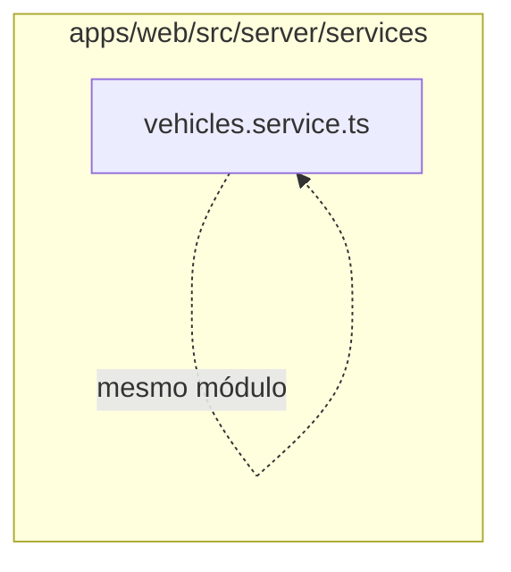

# 10. Serviços de cadastros e acesso

Executa regras de cadastro, referências, inspeções e administração de acesso. Este módulo contém **12 arquivos de código**, sendo **12 fichas completas** e **0 exceções em tabela**.

## Dependências do módulo

As setas representam imports internos confirmados. Dependências com outros módulos aparecem nas fichas individuais.

## 10.1 `apps/web/src/server/services/appointments.service.ts`

**Propósito:** Centraliza regras de negócio e acesso persistente de agendamentos.

**Processo:** As funções exportadas `createAppointment`, `listAppointments`, `findAppointment`, `updateAppointment`, `updateAppointmentStatus`, `removeAppointment` validam invariantes, consultam referências e leem/escrevem `Appointment` dentro da transação da requisição.

**Estado:** implementado — contém lógica executável e não há marcador explícito de implementação pendente.

**Testes:** sem teste direto — busca pelos exports, nome do recurso e endpoint nas suítes não encontrou cobertura identificável.

**Depende de:** `apps/web/src/server/db/prisma.ts` — Cria os clientes Prisma de aplicação e sistema e entrega a conexão contextual. `apps/web/src/server/dtos/create-appointment.dto.ts` — Define o contrato validado CreateAppointmentDto usado nas entradas de agendamentos. `apps/web/src/server/dtos/query-appointment.dto.ts` — Define o contrato validado QueryAppointmentDto usado nas entradas de agendamentos. `apps/web/src/server/dtos/update-appointment-status.dto.ts` — Define o contrato validado UpdateAppointmentStatusDto usado nas entradas de agendamentos. `apps/web/src/server/dtos/update-appointment.dto.ts` — Define o contrato validado UpdateAppointmentDto usado nas entradas de agendamentos. `apps/web/src/server/http/errors.ts` — Define erros HTTP tipados do servidor. `packages/database/src/index.ts` — Barrel público do pacote de banco. Banco — `Appointment`.

**Usado por:** `apps/web/src/app/api/appointments/[id]/route.ts`, `apps/web/src/app/api/appointments/[id]/status/route.ts`, `apps/web/src/app/api/appointments/route.ts`

**Bibliotecas externas relevantes:** nenhuma.

## 10.2 `apps/web/src/server/services/branches.service.ts`

**Propósito:** Centraliza regras de negócio e acesso persistente de filiais.

**Processo:** As funções exportadas `listBranches`, `createBranch`, `updateBranch`, `removeBranch` validam invariantes, consultam referências e leem/escrevem `Branch` dentro da transação da requisição.

**Estado:** implementado — contém lógica executável e não há marcador explícito de implementação pendente.

**Testes:** `apps/web/test/flows.spec.ts`, `apps/web/test/regressions.spec.ts`

**Depende de:** `apps/web/src/server/db/prisma.ts` — Cria os clientes Prisma de aplicação e sistema e entrega a conexão contextual. `apps/web/src/server/dtos/create-branch.dto.ts` — Define o contrato validado CreateBranchDto usado nas entradas de filiais. `apps/web/src/server/dtos/update-branch.dto.ts` — Define o contrato validado UpdateBranchDto usado nas entradas de filiais. `apps/web/src/server/http/errors.ts` — Define erros HTTP tipados do servidor. `packages/database/src/index.ts` — Barrel público do pacote de banco. Banco — `Branch`.

**Usado por:** `apps/web/src/app/api/branches/[id]/route.ts`, `apps/web/src/app/api/branches/route.ts`, `apps/web/test/flows.spec.ts`, `apps/web/test/regressions.spec.ts`

**Bibliotecas externas relevantes:** nenhuma.

## 10.3 `apps/web/src/server/services/customers.service.ts`

**Propósito:** Centraliza regras de negócio e acesso persistente de clientes.

**Processo:** As funções exportadas `createCustomer`, `listCustomers`, `findCustomer`, `updateCustomer`, `removeCustomer` validam invariantes, consultam referências e leem/escrevem `Customer` dentro da transação da requisição.

**Estado:** implementado — contém lógica executável e não há marcador explícito de implementação pendente.

**Testes:** `apps/web/test/flows.spec.ts`, `apps/web/test/regressions.spec.ts`, `apps/web/test/rls.spec.ts`

**Depende de:** `apps/web/src/server/db/prisma.ts` — Cria os clientes Prisma de aplicação e sistema e entrega a conexão contextual. `apps/web/src/server/dtos/create-customer.dto.ts` — Define o contrato validado CreateCustomerDto usado nas entradas de clientes. `apps/web/src/server/dtos/query-customer.dto.ts` — Define o contrato validado QueryCustomerDto usado nas entradas de clientes. `apps/web/src/server/dtos/update-customer.dto.ts` — Define o contrato validado UpdateCustomerDto usado nas entradas de clientes. `apps/web/src/server/http/errors.ts` — Define erros HTTP tipados do servidor. `packages/database/src/index.ts` — Barrel público do pacote de banco. Banco — `Customer`.

**Usado por:** `apps/web/src/app/api/customers/[id]/route.ts`, `apps/web/src/app/api/customers/route.ts`, `apps/web/test/flows.spec.ts`, `apps/web/test/regressions.spec.ts`, `apps/web/test/rls.spec.ts`

**Bibliotecas externas relevantes:** nenhuma.

## 10.4 `apps/web/src/server/services/inspection-templates.service.ts`

**Propósito:** Centraliza regras de negócio e acesso persistente de inspeções.

**Processo:** As funções exportadas `createInspectionTemplate`, `listInspectionTemplates`, `findInspectionTemplate`, `publishInspectionTemplate` validam invariantes, consultam referências e leem/escrevem `InspectionTemplate`, `InspectionTemplateVersion` dentro da transação da requisição.

**Estado:** implementado — contém lógica executável e não há marcador explícito de implementação pendente.

**Testes:** sem teste direto — busca pelos exports, nome do recurso e endpoint nas suítes não encontrou cobertura identificável.

**Depende de:** `apps/web/src/server/db/prisma.ts` — Cria os clientes Prisma de aplicação e sistema e entrega a conexão contextual. `apps/web/src/server/dtos/create-inspection-template.dto.ts` — Define o contrato validado CreateQuestionOptionDto, CreateQuestionDto, CreateSectionDto, CreateInspectionTemplateDto usado nas entradas de inspeções. `apps/web/src/server/dtos/query-inspection-template.dto.ts` — Define o contrato validado QueryInspectionTemplateDto usado nas entradas de inspeções. `apps/web/src/server/http/errors.ts` — Define erros HTTP tipados do servidor. `packages/database/src/index.ts` — Barrel público do pacote de banco. Banco — `InspectionTemplate`, `InspectionTemplateVersion`.

**Usado por:** `apps/web/src/app/api/inspection-templates/[id]/publish/route.ts`, `apps/web/src/app/api/inspection-templates/[id]/route.ts`, `apps/web/src/app/api/inspection-templates/route.ts`

**Bibliotecas externas relevantes:** nenhuma.

## 10.5 `apps/web/src/server/services/inspections.service.ts`

**Propósito:** Centraliza regras de negócio e acesso persistente de inspeções.

**Processo:** As funções exportadas `startInspection`, `listInspections`, `findInspection`, `updateInspection`, `completeInspection`, `upsertInspectionAnswer` validam invariantes, consultam referências e leem/escrevem `Inspection`, `InspectionAnswer`, `InspectionQuestion`, `InspectionTemplateVersion` dentro da transação da requisição.

**Estado:** implementado — contém lógica executável e não há marcador explícito de implementação pendente.

**Testes:** sem teste direto — busca pelos exports, nome do recurso e endpoint nas suítes não encontrou cobertura identificável.

**Depende de:** `apps/web/src/server/db/prisma.ts` — Cria os clientes Prisma de aplicação e sistema e entrega a conexão contextual. `apps/web/src/server/dtos/query-inspection.dto.ts` — Define o contrato validado QueryInspectionDto usado nas entradas de inspeções. `apps/web/src/server/dtos/start-inspection.dto.ts` — Define o contrato validado StartInspectionDto usado nas entradas de inspeções. `apps/web/src/server/dtos/update-inspection.dto.ts` — Define o contrato validado UpdateInspectionDto usado nas entradas de inspeções. `apps/web/src/server/dtos/upsert-answer.dto.ts` — Define o contrato validado UpsertAnswerDto usado nas entradas de inspeções. `apps/web/src/server/http/errors.ts` — Define erros HTTP tipados do servidor. `packages/database/src/index.ts` — Barrel público do pacote de banco. Banco — `Inspection`, `InspectionAnswer`, `InspectionQuestion`, `InspectionTemplateVersion`.

**Usado por:** `apps/web/src/app/api/inspections/[id]/answers/[questionId]/route.ts`, `apps/web/src/app/api/inspections/[id]/complete/route.ts`, `apps/web/src/app/api/inspections/[id]/route.ts`, `apps/web/src/app/api/inspections/route.ts`

**Bibliotecas externas relevantes:** nenhuma.

## 10.6 `apps/web/src/server/services/parts.service.ts`

**Propósito:** Centraliza regras de negócio e acesso persistente de peças.

**Processo:** As funções exportadas `createPart`, `listParts`, `findPart`, `updatePart`, `removePart` validam invariantes, consultam referências e leem/escrevem `PartCatalog` dentro da transação da requisição.

**Estado:** implementado — contém lógica executável e não há marcador explícito de implementação pendente.

**Testes:** `apps/web/test/flows.spec.ts`, `apps/web/test/regressions.spec.ts`

**Depende de:** `apps/web/src/server/db/prisma.ts` — Cria os clientes Prisma de aplicação e sistema e entrega a conexão contextual. `apps/web/src/server/dtos/create-part.dto.ts` — Define o contrato validado CreatePartDto usado nas entradas de peças. `apps/web/src/server/dtos/query-part.dto.ts` — Define o contrato validado QueryPartDto usado nas entradas de peças. `apps/web/src/server/dtos/update-part.dto.ts` — Define o contrato validado UpdatePartDto usado nas entradas de peças. `apps/web/src/server/http/errors.ts` — Define erros HTTP tipados do servidor. `packages/database/src/index.ts` — Barrel público do pacote de banco. Banco — `PartCatalog`.

**Usado por:** `apps/web/src/app/api/parts/[id]/route.ts`, `apps/web/src/app/api/parts/route.ts`, `apps/web/test/flows.spec.ts`, `apps/web/test/regressions.spec.ts`

**Bibliotecas externas relevantes:** nenhuma.

## 10.7 `apps/web/src/server/services/references.service.ts`

**Propósito:** Centraliza regras de negócio e acesso persistente de references.service.ts.

**Processo:** As funções exportadas `assertServiceRef`, `assertPartRef`, `assertUnitRef`, `assertCustomerRef`, `assertVehicleRef`, `assertLineRefs` validam invariantes, consultam referências e leem/escrevem `Customer`, `PartCatalog`, `ServiceCatalog`, `Unit`, `Vehicle` dentro da transação da requisição.

**Estado:** implementado — contém lógica executável e não há marcador explícito de implementação pendente.

**Testes:** sem teste direto — busca pelos exports, nome do recurso e endpoint nas suítes não encontrou cobertura identificável.

**Depende de:** `apps/web/src/server/db/prisma.ts` — Cria os clientes Prisma de aplicação e sistema e entrega a conexão contextual. `apps/web/src/server/http/errors.ts` — Define erros HTTP tipados do servidor. Banco — `Customer`, `PartCatalog`, `ServiceCatalog`, `Unit`, `Vehicle`.

**Usado por:** `apps/web/src/server/services/job-cards.service.ts`, `apps/web/src/server/services/quotations.service.ts`, `apps/web/src/server/services/stock.service.ts`

**Bibliotecas externas relevantes:** nenhuma.

## 10.8 `apps/web/src/server/services/roles.service.ts`

**Propósito:** Centraliza regras de negócio e acesso persistente de papéis e permissões.

**Processo:** As funções exportadas `listRoles`, `findRole`, `listPermissions`, `createRole`, `updateRole`, `removeRole` validam invariantes, consultam referências e leem/escrevem `MembershipRole`, `Permission`, `Role`, `RolePermission` dentro da transação da requisição.

**Estado:** implementado — contém lógica executável e não há marcador explícito de implementação pendente.

**Testes:** `apps/web/test/regressions.spec.ts`

**Depende de:** `apps/web/src/server/db/prisma.ts` — Cria os clientes Prisma de aplicação e sistema e entrega a conexão contextual. `apps/web/src/server/dtos/create-role.dto.ts` — Define o contrato validado CreateRoleDto usado nas entradas de papéis e permissões. `apps/web/src/server/dtos/update-role.dto.ts` — Define o contrato validado UpdateRoleDto usado nas entradas de papéis e permissões. `apps/web/src/server/http/errors.ts` — Define erros HTTP tipados do servidor. `packages/database/src/index.ts` — Barrel público do pacote de banco. `packages/shared/src/index.ts` — Barrel público do pacote compartilhado. Banco — `MembershipRole`, `Permission`, `Role`, `RolePermission`.

**Usado por:** `apps/web/src/app/api/roles/[id]/route.ts`, `apps/web/src/app/api/roles/permissions/route.ts`, `apps/web/src/app/api/roles/route.ts`, `apps/web/test/regressions.spec.ts`

**Bibliotecas externas relevantes:** nenhuma.

## 10.9 `apps/web/src/server/services/services.service.ts`

**Propósito:** Centraliza regras de negócio e acesso persistente de catálogo de serviços.

**Processo:** As funções exportadas `createService`, `listServices`, `findService`, `updateService`, `removeService` validam invariantes, consultam referências e leem/escrevem `ServiceCatalog` dentro da transação da requisição.

**Estado:** implementado — contém lógica executável e não há marcador explícito de implementação pendente.

**Testes:** `apps/web/test/flows.spec.ts`, `apps/web/test/regressions.spec.ts`, `apps/web/test/rls.spec.ts`

**Depende de:** `apps/web/src/server/db/prisma.ts` — Cria os clientes Prisma de aplicação e sistema e entrega a conexão contextual. `apps/web/src/server/dtos/create-service.dto.ts` — Define o contrato validado CreateServiceDto usado nas entradas de catálogo de serviços. `apps/web/src/server/dtos/query-service.dto.ts` — Define o contrato validado QueryServiceDto usado nas entradas de catálogo de serviços. `apps/web/src/server/dtos/update-service.dto.ts` — Define o contrato validado UpdateServiceDto usado nas entradas de catálogo de serviços. `apps/web/src/server/http/errors.ts` — Define erros HTTP tipados do servidor. `packages/database/src/index.ts` — Barrel público do pacote de banco. Banco — `ServiceCatalog`.

**Usado por:** `apps/web/src/app/api/services/[id]/route.ts`, `apps/web/src/app/api/services/route.ts`, `apps/web/test/regressions.spec.ts`

**Bibliotecas externas relevantes:** nenhuma.

## 10.10 `apps/web/src/server/services/suppliers.service.ts`

**Propósito:** Centraliza regras de negócio e acesso persistente de fornecedores.

**Processo:** As funções exportadas `createSupplier`, `listSuppliers`, `findSupplier`, `updateSupplier`, `removeSupplier` validam invariantes, consultam referências e leem/escrevem `Supplier` dentro da transação da requisição.

**Estado:** implementado — contém lógica executável e não há marcador explícito de implementação pendente.

**Testes:** sem teste direto — busca pelos exports, nome do recurso e endpoint nas suítes não encontrou cobertura identificável.

**Depende de:** `apps/web/src/server/db/prisma.ts` — Cria os clientes Prisma de aplicação e sistema e entrega a conexão contextual. `apps/web/src/server/dtos/create-supplier.dto.ts` — Define o contrato validado CreateSupplierDto usado nas entradas de fornecedores. `apps/web/src/server/dtos/query-supplier.dto.ts` — Define o contrato validado QuerySupplierDto usado nas entradas de fornecedores. `apps/web/src/server/dtos/update-supplier.dto.ts` — Define o contrato validado UpdateSupplierDto usado nas entradas de fornecedores. `apps/web/src/server/http/errors.ts` — Define erros HTTP tipados do servidor. `packages/database/src/index.ts` — Barrel público do pacote de banco. Banco — `Supplier`.

**Usado por:** `apps/web/src/app/api/suppliers/[id]/route.ts`, `apps/web/src/app/api/suppliers/route.ts`

**Bibliotecas externas relevantes:** nenhuma.

## 10.11 `apps/web/src/server/services/users.service.ts`

**Propósito:** Centraliza regras de negócio e acesso persistente de usuários/equipe.

**Processo:** As funções exportadas `listUsers`, `findUser`, `createUser`, `updateUser`, `removeUser` validam invariantes, consultam referências e leem/escrevem `Membership`, `MembershipRole`, `Role`, `User` dentro da transação da requisição.

**Estado:** implementado — contém lógica executável e não há marcador explícito de implementação pendente.

**Testes:** `apps/web/test/regressions.spec.ts`

**Depende de:** `apps/web/src/server/auth/auth.ts` — Configura o Better Auth com Prisma e cookies da aplicação. `apps/web/src/server/db/prisma.ts` — Cria os clientes Prisma de aplicação e sistema e entrega a conexão contextual. `apps/web/src/server/dtos/create-user.dto.ts` — Define o contrato validado CreateUserDto usado nas entradas de usuários/equipe. `apps/web/src/server/dtos/query-user.dto.ts` — Define o contrato validado QueryUserDto usado nas entradas de usuários/equipe. `apps/web/src/server/dtos/update-user.dto.ts` — Define o contrato validado UpdateUserDto usado nas entradas de usuários/equipe. `apps/web/src/server/http/errors.ts` — Define erros HTTP tipados do servidor. `packages/database/src/index.ts` — Barrel público do pacote de banco. `packages/shared/src/index.ts` — Barrel público do pacote compartilhado. Banco — `Membership`, `MembershipRole`, `Role`, `User`.

**Usado por:** `apps/web/src/app/api/users/[id]/route.ts`, `apps/web/src/app/api/users/route.ts`, `apps/web/test/regressions.spec.ts`

**Bibliotecas externas relevantes:** nenhuma.

## 10.12 `apps/web/src/server/services/vehicles.service.ts`

**Propósito:** Centraliza regras de negócio e acesso persistente de veículos.

**Processo:** As funções exportadas `createVehicle`, `listVehicles`, `findVehicle`, `updateVehicle`, `removeVehicle` validam invariantes, consultam referências e leem/escrevem `Customer`, `Vehicle` dentro da transação da requisição.

**Estado:** implementado — contém lógica executável e não há marcador explícito de implementação pendente.

**Testes:** `apps/web/test/flows.spec.ts`, `apps/web/test/regressions.spec.ts`

**Depende de:** `apps/web/src/server/db/prisma.ts` — Cria os clientes Prisma de aplicação e sistema e entrega a conexão contextual. `apps/web/src/server/dtos/create-vehicle.dto.ts` — Define o contrato validado CreateVehicleDto usado nas entradas de veículos. `apps/web/src/server/dtos/query-vehicle.dto.ts` — Define o contrato validado QueryVehicleDto usado nas entradas de veículos. `apps/web/src/server/dtos/update-vehicle.dto.ts` — Define o contrato validado UpdateVehicleDto usado nas entradas de veículos. `apps/web/src/server/http/errors.ts` — Define erros HTTP tipados do servidor. `packages/database/src/index.ts` — Barrel público do pacote de banco. Banco — `Customer`, `Vehicle`.

**Usado por:** `apps/web/src/app/api/vehicles/[id]/route.ts`, `apps/web/src/app/api/vehicles/route.ts`, `apps/web/test/flows.spec.ts`, `apps/web/test/regressions.spec.ts`

**Bibliotecas externas relevantes:** nenhuma.

## Quadro do módulo

| Arquivo | Estado | Teste | Processo/tela |
|---|---|---|---|
| `apps/web/src/server/services/appointments.service.ts` | implementado | sem teste direto | agendamentos |
| `apps/web/src/server/services/branches.service.ts` | implementado | `flows.spec.ts`, `regressions.spec.ts` | filiais |
| `apps/web/src/server/services/customers.service.ts` | implementado | `flows.spec.ts`, `regressions.spec.ts`, `rls.spec.ts` | clientes |
| `apps/web/src/server/services/inspection-templates.service.ts` | implementado | sem teste direto | inspeções |
| `apps/web/src/server/services/inspections.service.ts` | implementado | sem teste direto | inspeções |
| `apps/web/src/server/services/parts.service.ts` | implementado | `flows.spec.ts`, `regressions.spec.ts` | peças |
| `apps/web/src/server/services/references.service.ts` | implementado | sem teste direto | infraestrutura |
| `apps/web/src/server/services/roles.service.ts` | implementado | `regressions.spec.ts` | papéis e permissões |
| `apps/web/src/server/services/services.service.ts` | implementado | `flows.spec.ts`, `regressions.spec.ts`, `rls.spec.ts` | catálogo de serviços |
| `apps/web/src/server/services/suppliers.service.ts` | implementado | sem teste direto | fornecedores |
| `apps/web/src/server/services/users.service.ts` | implementado | `regressions.spec.ts` | usuários/equipe |
| `apps/web/src/server/services/vehicles.service.ts` | implementado | `flows.spec.ts`, `regressions.spec.ts` | veículos |
