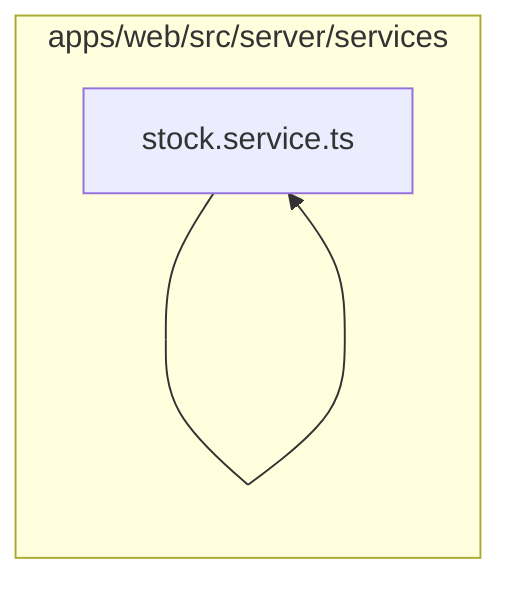

# 11. Serviços transacionais

Executa os fluxos de OS, cálculo, numeração, orçamento, faturamento, compras, estoque e relatórios. Este módulo contém **9 arquivos de código**, sendo **9 fichas completas** e **0 exceções em tabela**.

## Dependências do módulo

As setas representam imports internos confirmados. Dependências com outros módulos aparecem nas fichas individuais.

## 11.1 `apps/web/src/server/services/expenses.service.ts`

**Propósito:** Centraliza regras de negócio e acesso persistente de despesas.

**Processo:** As funções exportadas `createExpense`, `listExpenses`, `findExpense`, `updateExpense`, `removeExpense` validam invariantes, consultam referências e leem/escrevem `Expense` dentro da transação da requisição.

**Estado:** implementado — contém lógica executável e não há marcador explícito de implementação pendente.

**Testes:** sem teste direto — busca pelos exports, nome do recurso e endpoint nas suítes não encontrou cobertura identificável.

**Depende de:** `apps/web/src/server/db/prisma.ts` — Cria os clientes Prisma de aplicação e sistema e entrega a conexão contextual. `apps/web/src/server/dtos/create-expense.dto.ts` — Define o contrato validado CreateExpenseDto usado nas entradas de despesas. `apps/web/src/server/dtos/query-expense.dto.ts` — Define o contrato validado QueryExpenseDto usado nas entradas de despesas. `apps/web/src/server/dtos/update-expense.dto.ts` — Define o contrato validado UpdateExpenseDto usado nas entradas de despesas. `apps/web/src/server/http/errors.ts` — Define erros HTTP tipados do servidor. `packages/database/src/index.ts` — Barrel público do pacote de banco. Banco — `Expense`.

**Usado por:** `apps/web/src/app/api/expenses/[id]/route.ts`, `apps/web/src/app/api/expenses/route.ts`

**Bibliotecas externas relevantes:** nenhuma.

## 11.2 `apps/web/src/server/services/invoices.service.ts`

**Propósito:** Centraliza regras de negócio e acesso persistente de faturas.

**Processo:** As funções exportadas `listInvoices`, `findInvoice`, `updateInvoice`, `issueInvoice`, `cancelInvoice`, `createInvoiceFromJobCard`, `addInvoicePayment`, `removeInvoicePayment`, `renderInvoiceDocument` validam invariantes, consultam referências e leem/escrevem `Invoice`, `InvoiceLine`, `JobCard`, `Payment` dentro da transação da requisição.

**Estado:** implementado — contém lógica executável e não há marcador explícito de implementação pendente.

**Testes:** `apps/web/test/flows.spec.ts`, `apps/web/test/regressions.spec.ts`

**Depende de:** `apps/web/src/server/db/prisma.ts` — Cria os clientes Prisma de aplicação e sistema e entrega a conexão contextual. `apps/web/src/server/dtos/create-payment.dto.ts` — Define o contrato validado CreatePaymentDto usado nas entradas de faturas. `apps/web/src/server/dtos/query-invoice.dto.ts` — Define o contrato validado QueryInvoiceDto usado nas entradas de faturas. `apps/web/src/server/dtos/update-invoice.dto.ts` — Define o contrato validado UpdateInvoiceDto usado nas entradas de faturas. `apps/web/src/server/http/errors.ts` — Define erros HTTP tipados do servidor. `apps/web/src/server/services/number-sequence.service.ts` — Centraliza regras de negócio e acesso persistente de number-sequence. `packages/database/src/index.ts` — Barrel público do pacote de banco. Banco — `Invoice`, `InvoiceLine`, `JobCard`, `Payment`.

**Usado por:** `apps/web/src/app/api/invoices/[id]/cancel/route.ts`, `apps/web/src/app/api/invoices/[id]/document/route.ts`, `apps/web/src/app/api/invoices/[id]/issue/route.ts`, `apps/web/src/app/api/invoices/[id]/payments/[paymentId]/route.ts`, `apps/web/src/app/api/invoices/[id]/payments/route.ts`, `apps/web/src/app/api/invoices/[id]/route.ts`, `apps/web/src/app/api/invoices/from-job/[jobCardId]/route.ts`, `apps/web/src/app/api/invoices/route.ts`, `apps/web/test/flows.spec.ts`, `apps/web/test/regressions.spec.ts`

**Bibliotecas externas relevantes:** `@prisma/client`

## 11.3 `apps/web/src/server/services/job-cards.service.ts`

**Propósito:** Centraliza regras de negócio e acesso persistente de ordens de serviço.

**Processo:** As funções exportadas `createJobCard`, `listJobCards`, `findJobCard`, `updateJobCard`, `transitionJobCard`, `addJobLine`, `updateJobLine`, `removeJobLine`, `assignMechanic`, `removeMechanic` validam invariantes, consultam referências e leem/escrevem `JobCard`, `JobLine`, `JobLineTax`, `JobMechanic`, `JobStatusHistory` dentro da transação da requisição.

**Estado:** implementado — contém lógica executável e não há marcador explícito de implementação pendente.

**Testes:** `apps/web/test/flows.spec.ts`, `apps/web/test/regressions.spec.ts`

**Depende de:** `apps/web/src/server/db/prisma.ts` — Cria os clientes Prisma de aplicação e sistema e entrega a conexão contextual. `apps/web/src/server/dtos/assign-mechanic.dto.ts` — Define o contrato validado AssignMechanicDto usado nas entradas de ordens de serviço. `apps/web/src/server/dtos/create-job-card.dto.ts` — Define o contrato validado CreateJobCardDto usado nas entradas de ordens de serviço. `apps/web/src/server/dtos/create-job-line.dto.ts` — Define o contrato validado CreateJobLineDto usado nas entradas de ordens de serviço. `apps/web/src/server/dtos/query-job-card.dto.ts` — Define o contrato validado QueryJobCardDto usado nas entradas de ordens de serviço. `apps/web/src/server/dtos/transition-job-card.dto.ts` — Define o contrato validado TransitionJobCardDto usado nas entradas de ordens de serviço. `apps/web/src/server/dtos/update-job-card.dto.ts` — Define o contrato validado UpdateJobCardDto usado nas entradas de ordens de serviço. `apps/web/src/server/dtos/update-job-line.dto.ts` — Define o contrato validado UpdateJobLineDto usado nas entradas de ordens de serviço. `apps/web/src/server/http/errors.ts` — Define erros HTTP tipados do servidor. `apps/web/src/server/services/line-calculator.service.ts` — Centraliza regras de negócio e acesso persistente de line-calculator. `apps/web/src/server/services/number-sequence.service.ts` — Centraliza regras de negócio e acesso persistente de number-sequence. `apps/web/src/server/services/references.service.ts` — Centraliza regras de negócio e acesso persistente de references. `packages/database/src/index.ts` — Barrel público do pacote de banco. Banco — `JobCard`, `JobLine`, `JobLineTax`, `JobMechanic`, `JobStatusHistory`.

**Usado por:** `apps/web/src/app/api/job-cards/[id]/lines/[lineId]/route.ts`, `apps/web/src/app/api/job-cards/[id]/lines/route.ts`, `apps/web/src/app/api/job-cards/[id]/mechanics/[userId]/route.ts`, `apps/web/src/app/api/job-cards/[id]/mechanics/route.ts`, `apps/web/src/app/api/job-cards/[id]/route.ts`, `apps/web/src/app/api/job-cards/[id]/transition/route.ts`, `apps/web/src/app/api/job-cards/route.ts`, `apps/web/src/server/services/stock.service.ts`, `apps/web/test/flows.spec.ts`, `apps/web/test/regressions.spec.ts`

**Bibliotecas externas relevantes:** `@prisma/client`

## 11.4 `apps/web/src/server/services/line-calculator.service.ts`

**Propósito:** Centraliza regras de negócio e acesso persistente de line-calculator.service.ts.

**Processo:** As funções exportadas `calculateLine`, `LineAmountInput` validam invariantes, consultam referências e leem/escrevem `Tax` dentro da transação da requisição.

**Estado:** implementado — contém lógica executável e não há marcador explícito de implementação pendente.

**Testes:** sem teste direto — busca pelos exports, nome do recurso e endpoint nas suítes não encontrou cobertura identificável.

**Depende de:** `apps/web/src/server/db/prisma.ts` — Cria os clientes Prisma de aplicação e sistema e entrega a conexão contextual. `apps/web/src/server/http/errors.ts` — Define erros HTTP tipados do servidor. Banco — `Tax`.

**Usado por:** `apps/web/src/server/services/job-cards.service.ts`, `apps/web/src/server/services/quotations.service.ts`

**Bibliotecas externas relevantes:** `@prisma/client`

## 11.5 `apps/web/src/server/services/number-sequence.service.ts`

**Propósito:** Centraliza regras de negócio e acesso persistente de number-sequence.service.ts.

**Processo:** As funções exportadas `nextNumber`, `NumberSequenceOptions` validam invariantes, consultam referências e leem/escrevem `NumberSequence` dentro da transação da requisição.

**Estado:** implementado — contém lógica executável e não há marcador explícito de implementação pendente.

**Testes:** sem teste direto — busca pelos exports, nome do recurso e endpoint nas suítes não encontrou cobertura identificável.

**Depende de:** `apps/web/src/server/db/prisma.ts` — Cria os clientes Prisma de aplicação e sistema e entrega a conexão contextual. `packages/database/src/index.ts` — Barrel público do pacote de banco. Banco — `NumberSequence`.

**Usado por:** `apps/web/src/server/services/invoices.service.ts`, `apps/web/src/server/services/job-cards.service.ts`, `apps/web/src/server/services/purchases.service.ts`, `apps/web/src/server/services/quotations.service.ts`

**Bibliotecas externas relevantes:** nenhuma.

## 11.6 `apps/web/src/server/services/purchases.service.ts`

**Propósito:** Centraliza regras de negócio e acesso persistente de compras.

**Processo:** As funções exportadas `createPurchase`, `listPurchases`, `findPurchase`, `cancelPurchase` validam invariantes, consultam referências e leem/escrevem `Expense`, `PartCatalog`, `Purchase`, `PurchaseItem` dentro da transação da requisição.

**Estado:** implementado — contém lógica executável e não há marcador explícito de implementação pendente.

**Testes:** `apps/web/test/regressions.spec.ts`

**Depende de:** `apps/web/src/server/db/prisma.ts` — Cria os clientes Prisma de aplicação e sistema e entrega a conexão contextual. `apps/web/src/server/dtos/create-purchase.dto.ts` — Define o contrato validado CreatePurchaseItemDto, CreatePurchaseDto usado nas entradas de compras. `apps/web/src/server/dtos/query-purchase.dto.ts` — Define o contrato validado QueryPurchaseDto usado nas entradas de compras. `apps/web/src/server/http/errors.ts` — Define erros HTTP tipados do servidor. `apps/web/src/server/services/number-sequence.service.ts` — Centraliza regras de negócio e acesso persistente de number-sequence. `apps/web/src/server/services/stock.service.ts` — Centraliza regras de negócio e acesso persistente de stock. `packages/database/src/index.ts` — Barrel público do pacote de banco. Banco — `Expense`, `PartCatalog`, `Purchase`, `PurchaseItem`.

**Usado por:** `apps/web/src/app/api/purchases/[id]/cancel/route.ts`, `apps/web/src/app/api/purchases/[id]/route.ts`, `apps/web/src/app/api/purchases/route.ts`, `apps/web/test/regressions.spec.ts`

**Bibliotecas externas relevantes:** `@prisma/client`

## 11.7 `apps/web/src/server/services/quotations.service.ts`

**Propósito:** Centraliza regras de negócio e acesso persistente de orçamentos.

**Processo:** As funções exportadas `createQuotation`, `listQuotations`, `findQuotation`, `updateQuotation`, `addQuotationLine`, `updateQuotationLine`, `removeQuotationLine`, `sendQuotation`, `approveQuotation`, `rejectQuotation`, `removeQuotation`, `convertQuotationToInvoice` validam invariantes, consultam referências e leem/escrevem `Invoice`, `InvoiceLine`, `JobCard`, `Quotation`, `QuotationLine`, `QuotationLineTax` dentro da transação da requisição.

**Estado:** implementado — contém lógica executável e não há marcador explícito de implementação pendente.

**Testes:** `apps/web/test/flows.spec.ts`, `apps/web/test/regressions.spec.ts`

**Depende de:** `apps/web/src/server/db/prisma.ts` — Cria os clientes Prisma de aplicação e sistema e entrega a conexão contextual. `apps/web/src/server/dtos/create-quotation.dto.ts` — Define o contrato validado CreateQuotationDto usado nas entradas de orçamentos. `apps/web/src/server/dtos/line-item.dto.ts` — Define o contrato validado CreateLineItemDto, UpdateLineItemDto usado nas entradas de line-item. `apps/web/src/server/dtos/query-quotation.dto.ts` — Define o contrato validado QueryQuotationDto usado nas entradas de orçamentos. `apps/web/src/server/dtos/update-quotation.dto.ts` — Define o contrato validado UpdateQuotationDto usado nas entradas de orçamentos. `apps/web/src/server/http/errors.ts` — Define erros HTTP tipados do servidor. `apps/web/src/server/services/line-calculator.service.ts` — Centraliza regras de negócio e acesso persistente de line-calculator. `apps/web/src/server/services/number-sequence.service.ts` — Centraliza regras de negócio e acesso persistente de number-sequence. `apps/web/src/server/services/references.service.ts` — Centraliza regras de negócio e acesso persistente de references. `packages/database/src/index.ts` — Barrel público do pacote de banco. Banco — `Invoice`, `InvoiceLine`, `JobCard`, `Quotation`, `QuotationLine`, `QuotationLineTax`.

**Usado por:** `apps/web/src/app/api/quotations/[id]/approve/route.ts`, `apps/web/src/app/api/quotations/[id]/convert-to-invoice/route.ts`, `apps/web/src/app/api/quotations/[id]/lines/[lineId]/route.ts`, `apps/web/src/app/api/quotations/[id]/lines/route.ts`, `apps/web/src/app/api/quotations/[id]/reject/route.ts`, `apps/web/src/app/api/quotations/[id]/route.ts`, `apps/web/src/app/api/quotations/[id]/send/route.ts`, `apps/web/src/app/api/quotations/route.ts`, `apps/web/test/flows.spec.ts`, `apps/web/test/regressions.spec.ts`

**Bibliotecas externas relevantes:** `@prisma/client`

## 11.8 `apps/web/src/server/services/reports.service.ts`

**Propósito:** Centraliza regras de negócio e acesso persistente de relatórios.

**Processo:** As funções exportadas `financialReport`, `stockReport`, `jobCardsReport` validam invariantes, consultam referências e leem/escrevem `Expense`, `Invoice`, `JobCard`, `Payment`, `StockBalance` dentro da transação da requisição.

**Estado:** implementado — contém lógica executável e não há marcador explícito de implementação pendente.

**Testes:** sem teste direto — busca pelos exports, nome do recurso e endpoint nas suítes não encontrou cobertura identificável.

**Depende de:** `apps/web/src/server/db/prisma.ts` — Cria os clientes Prisma de aplicação e sistema e entrega a conexão contextual. `apps/web/src/server/dtos/query-report.dto.ts` — Define o contrato validado QueryReportDto usado nas entradas de relatórios. Banco — `Expense`, `Invoice`, `JobCard`, `Payment`, `StockBalance`.

**Usado por:** `apps/web/src/app/api/reports/financial/route.ts`, `apps/web/src/app/api/reports/job-cards/route.ts`, `apps/web/src/app/api/reports/stock/route.ts`

**Bibliotecas externas relevantes:** `@prisma/client`

## 11.9 `apps/web/src/server/services/stock.service.ts`

**Propósito:** Centraliza regras de negócio e acesso persistente de stock.service.ts.

**Processo:** As funções exportadas `listLocations`, `createLocation`, `createMovement`, `issueToJob`, `listBalances`, `listMovements`, `recordMovement`, `MovementInput` validam invariantes, consultam referências e leem/escrevem `PartCatalog`, `StockBalance`, `StockLocation`, `StockMovement` dentro da transação da requisição.

**Estado:** implementado — contém lógica executável e não há marcador explícito de implementação pendente.

**Testes:** `apps/web/test/flows.spec.ts`, `apps/web/test/regressions.spec.ts`

**Depende de:** `apps/web/src/server/db/prisma.ts` — Cria os clientes Prisma de aplicação e sistema e entrega a conexão contextual. `apps/web/src/server/dtos/create-location.dto.ts` — Define o contrato validado CreateLocationDto usado nas entradas de estoque. `apps/web/src/server/dtos/create-movement.dto.ts` — Define o contrato validado CreateMovementDto usado nas entradas de estoque. `apps/web/src/server/dtos/issue-to-job.dto.ts` — Define o contrato validado IssueToJobDto usado nas entradas de issue-to-job. `apps/web/src/server/dtos/query-balance.dto.ts` — Define o contrato validado QueryBalanceDto usado nas entradas de estoque. `apps/web/src/server/dtos/query-movement.dto.ts` — Define o contrato validado QueryMovementDto usado nas entradas de estoque. `apps/web/src/server/http/errors.ts` — Define erros HTTP tipados do servidor. `apps/web/src/server/services/job-cards.service.ts` — Centraliza regras de negócio e acesso persistente de ordens de serviço. `apps/web/src/server/services/references.service.ts` — Centraliza regras de negócio e acesso persistente de references. `packages/database/src/index.ts` — Barrel público do pacote de banco. Banco — `PartCatalog`, `StockBalance`, `StockLocation`, `StockMovement`.

**Usado por:** `apps/web/src/app/api/stock/balances/route.ts`, `apps/web/src/app/api/stock/issues/route.ts`, `apps/web/src/app/api/stock/locations/route.ts`, `apps/web/src/app/api/stock/movements/route.ts`, `apps/web/src/server/services/purchases.service.ts`, `apps/web/test/flows.spec.ts`, `apps/web/test/regressions.spec.ts`

**Bibliotecas externas relevantes:** `@prisma/client`

## Quadro do módulo

| Arquivo | Estado | Teste | Processo/tela |
|---|---|---|---|
| `apps/web/src/server/services/expenses.service.ts` | implementado | sem teste direto | despesas |
| `apps/web/src/server/services/invoices.service.ts` | implementado | `flows.spec.ts`, `regressions.spec.ts` | faturas |
| `apps/web/src/server/services/job-cards.service.ts` | implementado | `flows.spec.ts`, `regressions.spec.ts` | ordens de serviço |
| `apps/web/src/server/services/line-calculator.service.ts` | implementado | sem teste direto | infraestrutura |
| `apps/web/src/server/services/number-sequence.service.ts` | implementado | sem teste direto | infraestrutura |
| `apps/web/src/server/services/purchases.service.ts` | implementado | `regressions.spec.ts` | compras |
| `apps/web/src/server/services/quotations.service.ts` | implementado | `flows.spec.ts`, `regressions.spec.ts` | orçamentos |
| `apps/web/src/server/services/reports.service.ts` | implementado | sem teste direto | relatórios |
| `apps/web/src/server/services/stock.service.ts` | implementado | `flows.spec.ts`, `regressions.spec.ts` | infraestrutura |
