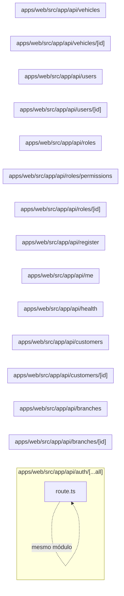

# 12. API de acesso e cadastros

Expõe autenticação, contexto do usuário, filiais, clientes, veículos, equipe e papéis. Este módulo contém **15 arquivos de código**, sendo **15 fichas completas** e **0 exceções em tabela**.

## Dependências do módulo

As setas representam imports internos confirmados. Dependências com outros módulos aparecem nas fichas individuais.

## 12.1 `apps/web/src/app/api/auth/[...all]/route.ts`

**Propósito:** Expõe o contrato HTTP de autenticação em `/api/auth/:all*`, fazendo validação e delegando a regra ao servidor.

**Processo:** GET/POST entra pelo handler, passa por valida parâmetros/entrada e produz a resposta diretamente.

**Estado:** implementado — contém lógica executável e não há marcador explícito de implementação pendente.

**Testes:** `apps/web/test/auth.spec.ts`

**Depende de:** `apps/web/src/server/auth/auth.ts` — Configura o Better Auth com Prisma e cookies da aplicação.

**Usado por:** nenhum importador interno; é ponto de entrada, script, página, rota ou candidato a código não usado.

**Bibliotecas externas relevantes:** `better-auth`

**Contrato:** `GET /api/auth/:all*` · `POST /api/auth/:all*` — pública (auth delegada ao Better Auth no endpoint de auth; registro e health têm controles próprios).

**Entrada:** parâmetros dinâmicos validados quando presentes; sem DTO explícito no arquivo.

**Saída:** JSON do handler/service; sucesso em 200 ou 201, conforme a operação.

**Erros:** 400 para entrada ou transição inválida; 401 sem sessão; 403 sem permissão; 404 quando o recurso não existe; 409 em conflito de unicidade/regra, conforme o service. `handleError` padroniza a resposta.

**Chama:** handler próprio/Better Auth · **Tabelas:** acessadas indiretamente pelo service ou nenhuma · **Telas que consomem:** `/login` (`apps/web/src/app/login/page.tsx`).

## 12.2 `apps/web/src/app/api/branches/[id]/route.ts`

**Propósito:** Expõe o contrato HTTP de filiais em `/api/branches/:id`, fazendo validação e delegando a regra ao servidor.

**Processo:** PATCH/DELETE entra pelo handler, passa por `runRoute` (sessão, permissão e tenant), valida parâmetros/entrada e chama `removeBranch`, `updateBranch`.

**Estado:** implementado — contém lógica executável e não há marcador explícito de implementação pendente.

**Testes:** `apps/web/test/regressions.spec.ts`

**Depende de:** `apps/web/src/server/auth/with-route.ts` — Wrapper das rotas que aplica sessão, RBAC, tenant, transação e tradução de erro. `apps/web/src/server/dtos/update-branch.dto.ts` — Define o contrato validado UpdateBranchDto usado nas entradas de filiais. `apps/web/src/server/http/params.ts` — Valida parâmetros de rota, especialmente UUIDs. `apps/web/src/server/http/parse-body.ts` — Transforma e valida body/query com class-transformer e class-validator. `apps/web/src/server/services/branches.service.ts` — Centraliza regras de negócio e acesso persistente de filiais.

**Usado por:** nenhum importador interno; é ponto de entrada, script, página, rota ou candidato a código não usado.

**Bibliotecas externas relevantes:** `next`

**Contrato:** `PATCH /api/branches/:id` · `DELETE /api/branches/:id` — branch.edit, branch.delete.

**Entrada:** parâmetros dinâmicos validados quando presentes; body/query validados por `UpdateBranchDto`.

**Saída:** JSON do handler/service; sucesso em 200.

**Erros:** 400 para entrada ou transição inválida; 401 sem sessão; 403 sem permissão; 404 quando o recurso não existe; 409 em conflito de unicidade/regra, conforme o service. `handleError` padroniza a resposta.

**Chama:** `removeBranch`, `updateBranch` · **Tabelas:** acessadas indiretamente pelo service ou nenhuma · **Telas que consomem:** `/branches` (`apps/web/src/app/(app)/branches/page.tsx`).

## 12.3 `apps/web/src/app/api/branches/route.ts`

**Propósito:** Expõe o contrato HTTP de filiais em `/api/branches`, fazendo validação e delegando a regra ao servidor.

**Processo:** GET/POST entra pelo handler, passa por `runRoute` (sessão, permissão e tenant), valida parâmetros/entrada e chama `createBranch`, `listBranches`.

**Estado:** implementado — contém lógica executável e não há marcador explícito de implementação pendente.

**Testes:** `apps/web/test/regressions.spec.ts`

**Depende de:** `apps/web/src/server/auth/with-route.ts` — Wrapper das rotas que aplica sessão, RBAC, tenant, transação e tradução de erro. `apps/web/src/server/dtos/create-branch.dto.ts` — Define o contrato validado CreateBranchDto usado nas entradas de filiais. `apps/web/src/server/http/parse-body.ts` — Transforma e valida body/query com class-transformer e class-validator. `apps/web/src/server/services/branches.service.ts` — Centraliza regras de negócio e acesso persistente de filiais.

**Usado por:** nenhum importador interno; é ponto de entrada, script, página, rota ou candidato a código não usado.

**Bibliotecas externas relevantes:** `next`

**Contrato:** `GET /api/branches` · `POST /api/branches` — branch.view, branch.create.

**Entrada:** parâmetros dinâmicos validados quando presentes; body/query validados por `CreateBranchDto`.

**Saída:** JSON do handler/service; sucesso em 201.

**Erros:** 400 para entrada ou transição inválida; 401 sem sessão; 403 sem permissão; 404 quando o recurso não existe; 409 em conflito de unicidade/regra, conforme o service. `handleError` padroniza a resposta.

**Chama:** `createBranch`, `listBranches` · **Tabelas:** acessadas indiretamente pelo service ou nenhuma · **Telas que consomem:** `/branches` (`apps/web/src/app/(app)/branches/page.tsx`).

## 12.4 `apps/web/src/app/api/customers/[id]/route.ts`

**Propósito:** Expõe o contrato HTTP de clientes em `/api/customers/:id`, fazendo validação e delegando a regra ao servidor.

**Processo:** GET/PATCH/DELETE entra pelo handler, passa por `runRoute` (sessão, permissão e tenant), valida parâmetros/entrada e chama `findCustomer`, `removeCustomer`, `updateCustomer`.

**Estado:** implementado — contém lógica executável e não há marcador explícito de implementação pendente.

**Testes:** `apps/web/test/regressions.spec.ts`

**Depende de:** `apps/web/src/server/auth/with-route.ts` — Wrapper das rotas que aplica sessão, RBAC, tenant, transação e tradução de erro. `apps/web/src/server/dtos/update-customer.dto.ts` — Define o contrato validado UpdateCustomerDto usado nas entradas de clientes. `apps/web/src/server/http/params.ts` — Valida parâmetros de rota, especialmente UUIDs. `apps/web/src/server/http/parse-body.ts` — Transforma e valida body/query com class-transformer e class-validator. `apps/web/src/server/services/customers.service.ts` — Centraliza regras de negócio e acesso persistente de clientes.

**Usado por:** nenhum importador interno; é ponto de entrada, script, página, rota ou candidato a código não usado.

**Bibliotecas externas relevantes:** `next`

**Contrato:** `GET /api/customers/:id` · `PATCH /api/customers/:id` · `DELETE /api/customers/:id` — customer.view, customer.edit, customer.delete.

**Entrada:** parâmetros dinâmicos validados quando presentes; body/query validados por `UpdateCustomerDto`.

**Saída:** JSON do handler/service; sucesso em 200.

**Erros:** 400 para entrada ou transição inválida; 401 sem sessão; 403 sem permissão; 404 quando o recurso não existe; 409 em conflito de unicidade/regra, conforme o service. `handleError` padroniza a resposta.

**Chama:** `findCustomer`, `removeCustomer`, `updateCustomer` · **Tabelas:** acessadas indiretamente pelo service ou nenhuma · **Telas que consomem:** `/customers` (`apps/web/src/app/(app)/customers/page.tsx`).

## 12.5 `apps/web/src/app/api/customers/route.ts`

**Propósito:** Expõe o contrato HTTP de clientes em `/api/customers`, fazendo validação e delegando a regra ao servidor.

**Processo:** GET/POST entra pelo handler, passa por `runRoute` (sessão, permissão e tenant), valida parâmetros/entrada e chama `createCustomer`, `listCustomers`.

**Estado:** implementado — contém lógica executável e não há marcador explícito de implementação pendente.

**Testes:** `apps/web/test/regressions.spec.ts`

**Depende de:** `apps/web/src/server/auth/with-route.ts` — Wrapper das rotas que aplica sessão, RBAC, tenant, transação e tradução de erro. `apps/web/src/server/dtos/create-customer.dto.ts` — Define o contrato validado CreateCustomerDto usado nas entradas de clientes. `apps/web/src/server/dtos/query-customer.dto.ts` — Define o contrato validado QueryCustomerDto usado nas entradas de clientes. `apps/web/src/server/http/parse-body.ts` — Transforma e valida body/query com class-transformer e class-validator. `apps/web/src/server/services/customers.service.ts` — Centraliza regras de negócio e acesso persistente de clientes.

**Usado por:** nenhum importador interno; é ponto de entrada, script, página, rota ou candidato a código não usado.

**Bibliotecas externas relevantes:** `next`

**Contrato:** `GET /api/customers` · `POST /api/customers` — customer.view, customer.create.

**Entrada:** parâmetros dinâmicos validados quando presentes; body/query validados por `CreateCustomerDto`, `QueryCustomerDto`.

**Saída:** JSON do handler/service; sucesso em 201.

**Erros:** 400 para entrada ou transição inválida; 401 sem sessão; 403 sem permissão; 404 quando o recurso não existe; 409 em conflito de unicidade/regra, conforme o service. `handleError` padroniza a resposta.

**Chama:** `createCustomer`, `listCustomers` · **Tabelas:** acessadas indiretamente pelo service ou nenhuma · **Telas que consomem:** `/customers` (`apps/web/src/app/(app)/customers/page.tsx`).

## 12.6 `apps/web/src/app/api/health/route.ts`

**Propósito:** Expõe o contrato HTTP de saúde da aplicação em `/api/health`, fazendo validação e delegando a regra ao servidor.

**Processo:** GET entra pelo handler, passa por valida parâmetros/entrada e produz a resposta diretamente.

**Estado:** implementado — contém lógica executável e não há marcador explícito de implementação pendente.

**Testes:** sem teste direto — busca pelos exports, nome do recurso e endpoint nas suítes não encontrou cobertura identificável.

**Depende de:** `apps/web/src/server/db/prisma.ts` — Cria os clientes Prisma de aplicação e sistema e entrega a conexão contextual.

**Usado por:** nenhum importador interno; é ponto de entrada, script, página, rota ou candidato a código não usado.

**Bibliotecas externas relevantes:** nenhuma.

**Contrato:** `GET /api/health` — pública (auth delegada ao Better Auth no endpoint de auth; registro e health têm controles próprios).

**Entrada:** parâmetros dinâmicos validados quando presentes; sem DTO explícito no arquivo.

**Saída:** JSON do handler/service; sucesso em 503.

**Erros:** 400 para entrada ou transição inválida; 401 sem sessão; 403 sem permissão; 404 quando o recurso não existe; 409 em conflito de unicidade/regra, conforme o service. `handleError` padroniza a resposta.

**Chama:** handler próprio/Better Auth · **Tabelas:** acessadas indiretamente pelo service ou nenhuma · **Telas que consomem:** nenhuma chamada direta encontrada nas páginas.

## 12.7 `apps/web/src/app/api/me/route.ts`

**Propósito:** Expõe o contrato HTTP de sessão atual em `/api/me`, fazendo validação e delegando a regra ao servidor.

**Processo:** GET entra pelo handler, passa por `runRoute` (sessão, permissão e tenant), valida parâmetros/entrada e produz a resposta diretamente.

**Estado:** implementado — contém lógica executável e não há marcador explícito de implementação pendente.

**Testes:** sem teste direto — busca pelos exports, nome do recurso e endpoint nas suítes não encontrou cobertura identificável.

**Depende de:** `apps/web/src/server/auth/with-route.ts` — Wrapper das rotas que aplica sessão, RBAC, tenant, transação e tradução de erro. `apps/web/src/server/db/prisma.ts` — Cria os clientes Prisma de aplicação e sistema e entrega a conexão contextual. `apps/web/src/server/http/errors.ts` — Define erros HTTP tipados do servidor. Banco — `Tenant`.

**Usado por:** nenhum importador interno; é ponto de entrada, script, página, rota ou candidato a código não usado.

**Bibliotecas externas relevantes:** `next`

**Contrato:** `GET /api/me` — sessão válida, sem permissão adicional declarada.

**Entrada:** parâmetros dinâmicos validados quando presentes; sem DTO explícito no arquivo.

**Saída:** JSON do handler/service; sucesso em 200.

**Erros:** 400 para entrada ou transição inválida; 401 sem sessão; 403 sem permissão; 404 quando o recurso não existe; 409 em conflito de unicidade/regra, conforme o service. `handleError` padroniza a resposta.

**Chama:** handler próprio/Better Auth · **Tabelas:** `Tenant` · **Telas que consomem:** `/job-cards/:id` (`apps/web/src/app/(app)/job-cards/[id]/page.tsx`), `/login` (`apps/web/src/app/login/page.tsx`).

## 12.8 `apps/web/src/app/api/register/route.ts`

**Propósito:** Expõe o contrato HTTP de provisionamento de oficina em `/api/register`, fazendo validação e delegando a regra ao servidor.

**Processo:** POST entra pelo handler, passa por valida parâmetros/entrada e produz a resposta diretamente.

**Estado:** implementado — contém lógica executável e não há marcador explícito de implementação pendente.

**Testes:** `apps/web/test/regressions.spec.ts`

**Depende de:** `apps/web/src/server/auth/dto/register-tenant.dto.ts` — Implementa a responsabilidade de register-tenant. `apps/web/src/server/auth/provision.ts` — Provisiona atomicamente usuário, tenant, filial, vínculo e papel owner. `apps/web/src/server/http/handle-error.ts` — Converte exceções conhecidas em respostas JSON seguras. `apps/web/src/server/http/parse-body.ts` — Transforma e valida body/query com class-transformer e class-validator. `apps/web/src/server/http/rate-limit.ts` — Implementa limitação simples de requisições em memória.

**Usado por:** nenhum importador interno; é ponto de entrada, script, página, rota ou candidato a código não usado.

**Bibliotecas externas relevantes:** `next`

**Contrato:** `POST /api/register` — pública (auth delegada ao Better Auth no endpoint de auth; registro e health têm controles próprios).

**Entrada:** parâmetros dinâmicos validados quando presentes; body/query validados por `RegisterTenantDto`.

**Saída:** JSON do handler/service; sucesso em 201.

**Erros:** 400 para entrada ou transição inválida; 401 sem sessão; 403 sem permissão; 404 quando o recurso não existe; 409 em conflito de unicidade/regra, conforme o service. `handleError` padroniza a resposta.

**Chama:** handler próprio/Better Auth · **Tabelas:** acessadas indiretamente pelo service ou nenhuma · **Telas que consomem:** nenhuma chamada direta encontrada nas páginas.

## 12.9 `apps/web/src/app/api/roles/[id]/route.ts`

**Propósito:** Expõe o contrato HTTP de papéis e permissões em `/api/roles/:id`, fazendo validação e delegando a regra ao servidor.

**Processo:** GET/PATCH/DELETE entra pelo handler, passa por `runRoute` (sessão, permissão e tenant), valida parâmetros/entrada e chama `findRole`, `removeRole`, `updateRole`.

**Estado:** implementado — contém lógica executável e não há marcador explícito de implementação pendente.

**Testes:** `apps/web/test/regressions.spec.ts`

**Depende de:** `apps/web/src/server/auth/with-route.ts` — Wrapper das rotas que aplica sessão, RBAC, tenant, transação e tradução de erro. `apps/web/src/server/dtos/update-role.dto.ts` — Define o contrato validado UpdateRoleDto usado nas entradas de papéis e permissões. `apps/web/src/server/http/params.ts` — Valida parâmetros de rota, especialmente UUIDs. `apps/web/src/server/http/parse-body.ts` — Transforma e valida body/query com class-transformer e class-validator. `apps/web/src/server/services/roles.service.ts` — Centraliza regras de negócio e acesso persistente de papéis e permissões.

**Usado por:** nenhum importador interno; é ponto de entrada, script, página, rota ou candidato a código não usado.

**Bibliotecas externas relevantes:** `next`

**Contrato:** `GET /api/roles/:id` · `PATCH /api/roles/:id` · `DELETE /api/roles/:id` — role.view, role.edit, role.delete.

**Entrada:** parâmetros dinâmicos validados quando presentes; body/query validados por `UpdateRoleDto`.

**Saída:** JSON do handler/service; sucesso em 200.

**Erros:** 400 para entrada ou transição inválida; 401 sem sessão; 403 sem permissão; 404 quando o recurso não existe; 409 em conflito de unicidade/regra, conforme o service. `handleError` padroniza a resposta.

**Chama:** `findRole`, `removeRole`, `updateRole` · **Tabelas:** acessadas indiretamente pelo service ou nenhuma · **Telas que consomem:** `/roles` (`apps/web/src/app/(app)/roles/page.tsx`), `/team` (`apps/web/src/app/(app)/team/page.tsx`).

## 12.10 `apps/web/src/app/api/roles/permissions/route.ts`

**Propósito:** Expõe o contrato HTTP de papéis e permissões em `/api/roles/permissions`, fazendo validação e delegando a regra ao servidor.

**Processo:** GET entra pelo handler, passa por `runRoute` (sessão, permissão e tenant), valida parâmetros/entrada e chama `listPermissions`.

**Estado:** implementado — contém lógica executável e não há marcador explícito de implementação pendente.

**Testes:** sem teste direto — busca pelos exports, nome do recurso e endpoint nas suítes não encontrou cobertura identificável.

**Depende de:** `apps/web/src/server/auth/with-route.ts` — Wrapper das rotas que aplica sessão, RBAC, tenant, transação e tradução de erro. `apps/web/src/server/services/roles.service.ts` — Centraliza regras de negócio e acesso persistente de papéis e permissões.

**Usado por:** nenhum importador interno; é ponto de entrada, script, página, rota ou candidato a código não usado.

**Bibliotecas externas relevantes:** `next`

**Contrato:** `GET /api/roles/permissions` — role.view.

**Entrada:** parâmetros dinâmicos validados quando presentes; sem DTO explícito no arquivo.

**Saída:** JSON do handler/service; sucesso em 200.

**Erros:** 400 para entrada ou transição inválida; 401 sem sessão; 403 sem permissão; 404 quando o recurso não existe; 409 em conflito de unicidade/regra, conforme o service. `handleError` padroniza a resposta.

**Chama:** `listPermissions` · **Tabelas:** acessadas indiretamente pelo service ou nenhuma · **Telas que consomem:** `/roles` (`apps/web/src/app/(app)/roles/page.tsx`), `/team` (`apps/web/src/app/(app)/team/page.tsx`).

## 12.11 `apps/web/src/app/api/roles/route.ts`

**Propósito:** Expõe o contrato HTTP de papéis e permissões em `/api/roles`, fazendo validação e delegando a regra ao servidor.

**Processo:** GET/POST entra pelo handler, passa por `runRoute` (sessão, permissão e tenant), valida parâmetros/entrada e chama `createRole`, `listRoles`.

**Estado:** implementado — contém lógica executável e não há marcador explícito de implementação pendente.

**Testes:** `apps/web/test/regressions.spec.ts`

**Depende de:** `apps/web/src/server/auth/with-route.ts` — Wrapper das rotas que aplica sessão, RBAC, tenant, transação e tradução de erro. `apps/web/src/server/dtos/create-role.dto.ts` — Define o contrato validado CreateRoleDto usado nas entradas de papéis e permissões. `apps/web/src/server/http/parse-body.ts` — Transforma e valida body/query com class-transformer e class-validator. `apps/web/src/server/services/roles.service.ts` — Centraliza regras de negócio e acesso persistente de papéis e permissões.

**Usado por:** nenhum importador interno; é ponto de entrada, script, página, rota ou candidato a código não usado.

**Bibliotecas externas relevantes:** `next`

**Contrato:** `GET /api/roles` · `POST /api/roles` — role.view, role.create.

**Entrada:** parâmetros dinâmicos validados quando presentes; body/query validados por `CreateRoleDto`.

**Saída:** JSON do handler/service; sucesso em 201.

**Erros:** 400 para entrada ou transição inválida; 401 sem sessão; 403 sem permissão; 404 quando o recurso não existe; 409 em conflito de unicidade/regra, conforme o service. `handleError` padroniza a resposta.

**Chama:** `createRole`, `listRoles` · **Tabelas:** acessadas indiretamente pelo service ou nenhuma · **Telas que consomem:** `/roles` (`apps/web/src/app/(app)/roles/page.tsx`), `/team` (`apps/web/src/app/(app)/team/page.tsx`).

## 12.12 `apps/web/src/app/api/users/[id]/route.ts`

**Propósito:** Expõe o contrato HTTP de usuários/equipe em `/api/users/:id`, fazendo validação e delegando a regra ao servidor.

**Processo:** GET/PATCH/DELETE entra pelo handler, passa por `runRoute` (sessão, permissão e tenant), valida parâmetros/entrada e chama `findUser`, `removeUser`, `updateUser`.

**Estado:** implementado — contém lógica executável e não há marcador explícito de implementação pendente.

**Testes:** `apps/web/test/regressions.spec.ts`

**Depende de:** `apps/web/src/server/auth/with-route.ts` — Wrapper das rotas que aplica sessão, RBAC, tenant, transação e tradução de erro. `apps/web/src/server/dtos/update-user.dto.ts` — Define o contrato validado UpdateUserDto usado nas entradas de usuários/equipe. `apps/web/src/server/http/params.ts` — Valida parâmetros de rota, especialmente UUIDs. `apps/web/src/server/http/parse-body.ts` — Transforma e valida body/query com class-transformer e class-validator. `apps/web/src/server/services/users.service.ts` — Centraliza regras de negócio e acesso persistente de usuários/equipe.

**Usado por:** nenhum importador interno; é ponto de entrada, script, página, rota ou candidato a código não usado.

**Bibliotecas externas relevantes:** `next`

**Contrato:** `GET /api/users/:id` · `PATCH /api/users/:id` · `DELETE /api/users/:id` — user.view, user.edit, user.delete.

**Entrada:** parâmetros dinâmicos validados quando presentes; body/query validados por `UpdateUserDto`.

**Saída:** JSON do handler/service; sucesso em 200.

**Erros:** 400 para entrada ou transição inválida; 401 sem sessão; 403 sem permissão; 404 quando o recurso não existe; 409 em conflito de unicidade/regra, conforme o service. `handleError` padroniza a resposta.

**Chama:** `findUser`, `removeUser`, `updateUser` · **Tabelas:** acessadas indiretamente pelo service ou nenhuma · **Telas que consomem:** `/job-cards/:id` (`apps/web/src/app/(app)/job-cards/[id]/page.tsx`), `/team` (`apps/web/src/app/(app)/team/page.tsx`).

## 12.13 `apps/web/src/app/api/users/route.ts`

**Propósito:** Expõe o contrato HTTP de usuários/equipe em `/api/users`, fazendo validação e delegando a regra ao servidor.

**Processo:** GET/POST entra pelo handler, passa por `runRoute` (sessão, permissão e tenant), valida parâmetros/entrada e chama `createUser`, `listUsers`.

**Estado:** implementado — contém lógica executável e não há marcador explícito de implementação pendente.

**Testes:** `apps/web/test/regressions.spec.ts`

**Depende de:** `apps/web/src/server/auth/with-route.ts` — Wrapper das rotas que aplica sessão, RBAC, tenant, transação e tradução de erro. `apps/web/src/server/dtos/create-user.dto.ts` — Define o contrato validado CreateUserDto usado nas entradas de usuários/equipe. `apps/web/src/server/dtos/query-user.dto.ts` — Define o contrato validado QueryUserDto usado nas entradas de usuários/equipe. `apps/web/src/server/http/parse-body.ts` — Transforma e valida body/query com class-transformer e class-validator. `apps/web/src/server/services/users.service.ts` — Centraliza regras de negócio e acesso persistente de usuários/equipe.

**Usado por:** nenhum importador interno; é ponto de entrada, script, página, rota ou candidato a código não usado.

**Bibliotecas externas relevantes:** `next`

**Contrato:** `GET /api/users` · `POST /api/users` — user.view, user.create.

**Entrada:** parâmetros dinâmicos validados quando presentes; body/query validados por `CreateUserDto`, `QueryUserDto`.

**Saída:** JSON do handler/service; sucesso em 201.

**Erros:** 400 para entrada ou transição inválida; 401 sem sessão; 403 sem permissão; 404 quando o recurso não existe; 409 em conflito de unicidade/regra, conforme o service. `handleError` padroniza a resposta.

**Chama:** `createUser`, `listUsers` · **Tabelas:** acessadas indiretamente pelo service ou nenhuma · **Telas que consomem:** `/job-cards/:id` (`apps/web/src/app/(app)/job-cards/[id]/page.tsx`), `/team` (`apps/web/src/app/(app)/team/page.tsx`).

## 12.14 `apps/web/src/app/api/vehicles/[id]/route.ts`

**Propósito:** Expõe o contrato HTTP de veículos em `/api/vehicles/:id`, fazendo validação e delegando a regra ao servidor.

**Processo:** GET/PATCH/DELETE entra pelo handler, passa por `runRoute` (sessão, permissão e tenant), valida parâmetros/entrada e chama `findVehicle`, `removeVehicle`, `updateVehicle`.

**Estado:** implementado — contém lógica executável e não há marcador explícito de implementação pendente.

**Testes:** `apps/web/test/regressions.spec.ts`

**Depende de:** `apps/web/src/server/auth/with-route.ts` — Wrapper das rotas que aplica sessão, RBAC, tenant, transação e tradução de erro. `apps/web/src/server/dtos/update-vehicle.dto.ts` — Define o contrato validado UpdateVehicleDto usado nas entradas de veículos. `apps/web/src/server/http/params.ts` — Valida parâmetros de rota, especialmente UUIDs. `apps/web/src/server/http/parse-body.ts` — Transforma e valida body/query com class-transformer e class-validator. `apps/web/src/server/services/vehicles.service.ts` — Centraliza regras de negócio e acesso persistente de veículos.

**Usado por:** nenhum importador interno; é ponto de entrada, script, página, rota ou candidato a código não usado.

**Bibliotecas externas relevantes:** `next`

**Contrato:** `GET /api/vehicles/:id` · `PATCH /api/vehicles/:id` · `DELETE /api/vehicles/:id` — vehicle.view, vehicle.edit, vehicle.delete.

**Entrada:** parâmetros dinâmicos validados quando presentes; body/query validados por `UpdateVehicleDto`.

**Saída:** JSON do handler/service; sucesso em 200.

**Erros:** 400 para entrada ou transição inválida; 401 sem sessão; 403 sem permissão; 404 quando o recurso não existe; 409 em conflito de unicidade/regra, conforme o service. `handleError` padroniza a resposta.

**Chama:** `findVehicle`, `removeVehicle`, `updateVehicle` · **Tabelas:** acessadas indiretamente pelo service ou nenhuma · **Telas que consomem:** `/vehicles` (`apps/web/src/app/(app)/vehicles/page.tsx`).

## 12.15 `apps/web/src/app/api/vehicles/route.ts`

**Propósito:** Expõe o contrato HTTP de veículos em `/api/vehicles`, fazendo validação e delegando a regra ao servidor.

**Processo:** GET/POST entra pelo handler, passa por `runRoute` (sessão, permissão e tenant), valida parâmetros/entrada e chama `createVehicle`, `listVehicles`.

**Estado:** implementado — contém lógica executável e não há marcador explícito de implementação pendente.

**Testes:** `apps/web/test/regressions.spec.ts`

**Depende de:** `apps/web/src/server/auth/with-route.ts` — Wrapper das rotas que aplica sessão, RBAC, tenant, transação e tradução de erro. `apps/web/src/server/dtos/create-vehicle.dto.ts` — Define o contrato validado CreateVehicleDto usado nas entradas de veículos. `apps/web/src/server/dtos/query-vehicle.dto.ts` — Define o contrato validado QueryVehicleDto usado nas entradas de veículos. `apps/web/src/server/http/parse-body.ts` — Transforma e valida body/query com class-transformer e class-validator. `apps/web/src/server/services/vehicles.service.ts` — Centraliza regras de negócio e acesso persistente de veículos.

**Usado por:** nenhum importador interno; é ponto de entrada, script, página, rota ou candidato a código não usado.

**Bibliotecas externas relevantes:** `next`

**Contrato:** `GET /api/vehicles` · `POST /api/vehicles` — vehicle.view, vehicle.create.

**Entrada:** parâmetros dinâmicos validados quando presentes; body/query validados por `CreateVehicleDto`, `QueryVehicleDto`.

**Saída:** JSON do handler/service; sucesso em 201.

**Erros:** 400 para entrada ou transição inválida; 401 sem sessão; 403 sem permissão; 404 quando o recurso não existe; 409 em conflito de unicidade/regra, conforme o service. `handleError` padroniza a resposta.

**Chama:** `createVehicle`, `listVehicles` · **Tabelas:** acessadas indiretamente pelo service ou nenhuma · **Telas que consomem:** `/vehicles` (`apps/web/src/app/(app)/vehicles/page.tsx`).

## Quadro do módulo

| Arquivo | Estado | Teste | Processo/tela |
|---|---|---|---|
| `apps/web/src/app/api/auth/[...all]/route.ts` | implementado | `auth.spec.ts` | autenticação |
| `apps/web/src/app/api/branches/[id]/route.ts` | implementado | `regressions.spec.ts` | filiais |
| `apps/web/src/app/api/branches/route.ts` | implementado | `regressions.spec.ts` | filiais |
| `apps/web/src/app/api/customers/[id]/route.ts` | implementado | `regressions.spec.ts` | clientes |
| `apps/web/src/app/api/customers/route.ts` | implementado | `regressions.spec.ts` | clientes |
| `apps/web/src/app/api/health/route.ts` | implementado | sem teste direto | saúde da aplicação |
| `apps/web/src/app/api/me/route.ts` | implementado | sem teste direto | sessão atual |
| `apps/web/src/app/api/register/route.ts` | implementado | `regressions.spec.ts` | provisionamento de oficina |
| `apps/web/src/app/api/roles/[id]/route.ts` | implementado | `regressions.spec.ts` | papéis e permissões |
| `apps/web/src/app/api/roles/permissions/route.ts` | implementado | sem teste direto | papéis e permissões |
| `apps/web/src/app/api/roles/route.ts` | implementado | `regressions.spec.ts` | papéis e permissões |
| `apps/web/src/app/api/users/[id]/route.ts` | implementado | `regressions.spec.ts` | usuários/equipe |
| `apps/web/src/app/api/users/route.ts` | implementado | `regressions.spec.ts` | usuários/equipe |
| `apps/web/src/app/api/vehicles/[id]/route.ts` | implementado | `regressions.spec.ts` | veículos |
| `apps/web/src/app/api/vehicles/route.ts` | implementado | `regressions.spec.ts` | veículos |
