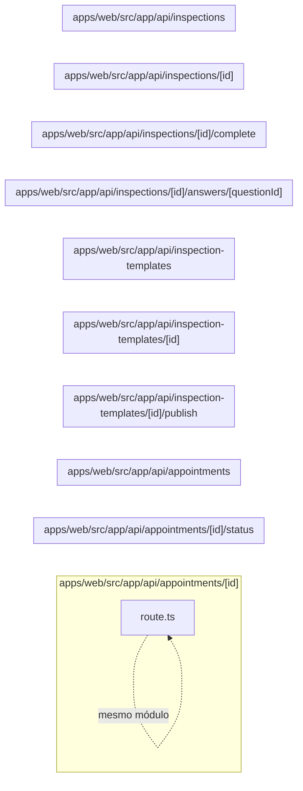

# 13. API de agenda e inspeções

Expõe agendamentos, templates versionados e execução de inspeções. Este módulo contém **10 arquivos de código**, sendo **10 fichas completas** e **0 exceções em tabela**.

## Dependências do módulo

As setas representam imports internos confirmados. Dependências com outros módulos aparecem nas fichas individuais.

## 13.1 `apps/web/src/app/api/appointments/[id]/route.ts`

**Propósito:** Expõe o contrato HTTP de agendamentos em `/api/appointments/:id`, fazendo validação e delegando a regra ao servidor.

**Processo:** GET/PATCH/DELETE entra pelo handler, passa por `runRoute` (sessão, permissão e tenant), valida parâmetros/entrada e chama `findAppointment`, `removeAppointment`, `updateAppointment`.

**Estado:** implementado — contém lógica executável e não há marcador explícito de implementação pendente.

**Testes:** `apps/web/test/regressions.spec.ts`

**Depende de:** `apps/web/src/server/auth/with-route.ts` — Wrapper das rotas que aplica sessão, RBAC, tenant, transação e tradução de erro. `apps/web/src/server/dtos/update-appointment.dto.ts` — Define o contrato validado UpdateAppointmentDto usado nas entradas de agendamentos. `apps/web/src/server/http/params.ts` — Valida parâmetros de rota, especialmente UUIDs. `apps/web/src/server/http/parse-body.ts` — Transforma e valida body/query com class-transformer e class-validator. `apps/web/src/server/services/appointments.service.ts` — Centraliza regras de negócio e acesso persistente de agendamentos.

**Usado por:** nenhum importador interno; é ponto de entrada, script, página, rota ou candidato a código não usado.

**Bibliotecas externas relevantes:** `next`

**Contrato:** `GET /api/appointments/:id` · `PATCH /api/appointments/:id` · `DELETE /api/appointments/:id` — appointment.view, appointment.edit, appointment.delete.

**Entrada:** parâmetros dinâmicos validados quando presentes; body/query validados por `UpdateAppointmentDto`.

**Saída:** JSON do handler/service; sucesso em 200.

**Erros:** 400 para entrada ou transição inválida; 401 sem sessão; 403 sem permissão; 404 quando o recurso não existe; 409 em conflito de unicidade/regra, conforme o service. `handleError` padroniza a resposta.

**Chama:** `findAppointment`, `removeAppointment`, `updateAppointment` · **Tabelas:** acessadas indiretamente pelo service ou nenhuma · **Telas que consomem:** `/appointments` (`apps/web/src/app/(app)/appointments/page.tsx`).

## 13.2 `apps/web/src/app/api/appointments/[id]/status/route.ts`

**Propósito:** Expõe o contrato HTTP de agendamentos em `/api/appointments/:id/status`, fazendo validação e delegando a regra ao servidor.

**Processo:** PATCH entra pelo handler, passa por `runRoute` (sessão, permissão e tenant), valida parâmetros/entrada e chama `updateAppointmentStatus`.

**Estado:** implementado — contém lógica executável e não há marcador explícito de implementação pendente.

**Testes:** `apps/web/test/regressions.spec.ts`

**Depende de:** `apps/web/src/server/auth/with-route.ts` — Wrapper das rotas que aplica sessão, RBAC, tenant, transação e tradução de erro. `apps/web/src/server/dtos/update-appointment-status.dto.ts` — Define o contrato validado UpdateAppointmentStatusDto usado nas entradas de agendamentos. `apps/web/src/server/http/params.ts` — Valida parâmetros de rota, especialmente UUIDs. `apps/web/src/server/http/parse-body.ts` — Transforma e valida body/query com class-transformer e class-validator. `apps/web/src/server/services/appointments.service.ts` — Centraliza regras de negócio e acesso persistente de agendamentos.

**Usado por:** nenhum importador interno; é ponto de entrada, script, página, rota ou candidato a código não usado.

**Bibliotecas externas relevantes:** `next`

**Contrato:** `PATCH /api/appointments/:id/status` — appointment.edit.

**Entrada:** parâmetros dinâmicos validados quando presentes; body/query validados por `UpdateAppointmentStatusDto`.

**Saída:** JSON do handler/service; sucesso em 200.

**Erros:** 400 para entrada ou transição inválida; 401 sem sessão; 403 sem permissão; 404 quando o recurso não existe; 409 em conflito de unicidade/regra, conforme o service. `handleError` padroniza a resposta.

**Chama:** `updateAppointmentStatus` · **Tabelas:** acessadas indiretamente pelo service ou nenhuma · **Telas que consomem:** `/appointments` (`apps/web/src/app/(app)/appointments/page.tsx`).

## 13.3 `apps/web/src/app/api/appointments/route.ts`

**Propósito:** Expõe o contrato HTTP de agendamentos em `/api/appointments`, fazendo validação e delegando a regra ao servidor.

**Processo:** GET/POST entra pelo handler, passa por `runRoute` (sessão, permissão e tenant), valida parâmetros/entrada e chama `createAppointment`, `listAppointments`.

**Estado:** implementado — contém lógica executável e não há marcador explícito de implementação pendente.

**Testes:** `apps/web/test/regressions.spec.ts`

**Depende de:** `apps/web/src/server/auth/with-route.ts` — Wrapper das rotas que aplica sessão, RBAC, tenant, transação e tradução de erro. `apps/web/src/server/dtos/create-appointment.dto.ts` — Define o contrato validado CreateAppointmentDto usado nas entradas de agendamentos. `apps/web/src/server/dtos/query-appointment.dto.ts` — Define o contrato validado QueryAppointmentDto usado nas entradas de agendamentos. `apps/web/src/server/http/parse-body.ts` — Transforma e valida body/query com class-transformer e class-validator. `apps/web/src/server/services/appointments.service.ts` — Centraliza regras de negócio e acesso persistente de agendamentos.

**Usado por:** nenhum importador interno; é ponto de entrada, script, página, rota ou candidato a código não usado.

**Bibliotecas externas relevantes:** `next`

**Contrato:** `GET /api/appointments` · `POST /api/appointments` — appointment.view, appointment.create.

**Entrada:** parâmetros dinâmicos validados quando presentes; body/query validados por `CreateAppointmentDto`, `QueryAppointmentDto`.

**Saída:** JSON do handler/service; sucesso em 201.

**Erros:** 400 para entrada ou transição inválida; 401 sem sessão; 403 sem permissão; 404 quando o recurso não existe; 409 em conflito de unicidade/regra, conforme o service. `handleError` padroniza a resposta.

**Chama:** `createAppointment`, `listAppointments` · **Tabelas:** acessadas indiretamente pelo service ou nenhuma · **Telas que consomem:** `/appointments` (`apps/web/src/app/(app)/appointments/page.tsx`).

## 13.4 `apps/web/src/app/api/inspection-templates/[id]/publish/route.ts`

**Propósito:** Expõe o contrato HTTP de templates de inspeção em `/api/inspection-templates/:id/publish`, fazendo validação e delegando a regra ao servidor.

**Processo:** POST entra pelo handler, passa por `runRoute` (sessão, permissão e tenant), valida parâmetros/entrada e chama `publishInspectionTemplate`.

**Estado:** implementado — contém lógica executável e não há marcador explícito de implementação pendente.

**Testes:** `apps/web/test/regressions.spec.ts`

**Depende de:** `apps/web/src/server/auth/with-route.ts` — Wrapper das rotas que aplica sessão, RBAC, tenant, transação e tradução de erro. `apps/web/src/server/http/params.ts` — Valida parâmetros de rota, especialmente UUIDs. `apps/web/src/server/services/inspection-templates.service.ts` — Centraliza regras de negócio e acesso persistente de inspeções.

**Usado por:** nenhum importador interno; é ponto de entrada, script, página, rota ou candidato a código não usado.

**Bibliotecas externas relevantes:** `next`

**Contrato:** `POST /api/inspection-templates/:id/publish` — inspection.edit.

**Entrada:** parâmetros dinâmicos validados quando presentes; sem DTO explícito no arquivo.

**Saída:** JSON do handler/service; sucesso em 200 ou 201, conforme a operação.

**Erros:** 400 para entrada ou transição inválida; 401 sem sessão; 403 sem permissão; 404 quando o recurso não existe; 409 em conflito de unicidade/regra, conforme o service. `handleError` padroniza a resposta.

**Chama:** `publishInspectionTemplate` · **Tabelas:** acessadas indiretamente pelo service ou nenhuma · **Telas que consomem:** `/inspection-templates/:id` (`apps/web/src/app/(app)/inspection-templates/[id]/page.tsx`), `/inspection-templates` (`apps/web/src/app/(app)/inspection-templates/page.tsx`), `/inspections` (`apps/web/src/app/(app)/inspections/page.tsx`).

## 13.5 `apps/web/src/app/api/inspection-templates/[id]/route.ts`

**Propósito:** Expõe o contrato HTTP de templates de inspeção em `/api/inspection-templates/:id`, fazendo validação e delegando a regra ao servidor.

**Processo:** GET entra pelo handler, passa por `runRoute` (sessão, permissão e tenant), valida parâmetros/entrada e chama `findInspectionTemplate`.

**Estado:** implementado — contém lógica executável e não há marcador explícito de implementação pendente.

**Testes:** sem teste direto — busca pelos exports, nome do recurso e endpoint nas suítes não encontrou cobertura identificável.

**Depende de:** `apps/web/src/server/auth/with-route.ts` — Wrapper das rotas que aplica sessão, RBAC, tenant, transação e tradução de erro. `apps/web/src/server/http/params.ts` — Valida parâmetros de rota, especialmente UUIDs. `apps/web/src/server/services/inspection-templates.service.ts` — Centraliza regras de negócio e acesso persistente de inspeções.

**Usado por:** nenhum importador interno; é ponto de entrada, script, página, rota ou candidato a código não usado.

**Bibliotecas externas relevantes:** `next`

**Contrato:** `GET /api/inspection-templates/:id` — inspection.view.

**Entrada:** parâmetros dinâmicos validados quando presentes; sem DTO explícito no arquivo.

**Saída:** JSON do handler/service; sucesso em 200.

**Erros:** 400 para entrada ou transição inválida; 401 sem sessão; 403 sem permissão; 404 quando o recurso não existe; 409 em conflito de unicidade/regra, conforme o service. `handleError` padroniza a resposta.

**Chama:** `findInspectionTemplate` · **Tabelas:** acessadas indiretamente pelo service ou nenhuma · **Telas que consomem:** `/inspection-templates/:id` (`apps/web/src/app/(app)/inspection-templates/[id]/page.tsx`), `/inspection-templates` (`apps/web/src/app/(app)/inspection-templates/page.tsx`), `/inspections` (`apps/web/src/app/(app)/inspections/page.tsx`).

## 13.6 `apps/web/src/app/api/inspection-templates/route.ts`

**Propósito:** Expõe o contrato HTTP de templates de inspeção em `/api/inspection-templates`, fazendo validação e delegando a regra ao servidor.

**Processo:** GET/POST entra pelo handler, passa por `runRoute` (sessão, permissão e tenant), valida parâmetros/entrada e chama `createInspectionTemplate`, `listInspectionTemplates`.

**Estado:** implementado — contém lógica executável e não há marcador explícito de implementação pendente.

**Testes:** `apps/web/test/regressions.spec.ts`

**Depende de:** `apps/web/src/server/auth/with-route.ts` — Wrapper das rotas que aplica sessão, RBAC, tenant, transação e tradução de erro. `apps/web/src/server/dtos/create-inspection-template.dto.ts` — Define o contrato validado CreateQuestionOptionDto, CreateQuestionDto, CreateSectionDto, CreateInspectionTemplateDto usado nas entradas de inspeções. `apps/web/src/server/dtos/query-inspection-template.dto.ts` — Define o contrato validado QueryInspectionTemplateDto usado nas entradas de inspeções. `apps/web/src/server/http/parse-body.ts` — Transforma e valida body/query com class-transformer e class-validator. `apps/web/src/server/services/inspection-templates.service.ts` — Centraliza regras de negócio e acesso persistente de inspeções.

**Usado por:** nenhum importador interno; é ponto de entrada, script, página, rota ou candidato a código não usado.

**Bibliotecas externas relevantes:** `next`

**Contrato:** `GET /api/inspection-templates` · `POST /api/inspection-templates` — inspection.view, inspection.create.

**Entrada:** parâmetros dinâmicos validados quando presentes; body/query validados por `CreateInspectionTemplateDto`, `QueryInspectionTemplateDto`.

**Saída:** JSON do handler/service; sucesso em 201.

**Erros:** 400 para entrada ou transição inválida; 401 sem sessão; 403 sem permissão; 404 quando o recurso não existe; 409 em conflito de unicidade/regra, conforme o service. `handleError` padroniza a resposta.

**Chama:** `createInspectionTemplate`, `listInspectionTemplates` · **Tabelas:** acessadas indiretamente pelo service ou nenhuma · **Telas que consomem:** `/inspection-templates/:id` (`apps/web/src/app/(app)/inspection-templates/[id]/page.tsx`), `/inspection-templates` (`apps/web/src/app/(app)/inspection-templates/page.tsx`), `/inspections` (`apps/web/src/app/(app)/inspections/page.tsx`).

## 13.7 `apps/web/src/app/api/inspections/[id]/answers/[questionId]/route.ts`

**Propósito:** Expõe o contrato HTTP de inspeções em `/api/inspections/:id/answers/:questionId`, fazendo validação e delegando a regra ao servidor.

**Processo:** PUT entra pelo handler, passa por `runRoute` (sessão, permissão e tenant), valida parâmetros/entrada e chama `upsertInspectionAnswer`.

**Estado:** implementado — contém lógica executável e não há marcador explícito de implementação pendente.

**Testes:** sem teste direto — busca pelos exports, nome do recurso e endpoint nas suítes não encontrou cobertura identificável.

**Depende de:** `apps/web/src/server/auth/with-route.ts` — Wrapper das rotas que aplica sessão, RBAC, tenant, transação e tradução de erro. `apps/web/src/server/dtos/upsert-answer.dto.ts` — Define o contrato validado UpsertAnswerDto usado nas entradas de inspeções. `apps/web/src/server/http/params.ts` — Valida parâmetros de rota, especialmente UUIDs. `apps/web/src/server/http/parse-body.ts` — Transforma e valida body/query com class-transformer e class-validator. `apps/web/src/server/services/inspections.service.ts` — Centraliza regras de negócio e acesso persistente de inspeções.

**Usado por:** nenhum importador interno; é ponto de entrada, script, página, rota ou candidato a código não usado.

**Bibliotecas externas relevantes:** `next`

**Contrato:** `PUT /api/inspections/:id/answers/:questionId` — inspection.edit.

**Entrada:** parâmetros dinâmicos validados quando presentes; body/query validados por `UpsertAnswerDto`.

**Saída:** JSON do handler/service; sucesso em 200.

**Erros:** 400 para entrada ou transição inválida; 401 sem sessão; 403 sem permissão; 404 quando o recurso não existe; 409 em conflito de unicidade/regra, conforme o service. `handleError` padroniza a resposta.

**Chama:** `upsertInspectionAnswer` · **Tabelas:** acessadas indiretamente pelo service ou nenhuma · **Telas que consomem:** `/dashboard` (`apps/web/src/app/(app)/dashboard/page.tsx`), `/inspections/:id` (`apps/web/src/app/(app)/inspections/[id]/page.tsx`), `/inspections` (`apps/web/src/app/(app)/inspections/page.tsx`).

## 13.8 `apps/web/src/app/api/inspections/[id]/complete/route.ts`

**Propósito:** Expõe o contrato HTTP de inspeções em `/api/inspections/:id/complete`, fazendo validação e delegando a regra ao servidor.

**Processo:** POST entra pelo handler, passa por `runRoute` (sessão, permissão e tenant), valida parâmetros/entrada e chama `completeInspection`.

**Estado:** implementado — contém lógica executável e não há marcador explícito de implementação pendente.

**Testes:** `apps/web/test/regressions.spec.ts`

**Depende de:** `apps/web/src/server/auth/with-route.ts` — Wrapper das rotas que aplica sessão, RBAC, tenant, transação e tradução de erro. `apps/web/src/server/http/params.ts` — Valida parâmetros de rota, especialmente UUIDs. `apps/web/src/server/services/inspections.service.ts` — Centraliza regras de negócio e acesso persistente de inspeções.

**Usado por:** nenhum importador interno; é ponto de entrada, script, página, rota ou candidato a código não usado.

**Bibliotecas externas relevantes:** `next`

**Contrato:** `POST /api/inspections/:id/complete` — inspection.edit.

**Entrada:** parâmetros dinâmicos validados quando presentes; sem DTO explícito no arquivo.

**Saída:** JSON do handler/service; sucesso em 200 ou 201, conforme a operação.

**Erros:** 400 para entrada ou transição inválida; 401 sem sessão; 403 sem permissão; 404 quando o recurso não existe; 409 em conflito de unicidade/regra, conforme o service. `handleError` padroniza a resposta.

**Chama:** `completeInspection` · **Tabelas:** acessadas indiretamente pelo service ou nenhuma · **Telas que consomem:** `/dashboard` (`apps/web/src/app/(app)/dashboard/page.tsx`), `/inspections/:id` (`apps/web/src/app/(app)/inspections/[id]/page.tsx`), `/inspections` (`apps/web/src/app/(app)/inspections/page.tsx`).

## 13.9 `apps/web/src/app/api/inspections/[id]/route.ts`

**Propósito:** Expõe o contrato HTTP de inspeções em `/api/inspections/:id`, fazendo validação e delegando a regra ao servidor.

**Processo:** GET/PATCH entra pelo handler, passa por `runRoute` (sessão, permissão e tenant), valida parâmetros/entrada e chama `findInspection`, `updateInspection`.

**Estado:** implementado — contém lógica executável e não há marcador explícito de implementação pendente.

**Testes:** `apps/web/test/regressions.spec.ts`

**Depende de:** `apps/web/src/server/auth/with-route.ts` — Wrapper das rotas que aplica sessão, RBAC, tenant, transação e tradução de erro. `apps/web/src/server/dtos/update-inspection.dto.ts` — Define o contrato validado UpdateInspectionDto usado nas entradas de inspeções. `apps/web/src/server/http/params.ts` — Valida parâmetros de rota, especialmente UUIDs. `apps/web/src/server/http/parse-body.ts` — Transforma e valida body/query com class-transformer e class-validator. `apps/web/src/server/services/inspections.service.ts` — Centraliza regras de negócio e acesso persistente de inspeções.

**Usado por:** nenhum importador interno; é ponto de entrada, script, página, rota ou candidato a código não usado.

**Bibliotecas externas relevantes:** `next`

**Contrato:** `GET /api/inspections/:id` · `PATCH /api/inspections/:id` — inspection.view, inspection.edit.

**Entrada:** parâmetros dinâmicos validados quando presentes; body/query validados por `UpdateInspectionDto`.

**Saída:** JSON do handler/service; sucesso em 200.

**Erros:** 400 para entrada ou transição inválida; 401 sem sessão; 403 sem permissão; 404 quando o recurso não existe; 409 em conflito de unicidade/regra, conforme o service. `handleError` padroniza a resposta.

**Chama:** `findInspection`, `updateInspection` · **Tabelas:** acessadas indiretamente pelo service ou nenhuma · **Telas que consomem:** `/dashboard` (`apps/web/src/app/(app)/dashboard/page.tsx`), `/inspections/:id` (`apps/web/src/app/(app)/inspections/[id]/page.tsx`), `/inspections` (`apps/web/src/app/(app)/inspections/page.tsx`).

## 13.10 `apps/web/src/app/api/inspections/route.ts`

**Propósito:** Expõe o contrato HTTP de inspeções em `/api/inspections`, fazendo validação e delegando a regra ao servidor.

**Processo:** GET/POST entra pelo handler, passa por `runRoute` (sessão, permissão e tenant), valida parâmetros/entrada e chama `listInspections`, `startInspection`.

**Estado:** implementado — contém lógica executável e não há marcador explícito de implementação pendente.

**Testes:** `apps/web/test/regressions.spec.ts`

**Depende de:** `apps/web/src/server/auth/with-route.ts` — Wrapper das rotas que aplica sessão, RBAC, tenant, transação e tradução de erro. `apps/web/src/server/dtos/query-inspection.dto.ts` — Define o contrato validado QueryInspectionDto usado nas entradas de inspeções. `apps/web/src/server/dtos/start-inspection.dto.ts` — Define o contrato validado StartInspectionDto usado nas entradas de inspeções. `apps/web/src/server/http/parse-body.ts` — Transforma e valida body/query com class-transformer e class-validator. `apps/web/src/server/services/inspections.service.ts` — Centraliza regras de negócio e acesso persistente de inspeções.

**Usado por:** nenhum importador interno; é ponto de entrada, script, página, rota ou candidato a código não usado.

**Bibliotecas externas relevantes:** `next`

**Contrato:** `GET /api/inspections` · `POST /api/inspections` — inspection.view, inspection.create.

**Entrada:** parâmetros dinâmicos validados quando presentes; body/query validados por `StartInspectionDto`, `QueryInspectionDto`.

**Saída:** JSON do handler/service; sucesso em 201.

**Erros:** 400 para entrada ou transição inválida; 401 sem sessão; 403 sem permissão; 404 quando o recurso não existe; 409 em conflito de unicidade/regra, conforme o service. `handleError` padroniza a resposta.

**Chama:** `listInspections`, `startInspection` · **Tabelas:** acessadas indiretamente pelo service ou nenhuma · **Telas que consomem:** `/dashboard` (`apps/web/src/app/(app)/dashboard/page.tsx`), `/inspections/:id` (`apps/web/src/app/(app)/inspections/[id]/page.tsx`), `/inspections` (`apps/web/src/app/(app)/inspections/page.tsx`).

## Quadro do módulo

| Arquivo | Estado | Teste | Processo/tela |
|---|---|---|---|
| `apps/web/src/app/api/appointments/[id]/route.ts` | implementado | `regressions.spec.ts` | agendamentos |
| `apps/web/src/app/api/appointments/[id]/status/route.ts` | implementado | `regressions.spec.ts` | agendamentos |
| `apps/web/src/app/api/appointments/route.ts` | implementado | `regressions.spec.ts` | agendamentos |
| `apps/web/src/app/api/inspection-templates/[id]/publish/route.ts` | implementado | `regressions.spec.ts` | templates de inspeção |
| `apps/web/src/app/api/inspection-templates/[id]/route.ts` | implementado | sem teste direto | templates de inspeção |
| `apps/web/src/app/api/inspection-templates/route.ts` | implementado | `regressions.spec.ts` | templates de inspeção |
| `apps/web/src/app/api/inspections/[id]/answers/[questionId]/route.ts` | implementado | sem teste direto | inspeções |
| `apps/web/src/app/api/inspections/[id]/complete/route.ts` | implementado | `regressions.spec.ts` | inspeções |
| `apps/web/src/app/api/inspections/[id]/route.ts` | implementado | `regressions.spec.ts` | inspeções |
| `apps/web/src/app/api/inspections/route.ts` | implementado | `regressions.spec.ts` | inspeções |
