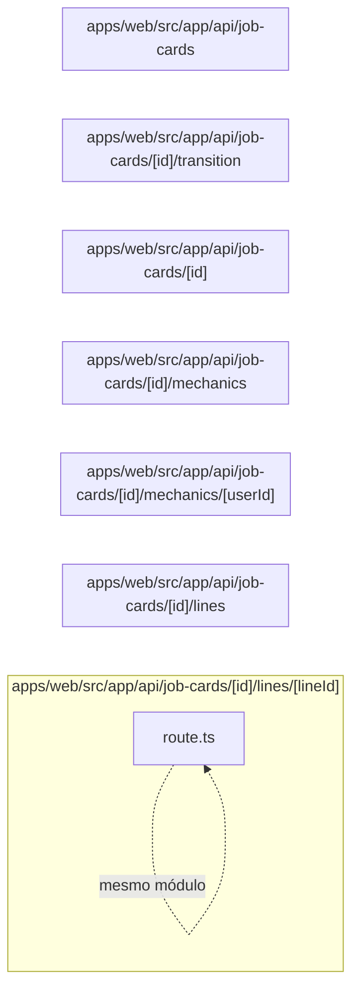

# 14. API de ordens de serviço

Expõe OS, itens, mecânicos e transições de estado. Este módulo contém **7 arquivos de código**, sendo **7 fichas completas** e **0 exceções em tabela**.

## Dependências do módulo

As setas representam imports internos confirmados. Dependências com outros módulos aparecem nas fichas individuais.

## 14.1 `apps/web/src/app/api/job-cards/[id]/lines/[lineId]/route.ts`

**Propósito:** Expõe o contrato HTTP de ordens de serviço em `/api/job-cards/:id/lines/:lineId`, fazendo validação e delegando a regra ao servidor.

**Processo:** PATCH/DELETE entra pelo handler, passa por `runRoute` (sessão, permissão e tenant), valida parâmetros/entrada e chama `removeJobLine`, `updateJobLine`.

**Estado:** implementado — contém lógica executável e não há marcador explícito de implementação pendente.

**Testes:** `apps/web/test/regressions.spec.ts`

**Depende de:** `apps/web/src/server/auth/with-route.ts` — Wrapper das rotas que aplica sessão, RBAC, tenant, transação e tradução de erro. `apps/web/src/server/dtos/update-job-line.dto.ts` — Define o contrato validado UpdateJobLineDto usado nas entradas de ordens de serviço. `apps/web/src/server/http/params.ts` — Valida parâmetros de rota, especialmente UUIDs. `apps/web/src/server/http/parse-body.ts` — Transforma e valida body/query com class-transformer e class-validator. `apps/web/src/server/services/job-cards.service.ts` — Centraliza regras de negócio e acesso persistente de ordens de serviço.

**Usado por:** nenhum importador interno; é ponto de entrada, script, página, rota ou candidato a código não usado.

**Bibliotecas externas relevantes:** `next`

**Contrato:** `PATCH /api/job-cards/:id/lines/:lineId` · `DELETE /api/job-cards/:id/lines/:lineId` — job_card.edit.

**Entrada:** parâmetros dinâmicos validados quando presentes; body/query validados por `UpdateJobLineDto`.

**Saída:** JSON do handler/service; sucesso em 200.

**Erros:** 400 para entrada ou transição inválida; 401 sem sessão; 403 sem permissão; 404 quando o recurso não existe; 409 em conflito de unicidade/regra, conforme o service. `handleError` padroniza a resposta.

**Chama:** `removeJobLine`, `updateJobLine` · **Tabelas:** acessadas indiretamente pelo service ou nenhuma · **Telas que consomem:** `/dashboard` (`apps/web/src/app/(app)/dashboard/page.tsx`), `/job-cards/:id` (`apps/web/src/app/(app)/job-cards/[id]/page.tsx`), `/job-cards` (`apps/web/src/app/(app)/job-cards/page.tsx`), `/quotations` (`apps/web/src/app/(app)/quotations/page.tsx`), `/stock` (`apps/web/src/app/(app)/stock/page.tsx`).

## 14.2 `apps/web/src/app/api/job-cards/[id]/lines/route.ts`

**Propósito:** Expõe o contrato HTTP de ordens de serviço em `/api/job-cards/:id/lines`, fazendo validação e delegando a regra ao servidor.

**Processo:** POST entra pelo handler, passa por `runRoute` (sessão, permissão e tenant), valida parâmetros/entrada e chama `addJobLine`.

**Estado:** implementado — contém lógica executável e não há marcador explícito de implementação pendente.

**Testes:** `apps/web/test/regressions.spec.ts`

**Depende de:** `apps/web/src/server/auth/with-route.ts` — Wrapper das rotas que aplica sessão, RBAC, tenant, transação e tradução de erro. `apps/web/src/server/dtos/create-job-line.dto.ts` — Define o contrato validado CreateJobLineDto usado nas entradas de ordens de serviço. `apps/web/src/server/http/params.ts` — Valida parâmetros de rota, especialmente UUIDs. `apps/web/src/server/http/parse-body.ts` — Transforma e valida body/query com class-transformer e class-validator. `apps/web/src/server/services/job-cards.service.ts` — Centraliza regras de negócio e acesso persistente de ordens de serviço.

**Usado por:** nenhum importador interno; é ponto de entrada, script, página, rota ou candidato a código não usado.

**Bibliotecas externas relevantes:** `next`

**Contrato:** `POST /api/job-cards/:id/lines` — job_card.edit.

**Entrada:** parâmetros dinâmicos validados quando presentes; body/query validados por `CreateJobLineDto`.

**Saída:** JSON do handler/service; sucesso em 201.

**Erros:** 400 para entrada ou transição inválida; 401 sem sessão; 403 sem permissão; 404 quando o recurso não existe; 409 em conflito de unicidade/regra, conforme o service. `handleError` padroniza a resposta.

**Chama:** `addJobLine` · **Tabelas:** acessadas indiretamente pelo service ou nenhuma · **Telas que consomem:** `/dashboard` (`apps/web/src/app/(app)/dashboard/page.tsx`), `/job-cards/:id` (`apps/web/src/app/(app)/job-cards/[id]/page.tsx`), `/job-cards` (`apps/web/src/app/(app)/job-cards/page.tsx`), `/quotations` (`apps/web/src/app/(app)/quotations/page.tsx`), `/stock` (`apps/web/src/app/(app)/stock/page.tsx`).

## 14.3 `apps/web/src/app/api/job-cards/[id]/mechanics/[userId]/route.ts`

**Propósito:** Expõe o contrato HTTP de ordens de serviço em `/api/job-cards/:id/mechanics/:userId`, fazendo validação e delegando a regra ao servidor.

**Processo:** DELETE entra pelo handler, passa por `runRoute` (sessão, permissão e tenant), valida parâmetros/entrada e chama `removeMechanic`.

**Estado:** implementado — contém lógica executável e não há marcador explícito de implementação pendente.

**Testes:** sem teste direto — busca pelos exports, nome do recurso e endpoint nas suítes não encontrou cobertura identificável.

**Depende de:** `apps/web/src/server/auth/with-route.ts` — Wrapper das rotas que aplica sessão, RBAC, tenant, transação e tradução de erro. `apps/web/src/server/http/params.ts` — Valida parâmetros de rota, especialmente UUIDs. `apps/web/src/server/services/job-cards.service.ts` — Centraliza regras de negócio e acesso persistente de ordens de serviço.

**Usado por:** nenhum importador interno; é ponto de entrada, script, página, rota ou candidato a código não usado.

**Bibliotecas externas relevantes:** `next`

**Contrato:** `DELETE /api/job-cards/:id/mechanics/:userId` — job_card.edit.

**Entrada:** parâmetros dinâmicos validados quando presentes; sem DTO explícito no arquivo.

**Saída:** JSON do handler/service; sucesso em 200.

**Erros:** 400 para entrada ou transição inválida; 401 sem sessão; 403 sem permissão; 404 quando o recurso não existe; 409 em conflito de unicidade/regra, conforme o service. `handleError` padroniza a resposta.

**Chama:** `removeMechanic` · **Tabelas:** acessadas indiretamente pelo service ou nenhuma · **Telas que consomem:** `/dashboard` (`apps/web/src/app/(app)/dashboard/page.tsx`), `/job-cards/:id` (`apps/web/src/app/(app)/job-cards/[id]/page.tsx`), `/job-cards` (`apps/web/src/app/(app)/job-cards/page.tsx`), `/quotations` (`apps/web/src/app/(app)/quotations/page.tsx`), `/stock` (`apps/web/src/app/(app)/stock/page.tsx`).

## 14.4 `apps/web/src/app/api/job-cards/[id]/mechanics/route.ts`

**Propósito:** Expõe o contrato HTTP de ordens de serviço em `/api/job-cards/:id/mechanics`, fazendo validação e delegando a regra ao servidor.

**Processo:** POST entra pelo handler, passa por `runRoute` (sessão, permissão e tenant), valida parâmetros/entrada e chama `assignMechanic`.

**Estado:** implementado — contém lógica executável e não há marcador explícito de implementação pendente.

**Testes:** `apps/web/test/regressions.spec.ts`

**Depende de:** `apps/web/src/server/auth/with-route.ts` — Wrapper das rotas que aplica sessão, RBAC, tenant, transação e tradução de erro. `apps/web/src/server/dtos/assign-mechanic.dto.ts` — Define o contrato validado AssignMechanicDto usado nas entradas de ordens de serviço. `apps/web/src/server/http/params.ts` — Valida parâmetros de rota, especialmente UUIDs. `apps/web/src/server/http/parse-body.ts` — Transforma e valida body/query com class-transformer e class-validator. `apps/web/src/server/services/job-cards.service.ts` — Centraliza regras de negócio e acesso persistente de ordens de serviço.

**Usado por:** nenhum importador interno; é ponto de entrada, script, página, rota ou candidato a código não usado.

**Bibliotecas externas relevantes:** `next`

**Contrato:** `POST /api/job-cards/:id/mechanics` — job_card.edit.

**Entrada:** parâmetros dinâmicos validados quando presentes; body/query validados por `AssignMechanicDto`.

**Saída:** JSON do handler/service; sucesso em 201.

**Erros:** 400 para entrada ou transição inválida; 401 sem sessão; 403 sem permissão; 404 quando o recurso não existe; 409 em conflito de unicidade/regra, conforme o service. `handleError` padroniza a resposta.

**Chama:** `assignMechanic` · **Tabelas:** acessadas indiretamente pelo service ou nenhuma · **Telas que consomem:** `/dashboard` (`apps/web/src/app/(app)/dashboard/page.tsx`), `/job-cards/:id` (`apps/web/src/app/(app)/job-cards/[id]/page.tsx`), `/job-cards` (`apps/web/src/app/(app)/job-cards/page.tsx`), `/quotations` (`apps/web/src/app/(app)/quotations/page.tsx`), `/stock` (`apps/web/src/app/(app)/stock/page.tsx`).

## 14.5 `apps/web/src/app/api/job-cards/[id]/route.ts`

**Propósito:** Expõe o contrato HTTP de ordens de serviço em `/api/job-cards/:id`, fazendo validação e delegando a regra ao servidor.

**Processo:** GET/PATCH entra pelo handler, passa por `runRoute` (sessão, permissão e tenant), valida parâmetros/entrada e chama `findJobCard`, `updateJobCard`.

**Estado:** implementado — contém lógica executável e não há marcador explícito de implementação pendente.

**Testes:** `apps/web/test/regressions.spec.ts`

**Depende de:** `apps/web/src/server/auth/with-route.ts` — Wrapper das rotas que aplica sessão, RBAC, tenant, transação e tradução de erro. `apps/web/src/server/dtos/update-job-card.dto.ts` — Define o contrato validado UpdateJobCardDto usado nas entradas de ordens de serviço. `apps/web/src/server/http/params.ts` — Valida parâmetros de rota, especialmente UUIDs. `apps/web/src/server/http/parse-body.ts` — Transforma e valida body/query com class-transformer e class-validator. `apps/web/src/server/services/job-cards.service.ts` — Centraliza regras de negócio e acesso persistente de ordens de serviço.

**Usado por:** nenhum importador interno; é ponto de entrada, script, página, rota ou candidato a código não usado.

**Bibliotecas externas relevantes:** `next`

**Contrato:** `GET /api/job-cards/:id` · `PATCH /api/job-cards/:id` — job_card.view, job_card.edit.

**Entrada:** parâmetros dinâmicos validados quando presentes; body/query validados por `UpdateJobCardDto`.

**Saída:** JSON do handler/service; sucesso em 200.

**Erros:** 400 para entrada ou transição inválida; 401 sem sessão; 403 sem permissão; 404 quando o recurso não existe; 409 em conflito de unicidade/regra, conforme o service. `handleError` padroniza a resposta.

**Chama:** `findJobCard`, `updateJobCard` · **Tabelas:** acessadas indiretamente pelo service ou nenhuma · **Telas que consomem:** `/dashboard` (`apps/web/src/app/(app)/dashboard/page.tsx`), `/job-cards/:id` (`apps/web/src/app/(app)/job-cards/[id]/page.tsx`), `/job-cards` (`apps/web/src/app/(app)/job-cards/page.tsx`), `/quotations` (`apps/web/src/app/(app)/quotations/page.tsx`), `/stock` (`apps/web/src/app/(app)/stock/page.tsx`).

## 14.6 `apps/web/src/app/api/job-cards/[id]/transition/route.ts`

**Propósito:** Expõe o contrato HTTP de ordens de serviço em `/api/job-cards/:id/transition`, fazendo validação e delegando a regra ao servidor.

**Processo:** POST entra pelo handler, passa por `runRoute` (sessão, permissão e tenant), valida parâmetros/entrada e chama `transitionJobCard`.

**Estado:** implementado — contém lógica executável e não há marcador explícito de implementação pendente.

**Testes:** `apps/web/test/regressions.spec.ts`

**Depende de:** `apps/web/src/server/auth/with-route.ts` — Wrapper das rotas que aplica sessão, RBAC, tenant, transação e tradução de erro. `apps/web/src/server/dtos/transition-job-card.dto.ts` — Define o contrato validado TransitionJobCardDto usado nas entradas de ordens de serviço. `apps/web/src/server/http/params.ts` — Valida parâmetros de rota, especialmente UUIDs. `apps/web/src/server/http/parse-body.ts` — Transforma e valida body/query com class-transformer e class-validator. `apps/web/src/server/services/job-cards.service.ts` — Centraliza regras de negócio e acesso persistente de ordens de serviço.

**Usado por:** nenhum importador interno; é ponto de entrada, script, página, rota ou candidato a código não usado.

**Bibliotecas externas relevantes:** `next`

**Contrato:** `POST /api/job-cards/:id/transition` — job_card.edit.

**Entrada:** parâmetros dinâmicos validados quando presentes; body/query validados por `TransitionJobCardDto`.

**Saída:** JSON do handler/service; sucesso em 200 ou 201, conforme a operação.

**Erros:** 400 para entrada ou transição inválida; 401 sem sessão; 403 sem permissão; 404 quando o recurso não existe; 409 em conflito de unicidade/regra, conforme o service. `handleError` padroniza a resposta.

**Chama:** `transitionJobCard` · **Tabelas:** acessadas indiretamente pelo service ou nenhuma · **Telas que consomem:** `/dashboard` (`apps/web/src/app/(app)/dashboard/page.tsx`), `/job-cards/:id` (`apps/web/src/app/(app)/job-cards/[id]/page.tsx`), `/job-cards` (`apps/web/src/app/(app)/job-cards/page.tsx`), `/quotations` (`apps/web/src/app/(app)/quotations/page.tsx`), `/stock` (`apps/web/src/app/(app)/stock/page.tsx`).

## 14.7 `apps/web/src/app/api/job-cards/route.ts`

**Propósito:** Expõe o contrato HTTP de ordens de serviço em `/api/job-cards`, fazendo validação e delegando a regra ao servidor.

**Processo:** GET/POST entra pelo handler, passa por `runRoute` (sessão, permissão e tenant), valida parâmetros/entrada e chama `createJobCard`, `listJobCards`.

**Estado:** implementado — contém lógica executável e não há marcador explícito de implementação pendente.

**Testes:** `apps/web/test/regressions.spec.ts`

**Depende de:** `apps/web/src/server/auth/with-route.ts` — Wrapper das rotas que aplica sessão, RBAC, tenant, transação e tradução de erro. `apps/web/src/server/dtos/create-job-card.dto.ts` — Define o contrato validado CreateJobCardDto usado nas entradas de ordens de serviço. `apps/web/src/server/dtos/query-job-card.dto.ts` — Define o contrato validado QueryJobCardDto usado nas entradas de ordens de serviço. `apps/web/src/server/http/parse-body.ts` — Transforma e valida body/query com class-transformer e class-validator. `apps/web/src/server/services/job-cards.service.ts` — Centraliza regras de negócio e acesso persistente de ordens de serviço.

**Usado por:** nenhum importador interno; é ponto de entrada, script, página, rota ou candidato a código não usado.

**Bibliotecas externas relevantes:** `next`

**Contrato:** `GET /api/job-cards` · `POST /api/job-cards` — job_card.view, job_card.create.

**Entrada:** parâmetros dinâmicos validados quando presentes; body/query validados por `CreateJobCardDto`, `QueryJobCardDto`.

**Saída:** JSON do handler/service; sucesso em 201.

**Erros:** 400 para entrada ou transição inválida; 401 sem sessão; 403 sem permissão; 404 quando o recurso não existe; 409 em conflito de unicidade/regra, conforme o service. `handleError` padroniza a resposta.

**Chama:** `createJobCard`, `listJobCards` · **Tabelas:** acessadas indiretamente pelo service ou nenhuma · **Telas que consomem:** `/dashboard` (`apps/web/src/app/(app)/dashboard/page.tsx`), `/job-cards/:id` (`apps/web/src/app/(app)/job-cards/[id]/page.tsx`), `/job-cards` (`apps/web/src/app/(app)/job-cards/page.tsx`), `/quotations` (`apps/web/src/app/(app)/quotations/page.tsx`), `/stock` (`apps/web/src/app/(app)/stock/page.tsx`).

## Quadro do módulo

| Arquivo | Estado | Teste | Processo/tela |
|---|---|---|---|
| `apps/web/src/app/api/job-cards/[id]/lines/[lineId]/route.ts` | implementado | `regressions.spec.ts` | ordens de serviço |
| `apps/web/src/app/api/job-cards/[id]/lines/route.ts` | implementado | `regressions.spec.ts` | ordens de serviço |
| `apps/web/src/app/api/job-cards/[id]/mechanics/[userId]/route.ts` | implementado | sem teste direto | ordens de serviço |
| `apps/web/src/app/api/job-cards/[id]/mechanics/route.ts` | implementado | `regressions.spec.ts` | ordens de serviço |
| `apps/web/src/app/api/job-cards/[id]/route.ts` | implementado | `regressions.spec.ts` | ordens de serviço |
| `apps/web/src/app/api/job-cards/[id]/transition/route.ts` | implementado | `regressions.spec.ts` | ordens de serviço |
| `apps/web/src/app/api/job-cards/route.ts` | implementado | `regressions.spec.ts` | ordens de serviço |
