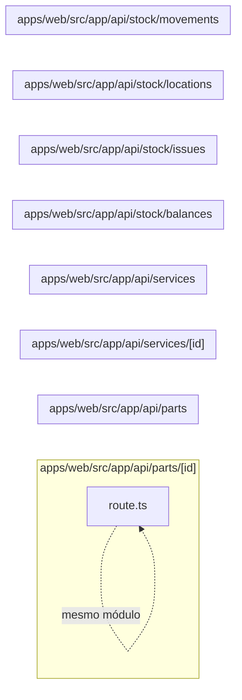

# 15. API de catálogos e estoque

Expõe peças, catálogo de serviços, locais, movimentos, saldos e baixas. Este módulo contém **8 arquivos de código**, sendo **8 fichas completas** e **0 exceções em tabela**.

## Dependências do módulo

As setas representam imports internos confirmados. Dependências com outros módulos aparecem nas fichas individuais.

## 15.1 `apps/web/src/app/api/parts/[id]/route.ts`

**Propósito:** Expõe o contrato HTTP de peças em `/api/parts/:id`, fazendo validação e delegando a regra ao servidor.

**Processo:** GET/PATCH/DELETE entra pelo handler, passa por `runRoute` (sessão, permissão e tenant), valida parâmetros/entrada e chama `findPart`, `removePart`, `updatePart`.

**Estado:** implementado — contém lógica executável e não há marcador explícito de implementação pendente.

**Testes:** `apps/web/test/regressions.spec.ts`

**Depende de:** `apps/web/src/server/auth/with-route.ts` — Wrapper das rotas que aplica sessão, RBAC, tenant, transação e tradução de erro. `apps/web/src/server/dtos/update-part.dto.ts` — Define o contrato validado UpdatePartDto usado nas entradas de peças. `apps/web/src/server/http/params.ts` — Valida parâmetros de rota, especialmente UUIDs. `apps/web/src/server/http/parse-body.ts` — Transforma e valida body/query com class-transformer e class-validator. `apps/web/src/server/services/parts.service.ts` — Centraliza regras de negócio e acesso persistente de peças.

**Usado por:** nenhum importador interno; é ponto de entrada, script, página, rota ou candidato a código não usado.

**Bibliotecas externas relevantes:** `next`

**Contrato:** `GET /api/parts/:id` · `PATCH /api/parts/:id` · `DELETE /api/parts/:id` — part.view, part.edit, part.delete.

**Entrada:** parâmetros dinâmicos validados quando presentes; body/query validados por `UpdatePartDto`.

**Saída:** JSON do handler/service; sucesso em 200.

**Erros:** 400 para entrada ou transição inválida; 401 sem sessão; 403 sem permissão; 404 quando o recurso não existe; 409 em conflito de unicidade/regra, conforme o service. `handleError` padroniza a resposta.

**Chama:** `findPart`, `removePart`, `updatePart` · **Tabelas:** acessadas indiretamente pelo service ou nenhuma · **Telas que consomem:** `/parts` (`apps/web/src/app/(app)/parts/page.tsx`), `/purchases` (`apps/web/src/app/(app)/purchases/page.tsx`), `/stock` (`apps/web/src/app/(app)/stock/page.tsx`).

## 15.2 `apps/web/src/app/api/parts/route.ts`

**Propósito:** Expõe o contrato HTTP de peças em `/api/parts`, fazendo validação e delegando a regra ao servidor.

**Processo:** GET/POST entra pelo handler, passa por `runRoute` (sessão, permissão e tenant), valida parâmetros/entrada e chama `createPart`, `listParts`.

**Estado:** implementado — contém lógica executável e não há marcador explícito de implementação pendente.

**Testes:** `apps/web/test/regressions.spec.ts`

**Depende de:** `apps/web/src/server/auth/with-route.ts` — Wrapper das rotas que aplica sessão, RBAC, tenant, transação e tradução de erro. `apps/web/src/server/dtos/create-part.dto.ts` — Define o contrato validado CreatePartDto usado nas entradas de peças. `apps/web/src/server/dtos/query-part.dto.ts` — Define o contrato validado QueryPartDto usado nas entradas de peças. `apps/web/src/server/http/parse-body.ts` — Transforma e valida body/query com class-transformer e class-validator. `apps/web/src/server/services/parts.service.ts` — Centraliza regras de negócio e acesso persistente de peças.

**Usado por:** nenhum importador interno; é ponto de entrada, script, página, rota ou candidato a código não usado.

**Bibliotecas externas relevantes:** `next`

**Contrato:** `GET /api/parts` · `POST /api/parts` — part.view, part.create.

**Entrada:** parâmetros dinâmicos validados quando presentes; body/query validados por `CreatePartDto`, `QueryPartDto`.

**Saída:** JSON do handler/service; sucesso em 201.

**Erros:** 400 para entrada ou transição inválida; 401 sem sessão; 403 sem permissão; 404 quando o recurso não existe; 409 em conflito de unicidade/regra, conforme o service. `handleError` padroniza a resposta.

**Chama:** `createPart`, `listParts` · **Tabelas:** acessadas indiretamente pelo service ou nenhuma · **Telas que consomem:** `/parts` (`apps/web/src/app/(app)/parts/page.tsx`), `/purchases` (`apps/web/src/app/(app)/purchases/page.tsx`), `/stock` (`apps/web/src/app/(app)/stock/page.tsx`).

## 15.3 `apps/web/src/app/api/services/[id]/route.ts`

**Propósito:** Expõe o contrato HTTP de catálogo de serviços em `/api/services/:id`, fazendo validação e delegando a regra ao servidor.

**Processo:** GET/PATCH/DELETE entra pelo handler, passa por `runRoute` (sessão, permissão e tenant), valida parâmetros/entrada e chama `findService`, `removeService`, `updateService`.

**Estado:** implementado — contém lógica executável e não há marcador explícito de implementação pendente.

**Testes:** `apps/web/test/flows.spec.ts`, `apps/web/test/regressions.spec.ts`, `apps/web/test/rls.spec.ts`

**Depende de:** `apps/web/src/server/auth/with-route.ts` — Wrapper das rotas que aplica sessão, RBAC, tenant, transação e tradução de erro. `apps/web/src/server/dtos/update-service.dto.ts` — Define o contrato validado UpdateServiceDto usado nas entradas de catálogo de serviços. `apps/web/src/server/http/params.ts` — Valida parâmetros de rota, especialmente UUIDs. `apps/web/src/server/http/parse-body.ts` — Transforma e valida body/query com class-transformer e class-validator. `apps/web/src/server/services/services.service.ts` — Centraliza regras de negócio e acesso persistente de catálogo de serviços.

**Usado por:** nenhum importador interno; é ponto de entrada, script, página, rota ou candidato a código não usado.

**Bibliotecas externas relevantes:** `next`

**Contrato:** `GET /api/services/:id` · `PATCH /api/services/:id` · `DELETE /api/services/:id` — service.view, service.edit, service.delete.

**Entrada:** parâmetros dinâmicos validados quando presentes; body/query validados por `UpdateServiceDto`.

**Saída:** JSON do handler/service; sucesso em 200.

**Erros:** 400 para entrada ou transição inválida; 401 sem sessão; 403 sem permissão; 404 quando o recurso não existe; 409 em conflito de unicidade/regra, conforme o service. `handleError` padroniza a resposta.

**Chama:** `findService`, `removeService`, `updateService` · **Tabelas:** acessadas indiretamente pelo service ou nenhuma · **Telas que consomem:** `/services` (`apps/web/src/app/(app)/services/page.tsx`).

## 15.4 `apps/web/src/app/api/services/route.ts`

**Propósito:** Expõe o contrato HTTP de catálogo de serviços em `/api/services`, fazendo validação e delegando a regra ao servidor.

**Processo:** GET/POST entra pelo handler, passa por `runRoute` (sessão, permissão e tenant), valida parâmetros/entrada e chama `createService`, `listServices`.

**Estado:** implementado — contém lógica executável e não há marcador explícito de implementação pendente.

**Testes:** `apps/web/test/flows.spec.ts`, `apps/web/test/regressions.spec.ts`, `apps/web/test/rls.spec.ts`

**Depende de:** `apps/web/src/server/auth/with-route.ts` — Wrapper das rotas que aplica sessão, RBAC, tenant, transação e tradução de erro. `apps/web/src/server/dtos/create-service.dto.ts` — Define o contrato validado CreateServiceDto usado nas entradas de catálogo de serviços. `apps/web/src/server/dtos/query-service.dto.ts` — Define o contrato validado QueryServiceDto usado nas entradas de catálogo de serviços. `apps/web/src/server/http/parse-body.ts` — Transforma e valida body/query com class-transformer e class-validator. `apps/web/src/server/services/services.service.ts` — Centraliza regras de negócio e acesso persistente de catálogo de serviços.

**Usado por:** nenhum importador interno; é ponto de entrada, script, página, rota ou candidato a código não usado.

**Bibliotecas externas relevantes:** `next`

**Contrato:** `GET /api/services` · `POST /api/services` — service.view, service.create.

**Entrada:** parâmetros dinâmicos validados quando presentes; body/query validados por `CreateServiceDto`, `QueryServiceDto`.

**Saída:** JSON do handler/service; sucesso em 201.

**Erros:** 400 para entrada ou transição inválida; 401 sem sessão; 403 sem permissão; 404 quando o recurso não existe; 409 em conflito de unicidade/regra, conforme o service. `handleError` padroniza a resposta.

**Chama:** `createService`, `listServices` · **Tabelas:** acessadas indiretamente pelo service ou nenhuma · **Telas que consomem:** `/services` (`apps/web/src/app/(app)/services/page.tsx`).

## 15.5 `apps/web/src/app/api/stock/balances/route.ts`

**Propósito:** Expõe o contrato HTTP de estoque em `/api/stock/balances`, fazendo validação e delegando a regra ao servidor.

**Processo:** GET entra pelo handler, passa por `runRoute` (sessão, permissão e tenant), valida parâmetros/entrada e chama `listBalances`.

**Estado:** implementado — contém lógica executável e não há marcador explícito de implementação pendente.

**Testes:** sem teste direto — busca pelos exports, nome do recurso e endpoint nas suítes não encontrou cobertura identificável.

**Depende de:** `apps/web/src/server/auth/with-route.ts` — Wrapper das rotas que aplica sessão, RBAC, tenant, transação e tradução de erro. `apps/web/src/server/dtos/query-balance.dto.ts` — Define o contrato validado QueryBalanceDto usado nas entradas de estoque. `apps/web/src/server/http/parse-body.ts` — Transforma e valida body/query com class-transformer e class-validator. `apps/web/src/server/services/stock.service.ts` — Centraliza regras de negócio e acesso persistente de stock.

**Usado por:** nenhum importador interno; é ponto de entrada, script, página, rota ou candidato a código não usado.

**Bibliotecas externas relevantes:** `next`

**Contrato:** `GET /api/stock/balances` — stock.view.

**Entrada:** parâmetros dinâmicos validados quando presentes; body/query validados por `QueryBalanceDto`.

**Saída:** JSON do handler/service; sucesso em 200.

**Erros:** 400 para entrada ou transição inválida; 401 sem sessão; 403 sem permissão; 404 quando o recurso não existe; 409 em conflito de unicidade/regra, conforme o service. `handleError` padroniza a resposta.

**Chama:** `listBalances` · **Tabelas:** acessadas indiretamente pelo service ou nenhuma · **Telas que consomem:** `/dashboard` (`apps/web/src/app/(app)/dashboard/page.tsx`), `/purchases` (`apps/web/src/app/(app)/purchases/page.tsx`), `/stock` (`apps/web/src/app/(app)/stock/page.tsx`).

## 15.6 `apps/web/src/app/api/stock/issues/route.ts`

**Propósito:** Expõe o contrato HTTP de estoque em `/api/stock/issues`, fazendo validação e delegando a regra ao servidor.

**Processo:** POST entra pelo handler, passa por `runRoute` (sessão, permissão e tenant), valida parâmetros/entrada e chama `issueToJob`.

**Estado:** implementado — contém lógica executável e não há marcador explícito de implementação pendente.

**Testes:** `apps/web/test/regressions.spec.ts`

**Depende de:** `apps/web/src/server/auth/with-route.ts` — Wrapper das rotas que aplica sessão, RBAC, tenant, transação e tradução de erro. `apps/web/src/server/dtos/issue-to-job.dto.ts` — Define o contrato validado IssueToJobDto usado nas entradas de issue-to-job. `apps/web/src/server/http/parse-body.ts` — Transforma e valida body/query com class-transformer e class-validator. `apps/web/src/server/services/stock.service.ts` — Centraliza regras de negócio e acesso persistente de stock.

**Usado por:** nenhum importador interno; é ponto de entrada, script, página, rota ou candidato a código não usado.

**Bibliotecas externas relevantes:** `next`

**Contrato:** `POST /api/stock/issues` — stock.create.

**Entrada:** parâmetros dinâmicos validados quando presentes; body/query validados por `IssueToJobDto`.

**Saída:** JSON do handler/service; sucesso em 201.

**Erros:** 400 para entrada ou transição inválida; 401 sem sessão; 403 sem permissão; 404 quando o recurso não existe; 409 em conflito de unicidade/regra, conforme o service. `handleError` padroniza a resposta.

**Chama:** `issueToJob` · **Tabelas:** acessadas indiretamente pelo service ou nenhuma · **Telas que consomem:** `/dashboard` (`apps/web/src/app/(app)/dashboard/page.tsx`), `/purchases` (`apps/web/src/app/(app)/purchases/page.tsx`), `/stock` (`apps/web/src/app/(app)/stock/page.tsx`).

## 15.7 `apps/web/src/app/api/stock/locations/route.ts`

**Propósito:** Expõe o contrato HTTP de estoque em `/api/stock/locations`, fazendo validação e delegando a regra ao servidor.

**Processo:** GET/POST entra pelo handler, passa por `runRoute` (sessão, permissão e tenant), valida parâmetros/entrada e chama `createLocation`, `listLocations`.

**Estado:** implementado — contém lógica executável e não há marcador explícito de implementação pendente.

**Testes:** `apps/web/test/regressions.spec.ts`

**Depende de:** `apps/web/src/server/auth/with-route.ts` — Wrapper das rotas que aplica sessão, RBAC, tenant, transação e tradução de erro. `apps/web/src/server/dtos/create-location.dto.ts` — Define o contrato validado CreateLocationDto usado nas entradas de estoque. `apps/web/src/server/http/parse-body.ts` — Transforma e valida body/query com class-transformer e class-validator. `apps/web/src/server/services/stock.service.ts` — Centraliza regras de negócio e acesso persistente de stock.

**Usado por:** nenhum importador interno; é ponto de entrada, script, página, rota ou candidato a código não usado.

**Bibliotecas externas relevantes:** `next`

**Contrato:** `GET /api/stock/locations` · `POST /api/stock/locations` — stock.view, stock.create.

**Entrada:** parâmetros dinâmicos validados quando presentes; body/query validados por `CreateLocationDto`.

**Saída:** JSON do handler/service; sucesso em 201.

**Erros:** 400 para entrada ou transição inválida; 401 sem sessão; 403 sem permissão; 404 quando o recurso não existe; 409 em conflito de unicidade/regra, conforme o service. `handleError` padroniza a resposta.

**Chama:** `createLocation`, `listLocations` · **Tabelas:** acessadas indiretamente pelo service ou nenhuma · **Telas que consomem:** `/dashboard` (`apps/web/src/app/(app)/dashboard/page.tsx`), `/purchases` (`apps/web/src/app/(app)/purchases/page.tsx`), `/stock` (`apps/web/src/app/(app)/stock/page.tsx`).

## 15.8 `apps/web/src/app/api/stock/movements/route.ts`

**Propósito:** Expõe o contrato HTTP de estoque em `/api/stock/movements`, fazendo validação e delegando a regra ao servidor.

**Processo:** GET/POST entra pelo handler, passa por `runRoute` (sessão, permissão e tenant), valida parâmetros/entrada e chama `createMovement`, `listMovements`.

**Estado:** implementado — contém lógica executável e não há marcador explícito de implementação pendente.

**Testes:** `apps/web/test/regressions.spec.ts`

**Depende de:** `apps/web/src/server/auth/with-route.ts` — Wrapper das rotas que aplica sessão, RBAC, tenant, transação e tradução de erro. `apps/web/src/server/dtos/create-movement.dto.ts` — Define o contrato validado CreateMovementDto usado nas entradas de estoque. `apps/web/src/server/dtos/query-movement.dto.ts` — Define o contrato validado QueryMovementDto usado nas entradas de estoque. `apps/web/src/server/http/parse-body.ts` — Transforma e valida body/query com class-transformer e class-validator. `apps/web/src/server/services/stock.service.ts` — Centraliza regras de negócio e acesso persistente de stock.

**Usado por:** nenhum importador interno; é ponto de entrada, script, página, rota ou candidato a código não usado.

**Bibliotecas externas relevantes:** `next`

**Contrato:** `GET /api/stock/movements` · `POST /api/stock/movements` — stock.view, stock.create.

**Entrada:** parâmetros dinâmicos validados quando presentes; body/query validados por `CreateMovementDto`, `QueryMovementDto`.

**Saída:** JSON do handler/service; sucesso em 201.

**Erros:** 400 para entrada ou transição inválida; 401 sem sessão; 403 sem permissão; 404 quando o recurso não existe; 409 em conflito de unicidade/regra, conforme o service. `handleError` padroniza a resposta.

**Chama:** `createMovement`, `listMovements` · **Tabelas:** acessadas indiretamente pelo service ou nenhuma · **Telas que consomem:** `/dashboard` (`apps/web/src/app/(app)/dashboard/page.tsx`), `/purchases` (`apps/web/src/app/(app)/purchases/page.tsx`), `/stock` (`apps/web/src/app/(app)/stock/page.tsx`).

## Quadro do módulo

| Arquivo | Estado | Teste | Processo/tela |
|---|---|---|---|
| `apps/web/src/app/api/parts/[id]/route.ts` | implementado | `regressions.spec.ts` | peças |
| `apps/web/src/app/api/parts/route.ts` | implementado | `regressions.spec.ts` | peças |
| `apps/web/src/app/api/services/[id]/route.ts` | implementado | `flows.spec.ts`, `regressions.spec.ts`, `rls.spec.ts` | catálogo de serviços |
| `apps/web/src/app/api/services/route.ts` | implementado | `flows.spec.ts`, `regressions.spec.ts`, `rls.spec.ts` | catálogo de serviços |
| `apps/web/src/app/api/stock/balances/route.ts` | implementado | sem teste direto | estoque |
| `apps/web/src/app/api/stock/issues/route.ts` | implementado | `regressions.spec.ts` | estoque |
| `apps/web/src/app/api/stock/locations/route.ts` | implementado | `regressions.spec.ts` | estoque |
| `apps/web/src/app/api/stock/movements/route.ts` | implementado | `regressions.spec.ts` | estoque |
