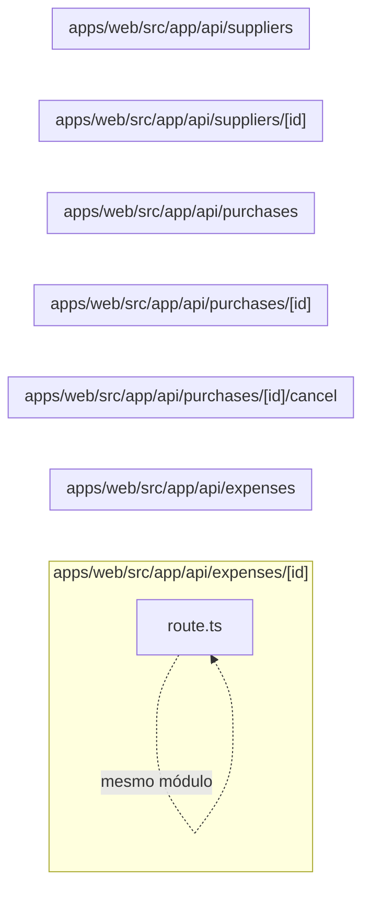

# 16. API de fornecedores, compras e despesas

Expõe fornecedores, despesas e o recebimento/cancelamento de compras. Este módulo contém **7 arquivos de código**, sendo **7 fichas completas** e **0 exceções em tabela**.

## Dependências do módulo

As setas representam imports internos confirmados. Dependências com outros módulos aparecem nas fichas individuais.

## 16.1 `apps/web/src/app/api/expenses/[id]/route.ts`

**Propósito:** Expõe o contrato HTTP de despesas em `/api/expenses/:id`, fazendo validação e delegando a regra ao servidor.

**Processo:** GET/PATCH/DELETE entra pelo handler, passa por `runRoute` (sessão, permissão e tenant), valida parâmetros/entrada e chama `findExpense`, `removeExpense`, `updateExpense`.

**Estado:** implementado — contém lógica executável e não há marcador explícito de implementação pendente.

**Testes:** `apps/web/test/regressions.spec.ts`

**Depende de:** `apps/web/src/server/auth/with-route.ts` — Wrapper das rotas que aplica sessão, RBAC, tenant, transação e tradução de erro. `apps/web/src/server/dtos/update-expense.dto.ts` — Define o contrato validado UpdateExpenseDto usado nas entradas de despesas. `apps/web/src/server/http/params.ts` — Valida parâmetros de rota, especialmente UUIDs. `apps/web/src/server/http/parse-body.ts` — Transforma e valida body/query com class-transformer e class-validator. `apps/web/src/server/services/expenses.service.ts` — Centraliza regras de negócio e acesso persistente de despesas.

**Usado por:** nenhum importador interno; é ponto de entrada, script, página, rota ou candidato a código não usado.

**Bibliotecas externas relevantes:** `next`

**Contrato:** `GET /api/expenses/:id` · `PATCH /api/expenses/:id` · `DELETE /api/expenses/:id` — expense.view, expense.edit, expense.delete.

**Entrada:** parâmetros dinâmicos validados quando presentes; body/query validados por `UpdateExpenseDto`.

**Saída:** JSON do handler/service; sucesso em 200.

**Erros:** 400 para entrada ou transição inválida; 401 sem sessão; 403 sem permissão; 404 quando o recurso não existe; 409 em conflito de unicidade/regra, conforme o service. `handleError` padroniza a resposta.

**Chama:** `findExpense`, `removeExpense`, `updateExpense` · **Tabelas:** acessadas indiretamente pelo service ou nenhuma · **Telas que consomem:** `/expenses` (`apps/web/src/app/(app)/expenses/page.tsx`).

## 16.2 `apps/web/src/app/api/expenses/route.ts`

**Propósito:** Expõe o contrato HTTP de despesas em `/api/expenses`, fazendo validação e delegando a regra ao servidor.

**Processo:** GET/POST entra pelo handler, passa por `runRoute` (sessão, permissão e tenant), valida parâmetros/entrada e chama `createExpense`, `listExpenses`.

**Estado:** implementado — contém lógica executável e não há marcador explícito de implementação pendente.

**Testes:** `apps/web/test/regressions.spec.ts`

**Depende de:** `apps/web/src/server/auth/with-route.ts` — Wrapper das rotas que aplica sessão, RBAC, tenant, transação e tradução de erro. `apps/web/src/server/dtos/create-expense.dto.ts` — Define o contrato validado CreateExpenseDto usado nas entradas de despesas. `apps/web/src/server/dtos/query-expense.dto.ts` — Define o contrato validado QueryExpenseDto usado nas entradas de despesas. `apps/web/src/server/http/parse-body.ts` — Transforma e valida body/query com class-transformer e class-validator. `apps/web/src/server/services/expenses.service.ts` — Centraliza regras de negócio e acesso persistente de despesas.

**Usado por:** nenhum importador interno; é ponto de entrada, script, página, rota ou candidato a código não usado.

**Bibliotecas externas relevantes:** `next`

**Contrato:** `GET /api/expenses` · `POST /api/expenses` — expense.view, expense.create.

**Entrada:** parâmetros dinâmicos validados quando presentes; body/query validados por `CreateExpenseDto`, `QueryExpenseDto`.

**Saída:** JSON do handler/service; sucesso em 201.

**Erros:** 400 para entrada ou transição inválida; 401 sem sessão; 403 sem permissão; 404 quando o recurso não existe; 409 em conflito de unicidade/regra, conforme o service. `handleError` padroniza a resposta.

**Chama:** `createExpense`, `listExpenses` · **Tabelas:** acessadas indiretamente pelo service ou nenhuma · **Telas que consomem:** `/expenses` (`apps/web/src/app/(app)/expenses/page.tsx`).

## 16.3 `apps/web/src/app/api/purchases/[id]/cancel/route.ts`

**Propósito:** Expõe o contrato HTTP de compras em `/api/purchases/:id/cancel`, fazendo validação e delegando a regra ao servidor.

**Processo:** POST entra pelo handler, passa por `runRoute` (sessão, permissão e tenant), valida parâmetros/entrada e chama `cancelPurchase`.

**Estado:** implementado — contém lógica executável e não há marcador explícito de implementação pendente.

**Testes:** `apps/web/test/regressions.spec.ts`

**Depende de:** `apps/web/src/server/auth/with-route.ts` — Wrapper das rotas que aplica sessão, RBAC, tenant, transação e tradução de erro. `apps/web/src/server/http/params.ts` — Valida parâmetros de rota, especialmente UUIDs. `apps/web/src/server/services/purchases.service.ts` — Centraliza regras de negócio e acesso persistente de compras.

**Usado por:** nenhum importador interno; é ponto de entrada, script, página, rota ou candidato a código não usado.

**Bibliotecas externas relevantes:** `next`

**Contrato:** `POST /api/purchases/:id/cancel` — purchase.edit.

**Entrada:** parâmetros dinâmicos validados quando presentes; sem DTO explícito no arquivo.

**Saída:** JSON do handler/service; sucesso em 200 ou 201, conforme a operação.

**Erros:** 400 para entrada ou transição inválida; 401 sem sessão; 403 sem permissão; 404 quando o recurso não existe; 409 em conflito de unicidade/regra, conforme o service. `handleError` padroniza a resposta.

**Chama:** `cancelPurchase` · **Tabelas:** acessadas indiretamente pelo service ou nenhuma · **Telas que consomem:** `/dashboard` (`apps/web/src/app/(app)/dashboard/page.tsx`), `/purchases` (`apps/web/src/app/(app)/purchases/page.tsx`).

## 16.4 `apps/web/src/app/api/purchases/[id]/route.ts`

**Propósito:** Expõe o contrato HTTP de compras em `/api/purchases/:id`, fazendo validação e delegando a regra ao servidor.

**Processo:** GET entra pelo handler, passa por `runRoute` (sessão, permissão e tenant), valida parâmetros/entrada e chama `findPurchase`.

**Estado:** implementado — contém lógica executável e não há marcador explícito de implementação pendente.

**Testes:** sem teste direto — busca pelos exports, nome do recurso e endpoint nas suítes não encontrou cobertura identificável.

**Depende de:** `apps/web/src/server/auth/with-route.ts` — Wrapper das rotas que aplica sessão, RBAC, tenant, transação e tradução de erro. `apps/web/src/server/http/params.ts` — Valida parâmetros de rota, especialmente UUIDs. `apps/web/src/server/services/purchases.service.ts` — Centraliza regras de negócio e acesso persistente de compras.

**Usado por:** nenhum importador interno; é ponto de entrada, script, página, rota ou candidato a código não usado.

**Bibliotecas externas relevantes:** `next`

**Contrato:** `GET /api/purchases/:id` — purchase.view.

**Entrada:** parâmetros dinâmicos validados quando presentes; sem DTO explícito no arquivo.

**Saída:** JSON do handler/service; sucesso em 200.

**Erros:** 400 para entrada ou transição inválida; 401 sem sessão; 403 sem permissão; 404 quando o recurso não existe; 409 em conflito de unicidade/regra, conforme o service. `handleError` padroniza a resposta.

**Chama:** `findPurchase` · **Tabelas:** acessadas indiretamente pelo service ou nenhuma · **Telas que consomem:** `/dashboard` (`apps/web/src/app/(app)/dashboard/page.tsx`), `/purchases` (`apps/web/src/app/(app)/purchases/page.tsx`).

## 16.5 `apps/web/src/app/api/purchases/route.ts`

**Propósito:** Expõe o contrato HTTP de compras em `/api/purchases`, fazendo validação e delegando a regra ao servidor.

**Processo:** GET/POST entra pelo handler, passa por `runRoute` (sessão, permissão e tenant), valida parâmetros/entrada e chama `createPurchase`, `listPurchases`.

**Estado:** implementado — contém lógica executável e não há marcador explícito de implementação pendente.

**Testes:** `apps/web/test/regressions.spec.ts`

**Depende de:** `apps/web/src/server/auth/with-route.ts` — Wrapper das rotas que aplica sessão, RBAC, tenant, transação e tradução de erro. `apps/web/src/server/dtos/create-purchase.dto.ts` — Define o contrato validado CreatePurchaseItemDto, CreatePurchaseDto usado nas entradas de compras. `apps/web/src/server/dtos/query-purchase.dto.ts` — Define o contrato validado QueryPurchaseDto usado nas entradas de compras. `apps/web/src/server/http/parse-body.ts` — Transforma e valida body/query com class-transformer e class-validator. `apps/web/src/server/services/purchases.service.ts` — Centraliza regras de negócio e acesso persistente de compras.

**Usado por:** nenhum importador interno; é ponto de entrada, script, página, rota ou candidato a código não usado.

**Bibliotecas externas relevantes:** `next`

**Contrato:** `GET /api/purchases` · `POST /api/purchases` — purchase.view, purchase.create.

**Entrada:** parâmetros dinâmicos validados quando presentes; body/query validados por `CreatePurchaseDto`, `QueryPurchaseDto`.

**Saída:** JSON do handler/service; sucesso em 201.

**Erros:** 400 para entrada ou transição inválida; 401 sem sessão; 403 sem permissão; 404 quando o recurso não existe; 409 em conflito de unicidade/regra, conforme o service. `handleError` padroniza a resposta.

**Chama:** `createPurchase`, `listPurchases` · **Tabelas:** acessadas indiretamente pelo service ou nenhuma · **Telas que consomem:** `/dashboard` (`apps/web/src/app/(app)/dashboard/page.tsx`), `/purchases` (`apps/web/src/app/(app)/purchases/page.tsx`).

## 16.6 `apps/web/src/app/api/suppliers/[id]/route.ts`

**Propósito:** Expõe o contrato HTTP de fornecedores em `/api/suppliers/:id`, fazendo validação e delegando a regra ao servidor.

**Processo:** GET/PATCH/DELETE entra pelo handler, passa por `runRoute` (sessão, permissão e tenant), valida parâmetros/entrada e chama `findSupplier`, `removeSupplier`, `updateSupplier`.

**Estado:** implementado — contém lógica executável e não há marcador explícito de implementação pendente.

**Testes:** `apps/web/test/regressions.spec.ts`

**Depende de:** `apps/web/src/server/auth/with-route.ts` — Wrapper das rotas que aplica sessão, RBAC, tenant, transação e tradução de erro. `apps/web/src/server/dtos/update-supplier.dto.ts` — Define o contrato validado UpdateSupplierDto usado nas entradas de fornecedores. `apps/web/src/server/http/params.ts` — Valida parâmetros de rota, especialmente UUIDs. `apps/web/src/server/http/parse-body.ts` — Transforma e valida body/query com class-transformer e class-validator. `apps/web/src/server/services/suppliers.service.ts` — Centraliza regras de negócio e acesso persistente de fornecedores.

**Usado por:** nenhum importador interno; é ponto de entrada, script, página, rota ou candidato a código não usado.

**Bibliotecas externas relevantes:** `next`

**Contrato:** `GET /api/suppliers/:id` · `PATCH /api/suppliers/:id` · `DELETE /api/suppliers/:id` — supplier.view, supplier.edit, supplier.delete.

**Entrada:** parâmetros dinâmicos validados quando presentes; body/query validados por `UpdateSupplierDto`.

**Saída:** JSON do handler/service; sucesso em 200.

**Erros:** 400 para entrada ou transição inválida; 401 sem sessão; 403 sem permissão; 404 quando o recurso não existe; 409 em conflito de unicidade/regra, conforme o service. `handleError` padroniza a resposta.

**Chama:** `findSupplier`, `removeSupplier`, `updateSupplier` · **Tabelas:** acessadas indiretamente pelo service ou nenhuma · **Telas que consomem:** `/purchases` (`apps/web/src/app/(app)/purchases/page.tsx`), `/suppliers` (`apps/web/src/app/(app)/suppliers/page.tsx`).

## 16.7 `apps/web/src/app/api/suppliers/route.ts`

**Propósito:** Expõe o contrato HTTP de fornecedores em `/api/suppliers`, fazendo validação e delegando a regra ao servidor.

**Processo:** GET/POST entra pelo handler, passa por `runRoute` (sessão, permissão e tenant), valida parâmetros/entrada e chama `createSupplier`, `listSuppliers`.

**Estado:** implementado — contém lógica executável e não há marcador explícito de implementação pendente.

**Testes:** `apps/web/test/regressions.spec.ts`

**Depende de:** `apps/web/src/server/auth/with-route.ts` — Wrapper das rotas que aplica sessão, RBAC, tenant, transação e tradução de erro. `apps/web/src/server/dtos/create-supplier.dto.ts` — Define o contrato validado CreateSupplierDto usado nas entradas de fornecedores. `apps/web/src/server/dtos/query-supplier.dto.ts` — Define o contrato validado QuerySupplierDto usado nas entradas de fornecedores. `apps/web/src/server/http/parse-body.ts` — Transforma e valida body/query com class-transformer e class-validator. `apps/web/src/server/services/suppliers.service.ts` — Centraliza regras de negócio e acesso persistente de fornecedores.

**Usado por:** nenhum importador interno; é ponto de entrada, script, página, rota ou candidato a código não usado.

**Bibliotecas externas relevantes:** `next`

**Contrato:** `GET /api/suppliers` · `POST /api/suppliers` — supplier.view, supplier.create.

**Entrada:** parâmetros dinâmicos validados quando presentes; body/query validados por `CreateSupplierDto`, `QuerySupplierDto`.

**Saída:** JSON do handler/service; sucesso em 201.

**Erros:** 400 para entrada ou transição inválida; 401 sem sessão; 403 sem permissão; 404 quando o recurso não existe; 409 em conflito de unicidade/regra, conforme o service. `handleError` padroniza a resposta.

**Chama:** `createSupplier`, `listSuppliers` · **Tabelas:** acessadas indiretamente pelo service ou nenhuma · **Telas que consomem:** `/purchases` (`apps/web/src/app/(app)/purchases/page.tsx`), `/suppliers` (`apps/web/src/app/(app)/suppliers/page.tsx`).

## Quadro do módulo

| Arquivo | Estado | Teste | Processo/tela |
|---|---|---|---|
| `apps/web/src/app/api/expenses/[id]/route.ts` | implementado | `regressions.spec.ts` | despesas |
| `apps/web/src/app/api/expenses/route.ts` | implementado | `regressions.spec.ts` | despesas |
| `apps/web/src/app/api/purchases/[id]/cancel/route.ts` | implementado | `regressions.spec.ts` | compras |
| `apps/web/src/app/api/purchases/[id]/route.ts` | implementado | sem teste direto | compras |
| `apps/web/src/app/api/purchases/route.ts` | implementado | `regressions.spec.ts` | compras |
| `apps/web/src/app/api/suppliers/[id]/route.ts` | implementado | `regressions.spec.ts` | fornecedores |
| `apps/web/src/app/api/suppliers/route.ts` | implementado | `regressions.spec.ts` | fornecedores |
