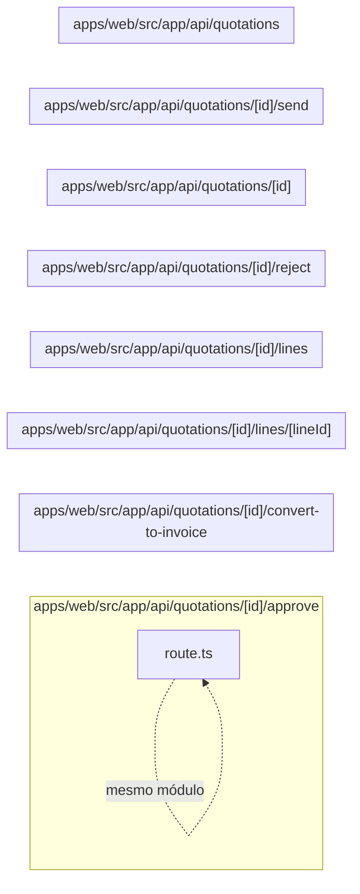

# 17. API de orçamentos

Expõe orçamento, itens, decisão e conversão para fatura. Este módulo contém **8 arquivos de código**, sendo **8 fichas completas** e **0 exceções em tabela**.

## Dependências do módulo

As setas representam imports internos confirmados. Dependências com outros módulos aparecem nas fichas individuais.

## 17.1 `apps/web/src/app/api/quotations/[id]/approve/route.ts`

**Propósito:** Expõe o contrato HTTP de orçamentos em `/api/quotations/:id/approve`, fazendo validação e delegando a regra ao servidor.

**Processo:** POST entra pelo handler, passa por `runRoute` (sessão, permissão e tenant), valida parâmetros/entrada e chama `approveQuotation`.

**Estado:** implementado — contém lógica executável e não há marcador explícito de implementação pendente.

**Testes:** `apps/web/test/regressions.spec.ts`

**Depende de:** `apps/web/src/server/auth/with-route.ts` — Wrapper das rotas que aplica sessão, RBAC, tenant, transação e tradução de erro. `apps/web/src/server/http/params.ts` — Valida parâmetros de rota, especialmente UUIDs. `apps/web/src/server/services/quotations.service.ts` — Centraliza regras de negócio e acesso persistente de orçamentos.

**Usado por:** nenhum importador interno; é ponto de entrada, script, página, rota ou candidato a código não usado.

**Bibliotecas externas relevantes:** `next`

**Contrato:** `POST /api/quotations/:id/approve` — quotation.approve.

**Entrada:** parâmetros dinâmicos validados quando presentes; sem DTO explícito no arquivo.

**Saída:** JSON do handler/service; sucesso em 200 ou 201, conforme a operação.

**Erros:** 400 para entrada ou transição inválida; 401 sem sessão; 403 sem permissão; 404 quando o recurso não existe; 409 em conflito de unicidade/regra, conforme o service. `handleError` padroniza a resposta.

**Chama:** `approveQuotation` · **Tabelas:** acessadas indiretamente pelo service ou nenhuma · **Telas que consomem:** `/dashboard` (`apps/web/src/app/(app)/dashboard/page.tsx`), `/quotations/:id` (`apps/web/src/app/(app)/quotations/[id]/page.tsx`), `/quotations` (`apps/web/src/app/(app)/quotations/page.tsx`).

## 17.2 `apps/web/src/app/api/quotations/[id]/convert-to-invoice/route.ts`

**Propósito:** Expõe o contrato HTTP de orçamentos em `/api/quotations/:id/convert-to-invoice`, fazendo validação e delegando a regra ao servidor.

**Processo:** POST entra pelo handler, passa por `runRoute` (sessão, permissão e tenant), valida parâmetros/entrada e chama `convertQuotationToInvoice`.

**Estado:** implementado — contém lógica executável e não há marcador explícito de implementação pendente.

**Testes:** `apps/web/test/regressions.spec.ts`

**Depende de:** `apps/web/src/server/auth/with-route.ts` — Wrapper das rotas que aplica sessão, RBAC, tenant, transação e tradução de erro. `apps/web/src/server/http/params.ts` — Valida parâmetros de rota, especialmente UUIDs. `apps/web/src/server/services/quotations.service.ts` — Centraliza regras de negócio e acesso persistente de orçamentos.

**Usado por:** nenhum importador interno; é ponto de entrada, script, página, rota ou candidato a código não usado.

**Bibliotecas externas relevantes:** `next`

**Contrato:** `POST /api/quotations/:id/convert-to-invoice` — invoice.create.

**Entrada:** parâmetros dinâmicos validados quando presentes; sem DTO explícito no arquivo.

**Saída:** JSON do handler/service; sucesso em 201.

**Erros:** 400 para entrada ou transição inválida; 401 sem sessão; 403 sem permissão; 404 quando o recurso não existe; 409 em conflito de unicidade/regra, conforme o service. `handleError` padroniza a resposta.

**Chama:** `convertQuotationToInvoice` · **Tabelas:** acessadas indiretamente pelo service ou nenhuma · **Telas que consomem:** `/dashboard` (`apps/web/src/app/(app)/dashboard/page.tsx`), `/quotations/:id` (`apps/web/src/app/(app)/quotations/[id]/page.tsx`), `/quotations` (`apps/web/src/app/(app)/quotations/page.tsx`).

## 17.3 `apps/web/src/app/api/quotations/[id]/lines/[lineId]/route.ts`

**Propósito:** Expõe o contrato HTTP de orçamentos em `/api/quotations/:id/lines/:lineId`, fazendo validação e delegando a regra ao servidor.

**Processo:** PATCH/DELETE entra pelo handler, passa por `runRoute` (sessão, permissão e tenant), valida parâmetros/entrada e chama `removeQuotationLine`, `updateQuotationLine`.

**Estado:** implementado — contém lógica executável e não há marcador explícito de implementação pendente.

**Testes:** `apps/web/test/regressions.spec.ts`

**Depende de:** `apps/web/src/server/auth/with-route.ts` — Wrapper das rotas que aplica sessão, RBAC, tenant, transação e tradução de erro. `apps/web/src/server/dtos/line-item.dto.ts` — Define o contrato validado CreateLineItemDto, UpdateLineItemDto usado nas entradas de line-item. `apps/web/src/server/http/params.ts` — Valida parâmetros de rota, especialmente UUIDs. `apps/web/src/server/http/parse-body.ts` — Transforma e valida body/query com class-transformer e class-validator. `apps/web/src/server/services/quotations.service.ts` — Centraliza regras de negócio e acesso persistente de orçamentos.

**Usado por:** nenhum importador interno; é ponto de entrada, script, página, rota ou candidato a código não usado.

**Bibliotecas externas relevantes:** `next`

**Contrato:** `PATCH /api/quotations/:id/lines/:lineId` · `DELETE /api/quotations/:id/lines/:lineId` — quotation.edit.

**Entrada:** parâmetros dinâmicos validados quando presentes; body/query validados por `UpdateLineItemDto`.

**Saída:** JSON do handler/service; sucesso em 200.

**Erros:** 400 para entrada ou transição inválida; 401 sem sessão; 403 sem permissão; 404 quando o recurso não existe; 409 em conflito de unicidade/regra, conforme o service. `handleError` padroniza a resposta.

**Chama:** `removeQuotationLine`, `updateQuotationLine` · **Tabelas:** acessadas indiretamente pelo service ou nenhuma · **Telas que consomem:** `/dashboard` (`apps/web/src/app/(app)/dashboard/page.tsx`), `/quotations/:id` (`apps/web/src/app/(app)/quotations/[id]/page.tsx`), `/quotations` (`apps/web/src/app/(app)/quotations/page.tsx`).

## 17.4 `apps/web/src/app/api/quotations/[id]/lines/route.ts`

**Propósito:** Expõe o contrato HTTP de orçamentos em `/api/quotations/:id/lines`, fazendo validação e delegando a regra ao servidor.

**Processo:** POST entra pelo handler, passa por `runRoute` (sessão, permissão e tenant), valida parâmetros/entrada e chama `addQuotationLine`.

**Estado:** implementado — contém lógica executável e não há marcador explícito de implementação pendente.

**Testes:** `apps/web/test/regressions.spec.ts`

**Depende de:** `apps/web/src/server/auth/with-route.ts` — Wrapper das rotas que aplica sessão, RBAC, tenant, transação e tradução de erro. `apps/web/src/server/dtos/line-item.dto.ts` — Define o contrato validado CreateLineItemDto, UpdateLineItemDto usado nas entradas de line-item. `apps/web/src/server/http/params.ts` — Valida parâmetros de rota, especialmente UUIDs. `apps/web/src/server/http/parse-body.ts` — Transforma e valida body/query com class-transformer e class-validator. `apps/web/src/server/services/quotations.service.ts` — Centraliza regras de negócio e acesso persistente de orçamentos.

**Usado por:** nenhum importador interno; é ponto de entrada, script, página, rota ou candidato a código não usado.

**Bibliotecas externas relevantes:** `next`

**Contrato:** `POST /api/quotations/:id/lines` — quotation.edit.

**Entrada:** parâmetros dinâmicos validados quando presentes; body/query validados por `CreateLineItemDto`.

**Saída:** JSON do handler/service; sucesso em 201.

**Erros:** 400 para entrada ou transição inválida; 401 sem sessão; 403 sem permissão; 404 quando o recurso não existe; 409 em conflito de unicidade/regra, conforme o service. `handleError` padroniza a resposta.

**Chama:** `addQuotationLine` · **Tabelas:** acessadas indiretamente pelo service ou nenhuma · **Telas que consomem:** `/dashboard` (`apps/web/src/app/(app)/dashboard/page.tsx`), `/quotations/:id` (`apps/web/src/app/(app)/quotations/[id]/page.tsx`), `/quotations` (`apps/web/src/app/(app)/quotations/page.tsx`).

## 17.5 `apps/web/src/app/api/quotations/[id]/reject/route.ts`

**Propósito:** Expõe o contrato HTTP de orçamentos em `/api/quotations/:id/reject`, fazendo validação e delegando a regra ao servidor.

**Processo:** POST entra pelo handler, passa por `runRoute` (sessão, permissão e tenant), valida parâmetros/entrada e chama `rejectQuotation`.

**Estado:** implementado — contém lógica executável e não há marcador explícito de implementação pendente.

**Testes:** `apps/web/test/regressions.spec.ts`

**Depende de:** `apps/web/src/server/auth/with-route.ts` — Wrapper das rotas que aplica sessão, RBAC, tenant, transação e tradução de erro. `apps/web/src/server/http/params.ts` — Valida parâmetros de rota, especialmente UUIDs. `apps/web/src/server/services/quotations.service.ts` — Centraliza regras de negócio e acesso persistente de orçamentos.

**Usado por:** nenhum importador interno; é ponto de entrada, script, página, rota ou candidato a código não usado.

**Bibliotecas externas relevantes:** `next`

**Contrato:** `POST /api/quotations/:id/reject` — quotation.approve.

**Entrada:** parâmetros dinâmicos validados quando presentes; sem DTO explícito no arquivo.

**Saída:** JSON do handler/service; sucesso em 200 ou 201, conforme a operação.

**Erros:** 400 para entrada ou transição inválida; 401 sem sessão; 403 sem permissão; 404 quando o recurso não existe; 409 em conflito de unicidade/regra, conforme o service. `handleError` padroniza a resposta.

**Chama:** `rejectQuotation` · **Tabelas:** acessadas indiretamente pelo service ou nenhuma · **Telas que consomem:** `/dashboard` (`apps/web/src/app/(app)/dashboard/page.tsx`), `/quotations/:id` (`apps/web/src/app/(app)/quotations/[id]/page.tsx`), `/quotations` (`apps/web/src/app/(app)/quotations/page.tsx`).

## 17.6 `apps/web/src/app/api/quotations/[id]/route.ts`

**Propósito:** Expõe o contrato HTTP de orçamentos em `/api/quotations/:id`, fazendo validação e delegando a regra ao servidor.

**Processo:** GET/PATCH/DELETE entra pelo handler, passa por `runRoute` (sessão, permissão e tenant), valida parâmetros/entrada e chama `findQuotation`, `removeQuotation`, `updateQuotation`.

**Estado:** implementado — contém lógica executável e não há marcador explícito de implementação pendente.

**Testes:** `apps/web/test/regressions.spec.ts`

**Depende de:** `apps/web/src/server/auth/with-route.ts` — Wrapper das rotas que aplica sessão, RBAC, tenant, transação e tradução de erro. `apps/web/src/server/dtos/update-quotation.dto.ts` — Define o contrato validado UpdateQuotationDto usado nas entradas de orçamentos. `apps/web/src/server/http/params.ts` — Valida parâmetros de rota, especialmente UUIDs. `apps/web/src/server/http/parse-body.ts` — Transforma e valida body/query com class-transformer e class-validator. `apps/web/src/server/services/quotations.service.ts` — Centraliza regras de negócio e acesso persistente de orçamentos.

**Usado por:** nenhum importador interno; é ponto de entrada, script, página, rota ou candidato a código não usado.

**Bibliotecas externas relevantes:** `next`

**Contrato:** `GET /api/quotations/:id` · `PATCH /api/quotations/:id` · `DELETE /api/quotations/:id` — quotation.view, quotation.edit, quotation.delete.

**Entrada:** parâmetros dinâmicos validados quando presentes; body/query validados por `UpdateQuotationDto`.

**Saída:** JSON do handler/service; sucesso em 200.

**Erros:** 400 para entrada ou transição inválida; 401 sem sessão; 403 sem permissão; 404 quando o recurso não existe; 409 em conflito de unicidade/regra, conforme o service. `handleError` padroniza a resposta.

**Chama:** `findQuotation`, `removeQuotation`, `updateQuotation` · **Tabelas:** acessadas indiretamente pelo service ou nenhuma · **Telas que consomem:** `/dashboard` (`apps/web/src/app/(app)/dashboard/page.tsx`), `/quotations/:id` (`apps/web/src/app/(app)/quotations/[id]/page.tsx`), `/quotations` (`apps/web/src/app/(app)/quotations/page.tsx`).

## 17.7 `apps/web/src/app/api/quotations/[id]/send/route.ts`

**Propósito:** Expõe o contrato HTTP de orçamentos em `/api/quotations/:id/send`, fazendo validação e delegando a regra ao servidor.

**Processo:** POST entra pelo handler, passa por `runRoute` (sessão, permissão e tenant), valida parâmetros/entrada e chama `sendQuotation`.

**Estado:** implementado — contém lógica executável e não há marcador explícito de implementação pendente.

**Testes:** `apps/web/test/regressions.spec.ts`

**Depende de:** `apps/web/src/server/auth/with-route.ts` — Wrapper das rotas que aplica sessão, RBAC, tenant, transação e tradução de erro. `apps/web/src/server/http/params.ts` — Valida parâmetros de rota, especialmente UUIDs. `apps/web/src/server/services/quotations.service.ts` — Centraliza regras de negócio e acesso persistente de orçamentos.

**Usado por:** nenhum importador interno; é ponto de entrada, script, página, rota ou candidato a código não usado.

**Bibliotecas externas relevantes:** `next`

**Contrato:** `POST /api/quotations/:id/send` — quotation.edit.

**Entrada:** parâmetros dinâmicos validados quando presentes; sem DTO explícito no arquivo.

**Saída:** JSON do handler/service; sucesso em 200 ou 201, conforme a operação.

**Erros:** 400 para entrada ou transição inválida; 401 sem sessão; 403 sem permissão; 404 quando o recurso não existe; 409 em conflito de unicidade/regra, conforme o service. `handleError` padroniza a resposta.

**Chama:** `sendQuotation` · **Tabelas:** acessadas indiretamente pelo service ou nenhuma · **Telas que consomem:** `/dashboard` (`apps/web/src/app/(app)/dashboard/page.tsx`), `/quotations/:id` (`apps/web/src/app/(app)/quotations/[id]/page.tsx`), `/quotations` (`apps/web/src/app/(app)/quotations/page.tsx`).

## 17.8 `apps/web/src/app/api/quotations/route.ts`

**Propósito:** Expõe o contrato HTTP de orçamentos em `/api/quotations`, fazendo validação e delegando a regra ao servidor.

**Processo:** GET/POST entra pelo handler, passa por `runRoute` (sessão, permissão e tenant), valida parâmetros/entrada e chama `createQuotation`, `listQuotations`.

**Estado:** implementado — contém lógica executável e não há marcador explícito de implementação pendente.

**Testes:** `apps/web/test/regressions.spec.ts`

**Depende de:** `apps/web/src/server/auth/with-route.ts` — Wrapper das rotas que aplica sessão, RBAC, tenant, transação e tradução de erro. `apps/web/src/server/dtos/create-quotation.dto.ts` — Define o contrato validado CreateQuotationDto usado nas entradas de orçamentos. `apps/web/src/server/dtos/query-quotation.dto.ts` — Define o contrato validado QueryQuotationDto usado nas entradas de orçamentos. `apps/web/src/server/http/parse-body.ts` — Transforma e valida body/query com class-transformer e class-validator. `apps/web/src/server/services/quotations.service.ts` — Centraliza regras de negócio e acesso persistente de orçamentos.

**Usado por:** nenhum importador interno; é ponto de entrada, script, página, rota ou candidato a código não usado.

**Bibliotecas externas relevantes:** `next`

**Contrato:** `GET /api/quotations` · `POST /api/quotations` — quotation.view, quotation.create.

**Entrada:** parâmetros dinâmicos validados quando presentes; body/query validados por `CreateQuotationDto`, `QueryQuotationDto`.

**Saída:** JSON do handler/service; sucesso em 201.

**Erros:** 400 para entrada ou transição inválida; 401 sem sessão; 403 sem permissão; 404 quando o recurso não existe; 409 em conflito de unicidade/regra, conforme o service. `handleError` padroniza a resposta.

**Chama:** `createQuotation`, `listQuotations` · **Tabelas:** acessadas indiretamente pelo service ou nenhuma · **Telas que consomem:** `/dashboard` (`apps/web/src/app/(app)/dashboard/page.tsx`), `/quotations/:id` (`apps/web/src/app/(app)/quotations/[id]/page.tsx`), `/quotations` (`apps/web/src/app/(app)/quotations/page.tsx`).

## Quadro do módulo

| Arquivo | Estado | Teste | Processo/tela |
|---|---|---|---|
| `apps/web/src/app/api/quotations/[id]/approve/route.ts` | implementado | `regressions.spec.ts` | orçamentos |
| `apps/web/src/app/api/quotations/[id]/convert-to-invoice/route.ts` | implementado | `regressions.spec.ts` | orçamentos |
| `apps/web/src/app/api/quotations/[id]/lines/[lineId]/route.ts` | implementado | `regressions.spec.ts` | orçamentos |
| `apps/web/src/app/api/quotations/[id]/lines/route.ts` | implementado | `regressions.spec.ts` | orçamentos |
| `apps/web/src/app/api/quotations/[id]/reject/route.ts` | implementado | `regressions.spec.ts` | orçamentos |
| `apps/web/src/app/api/quotations/[id]/route.ts` | implementado | `regressions.spec.ts` | orçamentos |
| `apps/web/src/app/api/quotations/[id]/send/route.ts` | implementado | `regressions.spec.ts` | orçamentos |
| `apps/web/src/app/api/quotations/route.ts` | implementado | `regressions.spec.ts` | orçamentos |
