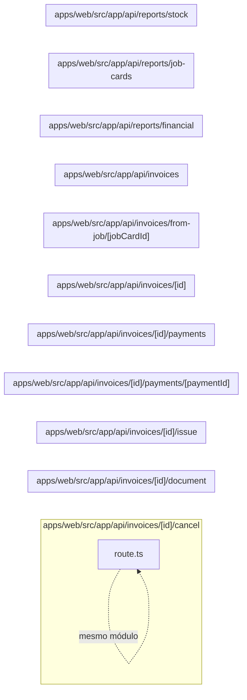

# 18. API de faturas e relatórios

Expõe emissão, pagamentos, cancelamento, documento e agregações gerenciais. Este módulo contém **11 arquivos de código**, sendo **11 fichas completas** e **0 exceções em tabela**.

## Dependências do módulo

As setas representam imports internos confirmados. Dependências com outros módulos aparecem nas fichas individuais.

## 18.1 `apps/web/src/app/api/invoices/[id]/cancel/route.ts`

**Propósito:** Expõe o contrato HTTP de faturas em `/api/invoices/:id/cancel`, fazendo validação e delegando a regra ao servidor.

**Processo:** POST entra pelo handler, passa por `runRoute` (sessão, permissão e tenant), valida parâmetros/entrada e chama `cancelInvoice`.

**Estado:** implementado — contém lógica executável e não há marcador explícito de implementação pendente.

**Testes:** `apps/web/test/regressions.spec.ts`

**Depende de:** `apps/web/src/server/auth/with-route.ts` — Wrapper das rotas que aplica sessão, RBAC, tenant, transação e tradução de erro. `apps/web/src/server/http/params.ts` — Valida parâmetros de rota, especialmente UUIDs. `apps/web/src/server/services/invoices.service.ts` — Centraliza regras de negócio e acesso persistente de faturas.

**Usado por:** nenhum importador interno; é ponto de entrada, script, página, rota ou candidato a código não usado.

**Bibliotecas externas relevantes:** `next`

**Contrato:** `POST /api/invoices/:id/cancel` — invoice.edit.

**Entrada:** parâmetros dinâmicos validados quando presentes; sem DTO explícito no arquivo.

**Saída:** JSON do handler/service; sucesso em 200 ou 201, conforme a operação.

**Erros:** 400 para entrada ou transição inválida; 401 sem sessão; 403 sem permissão; 404 quando o recurso não existe; 409 em conflito de unicidade/regra, conforme o service. `handleError` padroniza a resposta.

**Chama:** `cancelInvoice` · **Tabelas:** acessadas indiretamente pelo service ou nenhuma · **Telas que consomem:** `/dashboard` (`apps/web/src/app/(app)/dashboard/page.tsx`), `/invoices/:id` (`apps/web/src/app/(app)/invoices/[id]/page.tsx`), `/invoices` (`apps/web/src/app/(app)/invoices/page.tsx`), `/quotations/:id` (`apps/web/src/app/(app)/quotations/[id]/page.tsx`).

## 18.2 `apps/web/src/app/api/invoices/[id]/document/route.ts`

**Propósito:** Expõe o contrato HTTP de faturas em `/api/invoices/:id/document`, fazendo validação e delegando a regra ao servidor.

**Processo:** GET entra pelo handler, passa por `runRoute` (sessão, permissão e tenant), valida parâmetros/entrada e chama `renderInvoiceDocument`.

**Estado:** implementado — contém lógica executável e não há marcador explícito de implementação pendente.

**Testes:** sem teste direto — busca pelos exports, nome do recurso e endpoint nas suítes não encontrou cobertura identificável.

**Depende de:** `apps/web/src/server/auth/with-route.ts` — Wrapper das rotas que aplica sessão, RBAC, tenant, transação e tradução de erro. `apps/web/src/server/http/params.ts` — Valida parâmetros de rota, especialmente UUIDs. `apps/web/src/server/services/invoices.service.ts` — Centraliza regras de negócio e acesso persistente de faturas.

**Usado por:** nenhum importador interno; é ponto de entrada, script, página, rota ou candidato a código não usado.

**Bibliotecas externas relevantes:** `next`

**Contrato:** `GET /api/invoices/:id/document` — invoice.view.

**Entrada:** parâmetros dinâmicos validados quando presentes; sem DTO explícito no arquivo.

**Saída:** JSON do handler/service; sucesso em 200.

**Erros:** 400 para entrada ou transição inválida; 401 sem sessão; 403 sem permissão; 404 quando o recurso não existe; 409 em conflito de unicidade/regra, conforme o service. `handleError` padroniza a resposta.

**Chama:** `renderInvoiceDocument` · **Tabelas:** acessadas indiretamente pelo service ou nenhuma · **Telas que consomem:** `/dashboard` (`apps/web/src/app/(app)/dashboard/page.tsx`), `/invoices/:id` (`apps/web/src/app/(app)/invoices/[id]/page.tsx`), `/invoices` (`apps/web/src/app/(app)/invoices/page.tsx`), `/quotations/:id` (`apps/web/src/app/(app)/quotations/[id]/page.tsx`).

## 18.3 `apps/web/src/app/api/invoices/[id]/issue/route.ts`

**Propósito:** Expõe o contrato HTTP de faturas em `/api/invoices/:id/issue`, fazendo validação e delegando a regra ao servidor.

**Processo:** POST entra pelo handler, passa por `runRoute` (sessão, permissão e tenant), valida parâmetros/entrada e chama `issueInvoice`.

**Estado:** implementado — contém lógica executável e não há marcador explícito de implementação pendente.

**Testes:** `apps/web/test/regressions.spec.ts`

**Depende de:** `apps/web/src/server/auth/with-route.ts` — Wrapper das rotas que aplica sessão, RBAC, tenant, transação e tradução de erro. `apps/web/src/server/http/params.ts` — Valida parâmetros de rota, especialmente UUIDs. `apps/web/src/server/services/invoices.service.ts` — Centraliza regras de negócio e acesso persistente de faturas.

**Usado por:** nenhum importador interno; é ponto de entrada, script, página, rota ou candidato a código não usado.

**Bibliotecas externas relevantes:** `next`

**Contrato:** `POST /api/invoices/:id/issue` — invoice.edit.

**Entrada:** parâmetros dinâmicos validados quando presentes; sem DTO explícito no arquivo.

**Saída:** JSON do handler/service; sucesso em 200 ou 201, conforme a operação.

**Erros:** 400 para entrada ou transição inválida; 401 sem sessão; 403 sem permissão; 404 quando o recurso não existe; 409 em conflito de unicidade/regra, conforme o service. `handleError` padroniza a resposta.

**Chama:** `issueInvoice` · **Tabelas:** acessadas indiretamente pelo service ou nenhuma · **Telas que consomem:** `/dashboard` (`apps/web/src/app/(app)/dashboard/page.tsx`), `/invoices/:id` (`apps/web/src/app/(app)/invoices/[id]/page.tsx`), `/invoices` (`apps/web/src/app/(app)/invoices/page.tsx`), `/quotations/:id` (`apps/web/src/app/(app)/quotations/[id]/page.tsx`).

## 18.4 `apps/web/src/app/api/invoices/[id]/payments/[paymentId]/route.ts`

**Propósito:** Expõe o contrato HTTP de faturas em `/api/invoices/:id/payments/:paymentId`, fazendo validação e delegando a regra ao servidor.

**Processo:** DELETE entra pelo handler, passa por `runRoute` (sessão, permissão e tenant), valida parâmetros/entrada e chama `removeInvoicePayment`.

**Estado:** implementado — contém lógica executável e não há marcador explícito de implementação pendente.

**Testes:** sem teste direto — busca pelos exports, nome do recurso e endpoint nas suítes não encontrou cobertura identificável.

**Depende de:** `apps/web/src/server/auth/with-route.ts` — Wrapper das rotas que aplica sessão, RBAC, tenant, transação e tradução de erro. `apps/web/src/server/http/params.ts` — Valida parâmetros de rota, especialmente UUIDs. `apps/web/src/server/services/invoices.service.ts` — Centraliza regras de negócio e acesso persistente de faturas.

**Usado por:** nenhum importador interno; é ponto de entrada, script, página, rota ou candidato a código não usado.

**Bibliotecas externas relevantes:** `next`

**Contrato:** `DELETE /api/invoices/:id/payments/:paymentId` — payment.delete.

**Entrada:** parâmetros dinâmicos validados quando presentes; sem DTO explícito no arquivo.

**Saída:** JSON do handler/service; sucesso em 200.

**Erros:** 400 para entrada ou transição inválida; 401 sem sessão; 403 sem permissão; 404 quando o recurso não existe; 409 em conflito de unicidade/regra, conforme o service. `handleError` padroniza a resposta.

**Chama:** `removeInvoicePayment` · **Tabelas:** acessadas indiretamente pelo service ou nenhuma · **Telas que consomem:** `/dashboard` (`apps/web/src/app/(app)/dashboard/page.tsx`), `/invoices/:id` (`apps/web/src/app/(app)/invoices/[id]/page.tsx`), `/invoices` (`apps/web/src/app/(app)/invoices/page.tsx`), `/quotations/:id` (`apps/web/src/app/(app)/quotations/[id]/page.tsx`).

## 18.5 `apps/web/src/app/api/invoices/[id]/payments/route.ts`

**Propósito:** Expõe o contrato HTTP de faturas em `/api/invoices/:id/payments`, fazendo validação e delegando a regra ao servidor.

**Processo:** POST entra pelo handler, passa por `runRoute` (sessão, permissão e tenant), valida parâmetros/entrada e chama `addInvoicePayment`.

**Estado:** implementado — contém lógica executável e não há marcador explícito de implementação pendente.

**Testes:** `apps/web/test/regressions.spec.ts`

**Depende de:** `apps/web/src/server/auth/with-route.ts` — Wrapper das rotas que aplica sessão, RBAC, tenant, transação e tradução de erro. `apps/web/src/server/dtos/create-payment.dto.ts` — Define o contrato validado CreatePaymentDto usado nas entradas de faturas. `apps/web/src/server/http/params.ts` — Valida parâmetros de rota, especialmente UUIDs. `apps/web/src/server/http/parse-body.ts` — Transforma e valida body/query com class-transformer e class-validator. `apps/web/src/server/services/invoices.service.ts` — Centraliza regras de negócio e acesso persistente de faturas.

**Usado por:** nenhum importador interno; é ponto de entrada, script, página, rota ou candidato a código não usado.

**Bibliotecas externas relevantes:** `next`

**Contrato:** `POST /api/invoices/:id/payments` — payment.create.

**Entrada:** parâmetros dinâmicos validados quando presentes; body/query validados por `CreatePaymentDto`.

**Saída:** JSON do handler/service; sucesso em 201.

**Erros:** 400 para entrada ou transição inválida; 401 sem sessão; 403 sem permissão; 404 quando o recurso não existe; 409 em conflito de unicidade/regra, conforme o service. `handleError` padroniza a resposta.

**Chama:** `addInvoicePayment` · **Tabelas:** acessadas indiretamente pelo service ou nenhuma · **Telas que consomem:** `/dashboard` (`apps/web/src/app/(app)/dashboard/page.tsx`), `/invoices/:id` (`apps/web/src/app/(app)/invoices/[id]/page.tsx`), `/invoices` (`apps/web/src/app/(app)/invoices/page.tsx`), `/quotations/:id` (`apps/web/src/app/(app)/quotations/[id]/page.tsx`).

## 18.6 `apps/web/src/app/api/invoices/[id]/route.ts`

**Propósito:** Expõe o contrato HTTP de faturas em `/api/invoices/:id`, fazendo validação e delegando a regra ao servidor.

**Processo:** GET/PATCH entra pelo handler, passa por `runRoute` (sessão, permissão e tenant), valida parâmetros/entrada e chama `findInvoice`, `updateInvoice`.

**Estado:** implementado — contém lógica executável e não há marcador explícito de implementação pendente.

**Testes:** `apps/web/test/regressions.spec.ts`

**Depende de:** `apps/web/src/server/auth/with-route.ts` — Wrapper das rotas que aplica sessão, RBAC, tenant, transação e tradução de erro. `apps/web/src/server/dtos/update-invoice.dto.ts` — Define o contrato validado UpdateInvoiceDto usado nas entradas de faturas. `apps/web/src/server/http/params.ts` — Valida parâmetros de rota, especialmente UUIDs. `apps/web/src/server/http/parse-body.ts` — Transforma e valida body/query com class-transformer e class-validator. `apps/web/src/server/services/invoices.service.ts` — Centraliza regras de negócio e acesso persistente de faturas.

**Usado por:** nenhum importador interno; é ponto de entrada, script, página, rota ou candidato a código não usado.

**Bibliotecas externas relevantes:** `next`

**Contrato:** `GET /api/invoices/:id` · `PATCH /api/invoices/:id` — invoice.view, invoice.edit.

**Entrada:** parâmetros dinâmicos validados quando presentes; body/query validados por `UpdateInvoiceDto`.

**Saída:** JSON do handler/service; sucesso em 200.

**Erros:** 400 para entrada ou transição inválida; 401 sem sessão; 403 sem permissão; 404 quando o recurso não existe; 409 em conflito de unicidade/regra, conforme o service. `handleError` padroniza a resposta.

**Chama:** `findInvoice`, `updateInvoice` · **Tabelas:** acessadas indiretamente pelo service ou nenhuma · **Telas que consomem:** `/dashboard` (`apps/web/src/app/(app)/dashboard/page.tsx`), `/invoices/:id` (`apps/web/src/app/(app)/invoices/[id]/page.tsx`), `/invoices` (`apps/web/src/app/(app)/invoices/page.tsx`), `/quotations/:id` (`apps/web/src/app/(app)/quotations/[id]/page.tsx`).

## 18.7 `apps/web/src/app/api/invoices/from-job/[jobCardId]/route.ts`

**Propósito:** Expõe o contrato HTTP de faturas em `/api/invoices/from-job/:jobCardId`, fazendo validação e delegando a regra ao servidor.

**Processo:** POST entra pelo handler, passa por `runRoute` (sessão, permissão e tenant), valida parâmetros/entrada e chama `createInvoiceFromJobCard`.

**Estado:** implementado — contém lógica executável e não há marcador explícito de implementação pendente.

**Testes:** `apps/web/test/regressions.spec.ts`

**Depende de:** `apps/web/src/server/auth/with-route.ts` — Wrapper das rotas que aplica sessão, RBAC, tenant, transação e tradução de erro. `apps/web/src/server/http/params.ts` — Valida parâmetros de rota, especialmente UUIDs. `apps/web/src/server/services/invoices.service.ts` — Centraliza regras de negócio e acesso persistente de faturas.

**Usado por:** nenhum importador interno; é ponto de entrada, script, página, rota ou candidato a código não usado.

**Bibliotecas externas relevantes:** `next`

**Contrato:** `POST /api/invoices/from-job/:jobCardId` — invoice.create.

**Entrada:** parâmetros dinâmicos validados quando presentes; sem DTO explícito no arquivo.

**Saída:** JSON do handler/service; sucesso em 201.

**Erros:** 400 para entrada ou transição inválida; 401 sem sessão; 403 sem permissão; 404 quando o recurso não existe; 409 em conflito de unicidade/regra, conforme o service. `handleError` padroniza a resposta.

**Chama:** `createInvoiceFromJobCard` · **Tabelas:** acessadas indiretamente pelo service ou nenhuma · **Telas que consomem:** `/dashboard` (`apps/web/src/app/(app)/dashboard/page.tsx`), `/invoices/:id` (`apps/web/src/app/(app)/invoices/[id]/page.tsx`), `/invoices` (`apps/web/src/app/(app)/invoices/page.tsx`), `/quotations/:id` (`apps/web/src/app/(app)/quotations/[id]/page.tsx`).

## 18.8 `apps/web/src/app/api/invoices/route.ts`

**Propósito:** Expõe o contrato HTTP de faturas em `/api/invoices`, fazendo validação e delegando a regra ao servidor.

**Processo:** GET entra pelo handler, passa por `runRoute` (sessão, permissão e tenant), valida parâmetros/entrada e chama `listInvoices`.

**Estado:** implementado — contém lógica executável e não há marcador explícito de implementação pendente.

**Testes:** sem teste direto — busca pelos exports, nome do recurso e endpoint nas suítes não encontrou cobertura identificável.

**Depende de:** `apps/web/src/server/auth/with-route.ts` — Wrapper das rotas que aplica sessão, RBAC, tenant, transação e tradução de erro. `apps/web/src/server/dtos/query-invoice.dto.ts` — Define o contrato validado QueryInvoiceDto usado nas entradas de faturas. `apps/web/src/server/http/parse-body.ts` — Transforma e valida body/query com class-transformer e class-validator. `apps/web/src/server/services/invoices.service.ts` — Centraliza regras de negócio e acesso persistente de faturas.

**Usado por:** nenhum importador interno; é ponto de entrada, script, página, rota ou candidato a código não usado.

**Bibliotecas externas relevantes:** `next`

**Contrato:** `GET /api/invoices` — invoice.view.

**Entrada:** parâmetros dinâmicos validados quando presentes; body/query validados por `QueryInvoiceDto`.

**Saída:** JSON do handler/service; sucesso em 200.

**Erros:** 400 para entrada ou transição inválida; 401 sem sessão; 403 sem permissão; 404 quando o recurso não existe; 409 em conflito de unicidade/regra, conforme o service. `handleError` padroniza a resposta.

**Chama:** `listInvoices` · **Tabelas:** acessadas indiretamente pelo service ou nenhuma · **Telas que consomem:** `/dashboard` (`apps/web/src/app/(app)/dashboard/page.tsx`), `/invoices/:id` (`apps/web/src/app/(app)/invoices/[id]/page.tsx`), `/invoices` (`apps/web/src/app/(app)/invoices/page.tsx`), `/quotations/:id` (`apps/web/src/app/(app)/quotations/[id]/page.tsx`).

## 18.9 `apps/web/src/app/api/reports/financial/route.ts`

**Propósito:** Expõe o contrato HTTP de relatórios em `/api/reports/financial`, fazendo validação e delegando a regra ao servidor.

**Processo:** GET entra pelo handler, passa por `runRoute` (sessão, permissão e tenant), valida parâmetros/entrada e chama `financialReport`.

**Estado:** implementado — contém lógica executável e não há marcador explícito de implementação pendente.

**Testes:** sem teste direto — busca pelos exports, nome do recurso e endpoint nas suítes não encontrou cobertura identificável.

**Depende de:** `apps/web/src/server/auth/with-route.ts` — Wrapper das rotas que aplica sessão, RBAC, tenant, transação e tradução de erro. `apps/web/src/server/dtos/query-report.dto.ts` — Define o contrato validado QueryReportDto usado nas entradas de relatórios. `apps/web/src/server/http/parse-body.ts` — Transforma e valida body/query com class-transformer e class-validator. `apps/web/src/server/services/reports.service.ts` — Centraliza regras de negócio e acesso persistente de relatórios.

**Usado por:** nenhum importador interno; é ponto de entrada, script, página, rota ou candidato a código não usado.

**Bibliotecas externas relevantes:** `next`

**Contrato:** `GET /api/reports/financial` — report.view.

**Entrada:** parâmetros dinâmicos validados quando presentes; body/query validados por `QueryReportDto`.

**Saída:** JSON do handler/service; sucesso em 200.

**Erros:** 400 para entrada ou transição inválida; 401 sem sessão; 403 sem permissão; 404 quando o recurso não existe; 409 em conflito de unicidade/regra, conforme o service. `handleError` padroniza a resposta.

**Chama:** `financialReport` · **Tabelas:** acessadas indiretamente pelo service ou nenhuma · **Telas que consomem:** `/dashboard` (`apps/web/src/app/(app)/dashboard/page.tsx`).

## 18.10 `apps/web/src/app/api/reports/job-cards/route.ts`

**Propósito:** Expõe o contrato HTTP de relatórios em `/api/reports/job-cards`, fazendo validação e delegando a regra ao servidor.

**Processo:** GET entra pelo handler, passa por `runRoute` (sessão, permissão e tenant), valida parâmetros/entrada e chama `jobCardsReport`.

**Estado:** implementado — contém lógica executável e não há marcador explícito de implementação pendente.

**Testes:** sem teste direto — busca pelos exports, nome do recurso e endpoint nas suítes não encontrou cobertura identificável.

**Depende de:** `apps/web/src/server/auth/with-route.ts` — Wrapper das rotas que aplica sessão, RBAC, tenant, transação e tradução de erro. `apps/web/src/server/services/reports.service.ts` — Centraliza regras de negócio e acesso persistente de relatórios.

**Usado por:** nenhum importador interno; é ponto de entrada, script, página, rota ou candidato a código não usado.

**Bibliotecas externas relevantes:** `next`

**Contrato:** `GET /api/reports/job-cards` — report.view.

**Entrada:** parâmetros dinâmicos validados quando presentes; sem DTO explícito no arquivo.

**Saída:** JSON do handler/service; sucesso em 200.

**Erros:** 400 para entrada ou transição inválida; 401 sem sessão; 403 sem permissão; 404 quando o recurso não existe; 409 em conflito de unicidade/regra, conforme o service. `handleError` padroniza a resposta.

**Chama:** `jobCardsReport` · **Tabelas:** acessadas indiretamente pelo service ou nenhuma · **Telas que consomem:** `/dashboard` (`apps/web/src/app/(app)/dashboard/page.tsx`).

## 18.11 `apps/web/src/app/api/reports/stock/route.ts`

**Propósito:** Expõe o contrato HTTP de relatórios em `/api/reports/stock`, fazendo validação e delegando a regra ao servidor.

**Processo:** GET entra pelo handler, passa por `runRoute` (sessão, permissão e tenant), valida parâmetros/entrada e chama `stockReport`.

**Estado:** implementado — contém lógica executável e não há marcador explícito de implementação pendente.

**Testes:** sem teste direto — busca pelos exports, nome do recurso e endpoint nas suítes não encontrou cobertura identificável.

**Depende de:** `apps/web/src/server/auth/with-route.ts` — Wrapper das rotas que aplica sessão, RBAC, tenant, transação e tradução de erro. `apps/web/src/server/services/reports.service.ts` — Centraliza regras de negócio e acesso persistente de relatórios.

**Usado por:** nenhum importador interno; é ponto de entrada, script, página, rota ou candidato a código não usado.

**Bibliotecas externas relevantes:** `next`

**Contrato:** `GET /api/reports/stock` — report.view.

**Entrada:** parâmetros dinâmicos validados quando presentes; sem DTO explícito no arquivo.

**Saída:** JSON do handler/service; sucesso em 200.

**Erros:** 400 para entrada ou transição inválida; 401 sem sessão; 403 sem permissão; 404 quando o recurso não existe; 409 em conflito de unicidade/regra, conforme o service. `handleError` padroniza a resposta.

**Chama:** `stockReport` · **Tabelas:** acessadas indiretamente pelo service ou nenhuma · **Telas que consomem:** `/dashboard` (`apps/web/src/app/(app)/dashboard/page.tsx`).

## Quadro do módulo

| Arquivo | Estado | Teste | Processo/tela |
|---|---|---|---|
| `apps/web/src/app/api/invoices/[id]/cancel/route.ts` | implementado | `regressions.spec.ts` | faturas |
| `apps/web/src/app/api/invoices/[id]/document/route.ts` | implementado | sem teste direto | faturas |
| `apps/web/src/app/api/invoices/[id]/issue/route.ts` | implementado | `regressions.spec.ts` | faturas |
| `apps/web/src/app/api/invoices/[id]/payments/[paymentId]/route.ts` | implementado | sem teste direto | faturas |
| `apps/web/src/app/api/invoices/[id]/payments/route.ts` | implementado | `regressions.spec.ts` | faturas |
| `apps/web/src/app/api/invoices/[id]/route.ts` | implementado | `regressions.spec.ts` | faturas |
| `apps/web/src/app/api/invoices/from-job/[jobCardId]/route.ts` | implementado | `regressions.spec.ts` | faturas |
| `apps/web/src/app/api/invoices/route.ts` | implementado | sem teste direto | faturas |
| `apps/web/src/app/api/reports/financial/route.ts` | implementado | sem teste direto | relatórios |
| `apps/web/src/app/api/reports/job-cards/route.ts` | implementado | sem teste direto | relatórios |
| `apps/web/src/app/api/reports/stock/route.ts` | implementado | sem teste direto | relatórios |
