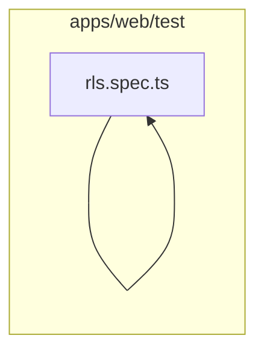

# 19. Testes

Prepara o banco isolado e verifica autenticação, RLS, regressões e fluxos integrados. Este módulo contém **7 arquivos de código**, sendo **0 fichas completas** e **7 exceções em tabela**.

## Dependências do módulo

As setas representam imports internos confirmados. Dependências com outros módulos aparecem nas fichas individuais.

## 19.1 Exceções permitidas

| Caminho | Propósito | Estado | Testes | Motivo da exceção |
|---|---|---|---|---|
| `apps/web/test/auth.spec.ts` | Suíte de integração que verifica auth.spec.ts contra um banco PostgreSQL isolado. | implementado | é teste/infraestrutura de teste | arquivo de teste; a exceção é permitida pelo prompt |
| `apps/web/test/empty.ts` | Implementa a responsabilidade de empty.ts na camada testes. | implementado | é teste/infraestrutura de teste | arquivo de teste; a exceção é permitida pelo prompt |
| `apps/web/test/flows.spec.ts` | Suíte de integração que verifica flows.spec.ts contra um banco PostgreSQL isolado. | implementado | é teste/infraestrutura de teste | arquivo de teste; a exceção é permitida pelo prompt |
| `apps/web/test/global-setup.ts` | Implementa a responsabilidade de global-setup.ts na camada testes. | implementado | é teste/infraestrutura de teste | arquivo de teste; a exceção é permitida pelo prompt |
| `apps/web/test/helpers.ts` | Implementa a responsabilidade de helpers.ts na camada testes. | implementado | é teste/infraestrutura de teste | arquivo de teste; a exceção é permitida pelo prompt |
| `apps/web/test/regressions.spec.ts` | Suíte de integração que verifica regressions.spec.ts contra um banco PostgreSQL isolado. | implementado | é teste/infraestrutura de teste | arquivo de teste; a exceção é permitida pelo prompt |
| `apps/web/test/rls.spec.ts` | Suíte de integração que verifica rls.spec.ts contra um banco PostgreSQL isolado. | implementado | é teste/infraestrutura de teste | arquivo de teste; a exceção é permitida pelo prompt |

## Quadro do módulo

| Arquivo | Estado | Teste | Processo/tela |
|---|---|---|---|
| `apps/web/test/auth.spec.ts` | exceção em tabela | `suíte de teste` | infraestrutura |
| `apps/web/test/empty.ts` | exceção em tabela | `suíte de teste` | infraestrutura |
| `apps/web/test/flows.spec.ts` | exceção em tabela | `suíte de teste` | infraestrutura |
| `apps/web/test/global-setup.ts` | exceção em tabela | `suíte de teste` | infraestrutura |
| `apps/web/test/helpers.ts` | exceção em tabela | `suíte de teste` | infraestrutura |
| `apps/web/test/regressions.spec.ts` | exceção em tabela | `suíte de teste` | infraestrutura |
| `apps/web/test/rls.spec.ts` | exceção em tabela | `suíte de teste` | infraestrutura |
